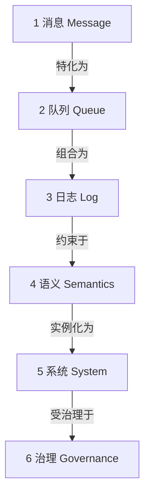
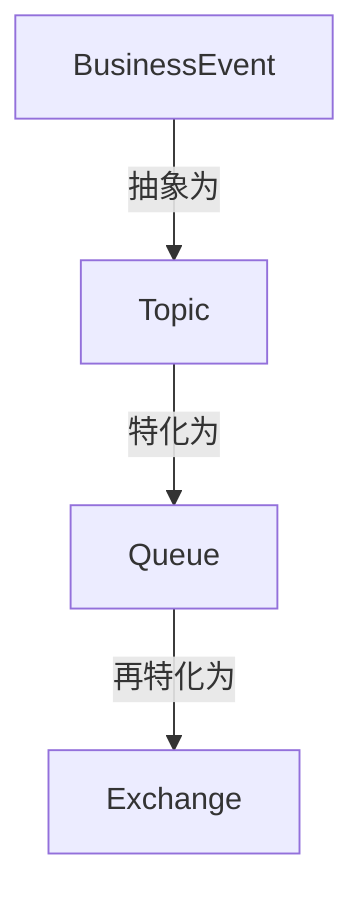
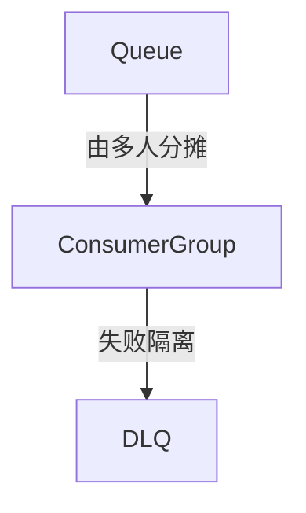
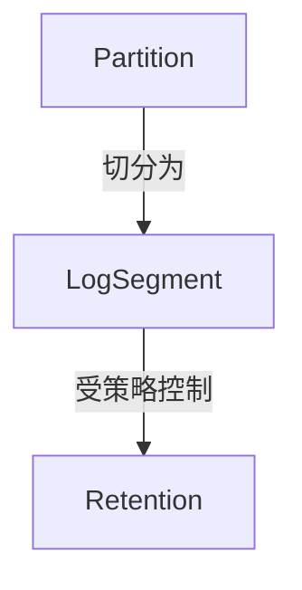
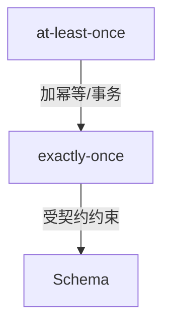
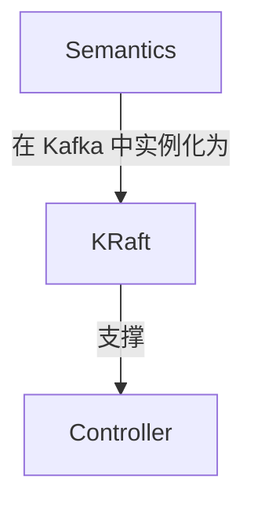
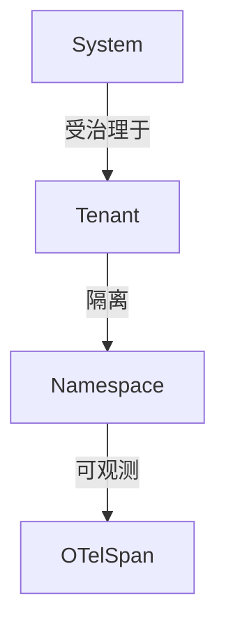

# 01 概念体系导读：按掌握依赖序重排 108 概念

> 本篇不是 01-58 的替代，而是它的“人话导航”。
> 所有概念名逐字取自 [01-58 全局核心概念卡片总表](../topics/01-基础概念与对比分析/01-58-全局核心概念卡片总表.md)；这里按“先理解消息，再理解队列、日志、语义，最后落到系统与治理”的依赖序重排。

## 六阶掌握地图



## 1. 消息：谁在发、发给谁、走哪条路



| 概念 | 人话定义 |
| ---- | ---- |
| [Topic](../topics/01-基础概念与对比分析/01-58-全局核心概念卡片总表.md) | 给消息贴的分类标签，发布者按它投递，订阅者按它过滤 |
| [Producer](../topics/01-基础概念与对比分析/01-58-全局核心概念卡片总表.md) | 发消息的人 |
| [Consumer](../topics/01-基础概念与对比分析/01-58-全局核心概念卡片总表.md) | 收消息的人 |
| [Broker](../topics/01-基础概念与对比分析/01-58-全局核心概念卡片总表.md) | 消息系统的中转站节点 |
| [Exchange](../topics/01-基础概念与对比分析/01-58-全局核心概念卡片总表.md) | RabbitMQ 里的路由器，把消息分发到队列 |
| [Message](../topics/01-基础概念与对比分析/01-58-全局核心概念卡片总表.md) | AsyncAPI 里描述一次传输的数据单元（payload + headers） |
| [Operation](../topics/01-基础概念与对比分析/01-58-全局核心概念卡片总表.md) | AsyncAPI 里“发”或“收”某个 channel 上消息的动作 |
| [Channel](../topics/01-基础概念与对比分析/01-58-全局核心概念卡片总表.md) | AsyncAPI 里消息传输的抽象地址 |
| [Binding（跨系统）](../topics/01-基础概念与对比分析/01-58-全局核心概念卡片总表.md) | 把路由规则里的 channel 绑定到具体协议/传输 |
| [Command Message](../topics/01-基础概念与对比分析/01-58-全局核心概念卡片总表.md) | 封装命令/指令的消息，通常需要 ACK |
| [Publish-Subscribe Channel](../topics/01-基础概念与对比分析/01-58-全局核心概念卡片总表.md) | 1:N 广播通道，一条消息给多个订阅者 |
| [Content-Based Router](../topics/01-基础概念与对比分析/01-58-全局核心概念卡片总表.md) | 按消息内容决定走哪条路 |
| [Message Translator](../topics/01-基础概念与对比分析/01-58-全局核心概念卡片总表.md) | 把消息格式或协议从 A 转成 B，不改业务语义 |
| [Exchange Types](../topics/01-基础概念与对比分析/01-58-全局核心概念卡片总表.md) | RabbitMQ direct/topic/fanout/headers 四种路由算法 |

## 2. 队列：消息怎么被一群人分摊



| 概念 | 人话定义 |
| ---- | ---- |
| [Queue](../topics/01-基础概念与对比分析/01-58-全局核心概念卡片总表.md) | 点对点容器，一条消息通常只被一个消费者处理 |
| [Consumer Group](../topics/01-基础概念与对比分析/01-58-全局核心概念卡片总表.md) | 一组协同消费者，共同消费并负载均衡 |
| [Share Group](../topics/01-基础概念与对比分析/01-58-全局核心概念卡片总表.md) | Kafka KIP-932 引入的共享消费组，多个消费者可并发读同一分区 |
| [Dead Letter](../topics/01-基础概念与对比分析/01-58-全局核心概念卡片总表.md) | 超过重试上限仍失败的消息，被转储到专门队列/主题 |
| [DLQ](../topics/01-基础概念与对比分析/01-58-全局核心概念卡片总表.md) | 集中存放处理失败消息的队列/主题 |
| [Poison Message](../topics/01-基础概念与对比分析/01-58-全局核心概念卡片总表.md) | 因内容/状态错误反复处理失败的消息 |
| [Backlog](../topics/01-基础概念与对比分析/01-58-全局核心概念卡片总表.md) | 已发布但尚未处理的消息累积量 |
| [Quorum Queue](../topics/01-基础概念与对比分析/01-58-全局核心概念卡片总表.md) | RabbitMQ 4.x 默认的 Raft 复制队列 |
| [Classic Queue](../topics/01-基础概念与对比分析/01-58-全局核心概念卡片总表.md) | RabbitMQ 传统队列类型 |
| [Binding（RabbitMQ）](../topics/01-基础概念与对比分析/01-58-全局核心概念卡片总表.md) | Exchange 到 Queue 的路由绑定关系 |
| [Dead Letter Exchange](../topics/01-基础概念与对比分析/01-58-全局核心概念卡片总表.md) | 接收被拒绝/过期/超限消息的特殊 Exchange |
| [Shared Subscription](../topics/01-基础概念与对比分析/01-58-全局核心概念卡片总表.md) | MQTT 5.0 共享订阅，组内多个订阅者负载均衡 |
| [Competing Consumers](../topics/01-基础概念与对比分析/01-58-全局核心概念卡片总表.md) | 多个消费者竞争同队列消息，提高吞吐 |
| [Consumer Group（Redis Stream）](../topics/01-基础概念与对比分析/01-58-全局核心概念卡片总表.md) | Redis Stream 消费组，组内成员分摊消息 |
| [XACK](../topics/01-基础概念与对比分析/01-58-全局核心概念卡片总表.md) | 消费者确认已处理 Stream 消息的命令 |
| [Pending Entries](../topics/01-基础概念与对比分析/01-58-全局核心概念卡片总表.md) | 已投递但未 ACK 的消息集合（PEL） |
| [Subscription Type](../topics/01-基础概念与对比分析/01-58-全局核心概念卡片总表.md) | Pulsar 消费者订阅模式：Exclusive/Shared/Failover/Key_Shared |

## 3. 日志：消息落盘、保留与重放



| 概念 | 人话定义 |
| ---- | ---- |
| [Partition](../topics/01-基础概念与对比分析/01-58-全局核心概念卡片总表.md) | Topic 的物理分片，顺序与并行的基本单元 |
| [Offset](../topics/01-基础概念与对比分析/01-58-全局核心概念卡片总表.md) | 消息在分区/流内的单调递增位置标识 |
| [Stream（跨系统）](../topics/01-基础概念与对比分析/01-58-全局核心概念卡片总表.md) | 持久化的追加式消息序列，可重放、可分片 |
| [Persistence](../topics/01-基础概念与对比分析/01-58-全局核心概念卡片总表.md) | 消息写入非易失性存储，重启后可恢复 |
| [Retention](../topics/01-基础概念与对比分析/01-58-全局核心概念卡片总表.md) | 消息在系统中的保留策略（时间/大小/消息数） |
| [Compaction](../topics/01-基础概念与对比分析/01-58-全局核心概念卡片总表.md) | 按 Key 保留最新值，删除旧记录以节省空间 |
| [Tiered Storage](../topics/01-基础概念与对比分析/01-58-全局核心概念卡片总表.md) | 热数据本地盘、冷数据卸载对象存储的分层架构 |
| [ISR](../topics/01-基础概念与对比分析/01-58-全局核心概念卡片总表.md) | In-Sync Replicas，与 Leader 保持同步的副本集合 |
| [High Watermark](../topics/01-基础概念与对比分析/01-58-全局核心概念卡片总表.md) | 已提交到 ISR 的最大 offset，消费者只能读到 HW 之前 |
| [Log Segment](../topics/01-基础概念与对比分析/01-58-全局核心概念卡片总表.md) | Kafka 分区日志的物理分段文件 |
| [Leader](../topics/01-基础概念与对比分析/01-58-全局核心概念卡片总表.md) | 分区的读写主副本 |
| [Follower](../topics/01-基础概念与对比分析/01-58-全局核心概念卡片总表.md) | 从 Leader 拉取数据并同步的副本 |
| [Record Batch](../topics/01-基础概念与对比分析/01-58-全局核心概念卡片总表.md) | Kafka 生产端批量发送的消息集合 |
| [Bookie](../topics/01-基础概念与对比分析/01-58-全局核心概念卡片总表.md) | Apache BookKeeper 存储节点，以 Ledger 模型持久化消息 |
| [Geo-Replication](../topics/01-基础概念与对比分析/01-58-全局核心概念卡片总表.md) | 跨地域数据中心异步复制 Topic 数据 |
| [Ledger](../topics/01-基础概念与对比分析/01-58-全局核心概念卡片总表.md) | BookKeeper 中追加写的最小存储单元 |
| [Stream（JetStream）](../topics/01-基础概念与对比分析/01-58-全局核心概念卡片总表.md) | JetStream 中按 subject 集合持久化存储的消息序列 |
| [Stream（Redis Stream）](../topics/01-基础概念与对比分析/01-58-全局核心概念卡片总表.md) | Redis 追加式日志结构，消息按 ID 顺序存储 |
| [Stream ID](../topics/01-基础概念与对比分析/01-58-全局核心概念卡片总表.md) | 消息在 Stream 中的唯一时间序列 ID |
| [MirrorMaker 2](../topics/01-基础概念与对比分析/01-58-全局核心概念卡片总表.md) | Kafka 集群间数据镜像与元数据同步工具 |

## 4. 语义：投递、事务与契约保证



| 概念 | 人话定义 |
| ---- | ---- |
| [at-most-once](../topics/01-基础概念与对比分析/01-58-全局核心概念卡片总表.md) | 最多投递一次，可能丢失但不重复 |
| [at-least-once](../topics/01-基础概念与对比分析/01-58-全局核心概念卡片总表.md) | 至少投递一次，可能重复但不丢失 |
| [exactly-once](../topics/01-基础概念与对比分析/01-58-全局核心概念卡片总表.md) | 系统语义内恰好处理一次，需端到端幂等+事务 |
| [QoS 0](../topics/01-基础概念与对比分析/01-58-全局核心概念卡片总表.md) | MQTT 最多一次投递，无确认 |
| [QoS 1](../topics/01-基础概念与对比分析/01-58-全局核心概念卡片总表.md) | MQTT 至少一次投递，PUBACK 确认 |
| [QoS 2](../topics/01-基础概念与对比分析/01-58-全局核心概念卡片总表.md) | MQTT 恰好一次协议语义，四次握手 |
| [Idempotency](../topics/01-基础概念与对比分析/01-58-全局核心概念卡片总表.md) | 同一操作多次执行结果与一次相同 |
| [Transaction](../topics/01-基础概念与对比分析/01-58-全局核心概念卡片总表.md) | 一组消息操作的原子提交或回滚 |
| [Backpressure](../topics/01-基础概念与对比分析/01-58-全局核心概念卡片总表.md) | 消费端向生产端反馈流控信号，防止过载 |
| [Ordering](../topics/01-基础概念与对比分析/01-58-全局核心概念卡片总表.md) | 消息按发送顺序被投递和处理的保证 |
| [Schema（跨系统）](../topics/01-基础概念与对比分析/01-58-全局核心概念卡片总表.md) | 消息 payload 的结构化契约定义 |
| [Schema（DSL）](../topics/01-基础概念与对比分析/01-58-全局核心概念卡片总表.md) | AsyncAPI 中消息 payload 的结构化契约 |
| [Confirm](../topics/01-基础概念与对比分析/01-58-全局核心概念卡片总表.md) | Publisher Confirm，Broker 异步 ack 消息入队 |
| [Session](../topics/01-基础概念与对比分析/01-58-全局核心概念卡片总表.md) | MQTT 客户端与 Broker 之间的持久化状态关联 |
| [Will](../topics/01-基础概念与对比分析/01-58-全局核心概念卡片总表.md) | 客户端异常断开时由 Broker 代发的遗嘱消息 |
| [Retain](../topics/01-基础概念与对比分析/01-58-全局核心概念卡片总表.md) | 主题上保留的最后一条消息，新订阅者立即收到 |
| [User Properties](../topics/01-基础概念与对比分析/01-58-全局核心概念卡片总表.md) | MQTT 5.0 用户自定义键值对报文属性 |
| [Topic Alias](../topics/01-基础概念与对比分析/01-58-全局核心概念卡片总表.md) | MQTT 5.0 用短整数映射长主题名以减少报文大小 |
| [AsyncAPI](../topics/01-基础概念与对比分析/01-58-全局核心概念卡片总表.md) | 异步 API 描述规范 |
| [CloudEvents](../topics/01-基础概念与对比分析/01-58-全局核心概念卡片总表.md) | CNCF 事件数据标准，统一事件元数据 |
| [Binding（AsyncAPI）](../topics/01-基础概念与对比分析/01-58-全局核心概念卡片总表.md) | AsyncAPI 中 Channel/Operation 到具体协议/传输的绑定 |
| [correlationId](../topics/01-基础概念与对比分析/01-58-全局核心概念卡片总表.md) | 用于关联请求与响应/因果链的标识 |
| [Outbox](../topics/01-基础概念与对比分析/01-58-全局核心概念卡片总表.md) | 事务内写业务表+Outbox 表，由 relay 异步投递 MQ |
| [Saga](../topics/01-基础概念与对比分析/01-58-全局核心概念卡片总表.md) | 长事务拆分为本地事务+补偿，通过事件协调 |
| [CQRS](../topics/01-基础概念与对比分析/01-58-全局核心概念卡片总表.md) | 命令查询职责分离，读写模型独立 |
| [Event Sourcing](../topics/01-基础概念与对比分析/01-58-全局核心概念卡片总表.md) | 以事件流为真相源持久化状态变更 |

## 5. 系统：六系统的专属机制



| 概念 | 人话定义 |
| ---- | ---- |
| [KRaft](../topics/01-基础概念与对比分析/01-58-全局核心概念卡片总表.md) | Kafka 基于 Raft 的内置元数据管理，替代 ZooKeeper |
| [Controller](../topics/01-基础概念与对比分析/01-58-全局核心概念卡片总表.md) | Kafka 集群负责分区状态机与副本管理的特殊 Broker |
| [KIP-932](../topics/01-基础概念与对比分析/01-58-全局核心概念卡片总表.md) | Kafka 共享消费组协议提案 |
| [Producer Idempotence](../topics/01-基础概念与对比分析/01-58-全局核心概念卡片总表.md) | Kafka Producer 通过 PID+Sequence Number 去重 |
| [Rebalance Protocol](../topics/01-基础概念与对比分析/01-58-全局核心概念卡片总表.md) | 消费者组成员变化时重新分配分区的协议 |
| [Consumer Group Coordinator](../topics/01-基础概念与对比分析/01-58-全局核心概念卡片总表.md) | 负责消费者组位点与成员管理的事务协调器 |
| [Broker（Pulsar）](../topics/01-基础概念与对比分析/01-58-全局核心概念卡片总表.md) | Pulsar 无状态计算层节点，处理协议与路由 |
| [Oxia](../topics/01-基础概念与对比分析/01-58-全局核心概念卡片总表.md) | Pulsar 新一代元数据存储，替代 ZooKeeper |
| [JetStream](../topics/01-基础概念与对比分析/01-58-全局核心概念卡片总表.md) | NATS 持久化消息层，提供流存储与 exactly-once 语义 |
| [Consumer（JetStream）](../topics/01-基础概念与对比分析/01-58-全局核心概念卡片总表.md) | JetStream 中从 Stream 读取消息的视图 |
| [Leafnode](../topics/01-基础概念与对比分析/01-58-全局核心概念卡片总表.md) | NATS 边缘 leaf 节点，与上游 hub 建立联邦 |
| [Supercluster](../topics/01-基础概念与对比分析/01-58-全局核心概念卡片总表.md) | 多个 NATS 集群通过 Gateway 互联形成更大联邦 |
| [KV](../topics/01-基础概念与对比分析/01-58-全局核心概念卡片总表.md) | JetStream Key-Value 存储抽象 |
| [Object Store](../topics/01-基础概念与对比分析/01-58-全局核心概念卡片总表.md) | JetStream 对象存储抽象，用于大文件/二进制 |
| [Leader Election](../topics/01-基础概念与对比分析/01-58-全局核心概念卡片总表.md) | 分布式系统中选出唯一协调者/主节点的过程 |

## 6. 治理：多租户、安全、可观测与集成



| 概念 | 人话定义 |
| ---- | ---- |
| [Tenant](../topics/01-基础概念与对比分析/01-58-全局核心概念卡片总表.md) | Pulsar 多租户一级隔离单元 |
| [Namespace](../topics/01-基础概念与对比分析/01-58-全局核心概念卡片总表.md) | Pulsar 租户下的二级隔离与策略单元 |
| [Federation](../topics/01-基础概念与对比分析/01-58-全局核心概念卡片总表.md) | 跨 RabbitMQ 集群/节点按需拉取消息复制 |
| [vhost](../topics/01-基础概念与对比分析/01-58-全局核心概念卡片总表.md) | RabbitMQ 的 Virtual Host，逻辑隔离单元 |
| [Enhanced Auth](../topics/01-基础概念与对比分析/01-58-全局核心概念卡片总表.md) | MQTT 5.0 增强认证，支持 Challenge-Response |
| [Server](../topics/01-基础概念与对比分析/01-58-全局核心概念卡片总表.md) | AsyncAPI 中消息中间件/代理的端点定义 |
| [Wire Tap](../topics/01-基础概念与对比分析/01-58-全局核心概念卡片总表.md) | 在通道上旁路复制消息用于监控 |
| [Specification Extensions](../topics/01-基础概念与对比分析/01-58-全局核心概念卡片总表.md) | AsyncAPI/OpenAPI 中 `x-` 前缀的自定义扩展字段 |
| [KEDA](../topics/01-基础概念与对比分析/01-58-全局核心概念卡片总表.md) | Kubernetes Event-driven Autoscaler，按事件指标扩缩容 |
| [OTel Span](../topics/01-基础概念与对比分析/01-58-全局核心概念卡片总表.md) | OpenTelemetry 追踪中的一个工作单元 |
| [SemConv](../topics/01-基础概念与对比分析/01-58-全局核心概念卡片总表.md) | OpenTelemetry 语义约定，标准化属性命名 |
| [Zero Trust](../topics/01-基础概念与对比分析/01-58-全局核心概念卡片总表.md) | 永不信任、持续验证的安全架构 |
| [SPIFFE](../topics/01-基础概念与对比分析/01-58-全局核心概念卡片总表.md) | 安全身份框架，为工作负载发放可验证身份 |
| [Cluster Linking](../topics/01-基础概念与对比分析/01-58-全局核心概念卡片总表.md) | Confluent Kafka 集群间 topic 级联邦复制 |
| [Prometheus](../topics/01-基础概念与对比分析/01-58-全局核心概念卡片总表.md) | 指标收集与告警系统，广泛用于 MQ 监控 |
| [Health Check](../topics/01-基础概念与对比分析/01-58-全局核心概念卡片总表.md) | 探针机制判断服务是否存活/就绪 |

## 10 个最易混概念对

| 易混对 | A 人话 | B 人话 | 一句话区分 |
| ---- | ---- | ---- | ---- |
| Consumer Group / Queue / Subscription | 一组消费者分摊消息 | 点对点容器 | 订阅是 Pulsar 里的消费视图，队里是 RabbitMQ 容器，消费组是 Kafka 的组 |
| Topic / Queue / Exchange | 消息分类标签 | 消息容器/路由器 | Topic 用于 Pub/Sub；Queue 用于点对点；Exchange 是 RabbitMQ 路由层 |
| Offset / Stream ID / Message ID | Kafka 分区位置 | Redis Stream 时间序列 ID | Offset 只在分区内单调；Stream ID 含时间戳；Message ID 依赖具体实现 |
| at-least-once / exactly-once | 可能重复但不丢 | 恰好一次 | exactly-once 需要系统语义+业务幂等共同保证 |
| Partition / Queue / Stream | 物理分片 | 逻辑队列/持久序列 | Partition 是 Kafka 并行单元；Queue 是 RabbitMQ 容器；Stream 是可重放日志 |
| Retention / TTL / Expiry | 消息保留策略 | 单条生命周期 | Retention 是系统级策略；TTL 是单条消息属性 |
| Compaction / Deletion | 按 Key 保留最新 | 直接删除 | Compaction 保留每个 Key 最新值；Deletion 按时间/大小整体清理 |
| Schema / Binding / Message | payload 契约 | 协议绑定 | Schema 管内容；Binding 管传输；Message 是数据单元 |
| Dead Letter / Poison Message | 失败消息收容所 | 反复失败的坏消息 | Poison Message 是原因/内容；Dead Letter 是结果/去向 |
| Quorum Queue / Classic Queue | Raft 复制队列 | 传统队列 | Quorum Queue 是 RabbitMQ 4.x 默认高可用队列 |

## 用法：从“人话”回到正式定义

```bash
# 查询 01-58 中某个概念的正式六元组（定义/属性/关系/示例/反例）
grep -n "Consumer Group" topics/01-基础概念与对比分析/01-58-全局核心概念卡片总表.md
```

---

**最后更新**: 2026-11-18
