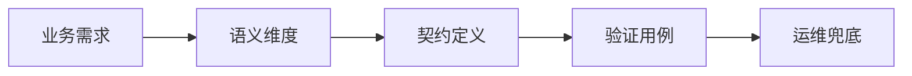

# 03 场景论证链：从业务需求到实现验证

> 业务场景不是“选一个 MQ”就结束，而是一条链：**需求 → 语义维度 → 契约 → 验证用例 → 运维兜底**。
> 本篇给出 8 条高频业务链的走查导航，全部指向 [Testing/06-契约语义测试/](../Testing/06-契约语义测试/README.md) 与 `topics/` 的真实路径。

## 场景链通用模板



| 链环 | 关键问题 | 典型产物 |
| ---- | ---- | ---- |
| 需求 | 业务要“不丢/不重/不乱序/可追踪”中的哪几个？ | SLO 文档 |
| 语义 | 选 at-most-once/at-least-once/exactly-once，顺序键是什么？ | 语义矩阵 |
| 契约 | AsyncAPI/CloudEvents/Schema 是否定义并版本化？ | `asyncapi.yaml` |
| 验证 | 是否有 GWT/TC 断言覆盖正常、异常、边界？ | `TC-SEM-xx` |
| 运维 | 监控、告警、DLQ、降级是否已配置？ | SRE 检查清单 |

## 场景链总览

| 业务场景 | 核心语义维度 | 契约层 | 验证用例层 | 设计/运维指针 |
| ---- | ---- | ---- | ---- | ---- |
| 订单生命周期 | 顺序 + 幂等 + 事务 | AsyncAPI `orderCreated` | [01-order-lifecycle/SEMANTICS.md](../Testing/06-契约语义测试/03-业务场景/01-order-lifecycle/SEMANTICS.md) | [02-01-场景化功能架构矩阵](../topics/02-场景驱动架构设计/02-01-场景化功能架构矩阵.md)、[02-21-消息事务设计](../topics/02-场景驱动架构设计/02-21-消息事务设计.md) |
| 支付对账 | exactly-once + 幂等 + 可观测 | CloudEvents + correlationId | [02-payment-reconciliation/SEMANTICS.md](../Testing/06-契约语义测试/03-业务场景/02-payment-reconciliation/SEMANTICS.md) | [01-63-Exactly-once语义全论证](../topics/01-基础概念与对比分析/01-63-Exactly-once语义全论证.md)、[03-41-消息幂等性保障指南](../topics/03-架构与运维实践/03-41-消息幂等性保障指南.md) |
| 库存扣减 | 顺序 + 事务 + 重试 | AsyncAPI `inventory.deducted` | [03-inventory/SEMANTICS.md](../Testing/06-契约语义测试/03-业务场景/03-inventory/SEMANTICS.md) | [02-13-消息顺序保证](../topics/02-场景驱动架构设计/02-13-消息顺序保证.md)、[02-16-消息重试机制](../topics/02-场景驱动架构设计/02-16-消息重试机制.md) |
| 通知推送 | 路由 + 过滤 + 追踪 | AsyncAPI channel binding | [04-notification/SEMANTICS.md](../Testing/06-契约语义测试/03-业务场景/04-notification/SEMANTICS.md) | [02-12-消息路由策略](../topics/02-场景驱动架构设计/02-12-消息路由策略.md)、[03-39-消息追踪与监控指南](../topics/03-架构与运维实践/03-39-消息追踪与监控指南.md) |
| IoT 遥测 | at-least-once/QoS + 背压 + 限流 | MQTT binding | [05-iot-telemetry/SEMANTICS.md](../Testing/06-契约语义测试/03-业务场景/05-iot-telemetry/SEMANTICS.md) | [01-64-MQTT-5.0协议全解析](../topics/01-基础概念与对比分析/01-64-MQTT-5.0协议全解析.md)、[03-53-消息限流与流量控制指南](../topics/03-架构与运维实践/03-53-消息限流与流量控制指南.md) |
| CDC 同步 | 顺序 + 格式转换 + 版本兼容 | AsyncAPI + Schema | [06-cdc-sync/SEMANTICS.md](../Testing/06-契约语义测试/03-业务场景/06-cdc-sync/SEMANTICS.md) | [02-33-消息转换与适配设计](../topics/02-场景驱动架构设计/02-33-消息转换与适配设计.md)、[03-49-消息转换与适配实践指南](../topics/03-架构与运维实践/03-49-消息转换与适配实践指南.md) |
| 审计追踪 | 不可变 + 可重放 + 血缘 | CloudEvents + Schema | [07-audit-trail/SEMANTICS.md](../Testing/06-契约语义测试/03-业务场景/07-audit-trail/SEMANTICS.md) | [01-47-事件溯源核心机制与存储选型](../topics/01-基础概念与对比分析/01-47-事件溯源核心机制与存储选型.md)、[03-62-消息数据治理实践指南](../topics/03-架构与运维实践/03-62-消息数据治理实践指南.md) |
| 任务队列 | 路由 + 死信 + 延迟/重试 | AsyncAPI operation | [08-task-queue/SEMANTICS.md](../Testing/06-契约语义测试/03-业务场景/08-task-queue/SEMANTICS.md) | [02-17-死信队列设计](../topics/02-场景驱动架构设计/02-17-死信队列设计.md)、[03-40-消息延迟与调度指南](../topics/03-架构与运维实践/03-40-消息延迟与调度指南.md) |

## 1. 订单生命周期

**场景需求**: 订单创建→支付→发货→完成，状态变更必须可追踪，且同一订单事件不能丢失或乱序。

**语义维度**: 分区键用 `orderId` 保证 [Ordering](../topics/01-基础概念与对比分析/01-58-全局核心概念卡片总表.md)；Producer 幂等 + 事务保证跨分区状态一致性【论证】。

**契约**: 用 AsyncAPI 描述 `orderCreated`、`orderPaid`、`orderShipped` 三个 channel，payload 绑定 Avro Schema。

**验证用例**: 参考 [01-order-lifecycle/SEMANTICS.md](../Testing/06-契约语义测试/03-业务场景/01-order-lifecycle/SEMANTICS.md) 的 GWT 断言，覆盖“同 orderId 事件顺序投递”与“重复发布不导致重复状态”。

## 2. 支付对账

**场景需求**: 支付结果必须被财务系统精确处理一次，否则会出现长短款。

**语义维度**: exactly-once 是目标，但需拆分为“系统语义 EOS + 业务幂等”【论证】；correlationId 串联支付请求与回调。

**契约**: CloudEvents 规范统一 `ce-type=payment.completed`，correlationId 取自 header。

**验证用例**: [02-payment-reconciliation/SEMANTICS.md](../Testing/06-契约语义测试/03-业务场景/02-payment-reconciliation/SEMANTICS.md) 提供“重复回调仅触发一次对账”的 TC-SEM 断言。

## 3. 库存扣减

**场景需求**: 高并发下同一 SKU 库存不能超卖，失败需可重试。

**语义维度**: 同 SKU 消息需顺序处理（[Ordering](../topics/01-基础概念与对比分析/01-58-全局核心概念卡片总表.md)）；重试需带指数退避与死信隔离（[Dead Letter](../topics/01-基础概念与对比分析/01-58-全局核心概念卡片总表.md)）。

**契约**: AsyncAPI `inventory.deducted` channel 声明 `x-ordering-key: sku` 扩展。

**验证用例**: [03-inventory/SEMANTICS.md](../Testing/06-契约语义测试/03-业务场景/03-inventory/SEMANTICS.md) 覆盖“同 SKU 并发扣减顺序执行”与“超限扣减进入 DLQ”。

## 4. 通知推送

**场景需求**: 一条通知可能按渠道（App/短信/邮件）路由，且需全链路追踪。

**语义维度**: [Content-Based Router](../topics/01-基础概念与对比分析/01-58-全局核心概念卡片总表.md) 按 `channel` 字段分发；traceparent/correlationId 实现可观测。

**契约**: AsyncAPI 一个 channel 多个 operation，binding 区分 Kafka/MQTT/HTTP。

**验证用例**: [04-notification/SEMANTICS.md](../Testing/06-契约语义测试/03-业务场景/04-notification/SEMANTICS.md) 断言“同一条通知不会同时进入两个互斥渠道”。

## 5. IoT 遥测

**场景需求**: 海量设备上报温度/位置，允许偶发丢失，但不能把服务端打崩。

**语义维度**: at-most-once 或 at-least-once 即可；重点是 [Backpressure](../topics/01-基础概念与对比分析/01-58-全局核心概念卡片总表.md) 与限流。

**契约**: MQTT binding，QoS=1，topic 层级 `sensors/{deviceId}/temp`。

**验证用例**: [05-iot-telemetry/SEMANTICS.md](../Testing/06-契约语义测试/03-业务场景/05-iot-telemetry/SEMANTICS.md) 覆盖“突发 10x 流量下服务端不 OOM”。

## 6. CDC 同步

**场景需求**: 数据库变更实时同步到搜索/缓存/数仓，需保证变更顺序与格式兼容。

**语义维度**: [Ordering](../topics/01-基础概念与对比分析/01-58-全局核心概念卡片总表.md) 在表维度保证；Schema 演进需向后/向前兼容；[Message Translator](../topics/01-基础概念与对比分析/01-58-全局核心概念卡片总表.md) 处理库表事件到业务事件的转换。

**契约**: AsyncAPI + Avro Schema，channel 对应 binlog 表。

**验证用例**: [06-cdc-sync/SEMANTICS.md](../Testing/06-契约语义测试/03-业务场景/06-cdc-sync/SEMANTICS.md) 断言“schema 变更不中断消费”。

## 7. 审计追踪

**场景需求**: 所有关键操作留痕，支持按时间重放与合规审计。

**语义维度**: 持久化、不可变、[Event Sourcing](../topics/01-基础概念与对比分析/01-58-全局核心概念卡片总表.md) 以事件流为真相源；数据血缘追踪影响范围。

**契约**: CloudEvents + 审计扩展字段 `x-audit-actor`、`x-audit-action`。

**验证用例**: [07-audit-trail/SEMANTICS.md](../Testing/06-契约语义测试/03-业务场景/07-audit-trail/SEMANTICS.md) 覆盖“事件不可删除且可按时间重放”。

## 8. 任务队列

**场景需求**: 异步执行任务，失败可重试，超期可延迟，死手可隔离。

**语义维度**: [Queue](../topics/01-基础概念与对比分析/01-58-全局核心概念卡片总表.md) 点对点；重试、延迟、DLQ 组合使用；路由按任务类型分发。

**契约**: AsyncAPI operation `sendTask`，binding 声明 `x-delay-ms` 与 `x-max-retries`。

**验证用例**: [08-task-queue/SEMANTICS.md](../Testing/06-契约语义测试/03-业务场景/08-task-queue/SEMANTICS.md) 断言“失败 3 次后转入 DLQ 且可人工重放”。

## 场景链完整性自查表

| 链环 | 检查问题 | 缺了怎么补 |
| ---- | ---- | ---- |
| 需求 | 业务到底要“不丢”“不重”“不乱序”中的哪几个？ | 与业务方确认 SLO，写入 [02-01-场景化功能架构矩阵](../topics/02-场景驱动架构设计/02-01-场景化功能架构矩阵.md) |
| 语义 | 选 at-most-once/at-least-once/exactly-once 的理由是什么？ | 查 [01-63-Exactly-once语义全论证](../topics/01-基础概念与对比分析/01-63-Exactly-once语义全论证.md) 与语义矩阵 |
| 契约 | AsyncAPI/CloudEvents/Schema 是否已定义并纳入版本控制？ | 参考 [Testing/06-契约语义测试/01-契约规格/](../Testing/06-契约语义测试/01-契约规格/bindings-matrix.md) |
| 验证 | 是否有 GWT/TC 断言覆盖正常、异常、边界三种情况？ | 在 [Testing/06-契约语义测试/04-行为用例/](../Testing/06-契约语义测试/04-行为用例/README.md) 补充 |
| 运维 | 监控、告警、降级、DLQ 是否已配置？ | 对应 [03-55-消息监控告警实践指南](../topics/03-架构与运维实践/03-55-消息监控告警实践指南.md) |

## 快速验证：从契约到断言

```yaml
# 示例：订单创建事件的 AsyncAPI 片段（契约层）
channels:
  orderCreated:
    address: orders.created
    messages:
      orderCreatedMessage:
        payload:
          schemaFormat: application/vnd.apache.avro+json;version=1.11.1
        bindings:
          kafka:
            key: "orderId"
```

```gherkin
# 示例：订单场景的 GWT 断言（验证层）
Scenario: 同一订单事件保持顺序
  Given order-123 已产生 created 与 paid 两个事件
  When 消费者按 orderId 分区消费
  Then 必须先处理 created 再处理 paid
```

## 从自查到行动

走完自查表后，把缺口映射到具体文件：

- 需求不清 → 回到 [02-01-场景化功能架构矩阵](../topics/02-场景驱动架构设计/02-01-场景化功能架构矩阵.md)。
- 语义不决 → 查 [TEST-C2-通信层语义矩阵与行为断言](../Testing/06-契约语义测试/02-语义矩阵/TEST-C2-通信层语义矩阵与行为断言.md)。
- 契约缺失 → 参考 [TEST-C3-业务场景契约库与用例规范](../Testing/06-契约语义测试/00-模型与规划/TEST-C3-业务场景契约库与用例规范.md)。
- 用例不足 → 在 [04-行为用例/](../Testing/06-契约语义测试/04-行为用例/README.md) 补充 GWT。
- 运维缺位 → 打开 [03-55-消息监控告警实践指南](../topics/03-架构与运维实践/03-55-消息监控告警实践指南.md)。

---

**参考来源**:

- [Testing/06-契约语义测试/README.md](../Testing/06-契约语义测试/README.md)
- [TEST-C3-业务场景契约库与用例规范](../Testing/06-契约语义测试/00-模型与规划/TEST-C3-业务场景契约库与用例规范.md)
- 项目内 02/03 系列对应主题文档

**最后更新**: 2026-11-18
