# 卷一：topics/01 基础篇消化

> 本卷覆盖 `topics/01-基础概念与对比分析/` 的 01-01 ~ 01-27 共 27 篇，是消息队列知识库的“概念底座”。阅读目标：建立 Kafka、MQTT、NATS、Pulsar、RabbitMQ、Redis Stream 六系统总览，掌握核心术语与形式化口径，理解各系统架构演进与版本事实，为 02/03/04 系列提供概念指针。
>
> 所有事实性陈述均带 topics 指针；置信标注遵循 AGENTS.md §4.1 P3 体系。

---

## 1. 卷首知识地图

```mermaid
graph LR
    subgraph 概念矩阵组
        direction TB
        A01[01-01 多维度概念矩阵对比]
        A02[01-02 思维导图架构设计]
        A03[01-03 决策图网分析]
        A04[01-04 形式化证明框架]
        A05[01-05 程序设计模式分析]
        A06[01-06 架构设计深度分析]
        A07[01-07 应用场景与架构演进]
        A10[01-10 系统控制与反馈机制]
        A11[01-11 核心概念全面梳理]
        A19[01-19 选型决策矩阵]
        A20[01-20 技术选型速查表]
        A21[01-21 快速参考卡片]
        A22[01-22 常见问题FAQ]
        A23[01-23 术语词汇表]
        A24[01-24 学习路径指南]
        A01 --> A02 --> A03 --> A04 --> A05 --> A06 --> A07 --> A10 --> A11 --> A19 --> A20 --> A21 --> A22 --> A23 --> A24
    end

    subgraph 协议组
        direction TB
        A16[01-16 MQTT 5.0新特性深度分析]
    end

    subgraph 演进与系统组
        direction TB
        A08[01-08 权威数据与基准测试]
        A09[01-09 异常处理与容错机制]
        A12[01-12 Pulsar深度分析]
        A13[01-13 Kafka-KRaft模式分析]
        A14[01-14 安全性分析]
        A15[01-15 RabbitMQ深度分析]
        A17[01-17 Redis-Stream分析]
        A18[01-18 性能基准测试对比]
        A25[01-25 Kafka-4.0新时代与队列语义分析]
        A26[01-26 NATS-2.x与JetStream演进分析]
        A27[01-27 RocketMQ-5.x深度分析]
        A08 --> A09 --> A12 --> A13 --> A14 --> A15 --> A17 --> A18 --> A25 --> A26 --> A27
    end

    A01 --> A16
    A11 --> A16
    A16 --> A12
    A03 --> A19
    A19 --> A08
    A18 --> A25
```

> 地图节点说明：共 **27** 个文档节点，分三大主题组。主线关系：概念矩阵组建立术语与选型框架 → 协议组（MQTT 5.0）补全 IoT/轻量协议视角 → 演进与系统组深入各系统架构、版本演进与基准。跨组边表示“读完后自然延伸到下一组”的最小阅读路径。

---

## 2. 置信口径速查

依据 AGENTS.md §4.1：

| 标注 | 含义 | 本卷使用场景 |
| ------ | ------ | -------------- |
| **【定理】** | 协议/规范语义，有官方规范或形式化模型保证 | MQTT QoS、Kafka ISR/ACK、Redis Stream 命令语义等 |
| **【论证】** | 架构对比/工程推理，有官方文档、论文或基准支撑 | 版本发布时间、架构分层、选型矩阵、升级路径 |
| **【估算】** | 工程经验值或项目整理量级，无公开溯源 | 具体 TPS/延迟/成本数字未注明出处时 |

> 各原文档顶部均有统一置信口径声明：“协议/规范语义=【定理】；架构对比与工程推理=【论证】；正文未单独标注的具体数字按【估算】理解。”本卷证据栏与此保持一致。

---

## 3. 逐篇消化卡

### 01-01 多维度概念矩阵对比

- **论点**：消息队列选型需从吞吐、延迟、持久化、一致性、消息模型等八维度正交对比，避免单一指标决策。
- **证据**：六系统八维度选型矩阵覆盖 Kafka/MQTT/NATS/Pulsar/RabbitMQ/Redis Stream【论证】；MQTT QoS 0/1/2、Kafka ISR/ACK 等协议语义为【定理】；具体数字如 Kafka 100万+ TPS、NATS Core 200万+ TPS 未注明出处按【估算】理解。
- **关联**：01-03（决策图网将矩阵维度转为判定路径）、01-19（选型决策矩阵的场景化落地）、01-11（核心概念定义支撑矩阵术语）。
- **易错**：将不同运行模式（NATS Core vs JetStream）混为一列时，须注意其吞吐/持久化/一致性差异。

### 01-02 思维导图架构设计

- **论点**：全库按“概念→设计→运维→动态演化”四层组织，配合思维导图可快速定位文档与认知任务。
- **证据**：全库架构思维导图列出 01/02/03/04/Testing/AI_Skills/资产层七大域【论证】；六种思维表征（概念矩阵/思维导图/决策图网/形式化证明/因果回路/决策树）对应不同认知任务【论证】。
- **关联**：01-01（概念矩阵是思维导图的基础）、01-03（决策图网处理流程依赖）、01-58（全局核心概念卡片是概念辨析的另一入口）。
- **易错**：把思维导图当作严格论证工具；它更适合体系导航，严格论证应使用 01-04。

### 01-03 决策图网分析

- **论点**：技术选型应通过“需求/约束 → 方案”单向决策网络推进，避免双向混用导致逻辑矛盾。
- **证据**：消息队列选型决策树按吞吐量、延迟、持久化、协议、部署复杂度逐层分支【论证】；CAP 定位矩阵将 Kafka/Pulsar/JetStream 归为 CP、MQTT/Core NATS 归为 AP【论证】；前沿主题节点按触发条件→关键判定→推荐路径组织【论证】。
- **关联**：01-01（矩阵提供维度输入）、01-19（选型决策矩阵给出场景映射）、01-59（全局选型决策总树是更完整的判定入口）。
- **易错**：同一语义边双向混用（如“CP→设计目标”与“设计目标→CP”同时存在）会破坏决策图网的逻辑一致性。

### 01-04 形式化证明框架

- **论点**：消息投递语义与一致性可通过符号化形式化框架表达，但真实保证需引用 TLA+/Jepsen 等外部验证资产。
- **证据**：Kafka `acks=-1` 已提交消息的持久性/一致性、MQTT QoS2 恰好一次、NATS Core at-most-once、Pulsar BookKeeper Quorum 持久性均按协议语义标【定理】；文中符号化证明为【论证】；Kafka KRaft TLA+ 规范和 Jepsen 评测为真实形式化资产【定理：模型经 TLC 检验的资产】。
- **关联**：01-11（核心概念全面梳理中的形式化定义）、01-63（Exactly-once 语义全论证）、01-13（Kafka KRaft 形式化资产落地）。
- **易错**：将文中符号化论证直接视为“数学定理”；缺少机器验证支撑时必须标【论证】。

### 01-05 程序设计模式分析

- **论点**：不同 MQ 在 API/客户端层面体现了不同的设计模式，Pulsar 在可编程批量、Key_Shared、Schema、动态配置等方面与 Kafka 差异显著。
- **证据**：Pulsar Key_Shared 通过一致性哈希实现动态并行度，无需预先分区【论证】；Pulsar 原生 Schema 与动态配置热加载降低运维复杂度约 30%【估算】；Kafka 自定义分区器/观察者模式/命令模式等为工程实现【论证】。
- **关联**：01-06（架构设计深度分析解释模式背后的架构）、01-12（Pulsar 深度分析验证这些模式）、01-72（消息与数据编码对比矩阵承接 Schema 主题）。
- **易错**：把 Pulsar“无状态 Broker”误解为 Broker 不持有任何数据；实际缓存可丢弃，元数据/游标仍外置。

### 01-06 架构设计深度分析

- **论点**：Kafka/MQTT/NATS/Pulsar 的分层架构反映了日志中心、设备中心、简单中心、多租户中心四种设计哲学。
- **证据**：Kafka 6 层分层模型（API/协议/逻辑/存储/副本/协调）、MQTT 5 层、NATS 6 层、Pulsar 6 层【论证】；Pulsar 存储计算分离、多租户原生、分层存储为架构事实【论证】；延迟/吞吐数字按【估算】理解。
- **关联**：01-05（程序设计模式是架构的代码投射）、01-12（Pulsar 深度分析是该架构的专章展开）、01-62（Pulsar 存算分离架构深度解析）。
- **易错**：认为 Pulsar Broker 完全无状态即可任意扩缩；实际 BookKeeper 与元数据层仍是容量/一致性的关键约束。

### 01-07 应用场景与架构演进

- **论点**：消息队列选型由场景-技术映射驱动，架构演进遵循“传统MQ→企业MQ→高吞吐MQ→云原生MQ→多协议统一”路径。
- **证据**：场景-技术映射表给出日志聚合→Kafka、IoT→MQTT、微服务→NATS 等首选方案【论证】；演进路径为历史梳理【论证】；具体延迟量级数字按【估算】。
- **关联**：01-01（多维矩阵给出技术对比）、01-19（选型决策矩阵细化场景评分）、01-20（速查表给出备选方案）。
- **易错**：把演进路径当作必须遵循的技术升级路线；实际应基于业务路径依赖与团队能力评估。

### 01-08 权威数据与基准测试

- **论点**：性能数字必须区分官方基准、第三方基准与生产环境案例，并注明来源与测试条件。
- **证据**：LinkedIn Kafka 单集群 2M+ TPS、NATS Core 单核 500K+ TPS 来自官方/生产案例【论证】；MQTT QoS 0/1/2 延迟范围与协议开销来自 OASIS 规范【定理】；第三方综合对比表标注为项目整理的非统一环境量级【估算】。
- **关联**：01-18（性能基准测试对比是本篇的量化视图）、01-20（速查表引用性能数字）、03-17（基准测试报告模板指导自测）。
- **易错**：直接跨表比较不同测试环境/负载下的吞吐数字；须以目标环境自测为准。

### 01-09 异常处理与容错机制

- **论点**：消息系统容错需在连接、消息、网络分区、慢消费者、磁盘满等多维度设计，并区分可重试与不可重试异常。
- **证据**：Kafka Producer/Consumer/Broker、MQTT、NATS、Pulsar 的异常类型与处理策略来自官方文档【论证】；Pulsar 无状态 Broker 故障不影响存储为架构特性【论证】；异常恢复时间等数字按【估算】。
- **关联**：01-10（系统控制与反馈机制是容错的控制论表达）、01-65（死信队列完整工程解析）、03-03（故障场景与恢复策略落地）。
- **易错**：对所有异常统一无限重试；应识别 `RetriableException` 与 `NonRetriableException`。

### 01-10 系统控制与反馈机制

- **论点**：消息系统可用 PID/自适应/分布式控制理论建模，Kafka Consumer Lag、MQTT QoS、NATS 流控都是反馈控制实例。
- **证据**：PID 控制器公式与控制理论应用为建模方法【论证】；Kafka ISR 控制、MQTT 令牌桶流控、NATS 慢消费者保护为工程实现【论证】；控制精度分级为工程推理【论证】。
- **关联**：01-09（异常处理是控制系统的故障响应）、04-07（控制回路是动态系统论深化）、03-13（性能调优实战案例）。
- **易错**：把控制理论公式直接套用到生产调参而忽视系统非线性、测量噪声与执行延迟。

### 01-11 核心概念全面梳理

- **论点**：消息队列的 20+ 核心概念可按基础/模型/一致性/可靠性/性能/架构六层组织，并形成形式化定义与关系网络。
- **证据**：发布-订阅、点对点、请求-响应模型的形式化定义与属性为概念抽象【论证】；Kafka 分区顺序性、ISR 一致性、ACK=all 保证不丢失按协议语义标【定理】；吞吐量/延迟影响因素为工程推理【论证】。
- **关联**：01-01（多维矩阵使用这些概念）、01-23（术语词汇表是本文的术语索引）、01-58（全局核心概念卡片总表）。
- **易错**：将“形式化证明”中的定理直接当作无条件的生产保证；实际成立依赖前提（如 ISR 副本数足够）。

### 01-12 Pulsar深度分析

- **论点**：Pulsar 通过存储计算分离、BookKeeper 分层存储、原生多租户和 5.0 LTS 的 Scalable Topics，定位云原生多租户流平台。
- **证据**：Pulsar 5.0.0 于 2026-10-05 GA，为第三个 LTS【论证：官方发布信息】；Oxia 是新生产集群推荐元数据存储【论证：官方文档】；官方 IoT 基准显示 5.0.0 较 4.0.13 吞吐提升约 1.7×、P99 延迟从 202.3s 降至 1.08s【估算/论证：官方基准】。
- **关联**：01-06（架构设计深度分析中的 Pulsar 分层模型）、01-62（存算分离架构深度解析）、01-29（S3 解耦存储消息系统分析）。
- **易错**：认为 Pulsar 5.0 Scalable Topics 已支持地理复制；当前限制明确不支持。

### 01-13 Kafka-KRaft模式分析

- **论点**：Kafka 4.x 已彻底移除 ZooKeeper，KRaft 成为唯一元数据模式，带来架构简化与扩展性提升。
- **证据**：Kafka 4.0.0 于 2025-03-18 发布并移除 ZK【论证：官方发布】；KIP-500 设计文档说明 Raft 替代 ZK【论证】；KRaft TLA+ 规范为真实形式化资产【定理：模型检验资产】。
- **关联**：01-25（Kafka 4.0 新时代与队列语义分析）、01-61（Kafka 存储与复制内幕深度解析）、03-27（版本升级指南）。
- **易错**：从 ZooKeeper 模式直接升级到 Kafka 4.x；必须先经 3.9 完成 ZK→KRaft 迁移。

### 01-14 安全性分析

- **论点**：消息队列安全需在传输、认证、授权、审计、应用层五层实施，TLS/SASL/SCRAM/ACL 是各系统通用手段。
- **证据**：Kafka SASL/SCRAM、MQTT TLS/证书、NATS JWT+Accounts、Pulsar TLS/OAuth2 配置来自官方文档【论证】；安全特性对比矩阵为项目整理【论证】。
- **关联**：01-49（消息系统零信任安全体系深化）、03-16（安全加固指南）、02-30（安全设计模式）。
- **易错**：仅启用 TLS 就认为实现端到端安全；应用层消息加密仍需业务侧实现。

### 01-15 RabbitMQ深度分析

- **论点**：RabbitMQ 4.x 以 AMQP 0-9-1/1.0 为核心，通过 Exchange-Queue-Binding 实现灵活路由，quorum queues 成为唯一可复制队列类型。
- **证据**：RabbitMQ 4.0 于 2024-09-18 发布并移除 classic queue mirroring【论证：官方发布】；官方升级文档规定 3.13/4.0/4.1 → 4.3/4.4 必须先升级到 4.2.x【定理：官方升级路径规定】；4.4 于 2026-10-20 发布，支持 quorum queue 延迟消息等【论证】。
- **关联**：01-06（架构设计中的 RabbitMQ 分层）、01-42（JMS-AMQP 传统企业消息标准）、03-15（迁移指南）。
- **易错**：从 3.13/4.0/4.1 直接滚动升级到 4.4；必须先落到 4.2.x 中转。

### 01-16 MQTT 5.0新特性深度分析

- **论点**：MQTT 5.0 通过 User Properties、Shared Subscriptions、Message Expiry、Topic Alias、Reason Code 等扩展，在保持轻量的同时增强错误处理与负载均衡能力。
- **证据**：MQTT 5.0 于 2019 年由 OASIS 发布【论证：官方发布】；QoS 0/1/2 投递语义由 OASIS 规范保证【定理】；Shared Subscriptions 语法 `$share/{ShareName}/{TopicFilter}` 为协议定义【定理】。
- **关联**：01-14（安全性分析中的 MQTT TLS/ACL）、01-46（IoT 与互联网领域消息标准纵览）、01-64（MQTT 5.0 协议全解析）。
- **易错**：认为 MQTT 5.0 Shared Subscriptions 保证消息顺序；实际为负载均衡，顺序性由 QoS/会话保证而非共享组。

### 01-17 Redis-Stream分析

- **论点**：Redis Stream 是轻量级追加日志，适合低延迟、中小规模、与现有 Redis 基础设施复用的场景，但需关注 Redis 8 许可证变化与 Valkey 分叉。
- **证据**：Redis Stream 自 Redis 5.0 引入，核心命令 XADD/XREADGROUP/XACK 为 Redis 命令语义【定理：命令规范】；Redis 8 采用 RSALv2/SSPLv1/AGPLv3 三许可证【论证：官方发布】；Valkey 为 Linux Foundation 2024-03 主导的 BSD 分叉【论证】。
- **关联**：01-01（多维矩阵中的 Redis Stream 列）、01-72（消息与数据编码对比矩阵）、01-34（许可证与选型合规分析）。
- **易错**：将 Redis Stream 当作 Kafka 替代用于大规模长期保留；其容量与保留模型受 Redis 内存/MAXLEN 限制。

### 01-18 性能基准测试对比

- **论点**：统一基准必须在相同硬件、软件版本、负载下测试，否则只能作为量级参考。
- **证据**：测试环境表格给出 Kafka 3.5.0、EMQX 5.0、NATS 2.10.0、Pulsar 3.0.0、RabbitMQ 3.12.0、Redis 7.0.0【论证】；表格明确标注为项目整理的非统一环境量级【估算】；各系统 ACK/QoS 语义为【定理】。
- **关联**：01-08（权威数据与基准测试给出官方/生产案例）、01-20（速查表引用性能指标）、03-17（基准测试报告模板）。
- **易错**：把本表数字直接作为选型决策的精确依据；应使用 03-17 模板在目标环境复测。

### 01-19 选型决策矩阵

- **论点**：场景-性能-成本三维矩阵可将 01-01 的多维对比落地为可勾选的选型结论。
- **证据**：场景选型矩阵、性能选型矩阵、成本选型矩阵为项目整理【论证】；与 01-59 全局选型决策总树口径对齐【论证】；动态系统论视角提示参见 04-05。
- **关联**：01-01（多维矩阵提供维度）、01-20（速查表给出推荐/备选）、01-59（全局选型决策总树）。
- **易错**：忽略成本/运维维度，只看技术适合度；矩阵强调运维复杂度与学习成本。

### 01-20 技术选型速查表

- **论点**：速查表通过“场景→系统→性能→功能→决策流程”五层，为日常决策提供一页纸入口。
- **证据**：按场景快速选型表、性能需求快速匹配表、功能需求快速匹配表为项目整理【论证】；决策流程图为判定逻辑【论证】。
- **关联**：01-19（选型决策矩阵是更详细的评分版）、01-21（快速参考卡片提供命令速查）、01-59（全局决策总树）。
- **易错**：将速查表的“首选”视为绝对结论；实际需结合 01-03/01-59 的完整决策网络。

### 01-21 快速参考卡片

- **论点**：快速参考卡片汇总 Kafka/MQTT/NATS/RabbitMQ/Redis Stream 的核心概念与常用命令，用于日常运维查阅。
- **证据**：各系统核心概念与命令来自官方文档与 CLI 手册【论证】；MQTT QoS 0/1/2 语义为【定理】。
- **关联**：01-20（速查表给出选型结论，本卡给出操作命令）、01-23（术语词汇表解释概念）、03 系列运维实践。
- **易错**：将命令示例直接复制到生产环境；需根据实际配置与安全策略调整。

### 01-22 常见问题FAQ

- **论点**：FAQ 将高频选型、性能、部署、运维、故障问题抽象为可快速回复的标准答案。
- **证据**：Q1-Q5 覆盖选型/性能/部署/监控/消息丢失，答案来自项目共识与官方最佳实践【论证】。
- **关联**：01-21（快速参考卡片提供命令）、01-24（学习路径指南给出进阶路线）、03-11（故障排查手册）。
- **易错**：把 FAQ 当作详尽解决方案；复杂场景仍需参考 02/03 系列专章。

### 01-23 术语词汇表

- **论点**：全库术语需统一中英文与置信口径，避免不同文档对同一概念表述不一致。
- **证据**：术语表覆盖通用/Kafka/MQTT-NATS/RabbitMQ-Pulsar/Redis-RocketMQ-Redpanda/事件标准/2026-11 扩展术语，共 50+ 词条【论证】；ISR、QoS 等协议语义标注【定理】。
- **关联**：01-11（核心概念全面梳理是术语的展开）、01-21（参考卡片使用术语）、01-58（全局核心概念卡片总表）。
- **易错**：混淆相似术语（如 Consumer Group vs Queue Group vs Subscription）。

### 01-24 学习路径指南

- **论点**：消息队列学习应遵循“初学者→进阶→专家”三阶段，配合 01/02/03 系列与前沿专题地图形成闭环。
- **证据**：三阶段路径与前沿专题地图为项目教学设计【论证】；实践项目建议基于 01/02/03 文档映射【论证】。
- **关联**：01-01/01-11/01-23（初学者基础）、02-12 等设计模式（进阶）、01-30~01-52 前沿专章（专家）。
- **易错**：跳过基础概念直接上手系统专章；术语不统一会导致后续设计/运维文档理解偏差。

### 01-25 Kafka-4.0新时代与队列语义分析

- **论点**：Kafka 4.x 通过 KRaft-only、KIP-848 新消费者组协议、KIP-932 Share Groups 及 4.4 的 DLQ，使 Kafka 同时具备流与原生队列语义。
- **证据**：Kafka 4.0.0 于 2025-03-18 移除 ZK、4.2.0 于 2026-02-17 使 KIP-932 GA、4.4.0 于 2026-10-22 加入 DLQ【论证：官方发布】；KIP-848 将全局 stop-the-world 再均衡改为增量转移【论证】；官方仅支持最近 3 个 release 补丁【论证：官方支持策略】。
- **关联**：01-13（KRaft 模式分析）、01-61（Kafka 存储与复制内幕）、01-70（流表一体与开放表格式收敛）。
- **易错**：在 Kafka 4.0/4.1 生产使用 KIP-932；Early Access/Preview 阶段不建议生产。

### 01-26 NATS-2.x与JetStream演进分析

- **论点**：NATS 采用 Core NATS + JetStream 双层模型，2.10~2.15 在批处理、调度、可靠性、运维方面持续演进，生产建议 2.14/2.15。
- **证据**：NATS 2.15 于 2026-09-17 发布，聚焦可靠性与运维【论证：官方发布】；2.13 被跳过从未发布【论证：官方 release notes】；JetStream API level 门控保证滚动升级安全【论证：官方文档】。
- **关联**：01-06（NATS 架构设计）、01-09（NATS 异常处理）、01-51（多云与边缘消息联邦技术）。
- **易错**：升级路径引用 2.13；官方明确 2.13 不存在，应 2.12 → 2.14。

### 01-27 RocketMQ-5.x深度分析

- **论点**：RocketMQ 5.x 通过 Proxy 实现存算分离、Pop 消费将负载均衡移到服务端、LiteTopic 面向 AI Agent 长会话场景，定位云原生消息/事件/流融合平台。
- **证据**：RocketMQ 5.5.1 于 2026-08-20 为当前最新稳定版【论证：官方发布】；Pop 消费对应 RIP-19/RIP-51【论证】；5.5.0 LiteTopic 由 RIP-83 定义【论证】；18 级固定延迟等级为 Broker 默认配置【定理：RocketMQ 命令语义】。
- **关联**：01-13（Kafka KRaft 元数据方案对比）、01-12（Pulsar 存算分离对比）、01-57（AI Agent 消息队列深化）。
- **易错**：在同一消费组混用经典 PushConsumer 与 Pop Consumer；文档建议不要混用。

---

## 4. 卷尾速查表

| 编号 | 标题 | 一句话论点 |
| ------ | ------ | ------------ |
| 01-01 | 多维度概念矩阵对比 | 从八维度正交对比六系统，避免单一指标选型。 |
| 01-02 | 思维导图架构设计 | 全库四层结构 + 六种思维表征，用于体系导航。 |
| 01-03 | 决策图网分析 | 用单向“需求→方案”决策网络避免选型逻辑矛盾。 |
| 01-04 | 形式化证明框架 | 投递语义可符号化表达，真实保证需引用 TLA+/Jepsen。 |
| 01-05 | 程序设计模式分析 | 各 MQ 客户端 API 体现不同设计模式，Pulsar 差异显著。 |
| 01-06 | 架构设计深度分析 | 四系统分层架构反映四种不同设计哲学。 |
| 01-07 | 应用场景与架构演进 | 场景-技术映射驱动，架构演进有历史路径依赖。 |
| 01-08 | 权威数据与基准测试 | 性能数字须区分来源、环境与测试条件。 |
| 01-09 | 异常处理与容错机制 | 多维度容错并区分可重试/不可重试异常。 |
| 01-10 | 系统控制与反馈机制 | PID/自适应/分布式控制理论可建模 MQ 流控与反馈。 |
| 01-11 | 核心概念全面梳理 | 20+ 核心概念六层组织，带形式化定义与关系网络。 |
| 01-12 | Pulsar深度分析 | 存算分离 + 分层存储 + 原生多租户的云原生流平台。 |
| 01-13 | Kafka-KRaft模式分析 | Kafka 4.x 彻底移除 ZK，KRaft 成为唯一元数据模式。 |
| 01-14 | 安全性分析 | 传输/认证/授权/审计/应用层五层安全体系。 |
| 01-15 | RabbitMQ深度分析 | Exchange-Queue-Binding 灵活路由，4.x 以 quorum queues 为主。 |
| 01-16 | MQTT 5.0新特性深度分析 | User Properties/Shared Subscriptions 等扩展增强 IoT 协议。 |
| 01-17 | Redis-Stream分析 | 轻量追加日志，适合低延迟中小规模与 Redis 复用。 |
| 01-18 | 性能基准测试对比 | 统一环境是基准可信前提，否则仅作量级参考。 |
| 01-19 | 选型决策矩阵 | 场景-性能-成本三维矩阵落地多维对比。 |
| 01-20 | 技术选型速查表 | 一页纸场景/性能/功能/决策流程速查。 |
| 01-21 | 快速参考卡片 | 五系统核心概念与常用命令速查。 |
| 01-22 | 常见问题FAQ | 高频选型/性能/部署/运维/故障问题标准答案。 |
| 01-23 | 术语词汇表 | 统一全库 50+ 术语中英文与置信口径。 |
| 01-24 | 学习路径指南 | 初学者→进阶→专家三阶段学习地图。 |
| 01-25 | Kafka-4.0新时代与队列语义分析 | KIP-932 Share Groups 使 Kafka 兼具流与队列语义。 |
| 01-26 | NATS-2.x与JetStream演进分析 | Core+JetStream 双层模型，2.14/2.15 为生产推荐线。 |
| 01-27 | RocketMQ-5.x深度分析 | Proxy 存算分离 + Pop 消费 + LiteTopic 面向 AI 场景。 |

---

**最后更新**: 2026-11-18
