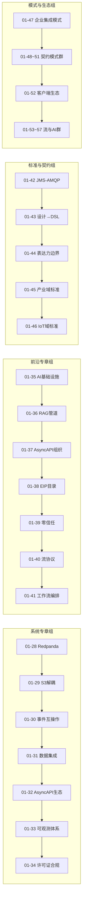

# 卷二：topics01 专章篇消化（01-28 ~ 01-57）

> 全量消化层卷二。逐篇四行卡：论点/证据/关联/易错。

## 本卷知识地图

## 逐篇消化卡

### 01-28 Redpanda 分析
- **论点**：C++ 无 JVM 的 Kafka 兼容路线 + 云原生形态（Cloud Topics/Shadowing）。
- **证据**：CalVer v26.2（2026-07，支持至 2027-07-28）；Iceberg Topics GA 于 25.1【论证，官方核实】。
- **关联**：01-67（存储解耦对照组）/01-25（Kafka 生态位互补）。
- **易错**：BSL 许可的商业边界——竞争性服务转售受限（01-34）。

### 01-29 S3 解耦存储消息系统分析
- **论点**：以 S3 为底座的解耦存储范式论证——成本/弹性/延迟三角。
- **证据**：分层存储成本差 3-5 倍【估算】；冷读延迟升至百毫秒级【估算】。
- **关联**：01-67（四路线深化）/01-70（流表同底座）。
- **易错**：把 S3 当"无限磁盘"——请求成本与尾延迟是真实约束。

### 01-30 事件互操作标准分析
- **论点**：CloudEvents 1.0.2 核心语义——四必需属性与传输绑定中立性。
- **证据**：specversion/type/source/id 必需【定理，规范原文】；HTTP/Kafka/MQTT 绑定对照。
- **关联**：02-57（信封模式落地）/conformance-matrix（CE 校验）。
- **易错**：扩展属性当规范属性用——互操作性静默丧失。

### 01-31 数据集成与流处理生态分析
- **论点**：CDC/流处理/湖仓的集成生态全景——Debezium/Flink/Spark 的定位分工。
- **证据**：Debezium 3.7（2026-09 核实）【论证】。
- **关联**：06-cdc-sync 场景/01-70（湖仓收敛）。
- **易错**：把 CDC 当 ETL 替代品——schema 漂移与快照一致性仍需工程。

### 01-32 AsyncAPI 工程生态深度分析
- **论点**：AsyncAPI 3.x 工具链全生态——spec/generator/modelina/studio/spectral。
- **证据**：@asyncapi/modelina v5.10.1（npm 核实）【论证】。
- **关联**：01-86（构件语义全书）/01-82（生成器支持矩阵）。
- **易错**：用 2.x 思维写 3.x——operation 模型已重构（channel 引用制）。

### 01-33 可观测性与自治运维能力体系分析
- **论点**：监测/告警/伸缩/自愈四能力域 + 自治分级框架。
- **证据**：六系统可观测矩阵；L0-L3 自治分级为 TEST-11 授权白名单的概念源【论证】。
- **关联**：03-63（落地）/04-07（控制回路深化）。
- **易错**：指标全≠可观测——无关联 trace 的指标是孤岛。

### 01-34 消息系统许可证与选型合规分析
- **论点**：AGPL/SSPL/BSL 传染边界与云托管转嫁的决策矩阵。
- **证据**：Redis AGPL 风波与 Valkey 分叉；IBM 收购 Confluent（2026-03）三层影响【论证+官方】。
- **关联**：01-28（BSL）/ROADMAP 观察哨。
- **易错**：只看 OSI 标记——BSL 的 Change Date 机制使"锁旧版=降限制"。

### 01-35 MQ 与 AI-Agent 基础设施分析
- **论点**：A2A/MCP 双层栈下消息系统的 Agent 基础设施定位。
- **证据**：MCP 捐赠 Linux Foundation；A2A 版本事实（批次 52 核实）【论证】。
- **关联**：01-57（深化）/ai-agent-contracts（测试层）。
- **易错**：用传统队列语义硬套 Agent 任务——任务有生命周期与工件语义。

### 01-36 事件驱动 RAG 与流式管道
- **论点**：索引新鲜度 SLO 驱动的事件驱动 RAG 管道设计。
- **证据**：新鲜度分级与降级路径设计模式【论证】。
- **关联**：01-56（AIOps）/01-35。
- **易错**：把向量索引更新当同步操作——事件管道才是正确解耦。

### 01-37 AsyncAPI 组织级应用与治理
- **论点**：企业级契约治理——目录/评审/版本策略的组织落地。
- **证据**：EventCatalog 治理流；breaking change 政策矩阵【论证】。
- **关联**：governance-tools（工具三件套）/02-56。
- **易错**：契约评审流于形式——无 Spectral 门禁的评审靠自觉。

### 01-38 EIP 全目录（企业集成模式）
- **论点**：65 个 EIP 模式的完整目录与消息系统映射。
- **证据**：Hohpe 官方目录对照；每模式标"可直接表达/需扩展/需下沉"【论证】。
- **关联**：01-43（模式→DSL 转换）/02-47（事务模式深化）。
- **易错**：模式照搬不顾语义——EIP 的前提是可靠的底层消息。

### 01-39 零信任安全架构
- **论点**：消息系统的零信任落地——身份/加密/最小权限的逐层策略。
- **证据**：SPIFFE/SASL-OIDC/mTLS 三层对照【论证】。
- **关联**：sec-baseline-scan（SEC 域测试）。
- **易错**：内网裸奔思维——零信任假设内网已被渗透。

### 01-40 应用层流协议与交互标准
- **论点**：gRPC/RSocket/WebSocket/SSE 的应用层协议选型论证。
- **证据**：Reactive Streams 边界；RSocket 双向流【论证】。
- **关联**：01-68（抽象层互补）/01-66（背压谱系）。
- **易错**：SSE 当双向通道用——它是单向服务器推送。

### 01-41 工作流编排系统与消息协同
- **论点**：Temporal/Camunda 等工作流系统与消息系统的事件协同模式。
- **证据**：工作流→消息契约导出路径【论证】。
- **关联**：01-43（BPMN→契约转换）。
- **易错**：用消息队列自研工作流——持久化执行语义远超消息能力。

### 01-42 JMS-AMQP 与传统企业消息标准
- **论点**：JMS/AMQP 1.0 的企业遗产价值与现代化路径。
- **证据**：AMQP 1.0 = ISO/IEC 19464【定理级标准】。
- **关联**：01-64（MQTT 对照）/01-86（binding 语义）。
- **易错**：JMS 2.0 语义与 AMQP 1.0 不等价——客户端可移植性神话。

### 01-43 设计到 DSL 的转换方法论
- **论点**：五源转换（Event Storming/EIP/代码/OpenAPI/BPMN）→ AsyncAPI 的规则体系。
- **证据**：每源 before/after 示例；springwolf 逆向工具链【论证】。
- **关联**：01-83（DSL 通论是它的地基）/01-80（转换树前置）。
- **易错**：转换规则当一次性产物——设计源演化后规则需重放。

### 01-44 DSL 表达力边界与等价转换策略
- **论点**：DSL 表达不了的四类语义（行为/派生/非功能/编排）与等价策略矩阵。
- **证据**：x- 扩展/外部 $ref/多规范混合/下沉代码四策略【论证】。
- **关联**：x- 扩展登记簿（bindings-matrix §三）/01-84（模式全集）。
- **易错**：x- 扩展失控无治理——登记簿是红线。

### 01-45 产业领域消息标准纵览
- **论点**：金融/医疗/物流/能源的领域权威标准（ISO 20022/FHIR/EPCIS/OpenADR）。
- **证据**：ISO 20022 pacs/pain/mx 族结构【论证，官方注册库】。
- **关联**：01-80（领域→场景判定起点）。
- **易错**：领域标准当可选参考——合规场景是硬约束。

### 01-46 IoT 与互联网领域消息标准纵览
- **论点**：Sparkplug B/OPC UA/电商订单事件/A2A 的领域契约化路径。
- **证据**：Sparkplug 主题命名空间规范【论证】。
- **关联**：05-iot-telemetry 场景/01-64。
- **易错**：MQTT 通配符当 Sparkplug 命名空间——语义层级不同。

### 01-47 企业集成模式与事务消息模式
- **论点**：Saga/outbox/事务消息的工程模式全集。
- **证据**：Saga 补偿与 outbox 模式的可靠性论证【论证】。
- **关联**：02-21（对应设计篇）/01-63（EOS 边界）。
- **易错**：双写（DB+消息）无 outbox——分布式事务的经典翻车点。

### 01-48~51 契约模式群（设计→DSL 转换/表达力边界/Spec-Driven/模式库）
- **论点**：契约工程四联——转换方法论/边界策略/规范驱动体系/通用模式库。
- **证据**：ODCS 对齐；质量/SLA 维度补全（批次 79）【论证】。
- **关联**：02-54/02-56/02-57（02 系姊妹篇）。
- **易错**：四篇割裂使用——契约工程是流水线而非孤立技术。

### 01-52 多语言客户端生态与编程模型
- **论点**：六系统 × 多语言客户端的覆盖矩阵与编程模型差异。
- **证据**：同步/异步/响应式三模型对照【论证】。
- **关联**：01-73~76（各语言深耕是它的下钻）。
- **易错**：把客户端当薄封装——不同语言客户端语义差异巨大。

### 01-53 流处理引擎深度对比
- **论点**：Flink/Spark Streams/Kafka Streams 的语义与运维对比。
- **证据**：状态后端/checkpoint 语义差异【论证】。
- **关联**：01-31/06-cdc-sync。
- **易错**：用 Spark 微批思维评 Flink 流——语义模型根本不同。

### 01-54 流数据库与实时物化视图
- **论点**：流数据库（RisingWave/Materialize 类）的消息系统依赖关系。
- **证据**：物化视图的 freshness 与上游语义【论证】。
- **关联**：01-70（流表一体的近亲）。
- **易错**：流数据库当消息系统替代品——它们是消费方不是传输层。

### 01-55 数据契约与数据产品化
- **论点**：数据契约（ODCS）与数据产品化的组织工程。
- **证据**：ODCS v3.1.0 单一收敛标准（LF AI & Data）【定理级，已核实】。
- **关联**：odcs-alignment（执行层）/02-57。
- **易错**：数据契约当文档——无质量/SLA 块的契约是空壳。

### 01-56 AIOps 消息系统智能运维
- **论点**：异常检测/根因分析/自愈建议的 AIOps 能力栈。
- **证据**：Confluent Intelligence 类产品核实【论证】。
- **关联**：03-63（自治运维）/04-07。
- **易错**：ML 检测无反馈闭环——误报不回流模型永不收敛。

### 01-57 AI-Agent 消息队列深化
- **论点**：Agent 任务队列/流式输出/多 Agent 协作的消息模式深化。
- **证据**：A2A v1.0.1/MCP Streamable HTTP（批次 52 核实）【论证】。
- **关联**：ai-agent-contracts（TC-AIG 用例）。
- **易错**：Agent 消息无幂等设计——LLM 重试放大副作用。

## 卷尾速查表

| 编号 | 标题 | 一句话论点 |
| ---- | ---- | ---- |
| 01-28 | Redpanda 分析 | C++ Kafka 兼容云原生路线 |
| 01-29 | S3 解耦存储 | 成本弹性延迟三角 |
| 01-30 | 事件互操作标准 | CloudEvents 中立绑定 |
| 01-31 | 数据集成生态 | CDC/流处理/湖仓分工 |
| 01-32 | AsyncAPI 工程生态 | 3.x 工具链全览 |
| 01-33 | 可观测能力体系 | 四能力域+自治分级 |
| 01-34 | 许可证合规 | 传染边界决策矩阵 |
| 01-35 | MQ×AI-Agent | Agent 基础设施定位 |
| 01-36 | 事件驱动 RAG | 新鲜度 SLO 驱动管道 |
| 01-37 | AsyncAPI 组织治理 | 企业级契约治理落地 |
| 01-38 | EIP 全目录 | 65 模式映射 |
| 01-39 | 零信任安全 | 逐层最小权限 |
| 01-40 | 应用层流协议 | gRPC/RSocket/SSE 选型 |
| 01-41 | 工作流编排协同 | 工作流-消息事件协同 |
| 01-42 | JMS-AMQP 标准 | 企业遗产现代化 |
| 01-43 | 设计→DSL 转换 | 五源转换规则体系 |
| 01-44 | DSL 表达力边界 | 四类不可表达与等价策略 |
| 01-45 | 产业域标准 | ISO 20022/FHIR/EPCIS |
| 01-46 | IoT 域标准 | Sparkplug/OPC UA/A2A |
| 01-47 | 企业集成模式 | Saga/outbox/事务消息 |
| 01-48~51 | 契约模式群 | 契约工程四联 |
| 01-52 | 客户端生态 | 覆盖矩阵与编程模型 |
| 01-53 | 流处理对比 | Flink/Spark/KS 语义差 |
| 01-54 | 流数据库 | 物化视图的上游依赖 |
| 01-55 | 数据契约 | ODCS 组织工程 |
| 01-56 | AIOps 智能运维 | 检测-归因-自愈栈 |
| 01-57 | AI-Agent 深化 | Agent 消息模式 |

---

**最后更新**: 2026-11-18
