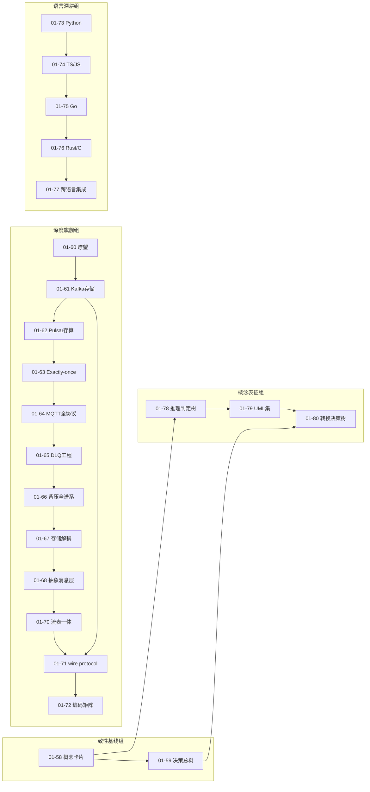

# 卷三：topics01 旗舰与表征层消化（01-58 ~ 01-80）

> 全量消化层卷三。逐篇四行卡：论点/证据/关联/易错。

## 本卷知识地图

## 逐篇消化卡

### 01-58 全局核心概念卡片总表
- **论点**：108 个核心概念以六元组（定义/属性/关系/示例/实例/反例）统一登记，是全库概念的唯一权威基线。
- **证据**：10 域分组，反例列为特色（国际文档罕见）；概念一致性核验的输入源【论证】。
- **关联**：01-02（导图是它的图版）/01-78（判定树是它的推理版）/knowledge-graph（机读版）。
- **易错**：新增概念不登记本表即造成多源定义漂移。

### 01-59 全局选型决策总树
- **论点**：全库选型的唯一入口——L0-L3 递归树（28 节点）+ 子树挂载规范。
- **证据**：14 项一致性核对表曾发现 4 项冲突并已对齐（01-19 等）【论证】。
- **关联**：01-03（图网版）/01-80（转换树在其 L1-L4 层前置）/02-56（契约治理决策）。
- **易错**：绕开总树在专章内另立选型结论=一致性破坏。

### 01-60 前沿瞭望：2026-11 技术扫描
- **论点**：六域前沿扫描备忘录（流处理/存储/AI/边缘/可观测/能耗）。
- **证据**：Pulsar 5.0 GA 2026-10-05 为 LTS（官方博客）；能耗 SCI 已 ISO/IEC 21031 认证【定理级来源】。
- **关联**：01-70（流表一体）/04-06（演化动力学素材）。
- **易错**：瞭望事实不回流专章即过期——季度复核触发器。

### 01-61 Kafka 存储与复制内幕
- **论点**：segment/复制协议/Leader Epoch/KRaft 元数据日志/分层存储的工程全貌。
- **证据**：KIP-101/279/405 状态均 Accepted；Kafka 4.4.0 2026-10-22 含 KIP-1191 DLQ（Confluence/官方博客）。
- **关联**：01-67（存储解耦是它的演进篇）/01-71（协议层）/03-68（重启行为档案）。
- **易错**：把 HW 当"已提交水位"——Leader Epoch 之前的截断语义才是正确模型。

### 01-62 Pulsar 存算分离架构深度解析
- **论点**：Broker 无状态化 + BookKeeper + Oxia 的三层架构内幕与读写路径全追踪。
- **证据**：Pulsar 5.0 官方推荐 Oxia 为新集群元数据存储（官方文档）；E≥WQ≥AQ【定理，BookKeeper 协议】。
- **关联**：01-29（S3 对照）/01-12（入门篇）/03-10（K8s 部署）。
- **易错**：把 bundle 裂分当自动均衡——它是手动/策略驱动的再平衡单元。

### 01-63 Exactly-once 语义全论证
- **论点**：交付语义的精确定义与六系统能力边界；EOS 是"系统+应用"联合责任。
- **证据**：KIP-98/129/447/890 全核实；Jepsen 2024-11 发现 Kafka 事务协议 unsound（KAFKA-17754）【定理级第三方证据】。
- **关联**：01-71（协议层落地）/TEST-C2（语义矩阵的论证源）/conformance-matrix。
- **易错**：宣称"配置 EOS=应用不重复处理"——消费侧幂等永远不可省。

### 01-64 MQTT-5.0 协议全解析
- **论点**：全协议级解析——报文/会话状态机/流控/Reason Code 43 项全表。
- **证据**：OASIS 2019-03-07 标准【定理】；EMQX 6.3.x/Mosquitto 2.1.2/HiveMQ 4.55 现状核实。
- **关联**：01-46（Sparkplug）/01-78（协议语义可判定化）/05-iot-telemetry 场景。
- **易错**：QoS2 与 Kafka acks=all 语义等价论——协议机制完全不同。

### 01-65 死信队列完整工程解析
- **论点**：DLQ 全生命周期工程——进入条件/三系统路径/重放/监控/成本。
- **证据**：RabbitMQ DLX 原生/NATS maxDeliver 耗尽转 DLQ/Pulsar DLQ policy/Kafka KIP-1191（4.4）【论证汇编】。
- **关联**：02-16（重试）/TEST-C2 死信格/04-通知与 08-任务场景。
- **易错**：对账差错走自动 DLQ——资金差错须人工通道（02-payment 场景的反面教材）。

### 01-66 背压机制全谱系
- **论点**：传输层/应用层/broker 内置/系统级四层背压全谱系 + 观测指标体系。
- **证据**：Reactive Streams 1.0.4【定理】；Flink 现代版基于 buffer 可用性（官方文档核实）。
- **关联**：04-07（控制回路）/01-73~76（各语言背压表达）。
- **易错**：把 Kafka producer 阻塞当故障——buffer.memory 满阻塞是设计行为。

### 01-67 存储解耦与队列化收敛
- **论点**：Kafka-on-S3 四路线对比 + share groups/streams 的队列化收敛。
- **证据**：Bufstream Jepsen 2024-11（3 safety+2 liveness，0.1.3 全修）；KIP-932 GA@4.2、KIP-1191@4.4【定理级】。
- **关联**：01-29/01-61/04-06（收敛对偶的实证）。
- **易错**：S3 权威路线的 acks=all 实际 durability 边界后移——须索取实现的 Jepsen 证据。

### 01-68 云原生抽象消息层评测
- **论点**：Dapr/Knative/Argo Events 十二维对照；抽象层的能力下沉损失量化。
- **证据**：Dapr 默认 at-least-once（官方文档）；Microcks-Dapr 官方协作（CNCF 博客 2026-05）。
- **关联**：01-40（传输层互补）/01-82（映射矩阵）。
- **易错**：核心链路（事务/EOS）走抽象层——能力裁剪不可逆。

### 01-70 流表一体与开放表格式收敛
- **论点**：Kafka→Iceberg 五种形态按数据份数排序；schema→表契约演化规则。
- **证据**：Tableflow GA 2025-03、Redpanda Iceberg Topics GA 25.1（官方）；Kafka 4.x 无原生集成（release notes 核实）【定理级】。
- **关联**：01-67/01-62（Pulsar offload）/03-66（基准）。
- **易错**：零拷贝视图的"表"无实体——账单在查询时 CPU 与 Kafka 读负载。

### 01-71 Kafka 线上协议深度解析
- **论点**：ApiVersions/RecordBatch v2/Produce-Fetch 全字段/事务协议报文级全解。
- **证据**：Kafka Protocol Guide 官方【定理】；KAFKA-17754 协议层解读（EndTxn 缺全局顺序）。
- **关联**：01-61/01-63/01-72（压缩字段）。
- **易错**：fetch.max.bytes 与 max.partition.fetch.bytes 的优先级混淆。

### 01-72 消息与数据编码对比矩阵
- **论点**：六系统大小限制实测参数 + 序列化全谱 + 压缩矩阵三合一。
- **证据**：Kafka message.max.bytes=1048588、RabbitMQ max_message_size 16MiB(4.0+)、NATS max_payload 1MiB（官方配置页）。
- **关联**：01-85（数据语言谱系）/01-73~76（语言落地）。
- **易错**：多层重复压缩；SSL 后压缩的顺序错误。

### 01-73 Python 消息客户端工程深耕
- **论点**：asyncio×消息语义的交互机制与生态选型。
- **证据**：aiokafka 0.15.0/confluent-kafka 2.16.1/paho 2.2.0（PyPI 核实）。
- **关联**：01-66（背压 Semaphore 表达）/01-77（金样本）。
- **易错**：poll 模型与事件循环混用导致心跳超时。

### 01-74 TypeScript-JavaScript 消息客户端工程深耕
- **论点**：事件循环×再平衡竞争；kafkajs 生态风险明示。
- **证据**：kafkajs v2.2.4 2023-02 后停滞（Issue #1603）；ioredis 降级 best-effort【论证】。
- **关联**：01-73（asyncio 对照表）/01-77。
- **易错**：再平衡回调中阻塞事件循环——会话超时雪崩。

### 01-75 Go 消息客户端工程深耕
- **论点**：goroutine/channel 与消息语义的天然适配及 cgo 边界成本。
- **证据**：segmentio/kafka-go v0.4.51；KIP-896 后新协议基线不合规风险（Confluent Cloud 文档）；sarama v1.61.1（IBM 接管后）。
- **关联**：01-76（Rust 所有权对照）。
- **易错**：再平衡回调里做重 IO—— coordinator 踢组。

### 01-76 系统编程语言消息客户端工程深耕
- **论点**：Rust 所有权模型×零拷贝消费；C 生态以 librdkafka 为轴。
- **证据**：rdkafka 0.25.0/async-nats 0.53.0/rumqttc 0.25.1（crates.io）；rumqttc 的 RUSTSEC 依赖告警【论证】。
- **关联**：01-75（Go 对照）。
- **易错**：rdkafka rebalance 回调 Send 约束违反——编译期不查运行时炸。

### 01-77 跨语言集成测试与 DSL 转换链
- **论点**：金样本对账法——5 语言 20 有向边全配对验证序列化对等。
- **证据**：漂移三源（精度/可选性/时间）；xlang-matrix.sh --validate 实测通过。
- **关联**：01-82（映射矩阵是它的输入源）/Testing/06 场景包。
- **易错**：JS Number 精度 2^53——int64 金额字段跨语言必踩。

### 01-78 概念推理判定树
- **论点**：从 01-58 抽取逻辑关系（蕴含/互斥/特化/组成）构建可执行概念判定树。
- **证据**：≥3 棵判定树（消息形态/可靠性/存储）；机读 YAML 供 knowledge-graph 引用。
- **关联**：01-59（判概念 vs 选系统的互补）/01-58。
- **易错**：把选型树当概念树用——层级与判据完全不同。

### 01-79 消息系统核心模式 UML 表示集
- **论点**：类图/组件图/时序图/状态图的 MQ 模式规范表达（PlantUML）。
- **证据**：发布订阅/再平衡/事务/DLQ/消息生命周期五组图；每图附读图要点【论证】。
- **关联**：01-80（转换树产物之一的图示）。
- **易错**：时序图画成流程图——生命线与消息箭头语义被稀释。

### 01-80 场景领域转换决策树
- **论点**：领域→场景→模式→契约→实现五级转换的逐级判定树。
- **证据**：与 01-59 在 L3 层合流；调用链图示；每级输出产物明确。
- **关联**：01-45/01-46（领域端）/Testing/06-03-业务场景（契约端）。
- **易错**：跳级转换（领域直达实现）——契约层缺失导致验证无输入。

## 卷尾速查表

| 编号 | 标题 | 一句话论点 |
| ---- | ---- | ---- |
| 01-58 | 概念卡片总表 | 108 概念六元组唯一基线 |
| 01-59 | 全局选型决策总树 | 选型唯一入口 L0-L3 |
| 01-60 | 前沿瞭望 | 六域扫描季度复核触发器 |
| 01-61 | Kafka 存储复制内幕 | 存储/复制/分层工程全貌 |
| 01-62 | Pulsar 存算分离 | 三层架构与读写路径 |
| 01-63 | Exactly-once 全论证 | EOS 是系统+应用联合责任 |
| 01-64 | MQTT-5.0 全协议 | 协议级语义全集 |
| 01-65 | 死信队列工程 | DLQ 全生命周期 |
| 01-66 | 背压全谱系 | 四层背压+观测 |
| 01-67 | 存储解耦与队列化 | Kafka-on-S3 四路线 |
| 01-68 | 抽象消息层 | Dapr/Knative/Argo 对照 |
| 01-70 | 流表一体 | 五种 Kafka→Iceberg 形态 |
| 01-71 | Kafka wire protocol | 协议报文级全解 |
| 01-72 | 编码对比矩阵 | 大小/序列化/压缩三合一 |
| 01-73 | Python 深耕 | asyncio×消息语义 |
| 01-74 | TS/JS 深耕 | 事件循环×再平衡 |
| 01-75 | Go 深耕 | goroutine×背压 |
| 01-76 | Rust/C 深耕 | 所有权×零拷贝 |
| 01-77 | 跨语言集成测试 | 金样本 20 边对账 |
| 01-78 | 概念推理判定树 | 概念逻辑关系可执行化 |
| 01-79 | UML 表示集 | 五类图规范表达 |
| 01-80 | 转换决策树 | 领域→实现五级转换 |

---

**最后更新**: 2026-11-18
