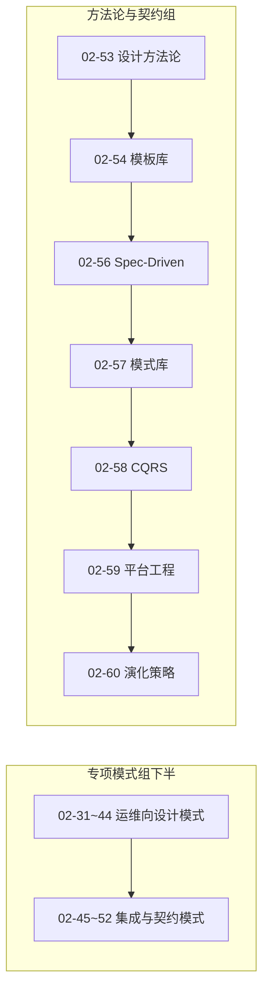

# 卷五：topics02 模式与契约篇消化（02-31 ~ 02-60）

> 全量消化层卷五。上接卷四（02-01~30），覆盖 02 系后 30 篇。

## 本卷知识地图

## 逐篇消化卡

### 02-31~33 观测向设计组

- **论点**：可观测/追踪/审计三篇的设计原理面——指标/链路与合规日志的设计决策。
- **证据**：01-33 能力体系的下钻；审计链与 07-audit-trail 场景衔接【论证】。
- **关联**：03-63 落地/02-50 合规。
- **易错**：观测设计事后补——埋点策略是设计期决策。

### 02-34 桥接与互操作设计

- **论点**：系统间桥接（Kafka↔MQTT 等）的语义保真设计。
- **证据**：TC-INT-02 bridge-test 用例对应【论证】。
- **关联**：02-08 混合架构/06-行为验证。
- **易错**：桥接当透明管道——QoS/顺序语义在桥接处必然重协商。

### 02-35~39 弹性与治理组

- **论点**：容错/隔离/限流/熔断/降级五篇的弹性设计原理。
- **证据**：04-03 故障传播方程的设计侧输入【论证】。
- **关联**：04-04 混沌验证/TC-CHA 用例。
- **易错**：弹性组件无演练——未注入故障的熔断是摆设。

### 02-40 消息性能调优设计

- **论点**：分层调优方法论（应用/broker/系统）。
- **证据**：02-09 案例的设计化抽象【论证】。
- **关联**：03-29 调优手册（02↔03 对应）。
- **易错**：跨层调优串扰——压缩参数改动的 CPU/带宽两面。

### 02-41 消息容量规划设计

- **论点**：容量估算的形式化方法（吞吐×保留×副本）。
- **证据**：估算公式与【估算】标注纪律【论证】。
- **关联**：03-65 成本归集/01-29 成本三角。
- **易错**：按峰值采购——基线+峰值双模型才经济。

### 02-43 Schema 注册与治理设计

- **论点**：注册中心的组织级治理设计。
- **证据**：Confluent/Apicurio 双实现对照【论证】。
- **关联**：01-85 谱系/02-60 兼容策略。
- **易错**：注册中心当存储——它是治理点不是备份。

### 02-44 多租户消息设计

- **论点**：租户隔离的三档（逻辑/命名空间/集群）。
- **证据**：Pulsar namespace 隔离 vs Kafka ACL【论证】。
- **关联**：01-62/01-34。
- **易错**：逻辑隔离的 noisy neighbor——配额机制必须配套。

### 02-45 请求响应模式设计

- **论点**：消息上的 RPC（reply-to/correlation-id）。
- **证据**：MQTT5 Response Topic 协议级支持【定理级】。
- **关联**：01-64/02-46 异步化边界。
- **易错**：全链路消息 RPC——超时与幂等复杂度倍增。

### 02-46 异步化改造设计

- **论点**：同步系统的渐进异步化路径。
- **证据**： strangler 模式的消息化变体【论证】。
- **关联**：02-45/02-47。
- **易错**：大爆炸式改造——双写过渡期的数据一致性。

### 02-47 企业集成模式落地

- **论点**：01-38 EIP 目录的工程落地深化。
- **证据**：Saga/outbox 的可执行设计【论证】。
- **关联**：02-21/06-cdc-sync。
- **易错**：模式目录当菜单——模式间有依赖顺序。

### 02-48 契约设计工作流

- **论点**：design-first 六步工作流（事件风暴→评审→治理）。
- **证据**：02-56 体系的流程面【论证】。
- **关联**：01-43/Testing/06 场景包（产物落点）。
- **易错**：契约评审无门禁——Spectral 自动化是底线。

### 02-49 事件溯源设计

- **论点**：事件溯源与消息系统的适配设计。
- **证据**：事件存储与 broker 的分工【论证】。
- **关联**：02-58 CQRS/07-audit-trail。
- **易错**：broker 当事件存储——保留期与查询能力都不满足。

### 02-50 消息数据合规设计

- **论点**：PII 最小化/加密/删除权的消息侧折衷。
- **证据**：不可变日志 vs GDPR 删除权——加密擦除方案【论证】。
- **关联**：02-29/SEC 域/07-audit-trail 关闭去重的合规依据。
- **易错**：明文 PII 进 broker——下游复制放大违规面。

### 02-51 多活消息架构设计

- **论点**：环回/冲突/单元化四模式的多活设计。
- **证据**：NATS supercluster 与 Kafka MM2 对照【论证】。
- **关联**：03-64 跨地域/02-14 拓扑。
- **易错**：多活无冲突域划分——双写冲突无解。

### 02-52 消息数据血缘设计

- **论点**：三档精度的血缘捕获设计。
- **证据**：OpenLineage 接口【论证】。
- **关联**：06-cdc-sync/03-65。
- **易错**：人工维护血缘——静态文档三月即腐化。

### 02-53 设计方法论

- **论点**：Event Storming→契约的完整转化方法论。
- **证据**：01-43 的场景设计面【论证】。
- **关联**：01-80 转换树的设计层。
- **易错**：方法论无产物模板——停留在工作坊热情。

### 02-54 事件契约模板库与命名规范

- **论点**：契约字段/命名/版本的统一规范。
- **证据**：模板与 lint 规则【论证】。
- **关联**：02-57/01-84 模式全集的命名源。
- **易错**：命名规范事后统一——改名即破坏。

### 02-56 Spec-Driven 契约驱动开发体系

- **论点**：契约三范式与治理门禁体系。
- **证据**：ODCS 对齐（批次 79）【论证】。
- **关联**：governance-tools/01-37。
- **易错**：spec-first 无强制门禁——口号化。

### 02-57 IT 通用场景事件契约模式库

- **论点**：六大通用场景契约（命令/CDC/告警/审计/任务/Webhook）。
- **证据**：Debezium envelope 字段核实【论证】。
- **关联**：01-84 模式全集的场景化/Testing/06 场景包复用其 envelope。
- **易错**：模式库字段照抄——租户字段必须按域裁剪。

### 02-58 CQRS 与事件溯源落地设计

- **论点**：CQRS 读写分离与投影设计的消息侧。
- **证据**：投影重建的流消费设计【论证】。
- **关联**：02-49/01-54 物化视图。
- **易错**：投影无重放设计——事件 schema 演进即死。

### 02-59 消息平台工程与内部开发者门户

- **论点**：Golden Path 与自助服务的平台化。
- **证据**：Backstage/EventCatalog 集成【论证】。
- **关联**：governance-tools/EventCatalog 目录化。
- **易错**：平台无等级模型——全自助等于无治理。

### 02-60 消息设计与演化策略

- **论点**：兼容性矩阵与演化模式目录（批次 96）。
- **证据**：六种变更分类与五模式【论证】。
- **关联**：01-85/02-26/治理门禁链。
- **易错**：并行双写窗口无 deadline——双写永久化。

## 卷尾速查表（02-31~60 共 30 篇，卡片首行即索引，此处略）

---

**最后更新**: 2026-11-18
