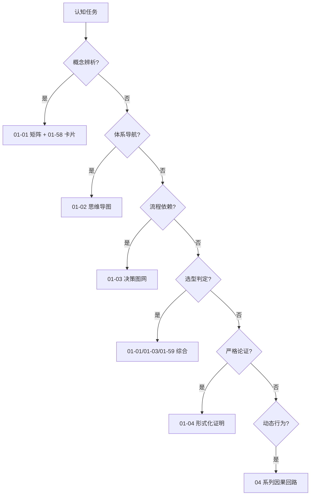

# 1.2 思维导图架构设计

> **置信口径**: 协议/规范语义=【定理】（官方规范保证）；架构对比与工程推理=【论证】；正文未单独标注的具体数字按【估算】理解（AGENTS.md §4.1，P3 基线声明）。

## 目录

- [1.2 思维导图架构设计](#12-思维导图架构设计)
  - [目录](#目录)
  - [1.2.1 全库架构思维导图](#121-全库架构思维导图)
  - [1.2.2 核心域导航说明](#122-核心域导航说明)
  - [1.2.3 思维表征选型指南](#123-思维表征选型指南)
  - [1.2.4 架构设计原则](#124-架构设计原则)
    - [Kafka设计原则](#kafka设计原则)
    - [MQTT设计原则](#mqtt设计原则)
    - [NATS设计原则](#nats设计原则)
  - [1.2.5 KRaft模式架构说明](#125-kraft模式架构说明)
    - [Kafka KRaft模式（推荐）](#kafka-kraft模式推荐)
    - [传统ZooKeeper模式（已弃用）](#传统zookeeper模式已弃用)
  - [1.2.6 架构设计参考资源](#126-架构设计参考资源)
    - [Kafka架构参考](#kafka架构参考)
    - [MQTT架构参考](#mqtt架构参考)
    - [NATS架构参考](#nats架构参考)

---

## 1.2.1 全库架构思维导图

```mermaid
mindmap
  root((消息队列全面分析论证知识库))
    01 基础概念与对比分析
      概念矩阵与速查
        01-01 多维度概念矩阵对比
        01-19 选型决策矩阵
        01-20 技术选型速查表
        01-21 快速参考卡片
        01-23 术语词汇表
        01-24 学习路径指南
      六大系统专章
        01-05 程序设计模式分析
        01-06 架构设计深度分析
        01-09 异常处理与容错机制
        01-12 Pulsar 深度分析
        01-13 Kafka KRaft 模式分析
        01-14 安全性分析
        01-15 RabbitMQ 深度分析
        01-16 MQTT 5.0 新特性
        01-17 Redis Stream 分析
      前沿专章 01-25~57
        系统演进
          01-25 Kafka 4.0 与队列语义
          01-26 NATS 2.x 与 JetStream 演进
          01-27 RocketMQ 5.x
          01-28 Redpanda
          01-29 S3 解耦存储消息系统
        事件标准与互操作
          01-30 事件互操作标准
          01-32 AsyncAPI 工程生态
          01-37 AsyncAPI 组织级应用与治理
          01-38 企业集成模式全目录
          01-39 云消息模式与微服务消息模式
          01-40 应用层流协议与交互标准
          01-41 工作流编排系统与消息协同
          01-42 JMS-AMQP 与传统企业消息标准
        数据集成与流处理
          01-31 数据集成与流处理生态
          01-53 流处理引擎深度对比
          01-54 流数据库与实时物化视图
        DSL 与契约体系
          01-43 设计到 DSL 的转换方法论
          01-44 DSL 表达力边界与等价转换
          01-45 产业领域消息标准
          01-46 IoT 与互联网领域消息标准
          01-55 数据契约与数据产品化
        AI 与智能运维
          01-33 可观测性与自治运维能力体系
          01-35 MQ 与 AI Agent 基础设施
          01-36 事件驱动 RAG 与流式管道
          01-56 AIOps 消息系统智能运维
          01-57 AI Agent 消息队列深化
        安全与联邦
          01-34 许可证与选型合规
          01-47 事件溯源核心机制与存储选型
          01-48 Serverless 事件架构
          01-49 消息系统零信任安全体系
          01-50 OpenTelemetry 消息语义
          01-51 多云与边缘消息联邦
          01-52 多语言客户端生态
    02 场景驱动架构设计
      场景化矩阵与案例
        02-01 场景化功能架构矩阵
        02-02 多场景架构决策图网
        02-05~09 生产/混合/性能/异常案例
      消息专项设计模式 02-12~46
        路由 顺序 去重 压缩 重试 死信
        过滤 优先级 批处理 事务 流控 追踪
        延迟 幂等 序列化 分区 存储 监控
        安全 路由与负载均衡 聚合拆分 转换适配
        桥接集成 版本兼容 缓存 限流 降级
        监控告警 性能调优 容量规划 灾难恢复
        测试 成本优化 自动化运维 数据治理
      契约 DSL 与平台工程
        02-47 企业集成模式与事务消息模式
        02-48 契约设计工作流与事件 API 治理
        02-49 自动伸缩与自愈架构设计
        02-50 消息数据合规设计
        02-51 多活消息架构设计
        02-52 消息数据血缘与影响分析设计
        02-53 事件驱动设计方法论与工作坊
        02-54 事件契约模板库与命名规范
        02-56 Spec-Driven 契约驱动开发体系
        02-57 IT 通用场景事件契约模式库
        02-58 CQRS 与事件溯源落地设计
    03 架构与运维实践
      运维总览
        03-01 部署架构模式矩阵
        03-02 成本模型与监控告警
        03-03 故障场景与恢复策略
        03-04 场景化架构与运维决策框架
      通用指南 03-10~38
        03-10 Kubernetes 部署实践
        03-11 故障排查手册
        03-12 云服务消息队列对比
        03-15 迁移指南
        03-16 安全加固指南
        03-17 基准测试报告模板
        03-18 成本优化指南
        03-19 故障恢复演练
        03-20 容量规划指南
        03-21 灾难恢复计划
        03-22 性能测试指南
        03-23 故障预防指南
        03-27 版本升级指南
        03-30 自动化运维指南
        03-32 安全审计指南
        03-33 合规性指南
        03-34 数据治理指南
      专项模式落地 03-39~62
        03-39 消息追踪与监控指南
        03-40 消息延迟与调度指南
        03-41 消息幂等性保障指南
        03-42 消息序列化与版本管理指南
        03-43 消息分区与负载均衡指南
        03-44 消息存储与备份恢复指南
        03-45 消息监控与可观测性指南
        03-46 消息安全与合规指南
        03-47~03-58 路由/聚合/转换/桥接/缓存/限流/降级等
        03-59 消息测试实践指南
        03-60 消息成本优化实践指南
        03-61 消息自动化运维实践指南
        03-62 消息数据治理实践指南
      前沿运维专题
        03-63 可观测与自治运维实践指南
        03-64 跨地域消息运维实践指南
        03-65 MQ 成本归集实践指南
    04 动态系统论与演化分析
      04-01 系统动力学视角
      04-02 时间维度演化分析
      04-03 负载动态响应与故障传播
      04-04 混沌工程与系统韧性
      04-05 动态系统总结与选型决策
    Testing 测试验证体系
      00-规范与计划
      01-部署用例
      02-集成用例
      03-集群用例
      04-可观测用例
      05-体系与机制
    AI_Skills 技能体系
      AI_SKILL-01 国际 Agent Skills 标准与生态对齐
      AI_SKILL-02 项目主题技能图谱
      AI_SKILL-03 技能制作规范
      AI_SKILL-04 技能模板与模型
      AI_SKILL-05 用例与用法说明
      skills/ 7 个 Agent Skills
    资产层
      config-templates 58 个生产配置模板
      examples 52 个多语言代码示例
      scripts 108 个运维脚本
```



## 1.2.2 核心域导航说明

全库按"概念→设计→运维→动态演化"四层组织，配合 Testing、AI_Skills 与资产层形成闭环：

1. **概念层（01）**：先读 [01-01 多维度概念矩阵对比](./01-01-多维度概念矩阵对比.md) 建立术语对齐，再按关注域选择专章。系统演进类（01-25~29）适合评估新系统；事件标准类（01-30~42）适合互操作与治理设计；DSL/契约类（01-43~46、01-55）适合事件 API 治理；AI/运维类（01-33、01-35、01-36、01-56、01-57）适合智能化与可观测设计；安全/联邦类（01-47~52）适合边界安全与跨云设计。
2. **设计层（02）**：02-01/02-02 给出场景化总览；02-12~46 是消息专项设计模式，与 03-39~62 一一对应；02-47~58 覆盖契约 DSL、平台工程、事件溯源/CQRS 等前沿设计主题。
3. **运维层（03）**：03-01~04 为运维总览；03-10~38 为通用指南；03-39~62 为 02-12~46 的落地对照；03-63~65 为自治运维、跨地域、成本归集等前沿专题。
4. **动态演化层（04）**：用因果回路图与系统动力学模型解释负载、故障、演化的动态行为，与 01、02、03 的静态结论形成互补。
5. **Testing 与 AI_Skills**：测试体系提供部署/集成/集群/可观测/体系机制五类用例；AI_Skills 提供 5 篇规范与 7 个 Agent Skill，用于自动化辅助分析。从 topics 引用时使用相对路径 [Testing 测试验证体系](../../Testing/README.md) 与 [AI_Skills 技能体系](../../AI_Skills/README.md)。
6. **资产层**：`config-templates/` 提供可直接引用的生产参数，`examples/` 提供多语言客户端示例，`scripts/` 提供运维脚本，三者在 03 系列与 Testing 中被反复引用。

**01 系列前沿专章域聚类**:

| 域 | 代表文档 | 典型问题 |
| --- | --- | --- |
| 系统演进 | 01-25~29 | 新系统选型、版本升级影响 |
| 事件标准与互操作 | 01-30、01-32、01-37~42 | 协议映射、事件 API 治理 |
| 数据集成与流处理 | 01-31、01-53~54 | 流引擎/流库选型、实时物化视图 |
| DSL 与契约体系 | 01-43~46、01-55 | Schema 治理、数据契约产品化 |
| AI 与智能运维 | 01-33、01-35~36、01-56~57 | AIOps 分级、Agent 消息模式 |
| 安全与联邦 | 01-34、01-47~52 | 零信任、事件溯源、跨云联邦 |

**阅读路径示例**:

```text
场景：需要为多云 IoT 平台选消息系统
路径：
  01-01 概念矩阵 → 建立 Kafka/MQTT/NATS 等维度认知
  01-16 MQTT 5.0 → 确认 IoT 协议选择
  01-51 多云与边缘消息联邦 → 确认联邦拓扑
  01-49 零信任安全体系 → 确认安全层设计
  02-02 多场景架构决策图网 → 综合方案设计
  03-10 Kubernetes 部署实践 → 落地部署
  ../../Testing/01-部署用例 → 验证部署正确性
```

## 1.2.3 思维表征选型指南

知识库提供六种思维表征，分别对应不同认知任务。下表给出首选（✓）与辅助（○）关系：

| 认知任务 | 概念矩阵 01-01 | 思维导图 01-02 | 决策图网 01-03 | 形式化证明 01-04 | 因果回路 04 系列 | 速查卡片/决策树 01-58/59 |
| --- | --- | --- | --- | --- | --- | --- |
| 概念辨析 | ✓ | ○ | ○ | — | — | ✓ |
| 体系导航 | ○ | ✓ | ○ | — | — | ○ |
| 流程依赖 | — | ○ | ✓ | ○ | — | — |
| 选型判定 | ✓ | ○ | ✓ | — | — | ✓ |
| 严格论证 | — | — | ○ | ✓ | — | — |
| 动态行为 | — | — | ○ | — | ✓ | — |

使用说明：

- **概念辨析**首选 [01-01 多维度概念矩阵对比](./01-01-多维度概念矩阵对比.md) 进行正交维度对比，配合 [01-58 全局核心概念卡片总表](./01-58-全局核心概念卡片总表.md) 快速查阅术语边界。
- **体系导航**首选本文 1.2.1 全库思维导图，自上而下定位文档；需要跨域关联时，再用 01-01 矩阵做横向对比。
- **流程依赖**（如"消息从生产到消费的完整链路、失败重试链路"）首选 [01-03 决策图网分析](./01-03-决策图网分析.md)，其决策节点与有向边天然表达依赖关系。
- **选型判定**需要综合 01-01 矩阵的维度评分、01-03 图网的判定路径，以及 [01-59 全局选型决策总树](./01-59-全局选型决策总树.md) 的快速分支；三者结合可减少遗漏关键约束。
- **严格论证**（如" exactly-once 语义成立条件"）使用 [01-04 形式化证明框架](./01-04-形式化证明框架.md)，引用 TLA+/Jepsen 等真实形式化资产。
- **动态行为**（如"背压-延迟-吞吐量的反馈回路"）使用 04 系列因果回路图，避免静态结论忽视演化效应。

**表征选型流程**:



**02/03 设计-运维对应示例**:

| 设计主题 | 02 设计文档 | 03 落地文档 | 资产 |
| --- | --- | --- | --- |
| 消息追踪 | 02-23 消息追踪设计 | 03-39 消息追踪与监控指南 | `scripts/otel-trace.sh` |
| 消息延迟 | 02-24 消息延迟设计 | 03-40 消息延迟与调度指南 | `config-templates/kafka-delayed.properties` |
| 消息幂等 | 02-25 消息幂等性设计 | 03-41 消息幂等性保障指南 | `examples/java-idempotent-producer/` |
| 消息分区 | 02-27 消息分区设计 | 03-43 消息分区与负载均衡指南 | `config-templates/kafka-partitioning.json` |
| 消息存储 | 02-28 消息存储设计 | 03-44 消息存储与备份恢复指南 | `scripts/backup-kafka-topics.sh` |

## 1.2.4 架构设计原则

### Kafka设计原则

1. **日志即消息**：将消息视为追加日志，实现顺序写优化
2. **分区并行**：通过Partition实现水平扩展，吞吐量与分区数线性相关
3. **拉模式消费**：Consumer主动拉取，控制消费速率，避免过载
4. **零拷贝传输**：利用sendfile系统调用，减少数据拷贝

### MQTT设计原则

1. **主题命名空间**：层次化主题支持灵活订阅
2. **QoS分级**：提供不同可靠性保证，适应网络环境
3. **会话持久化**：支持断线重连后的消息恢复
4. **轻量头部**：固定头仅2字节，适合IoT低带宽

### NATS设计原则

1. **简单性优先**：文本协议易于调试，单一二进制部署
2. **无中心化**：所有节点对等，无主从之分，自愈集群
3. **双重模式**：Core模式极致性能，JetStream模式提供持久化
4. **多租户隔离**：Accounts和Streams实现资源隔离

## 1.2.5 KRaft模式架构说明

### Kafka KRaft模式（推荐）

**Kafka 3.3+引入KRaft模式，替代ZooKeeper依赖**：

```text
Kafka KRaft模式架构
├── Controller Quorum（3-5节点）
│   ├── Raft共识算法
│   ├── 元数据管理
│   └── 无外部依赖
├── Broker节点
│   ├── 数据存储
│   └── 消息路由
└── 优势
    ├── 性能提升（延迟降低50%+）
    ├── 运维简化（单一系统）
    └── 扩展性提升（支持百万级分区）
```

**详细分析**：参见 [01-13-Kafka-KRaft模式分析](./01-13-Kafka-KRaft模式分析.md)

### 传统ZooKeeper模式（已弃用）

**Kafka 3.5+完全移除ZooKeeper支持**，仅支持KRaft模式。

**注意**：新项目应直接使用KRaft模式，现有项目建议逐步迁移。

## 1.2.6 架构设计参考资源

### Kafka架构参考

- **官方文档**: [Kafka Architecture](https://kafka.apache.org/documentation/#design)
- **设计理念**: [The Log: What every software engineer should know](https://kafka.apache.org/documentation/#intro_concepts_and_terms)
- **存储设计**: [Kafka Storage](https://kafka.apache.org/documentation/#storage)
- **副本机制**: [Kafka Replication](https://kafka.apache.org/documentation/#replication)

### MQTT架构参考

- **OASIS标准**: [MQTT 5.0 Specification](https://docs.oasis-open.org/mqtt/mqtt/v5.0/mqtt-v5.0.html)
- **协议设计**: [MQTT Protocol](https://docs.oasis-open.org/mqtt/mqtt/v5.0/mqtt-v5.0.html#_Toc3901024)
- **QoS机制**: [MQTT QoS Levels](https://docs.oasis-open.org/mqtt/mqtt/v5.0/mqtt-v5.0.html#_Toc3901233)
- **主题设计**: [MQTT Topics](https://docs.oasis-open.org/mqtt/mqtt/v5.0/mqtt-v5.0.html#_Toc3901103)

### NATS架构参考

- **官方文档**: [NATS Architecture](https://docs.nats.io/nats-concepts/architecture)
- **集群设计**: [NATS Clustering](https://docs.nats.io/nats-concepts/clustering)
- **JetStream**: [JetStream Architecture](https://docs.nats.io/nats-concepts/jetstream)
- **CNCF资源**: [NATS in CNCF](https://landscape.cncf.io/)

---

**参考来源**:

- 基于concept01.md内容整理
- Apache Kafka官方设计文档和LinkedIn工程博客
- OASIS MQTT标准规范
- NATS CNCF官方文档
- 项目目录结构（AGENTS.md §2）

---

**最后更新**: 2026-11-18
