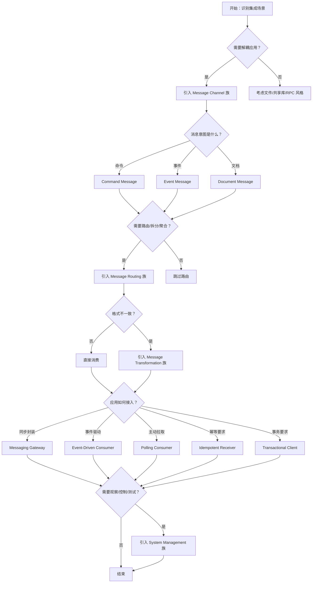

# 1.38 企业集成模式全目录与系统映射

> **置信口径**: 协议/规范语义=【定理】（官方规范保证）；架构对比与工程推理=【论证】；正文未单独标注的具体数字按【估算】理解（AGENTS.md §4.1，P3 基线声明）。
> **时效声明**: EIP 目录以 [enterpriseintegrationpatterns.com](https://www.enterpriseintegrationpatterns.com/patterns/messaging/) 为准，核实至 2026-11。当前目录共 65 个 messaging patterns，分 6 个模式族。
> **本文档定位**: 概念矩阵与模式速查。给出 EIP 完整目录与六消息系统的映射索引，帮助读者把“模式语言”翻译成“系统能力”。各模式的深度论证与选型见 [2.47 企业集成模式与事务消息模式](../02-场景驱动架构设计/02-47-企业集成模式与事务消息模式.md)；落地操作与检查清单见 03 系列对应篇（如 03-41/03-47/03-48/03-49/03-54 等）。

## 目录

- [1.38 企业集成模式全目录与系统映射](#138-企业集成模式全目录与系统映射)
  - [目录](#目录)
  - [1.38.1 EIP 方法论与目录结构](#1381-eip-方法论与目录结构)
  - [1.38.2 六大模式族速查](#1382-六大模式族速查)
    - [Message Channel 族](#message-channel-族)
    - [Message Construction 族](#message-construction-族)
    - [Message Routing 族](#message-routing-族)
    - [Message Transformation 族](#message-transformation-族)
    - [Messaging Endpoints 族](#messaging-endpoints-族)
    - [System Management 族](#system-management-族)
  - [1.38.3 六系统映射总表](#1383-六系统映射总表)
  - [1.38.4 与云模式目录的衔接](#1384-与云模式目录的衔接)
  - [1.38.5 模式族选型决策树](#1385-模式族选型决策树)
  - [1.38.6 参考来源](#1386-参考来源)

---

## 1.38.1 EIP 方法论与目录结构

【论证】Enterprise Integration Patterns（EIP）由 Gregor Hohpe 与 Bobby Woolf 在 2003 年提出，是企业应用集成领域的事实标准模式语言。其官方网站将 65 个 messaging patterns 组织为 6 个模式族，为 Kafka、RabbitMQ、NATS、Pulsar、Redis Stream、MQTT 等现代消息系统提供了独立于厂商的设计词汇。

EIP 的核心价值有三点：

1. **统一术语**：同一方案在不同系统中的名称不同，EIP 提供跨产品通用名（如 Dead Letter Channel、Content-Based Router）。
2. **设计指导**：每个模式描述问题、方案与 trade-off，帮助架构师在消息系统之上做组合设计。
3. **可迁移性**：当业务从 RabbitMQ 迁往 Kafka 或 NATS 时，EIP 词汇可保留，仅替换具体实现。

目录结构如下（按官网 2026-11 版本）：

```text
Integration Styles
├── File Transfer
├── Shared Database
├── Remote Procedure Invocation
└── Messaging                 ← 本文档聚焦 Messaging 风格
    ├── Messaging Systems     ← 基础：Message、Message Channel、Router、Translator、Endpoint
    ├── Message Channel       ← 12 patterns
    ├── Message Construction  ← 9 patterns
    ├── Message Routing       ← 14 patterns
    ├── Message Transformation← 8 patterns
    ├── Messaging Endpoints   ← 14 patterns
    └── System Management     ← 8 patterns
    合计：65 messaging patterns
```

> 说明：不同资料对“Integration Styles”是否计入 messaging patterns 有不同口径；本文采用官网口径，将 65 个 patterns 限定为 Messaging 风格下的 6 个模式族，不含 Integration Styles 的 4 种集成风格本身。

---

## 1.38.2 六大模式族速查

以下每族给出：模式名、一句话定义、本项目对应文档或系统机制。映射以“能直接在本项目中找到深度论证/运维实践”优先，无法直接对应的项目文档时给出典型系统实现。

### Message Channel 族

【论证】Channel 族回答“消息在哪里流动”，是消息系统最原子的抽象。EIP 官网共列出 12 个模式。

| EIP 模式 | 一句话定义 | 本项目对应文档/系统机制 |
| --- | --- | --- |
| Point-to-Point Channel | 每条消息只被单一消费者处理 | [2.12 消息路由策略](../02-场景驱动架构设计/02-12-消息路由策略.md)、Kafka 队列语义（KIP-932 Share Groups） |
| Publish-Subscribe Channel | 每条消息广播给所有订阅者 | [2.12 消息路由策略](../02-场景驱动架构设计/02-12-消息路由策略.md)、MQTT topic / Kafka Consumer Group |
| Datatype Channel | 同一数据类型使用专用通道，避免解析错误 | [2.26 消息序列化设计](../02-场景驱动架构设计/02-26-消息序列化设计.md)、Schema Registry |
| Invalid Message Channel | 格式非法的消息进入专门通道处理 | [2.18 消息过滤策略](../02-场景驱动架构设计/02-18-消息过滤策略.md)、[3-49 消息转换与适配实践指南](../03-架构与运维实践/03-49-消息转换与适配实践指南.md) |
| Dead Letter Channel | 处理失败/无法路由的消息进入死信通道 | [2.17 死信队列设计](../02-场景驱动架构设计/02-17-死信队列设计.md)、03 系列 DLQ 运维 |
| Guaranteed Delivery | 消息在消费者确认前持久保存，不丢消息 | [2.11 数据一致性保障](../02-场景驱动架构设计/02-11-数据一致性保障.md)、Kafka acks=all / NATS JetStream |
| Messaging Bridge | 连接两个异构消息系统 | [2.34 消息桥接与集成设计](../02-场景驱动架构设计/02-34-消息桥接与集成设计.md)、[3-50 消息桥接与集成实践指南](../03-架构与运维实践/03-50-消息桥接与集成实践指南.md) |
| Message Bus | 多个应用共享一组标准消息通道 | [2.34 消息桥接与集成设计](../02-场景驱动架构设计/02-34-消息桥接与集成设计.md)、事件总线架构 |
| Channel Adapter | 将应用 API 接入消息通道 | 各系统 Producer/Consumer SDK、Camel/NiFi 连接器 |
| Message Channel | 消息在端点之间传输的管道 | [2.10 高可用架构设计](../02-场景驱动架构设计/02-10-高可用架构设计.md)、[2.30 消息安全设计](../02-场景驱动架构设计/02-30-消息安全设计.md) |
| Return Address | 消息携带回复地址，便于异步回传 | MQTT 5.0 Response Topic、NATS request-reply Inbox |
| Correlation Identifier | 将请求与回复关联 | [2.23 消息追踪设计](../02-场景驱动架构设计/02-23-消息追踪设计.md)、OpenTelemetry trace-id |

### Message Construction 族

【论证】Construction 族回答“消息里放什么、如何标识意图与关系”，共 9 个模式。

| EIP 模式 | 一句话定义 | 本项目对应文档/系统机制 |
| --- | --- | --- |
| Command Message | 消息表达“请做某事”的请求 | [2.47 企业集成模式与事务消息模式](../02-场景驱动架构设计/02-47-企业集成模式与事务消息模式.md) Saga 编排命令 |
| Event Message | 消息表达“某事已发生”的通知 | [2.48 契约设计工作流与事件 API 治理](../02-场景驱动架构设计/02-48-契约设计工作流与事件API治理.md)、CloudEvents |
| Document Message | 消息仅传递数据文档，不触发行为 | [2.33 消息转换与适配设计](../02-场景驱动架构设计/02-33-消息转换与适配设计.md) |
| Request-Reply | 异步请求-响应模式 | MQTT 5.0 Request/Response、NATS request-reply |
| Return Address | 回复应发往的地址 | 见 Channel 族 |
| Correlation Identifier | 关联请求与响应 | 见 Channel 族 |
| Message Sequence | 一组相关消息按序号拆分传输 | [2.32 消息聚合与拆分设计](../02-场景驱动架构设计/02-32-消息聚合与拆分设计.md) |
| Message Expiration | 消息超过有效期后不再处理 | [2.24 消息延迟设计](../02-场景驱动架构设计/02-24-消息延迟设计.md)、MQTT 5.0 Message Expiry |
| Format Indicator | 消息体格式版本或内容类型标识 | [2.35 消息版本兼容设计](../02-场景驱动架构设计/02-35-消息版本兼容设计.md)、Content-Type 头 |

### Message Routing 族

【论证】Routing 族回答“消息该发给谁”，是 EIP 中数量最多的族，共 14 个模式。

| EIP 模式 | 一句话定义 | 本项目对应文档/系统机制 |
| --- | --- | --- |
| Content-Based Router | 按消息内容决定目标通道 | [2.18 消息过滤策略](../02-场景驱动架构设计/02-18-消息过滤策略.md)、[2.31 消息路由与负载均衡设计](../02-场景驱动架构设计/02-31-消息路由与负载均衡设计.md) |
| Message Filter | 丢弃不符合条件的消息 | [2.18 消息过滤策略](../02-场景驱动架构设计/02-18-消息过滤策略.md)、Kafka Stream filter / RabbitMQ header exchange |
| Dynamic Router | 运行时根据规则表决定路由 | [2.31 消息路由与负载均衡设计](../02-场景驱动架构设计/02-31-消息路由与负载均衡设计.md) |
| Recipient List | 一条消息发给多个动态指定的接收者 | [2.31 消息路由与负载均衡设计](../02-场景驱动架构设计/02-31-消息路由与负载均衡设计.md) |
| Splitter | 将一条消息拆分为多条子消息 | [2.32 消息聚合与拆分设计](../02-场景驱动架构设计/02-32-消息聚合与拆分设计.md)、[3-48 消息聚合与拆分实践指南](../03-架构与运维实践/03-48-消息聚合与拆分实践指南.md) |
| Aggregator | 将多条相关消息聚合成一条 | [2.32 消息聚合与拆分设计](../02-场景驱动架构设计/02-32-消息聚合与拆分设计.md)、Kafka Streams aggregate |
| Resequencer | 乱序到达的消息按原序重新排列 | [2.13 消息顺序保证](../02-场景驱动架构设计/02-13-消息顺序保证.md)、Kafka 分区单消费者 |
| Composed Message Processor | 拆分-处理-聚合的组合模式 | [2.32 消息聚合与拆分设计](../02-场景驱动架构设计/02-32-消息聚合与拆分设计.md) |
| Scatter-Gather | 广播请求并收集所有回复 | [2.31 消息路由与负载均衡设计](../02-场景驱动架构设计/02-31-消息路由与负载均衡设计.md) |
| Routing Slip | 消息附带下一步路由清单，逐站转发 | Camel RoutingSlip、Saga 状态机 |
| Process Manager | 中央状态机管理多步骤路由与补偿 | [2.47 企业集成模式与事务消息模式](../02-场景驱动架构设计/02-47-企业集成模式与事务消息模式.md) 编排式 Saga |
| Message Broker | 中间人解耦发送者与接收者 | [2.12 消息路由策略](../02-场景驱动架构设计/02-12-消息路由策略.md)、所有消息中间件本质 |
| Message Router | 根据条件把消息从一条通道转到另一条 | [2.12 消息路由策略](../02-场景驱动架构设计/02-12-消息路由策略.md) |
| Filter (Dynamic Filter) | 动态调整过滤规则 | [2.18 消息过滤策略](../02-场景驱动架构设计/02-18-消息过滤策略.md) |

以下是一个基于 Spring Integration 的 Content-Based Router 示例，演示 Routing 族在应用层的落地：

```java
@Bean
public IntegrationFlow routerFlow() {
    return IntegrationFlow.from("inputChannel")
        .route(Order.class, order -> order.getType().name(),
            mapping -> mapping
                .subFlowMapping("RETAIL", sf -> sf.channel("retailChannel"))
                .subFlowMapping("WHOLESALE", sf -> sf.channel("wholesaleChannel"))
                .defaultOutputChannel("defaultChannel"))
        .get();
}
```

### Message Transformation 族

【论证】Transformation 族回答“消息格式如何适配不同系统”，共 8 个模式。

| EIP 模式 | 一句话定义 | 本项目对应文档/系统机制 |
| --- | --- | --- |
| Envelope Wrapper | 用包装信封携带路由/元数据，保护原始载荷 | [2.33 消息转换与适配设计](../02-场景驱动架构设计/02-33-消息转换与适配设计.md)、CloudEvents 信封 |
| Content Enricher | 消费时补充缺失数据 | [2.33 消息转换与适配设计](../02-场景驱动架构设计/02-33-消息转换与适配设计.md)、lookup join |
| Content Filter | 移除消费者不需要的字段 | [2.33 消息转换与适配设计](../02-场景驱动架构设计/02-33-消息转换与适配设计.md)、字段白名单 |
| Claim Check | 大载荷暂存外部存储，消息只传引用 | [2.15 消息压缩策略](../02-场景驱动架构设计/02-15-消息压缩策略.md)、对象存储引用 |
| Normalizer | 将多种异构格式统一为 canonical 格式 | [2.33 消息转换与适配设计](../02-场景驱动架构设计/02-33-消息转换与适配设计.md)、[2.35 消息版本兼容设计](../02-场景驱动架构设计/02-35-消息版本兼容设计.md) |
| Canonical Data Model | 定义跨系统的标准数据模型 | [2.48 契约设计工作流与事件 API 治理](../02-场景驱动架构设计/02-48-契约设计工作流与事件API治理.md)、Schema Registry |
| Message Translator | 转换消息格式或协议 | [2.33 消息转换与适配设计](../02-场景驱动架构设计/02-33-消息转换与适配设计.md)、[3-49 消息转换与适配实践指南](../03-架构与运维实践/03-49-消息转换与适配实践指南.md) |
| Detour | 按条件绕道处理分支 | [2.31 消息路由与负载均衡设计](../02-场景驱动架构设计/02-31-消息路由与负载均衡设计.md) |

### Messaging Endpoints 族

【论证】Endpoints 族回答“应用如何接入消息系统”，共 14 个模式。

| EIP 模式 | 一句话定义 | 本项目对应文档/系统机制 |
| --- | --- | --- |
| Messaging Gateway | 把消息 API 包装成同步 API 供应用调用 | 各系统 SDK、Spring MessagingTemplate |
| Messaging Mapper | 在领域对象与消息格式之间映射 | [2.26 消息序列化设计](../02-场景驱动架构设计/02-26-消息序列化设计.md)、DTO/Protobuf mapper |
| Transactional Client | 生产/消费与本地事务绑定 | [2.21 消息事务设计](../02-场景驱动架构设计/02-21-消息事务设计.md)、[2.47 企业集成模式与事务消息模式](../02-场景驱动架构设计/02-47-企业集成模式与事务消息模式.md) |
| Polling Consumer | 应用主动轮询拉取消息 | Kafka consumer poll loop、RabbitMQ basicGet |
| Event-Driven Consumer | 消息到达时回调应用 | MQTT callback、NATS subscription |
| Competing Consumers | 多个消费者竞争同一队列 | [2.31 消息路由与负载均衡设计](../02-场景驱动架构设计/02-31-消息路由与负载均衡设计.md)、Kafka consumer group |
| Message Dispatcher | 单通道消息分派给多个处理器 | 应用层消息路由分发 |
| Selective Consumer | 消费者只接收匹配条件的消息 | RabbitMQ direct/topic binding、Kafka stream filter |
| Durable Subscriber | 离线订阅者也能恢复漏收消息 | MQTT Clean Session=false、NATS durable consumer |
| Idempotent Receiver | 重复消息只被处理一次 | [2.14 消息去重策略](../02-场景驱动架构设计/02-14-消息去重策略.md)、[2.25 消息幂等性设计](../02-场景驱动架构设计/02-25-消息幂等性设计.md)、[3-41 消息幂等性保障指南](../03-架构与运维实践/03-41-消息幂等性保障指南.md) |
| Service Activator | 消息到达时调用业务服务 | Spring @ServiceActivator、消费端 handler |

以下是一个 NATS JetStream durable pull consumer 的创建示例，对应 Durable Subscriber 模式：

```bash
# 创建 stream（若不存在）
nats stream add ORDERS --subjects "orders.*" --storage file --retention limits --replicas 3

# 创建 durable consumer，支持离线后从上次确认位置恢复
nats consumer add ORDERS order-processor \
  --pull \
  --deliver-group order-workers \
  --ack explicit \
  --max-deliver 5 \
  --filter "orders.created"
```

| Messaging Endpoint | 应用与消息系统交互的端点 | [2.10 高可用架构设计](../02-场景驱动架构设计/02-10-高可用架构设计.md) |
| Event-Driven Consumer (Push) | 服务端 push 到消费者 | WebSocket/MQTT push |
| Polling Consumer (Pull) | 消费者主动 pull | Kafka fetch、NATS pull consumer |

### System Management 族

【论证】System Management 族回答“如何观察、控制、测试消息系统”，共 8 个模式。

| EIP 模式 | 一句话定义 | 本项目对应文档/系统机制 |
| --- | --- | --- |
| Control Bus | 通过专用通道管理组件 | [1.33 可观测性与自治运维能力体系分析](01-33-可观测性与自治运维能力体系分析.md)、管理 topic |
| Wire Tap | 无损旁路复制消息流用于审计 | [2.23 消息追踪设计](../02-场景驱动架构设计/02-23-消息追踪设计.md)、Kafka MirrorMaker/NATS 复制 |
| Message History | 消息附加经过的组件列表 | [2.23 消息追踪设计](../02-场景驱动架构设计/02-23-消息追踪设计.md)、OpenTelemetry baggage |
| Smart Proxy | 代理端点并附加追踪/缓存能力 | 服务网格 sidecar、API Gateway |
| Test Message | 注入测试消息验证通道 | [2.43 消息测试设计](../02-场景驱动架构设计/02-43-消息测试设计.md)、[3-59 消息测试实践指南](../03-架构与运维实践/03-59-消息测试实践指南.md) |
| Channel Purger | 清空通道中的旧消息 | TTL/retention 策略、运维脚本 |
| Detour | 临时将流量绕道到测试/调试路径 | [2.38 消息降级设计](../02-场景驱动架构设计/02-38-消息降级设计.md) |
| Message Store | 持久化所有流经消息 | [2.28 消息存储设计](../02-场景驱动架构设计/02-28-消息存储设计.md)、[3-44 消息存储与备份恢复指南](../03-架构与运维实践/03-44-消息存储与备份恢复指南.md) |

---

## 1.38.3 六系统映射总表

【论证】下表把 EIP 中常用的关键模式映射到 Kafka、RabbitMQ、NATS、Pulsar、MQTT、Redis Stream 的实现机制。表格中的“原生/框架/应用层”表示该模式主要由消息系统本身、集成框架还是业务代码承担。

| EIP 关键模式 | Kafka | RabbitMQ | NATS | Pulsar | MQTT | Redis Stream |
| --- | --- | --- | --- | --- | --- | --- |
| Point-to-Point | KIP-932 Share Groups；传统 queue = 单 consumer group | Queue / Work Queue | Queue group (JetStream pull consumer) | Shared subscription | Shared Subscription (MQTT 5.0) | 单消费者 XREAD |
| Publish-Subscribe | Consumer Group 广播；multiple groups | Fanout / Topic exchange | Subject 广播；JetStream consumer | Non-shared subscription | Topic broadcast | 多消费者独立读取 |
| Dead Letter Channel | `dead-letter-topic` + `DeliveryAttempt`（KIP-932） | DLX + dead-letter queue | `MaxDeliver` + `Backoff` + consumer NAK | Retry letter + dead letter topic | 应用层死信队列 | 应用层转移/阻塞 |
| Guaranteed Delivery | acks=all + min.insync.replicas + commit | Publisher confirm + consumer ack | JetStream ACK + stream replication | Persistent subscription + bookie | QoS1/Qo2 + 会话持久化 | AOF 持久化 + ACK |
| Content-Based Router | Kafka Streams `branch/filter` | Exchange type + routing key + headers | Subject wildcard；JetStream filterSubject | Pulsar Functions | 应用层过滤 | 应用层过滤 |
| Message Filter | Kafka Streams `filter` | Header exchange / consumer filter | Subject 过滤 | Pulsar Functions filter | 应用层过滤 | 应用层过滤 |
| Splitter | Kafka Streams `flatMap` | 应用层 | 应用层 | Pulsar Functions | 应用层 | 应用层 |
| Aggregator | Kafka Streams `aggregate/groupByKey` | 应用层 / 插件 | 应用层 | Pulsar Functions | 应用层 | 应用层 |
| Resequencer | 单分区单消费者保序 | 单队列单消费者 | JetStream consumer 顺序投递 | Key-shared + 单分片 | QoS 保发送序、应用层重排 | 单流顺序 |
| Idempotent Receiver | 幂等 producer `enable.idempotence` | 应用层去重 | 应用层去重 | 应用层去重 | 应用层去重 | 应用层去重 |
| Transactional Client | Kafka Transactions | AMQP tx / publisher confirm | 应用层 Outbox | Pulsar transactions | 应用层 Outbox | MULTI/EXEC 或应用层 |
| Request-Reply | 应用层 correlation-id | 应用层 correlation-id | Core request-reply | 应用层 | MQTT 5.0 Request/Response | 应用层 |
| Durable Subscriber | Consumer group + offset | Durable queue + auto-delete=false | Durable consumer + ACK | Durable subscription | Clean Session=false + QoS1/2 | Consumer group + last-id |
| Wire Tap / Message History | Kafka Connect / MirrorMaker；headers | 插件 / shovel | JetStream 复制 / headers | Pulsar Functions | 应用层 | 应用层 |

> 注：六系统并非都原生实现所有 EIP 模式。Kafka 在流处理（Routing/Transformation/Aggregation）上最完整；RabbitMQ 在 endpoint 与路由原语上最丰富；NATS 在轻量 pub/sub 与 request/reply 上最简洁；Pulsar 在云原生多租户与 function 上均衡；MQTT 专注 IoT 发布订阅；Redis Stream 则偏向轻量日志与缓存场景。

Kafka Streams 对 Aggregator 模式的原生支持示例：

```java
KStream<String, OrderEvent> orders = builder.stream("orders");
orders.groupByKey()
      .aggregate(
          OrderSummary::new,
          (key, event, summary) -> summary.add(event),
          Materialized.with(Serdes.String(), new OrderSummarySerde())
      )
      .toStream()
      .to("order-summary", Produced.with(Serdes.String(), new OrderSummarySerde()));
```

RabbitMQ 对 Dead Letter Channel 的声明示例：

```bash
# 声明死信交换机与队列
rabbitmqadmin declare exchange name=orders.dlx type=direct
rabbitmqadmin declare queue name=orders.dlq
rabbitmqadmin declare binding source=orders.dlx destination=orders.dlq routing_key=failed

# 业务队列指定 x-dead-letter-exchange
rabbitmqadmin declare queue name=orders.work \
  arguments='{"x-dead-letter-exchange":"orders.dlx","x-dead-letter-routing-key":"failed"}'
```

---

## 1.38.4 与云模式目录的衔接

【论证】AWS、Azure、GCP 均发布了自己的云模式目录（如 AWS Integration Patterns、Azure Architecture Center Messaging Patterns、Google Cloud Event-Driven Architecture）。这些目录与 EIP 的关系是“云上实现视角对通用模式语言的再组织”。

| 云目录 | 侧重点 | 与 EIP 的对应关系 |
| --- | --- | --- |
| AWS Integration Patterns | SQS/SNS/EventBridge/Step Functions | Queue = Point-to-Point；EventBus = Message Broker；Step Functions = Process Manager |
| Azure Messaging Patterns | Service Bus / Event Hubs / Event Grid | Service Bus Queue/Topic = Point-to-Point/Pub-Sub；Event Grid = Event-Driven Consumer 分发 |
| GCP EDA Patterns | Pub/Sub / Workflows / Eventarc | Pub/Sub = Pub-Sub Channel + Push/Pull Consumer；Workflows = Saga/Process Manager |

本项目对云模式目录的对照见 [1.39 云消息模式与微服务消息模式目录](01-39-云消息模式与微服务消息模式目录.md)。当前若需直接落地，可先按本表映射到具体云服务的实现机制，再参考 03 系列运维指南。

---

## 1.38.5 模式族选型决策树

【论证】当团队面对一个集成场景时，可先从“消息在哪里流动”到“应用如何接入”，再到“如何观察与控制”，按以下决策树选择模式族。深度模式论证与代码示例见 [2.47](../02-场景驱动架构设计/02-47-企业集成模式与事务消息模式.md)。



关键决策原则：

1. **先选 Channel 语义**：一对一优先 Point-to-Point；一对多优先 Publish-Subscribe。
2. **再决定消息意图**：命令需要可靠投递与事务；事件需要 schema 治理与版本兼容；文档需要大载荷处理与 Claim Check。
3. **复杂流程引入 Routing + Transformation**：当消息需要按内容分发、拆分聚合、或格式转换时，再启用 Routing 与 Transformation 族。
4. **接入方式由应用架构决定**：微服务内部事件驱动选 Event-Driven Consumer；需要同步 facade 选 Messaging Gateway；与数据库事务绑定选 Transactional Client + Outbox。
5. **可观测与控制不能遗漏**：上线前必须规划 Wire Tap、Message History、Control Bus、Test Message。

示例：一个“订单创建后扣库存、支付、发货”的长流程，会组合使用：

- **Event Message**（订单已创建）
- **Message Broker**（事件总线解耦服务）
- **Process Manager / Saga**（编排式长事务，见 [2.47](../02-场景驱动架构设计/02-47-企业集成模式与事务消息模式.md)）
- **Idempotent Receiver**（防重，见 [2.14](../02-场景驱动架构设计/02-14-消息去重策略.md)、[2.25](../02-场景驱动架构设计/02-25-消息幂等性设计.md)）
- **Dead Letter Channel**（失败兜底，见 [2.17](../02-场景驱动架构设计/02-17-死信队列设计.md)）
- **Wire Tap / Message History**（追踪审计，见 [2.23](../02-场景驱动架构设计/02-23-消息追踪设计.md)）

---

## 1.38.6 参考来源

- Enterprise Integration Patterns — [Messaging Patterns Overview](https://www.enterpriseintegrationpatterns.com/patterns/messaging/)（65 patterns，6 族，核实至 2026-11）
- Hohpe, G. & Woolf, B. *Enterprise Integration Patterns: Designing, Building, and Deploying Messaging Solutions*. Addison-Wesley, 2003.
- microservices.io — [Transactional outbox pattern](https://microservices.io/patterns/data/transactional-outbox)
- microservices.io — [Saga pattern](https://microservices.io/patterns/data/saga)
- Apache Kafka Documentation — [KIP-932: Queues for Kafka](https://cwiki.apache.org/confluence/display/KAFKA/KIP-932%3A+Queues+for+Kafka)
- RabbitMQ Documentation — [Dead Letter Exchanges](https://www.rabbitmq.com/docs/dlx)
- NATS Documentation — [JetStream Consumers](https://docs.nats.io/nats-concepts/jetstream/consumers)
- MQTT 5.0 Specification — [OASIS MQTT Version 5.0](https://docs.oasis-open.org/mqtt/mqtt/v5.0/mqtt-v5.0.html)
- Pulsar Documentation — [Pulsar Functions](https://pulsar.apache.org/docs/functions-overview/)
- Redis Documentation — [Redis Streams](https://redis.io/docs/data-types/streams/)

---

**最后更新**: 2026-11-18
