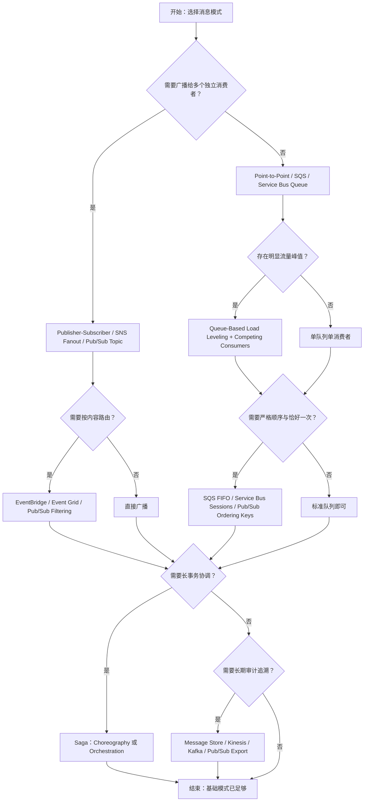

# 1.39 云消息模式与微服务消息模式目录

> **置信口径**: 协议/规范语义=【定理】（官方规范保证）；架构对比与工程推理=【论证】；正文未单独标注的具体数字按【估算】理解（AGENTS.md §4.1，P3 基线声明）。
> **时效声明**: 本文事实基于 Azure Architecture Center、AWS 官方文档、Google Cloud 官方文档与 microservices.io 公开信息，核实至 2026-11。
> **本文档定位**: 模式速查与选型论证。汇总云厂商与微服务领域的主流消息模式目录，并与 EIP、六消息系统做对照索引。各模式的深度论证与事务消息设计见 [2.47 企业集成模式与事务消息模式](../02-场景驱动架构设计/02-47-企业集成模式与事务消息模式.md)；AsyncAPI 与事件契约治理见 [1.37 AsyncAPI 组织级应用与治理](01-37-AsyncAPI组织级应用与治理.md)；落地操作与检查清单见 03 系列对应篇。

## 目录

- [1.39 云消息模式与微服务消息模式目录](#139-云消息模式与微服务消息模式目录)
  - [目录](#目录)
  - [1.39.1 云厂商消息模式目录](#1391-云厂商消息模式目录)
    - [Azure Architecture Center 消息模式](#azure-architecture-center-消息模式)
    - [AWS 消息模式](#aws-消息模式)
    - [Google Cloud Pub/Sub 消息模式](#google-cloud-pubsub-消息模式)
    - [云模式与 EIP 对应关系表](#云模式与-eip-对应关系表)
  - [1.39.2 microservices.io 消息模式](#1392-microservicesio-消息模式)
  - [1.39.3 六系统落地映射表](#1393-六系统落地映射表)
  - [1.39.4 模式选型决策](#1394-模式选型决策)
    - [按场景选模式](#按场景选模式)
    - [决策树](#决策树)
  - [1.39.5 互链与延伸阅读](#1395-互链与延伸阅读)
  - [1.39.6 参考来源](#1396-参考来源)

---

## 1.39.1 云厂商消息模式目录

【论证】AWS、Azure、GCP 均发布了自己的云模式目录或消息服务最佳实践。这些目录并非创造新模式，而是把 EIP 中的通用模式用托管服务重新命名、组合，并补充云原生约束（如按需扩展、serverless、IAM 治理、按量计费）。本节列出三大云厂商当前公开文档中的消息相关模式清单，并给出与 EIP 的对应关系。

### Azure Architecture Center 消息模式

【论证】Azure Architecture Center 的 [Cloud Design Patterns](https://learn.microsoft.com/en-us/azure/architecture/patterns/) 目录截至 2026-11 共列出约 40 个云设计模式，其中与消息直接相关或频繁与消息系统组合使用的模式如下。

| Azure 模式 | 一句话定义 | 典型 Azure 服务 | 与 EIP 的对应 |
| --- | --- | --- | --- |
| [Asynchronous Request-Reply](https://learn.microsoft.com/en-us/azure/architecture/patterns/async-request-reply) | 将后端异步处理与前端解耦，前端通过轮询或回调获取结果 | Service Bus、Event Grid、Functions | Request-Reply + Messaging Gateway |
| [Claim Check](https://learn.microsoft.com/en-us/azure/architecture/patterns/claim-check) | 大载荷存入外部存储，消息只传递引用 | Service Bus + Blob Storage | Claim Check |
| [Competing Consumers](https://learn.microsoft.com/en-us/azure/architecture/patterns/competing-consumers) | 多个并发消费者竞争同一通道的消息 | Service Bus Queue、Event Hubs | Competing Consumers |
| [Priority Queue](https://learn.microsoft.com/en-us/azure/architecture/patterns/priority-queue) | 按优先级路由消息，高优先级先处理 | Service Bus（topic subscription 优先级） | Priority Queue |
| [Publisher-Subscriber](https://learn.microsoft.com/en-us/azure/architecture/patterns/publisher-subscriber) | 发布者通过代理向多个订阅者异步广播事件 | Service Bus Topic、Event Grid | Publish-Subscribe Channel |
| [Queue-Based Load Leveling](https://learn.microsoft.com/en-us/azure/architecture/patterns/queue-based-load-leveling) | 用队列缓冲瞬时峰值，保护后端服务 | Service Bus Queue、Storage Queue | Point-to-Point Channel + Competing Consumers |
| [Sequential Convoy](https://learn.microsoft.com/en-us/azure/architecture/patterns/sequential-convoy) | 在不阻塞其他消息组的前提下，按定义顺序处理一组相关消息 | Service Bus Sessions | Resequencer + Message Sequence |
| [Messaging Bridge](https://learn.microsoft.com/en-us/azure/architecture/patterns/messaging-bridge) | 在异构消息系统之间建立中介 | Service Bus / Event Hubs / Kafka Connect | Messaging Bridge |
| [Choreography](https://learn.microsoft.com/en-us/azure/architecture/patterns/choreography) | 各服务自主决定业务操作的处理时机与方式，无需中央编排器 | Event Grid、Service Bus | Saga（Choreography） |
| [Saga](https://learn.microsoft.com/en-us/azure/architecture/patterns/saga) | 在分布式事务场景中跨微服务管理数据一致性 | Service Bus、Durable Functions | Saga |
| [Idempotent Consumer](https://learn.microsoft.com/en-us/azure/architecture/patterns/idempotent-consumer) | 重复消费消息时保证幂等 | 应用层 + Service Bus Deduplication | Idempotent Receiver |

Azure 模式目录还包括 Event Sourcing、CQRS、Retry、Circuit Breaker、Pipes and Filters 等，它们常与消息模式组合使用，但本身不限于消息领域。

以下示例展示如何在 Azure 中用 Service Bus Topic 与多个 Subscription 实现 Publisher-Subscriber + Competing Consumers 组合：

```bash
# 创建 Service Bus 命名空间、主题与订阅
az servicebus namespace create --resource-group rg-mq --name sb-mq-demo --location eastus
az servicebus topic create --resource-group rg-mq --namespace-name sb-mq-demo --name orders-events
az servicebus subscription create --resource-group rg-mq --namespace-name sb-mq-demo \
  --topic-name orders-events --name inventory-sub --lock-duration PT5M
az servicebus subscription create --resource-group rg-mq --namespace-name sb-mq-demo \
  --topic-name orders-events --name analytics-sub --enable-dead-lettering-on-message-expiration true
```

### AWS 消息模式

【论证】AWS 没有单独发布一个与 Azure 对等的“模式目录”页面，但其官方文档将常见消息场景归纳为若干可复用模式。下表根据 [Amazon SNS](https://docs.aws.amazon.com/sns/latest/dg/welcome.html)、[Amazon SQS](https://docs.aws.amazon.com/AWSSimpleQueueService/latest/SQSDeveloperGuide/welcome.html)、[Amazon EventBridge](https://docs.aws.amazon.com/eventbridge/latest/userguide/eb-what-is.html) 与 [Amazon Kinesis Data Streams](https://docs.aws.amazon.com/streams/latest/dev/introduction.html) 官方文档整理。

| AWS 模式/能力 | 一句话定义 | 核心服务 | 与 EIP 的对应 |
| --- | --- | --- | --- |
| SNS Fanout | 一条消息发布到 SNS topic 后并行推送到多个 SQS/Lambda/Firehose/HTTP 端点 | SNS + SQS/Lambda/Firehose | Publish-Subscribe Channel + Recipient List |
| SQS Standard Queue | 高吞吐、至少一次、不保序的队列 | SQS Standard | Point-to-Point Channel + Competing Consumers |
| SQS FIFO Queue | 严格有序、Exactly-Once Processing、按消息组并行的队列 | SQS FIFO | Resequencer + Idempotent Receiver |
| EventBridge Event Bus | 基于事件模式匹配规则并路由到多个目标的事件总线 | EventBridge Event Bus | Message Broker + Content-Based Router |
| EventBridge Pipes | 点对点集成源与目标，支持过滤、增强、转换 | EventBridge Pipes | Message Translator + Content-Based Router |
| EventBridge Scheduler | 无服务器调度器，按 cron/rate 触发目标 | EventBridge Scheduler | Scheduler Agent Supervisor |
| Kinesis Sharded Stream | 分片日志流，按 partition key 保序、支持多独立消费者 | Kinesis Data Streams | Message Store + Resequencer |
| SQS DLQ | 处理失败的消息转入死信队列隔离 | SQS Dead-Letter Queue | Dead Letter Channel |

AWS 文档明确说明 SQS FIFO 队列提供 exactly-once processing 与严格顺序，标准队列提供最大吞吐但仅保证至少一次与尽力而为顺序。SNS 的 Fanout 场景是其文档中的“Application integration”首选示例。

以下示例展示 AWS CLI 中 SNS 到 SQS 的 Fanout 配置：

```bash
# 创建 SNS topic 与两个 SQS queue，再建立订阅
aws sns create-topic --name order-events
aws sqs create-queue --queue-name order-inventory-queue
aws sqs create-queue --queue-name order-analytics-queue

# 分别获取 queue ARN 并订阅到 SNS topic（省略 ARN 变量赋值）
aws sns subscribe --topic-arn arn:aws:sns:us-east-1:123456789012:order-events \
  --protocol sqs --notification-endpoint arn:aws:sqs:us-east-1:123456789012:order-inventory-queue
aws sns subscribe --topic-arn arn:aws:sns:us-east-1:123456789012:order-events \
  --protocol sqs --notification-endpoint arn:aws:sqs:us-east-1:123456789012:order-analytics-queue
```

### Google Cloud Pub/Sub 消息模式

【论证】Google Cloud 同样没有独立的“模式目录”站点，但其 [Pub/Sub 官方文档](https://cloud.google.com/pubsub/docs/overview) 将以下能力作为核心消息模式推广。下表基于公开文档与 2026-11 的社区/考试资料整理。

| GCP 模式/能力 | 一句话定义 | 核心服务 | 与 EIP 的对应 |
| --- | --- | --- | --- |
| Pull Subscription | 消费者主动拉取消息，适合批处理与高吞吐流水线 | Cloud Pub/Sub Pull | Polling Consumer |
| Push Subscription | Pub/Sub 通过 HTTPS POST 将消息推送到订阅端点 | Cloud Pub/Sub Push | Event-Driven Consumer |
| Ordering Keys | 同一 ordering key 内的消息按发布顺序投递 | Cloud Pub/Sub ordering | Resequencer |
| Exactly-Once Delivery | 成功确认后不再重新投递（pull 与 StreamingPull） | Cloud Pub/Sub exactly-once | Idempotent Receiver（由服务原生保证） |
| Dead-Letter Topics | 失败消息隔离到死信主题，避免阻塞主订阅 | Cloud Pub/Sub dead-letter topics | Dead Letter Channel |
| Message Filtering | 按属性过滤，只向订阅投递匹配消息 | Cloud Pub/Sub filtering | Message Filter |
| Schema Enforcement | 通过 Avro/Protobuf schema 校验消息 | Cloud Pub/Sub schemas | Canonical Data Model |
| Cloud Storage BigQuery Export | 将消息导出到对象存储或数仓 | Pub/Sub to Cloud Storage/BigQuery | Message Store + Wire Tap |

GCP Pub/Sub 的 exactly-once delivery 自 2022 年起 GA，适用于 pull 订阅与 StreamingPull；push 订阅与 export 订阅不支持。ordered delivery 需在同一 ordering key 内生效，且要求启用 exactly-once 时同时满足幂等确认语义。

以下示例展示用 gcloud 创建带 ordering key 与 dead-letter topic 的 Pub/Sub 订阅：

```bash
# 创建 topic、死信 topic 与启用顺序和 exactly-once 的订阅
gcloud pubsub topics create orders
gcloud pubsub topics create orders-dlq
gcloud pubsub subscriptions create orders-processor \
  --topic orders \
  --enable-message-ordering \
  --enable-exactly-once-delivery \
  --dead-letter-topic orders-dlq \
  --max-delivery-attempts 5 \
  --ack-deadline 60
```

### 云模式与 EIP 对应关系表

【论证】云厂商模式大多是 EIP 在托管服务中的“云化重命名”。下表把三大云厂商的常见模式汇总到 EIP 模式族，便于在跨云迁移或混合架构时保持术语一致。

| EIP 模式 | Azure | AWS | GCP |
| --- | --- | --- | --- |
| Point-to-Point Channel | Service Bus Queue | SQS Standard/FIFO Queue | Pub/Sub Subscription（单消费者时表现为队列） |
| Publish-Subscribe Channel | Service Bus Topic / Event Grid | SNS Topic | Pub/Sub Topic + 多 Subscription |
| Competing Consumers | Service Bus Queue 多接收者 | SQS 多消费者 | Pub/Sub Pull 多客户端 |
| Priority Queue | Service Bus 优先级订阅 | 应用层（多个队列+权重） | 应用层（多个订阅+优先级） |
| Queue-Based Load Leveling | Service Bus Queue / Storage Queue | SQS 缓冲层 | Pub/Sub Subscription 缓冲 |
| Asynchronous Request-Reply | Service Bus + Functions/Event Grid | SQS + Lambda/API Gateway | Pub/Sub + Cloud Run/Cloud Functions |
| Claim Check | Service Bus + Blob Storage | SQS Extended Client + S3 | Pub/Sub + Cloud Storage |
| Sequential Convoy | Service Bus Sessions | SQS FIFO Message Group | Pub/Sub Ordering Keys |
| Dead Letter Channel | Service Bus DLQ/Dead-letter subscription | SQS DLQ | Pub/Sub Dead-Letter Topic |
| Content-Based Router | Event Grid 事件过滤 | EventBridge Rules | Pub/Sub Filtering |
| Message Broker | Service Bus / Event Grid | EventBridge Event Bus | Pub/Sub |
| Saga | Service Bus + Durable Functions | Step Functions + SQS/SNS | Workflows + Pub/Sub |
| Idempotent Receiver | Service Bus 重复检测 + 应用层幂等 | SQS FIFO 去重 + 应用层幂等 | Pub/Sub Exactly-Once + 应用层幂等 |

> 说明：Priority Queue 在三大云中均无原生完全支持，通常需要应用层维护多条队列或订阅并分配权重，属于【估算】工程实践。

---

## 1.39.2 microservices.io 消息模式

【论证】[microservices.io](https://microservices.io/) 由 Chris Richardson 维护，是微服务架构模式的权威目录。其消息与数据相关模式并非严格复刻 EIP，而是从“微服务间通信与数据一致性”视角出发，强调 Database per Service、Event Sourcing、Saga、CQRS 等组合。下表列出与消息系统直接相关的模式。

| microservices.io 模式 | 一句话定义 | 与 EIP 的关系 | 典型消息系统实现 |
| --- | --- | --- | --- |
| [Messaging](https://microservices.io/patterns/messaging/messaging.html) | 服务通过异步消息通信，替代同步 RPC | 对应 Messaging 风格整体 | Kafka、RabbitMQ、NATS、Pulsar、Pub/Sub |
| [Message Broker](https://microservices.io/patterns/messaging/message-broker.html) | 用中间件解耦生产者与消费者 | 对应 Message Broker | 所有消息中间件 |
| [Transactional Outbox](https://microservices.io/patterns/data/transactional-outbox) | 将事件写入业务数据库的 outbox 表，再由 relay 发布 | 对应 Transactional Client + Event Message | Kafka、RabbitMQ、NATS、Pulsar |
| [Message Relay / Polling Publisher](https://microservices.io/patterns/data/transactional-outbox) | 读取 outbox 并发布到 broker | 对应 Channel Adapter | Debezium、Eventuate Tram、自研 relay |
| [Domain Event](https://microservices.io/patterns/data/domain-event.html) | DDD 聚合在状态变更时发布领域事件 | 对应 Event Message | Kafka topic、RabbitMQ event exchange |
| [Saga (Choreography)](https://microservices.io/patterns/data/saga.html) | 各服务通过领域事件协同长事务 | 对应 Process Manager / Choreography | Kafka + Domain Events |
| [Saga (Orchestration)](https://microservices.io/patterns/data/saga.html) | 中央编排器发送命令并处理补偿 | 对应 Process Manager | Kafka + Saga Orchestrator、Camunda |
| [API Composition](https://microservices.io/patterns/data/api-composition.html) | API 网关/组合器聚合多个服务查询 | 与 Messaging Gateway 互补 | 通常同步，但可搭配 CQRS 事件视图 |
| [CQRS](https://microservices.io/patterns/data/cqrs.html) | 命令与查询模型分离，读模型通过事件更新 | 对应 Event-Driven Consumer + Materialized View | Kafka Streams、Pulsar Functions |
| [Event Sourcing](https://microservices.io/patterns/data/event-sourcing.html) | 以不可变事件序列作为状态来源 | 对应 Message Store + Event Message | Kafka event log、EventStoreDB |
| [Messaging Bridge](https://microservices.io/patterns/messaging/messaging-bridge.html) | 连接异构消息系统 | 对应 Messaging Bridge | Kafka Connect、NATS bridge、Camel |

> 关键洞察：microservices.io 的 Transactional Outbox、Saga、CQRS、Event Sourcing 经常组合出现。Outbox 解决“数据库与消息双写”的原子性问题；Saga 解决跨服务长事务；CQRS 与 Event Sourcing 则把事件日志作为系统状态的唯一真相源。

---

## 1.39.3 六系统落地映射表

【论证】下表把前两节的云模式与微服务模式映射到 Kafka、RabbitMQ、NATS、Pulsar、MQTT、Redis Stream（并补充 RocketMQ、Redpanda）的实现机制。标注“原生/框架/应用层”表示该能力主要由系统本身、集成框架还是业务代码承担。

| 模式/能力 | Kafka | RabbitMQ | NATS | Pulsar | MQTT | Redis Stream |
| --- | --- | --- | --- | --- | --- | --- |
| Publish-Subscribe | Consumer Group 广播；多个 group 独立消费 | Fanout / Topic exchange | Subject 广播；JetStream consumer | Non-shared subscription | Topic 广播 | 多消费者独立读取 |
| Point-to-Point / Queue | KIP-932 Share Groups；传统 queue = 单 consumer group | Queue / Work Queue | Queue group (JetStream pull) | Shared subscription | Shared Subscription (MQTT 5.0) | 单消费者 XREAD |
| Fanout to Multiple Consumers | 多 Consumer Group | Fanout exchange + 多 queue | 多 JetStream consumer / queue group | 多 subscription | 多订阅同一 topic | 多消费者独立 IDREAD |
| Competing Consumers | Consumer Group 内部分区分配 | Queue 多消费者 | JetStream pull consumer group | Shared subscription | 应用层 | 应用层 |
| Priority Queue | 应用层多 topic | 优先级队列插件 / 应用层 | 应用层 | 应用层 | 应用层 | 应用层 |
| Queue-Based Load Leveling | topic 缓冲 + consumer lag | queue 缓冲 | stream 缓冲 | topic 缓冲 | 应用层 | stream 缓冲 |
| Asynchronous Request-Reply | 应用层 correlation-id + 回调 topic | 应用层 correlation-id | Core request-reply (inbox) | 应用层 | MQTT 5.0 Request/Response | 应用层 |
| Claim Check | 应用层 + S3/HDFS 引用 | 应用层 + 对象存储引用 | 应用层 + 对象存储引用 | 应用层 + 对象存储引用 | 应用层 | 应用层 |
| Sequential Convoy / Ordering | 单分区单消费者保序；KIP-932 队列有序 | 单队列单消费者 | JetStream consumer 顺序投递 | Key-shared + 单分片 | QoS 尽力保序 | 单流顺序 |
| Dead Letter Channel | `dead-letter-topic` + `DeliveryAttempt`（KIP-932） | DLX + dead-letter queue | `MaxDeliver` + `Backoff` + NAK | Retry letter + dead letter topic | 应用层死信队列 | 应用层转移/阻塞 |
| Content-Based Router | Kafka Streams `branch/filter` | Exchange + routing key + headers | Subject wildcard；filterSubject | Pulsar Functions | 应用层过滤 | 应用层过滤 |
| Idempotent Receiver | `enable.idempotence`（producer 端） | 应用层去重 | 应用层去重 | 应用层去重 | 应用层去重 | 应用层去重 |
| Transactional Client | Kafka Transactions | AMQP tx / publisher confirm | 应用层 Outbox | Pulsar transactions | 应用层 Outbox | MULTI/EXEC 或应用层 |
| Saga / Process Manager | 编排器 + Kafka topic | 编排器 + RabbitMQ | 编排器 + NATS subject | 编排器 + Pulsar topic | 应用层 | 应用层 |
| CQRS / Read Model Projection | Kafka Streams KTable | 应用层投影 | 应用层投影 | Pulsar Functions | 应用层 | 应用层 |
| Event Sourcing | Kafka log 作为 event store | 应用层 + 事件存储 | JetStream stream 作为轻量 event log | Pulsar topic 持久化 | 应用层 | Redis Stream 作为轻量 event log |

**RocketMQ / Redpanda 补充**：

- **RocketMQ**：原生支持延迟消息、顺序消息、事务消息、死信队列，对 Saga、Sequential Convoy、Transactional Client 的覆盖较好；但流处理能力弱于 Kafka。
- **Redpanda**：Kafka API 兼容，因此上表中 Kafka 列几乎完全适用；额外提供自管理的 raft 复制与无 ZooKeeper 部署，对 Publish-Subscribe、Competing Consumers、Dead Letter Channel 的落地与 Kafka 一致。

Kafka 对 Aggregator / Content-Based Router 的原生支持示例：

```java
KStream<String, OrderEvent> orders = builder.stream("orders");
orders.groupByKey()
      .aggregate(
          OrderSummary::new,
          (key, event, summary) -> summary.add(event),
          Materialized.with(Serdes.String(), new OrderSummarySerde())
      )
      .toStream()
      .to("order-summary");
```

NATS JetStream 对 Dead Letter Channel 与 Competing Consumers 的组合示例：

```bash
# 创建 stream 与 durable pull consumer group
nats stream add ORDERS --subjects "orders.*" --storage file --retention limits --replicas 3
nats consumer add ORDERS order-processor \
  --pull --deliver-group order-workers \
  --ack explicit --max-deliver 5 --filter "orders.created"
```

---

## 1.39.4 模式选型决策

【论证】在云原生与微服务架构中，选型问题常表现为“我应该用 SNS+SQS、EventBridge、Service Bus、Pub/Sub 还是自托管 Kafka/RabbitMQ/NATS？”。本节按四类典型场景给出决策表，并附 mermaid 决策树辅助快速判断。

### 按场景选模式

| 业务场景 | 首选模式 | 首选云实现 | 自托管实现 | 关键检查点 |
| --- | --- | --- | --- | --- |
| 削峰填谷 / 保护下游 | Queue-Based Load Leveling + Competing Consumers | SQS Standard / Service Bus Queue / Pub/Sub Pull | Kafka Consumer Group / RabbitMQ Queue | 队列深度告警、消费者扩容策略、死信队列 |
| 服务解耦 / 事件广播 | Publisher-Subscriber + Message Broker | SNS Fanout / EventBridge / Event Grid / Pub/Sub | Kafka multi-consumer-group / RabbitMQ Fanout | 订阅管理、schema 治理、消费进度监控 |
| 审计 / 合规 / 追溯 | Message Store + Wire Tap | Kinesis Data Streams / Pub/Sub Export to BigQuery/S3 | Kafka log retention / NATS stream mirror | 保留周期、加密、访问控制、 replay 能力 |
| 长流程 / 工作流 / 分布式事务 | Saga（Orchestration 或 Choreography） | Step Functions + SQS/SNS / Durable Functions + Service Bus / Workflows + Pub/Sub | Kafka + Saga 编排器 / Camunda + RabbitMQ | 补偿设计、幂等、超时、状态机可视化 |
| 严格顺序 + 恰好一次 | Sequential Convoy + Idempotent Receiver | SQS FIFO / Service Bus Sessions / Pub/Sub Ordering Keys | Kafka 单分区单消费者 / RabbitMQ 单队列 | 吞吐量上限、分区/消息组设计、去重窗口 |
| 大消息 / 多媒体 | Claim Check | SQS Extended + S3 / Service Bus + Blob / Pub/Sub + Cloud Storage | Kafka + S3 引用 / RabbitMQ + 对象存储 | 引用有效期、权限、元数据一致性 |

### 决策树



关键决策原则：

1. **先判断广播 vs 单播**：多独立消费者用 pub/sub；单一处理单元用 queue。
2. **再判断是否需要内容路由**：需要复杂事件模式匹配优先 EventBridge / Event Grid / Pub/Sub Filtering。
3. **顺序与恰好一次是高成本选项**：会限制并行度，只在业务真正需要时启用。
4. **长流程必须引入 Saga 与幂等**：无论编排还是协同，都要配套 Transactional Outbox 与 Idempotent Receiver。
5. **审计需求决定保留策略**：消息系统本身 retention 有限时，配合导出到对象存储或数仓。

---

## 1.39.5 互链与延伸阅读

- EIP 完整目录与六系统映射见 [1.38 企业集成模式全目录与系统映射](01-38-企业集成模式全目录与系统映射.md)。
- 事务消息、Saga、Outbox 的深度论证与代码示例见 [2.47 企业集成模式与事务消息模式](../02-场景驱动架构设计/02-47-企业集成模式与事务消息模式.md)。
- AsyncAPI 与事件契约治理见 [1.37 AsyncAPI 组织级应用与治理](01-37-AsyncAPI组织级应用与治理.md)。
- 落地操作与检查清单见 03 系列对应篇：03-41（幂等）、03-44（存储）、03-47/03-48（事务与聚合）、03-49（转换适配）、03-50（桥接）等。

---

## 1.39.6 参考来源

- Azure Architecture Center — [Cloud Design Patterns](https://learn.microsoft.com/en-us/azure/architecture/patterns/)（完整模式目录，核实至 2026-11）
- Azure Architecture Center — [Publisher-Subscriber pattern](https://learn.microsoft.com/en-us/azure/architecture/patterns/publisher-subscriber)
- Azure Architecture Center — [Asynchronous Request-Reply pattern](https://learn.microsoft.com/en-us/azure/architecture/patterns/async-request-reply)
- Azure Architecture Center — [Queue-Based Load Leveling pattern](https://learn.microsoft.com/en-us/azure/architecture/patterns/queue-based-load-leveling)
- Azure Architecture Center — [Competing Consumers pattern](https://learn.microsoft.com/en-us/azure/architecture/patterns/competing-consumers)
- Azure Architecture Center — [Sequential Convoy pattern](https://learn.microsoft.com/en-us/azure/architecture/patterns/sequential-convoy)
- Azure Architecture Center — [Claim Check pattern](https://learn.microsoft.com/en-us/azure/architecture/patterns/claim-check)
- Azure Architecture Center — [Messaging Bridge pattern](https://learn.microsoft.com/en-us/azure/architecture/patterns/messaging-bridge)
- AWS Documentation — [What is Amazon SNS?](https://docs.aws.amazon.com/sns/latest/dg/welcome.html)
- AWS Documentation — [Fanout Amazon SNS notifications to Amazon SQS queues](https://docs.aws.amazon.com/sns/latest/dg/sns-sqs-as-subscriber.html)
- AWS Documentation — [Amazon SQS FIFO queues](https://docs.aws.amazon.com/AWSSimpleQueueService/latest/SQSDeveloperGuide/FIFO-queues.html)
- AWS Documentation — [What is Amazon EventBridge?](https://docs.aws.amazon.com/eventbridge/latest/userguide/eb-what-is.html)
- AWS Documentation — [Amazon EventBridge Pipes](https://docs.aws.amazon.com/eventbridge/latest/userguide/eb-pipes.html)
- AWS Documentation — [What is Amazon EventBridge Scheduler?](https://docs.aws.amazon.com/scheduler/latest/UserGuide/what-is-scheduler.html)
- AWS Documentation — [Amazon Kinesis Data Streams terminology and concepts](https://docs.aws.amazon.com/streams/latest/dev/key-concepts.html)
- Google Cloud Documentation — [Cloud Pub/Sub overview](https://cloud.google.com/pubsub/docs/overview)
- Google Cloud Documentation — [Pub/Sub: Exactly-once delivery](https://cloud.google.com/pubsub/docs/exactly-once-delivery)
- Google Cloud Documentation — [Pub/Sub: Ordering messages](https://cloud.google.com/pubsub/docs/ordering)
- Google Cloud Documentation — [Pub/Sub: Subscriber overview](https://cloud.google.com/pubsub/docs/subscriber)
- microservices.io — [Transactional outbox pattern](https://microservices.io/patterns/data/transactional-outbox)
- microservices.io — [Saga pattern](https://microservices.io/patterns/data/saga.html)
- microservices.io — [CQRS pattern](https://microservices.io/patterns/data/cqrs.html)
- microservices.io — [Event sourcing pattern](https://microservices.io/patterns/data/event-sourcing.html)
- microservices.io — [Domain event pattern](https://microservices.io/patterns/data/domain-event.html)
- microservices.io — [API composition pattern](https://microservices.io/patterns/data/api-composition.html)
- Enterprise Integration Patterns — [Messaging Patterns Overview](https://www.enterpriseintegrationpatterns.com/patterns/messaging/)
- Hohpe, G. & Woolf, B. *Enterprise Integration Patterns: Designing, Building, and Deploying Messaging Solutions*. Addison-Wesley, 2003.

---

**最后更新**: 2026-11-18
