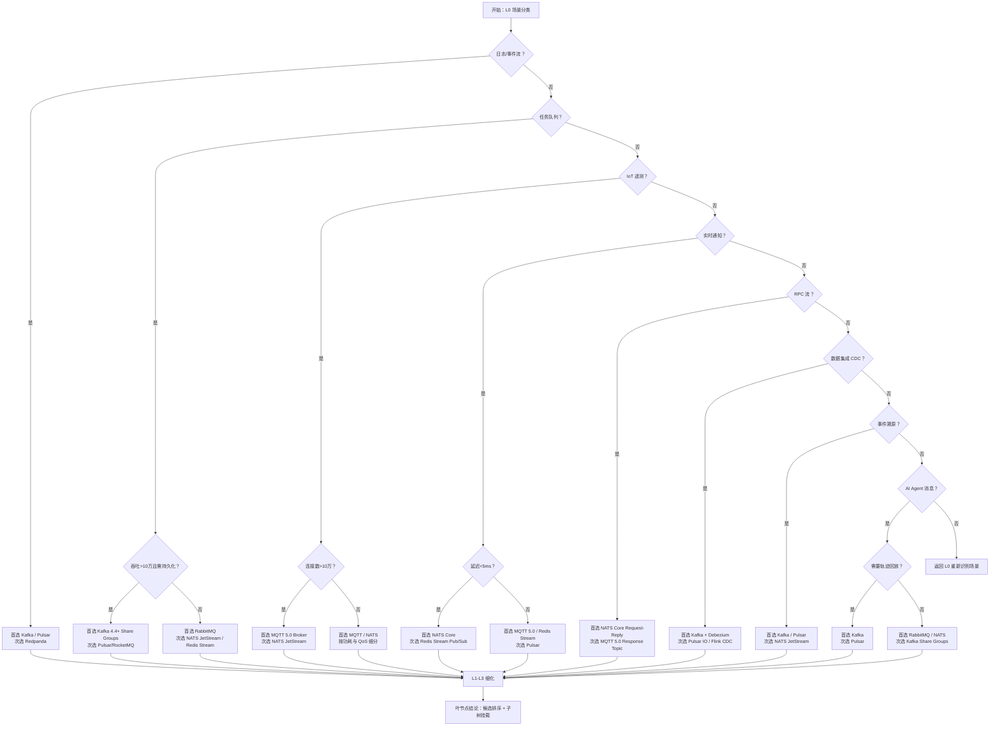

# 1.59 全局选型决策总树

> **置信口径**: 协议/规范语义=【定理】（官方规范保证）；架构对比与工程推理=【论证】；正文未单独标注的具体数字按【估算】理解（AGENTS.md §4.1，P3 基线声明）。
> **时效声明**: 本文事实基于 Apache Kafka、MQTT、NATS、Pulsar、RabbitMQ、Redis Stream 官方文档与 01 系列各专章，核实至 2026-11。版本基线：Kafka 4.4.x、NATS Server 2.15.x、Pulsar 4.2.x、RabbitMQ 4.x、Redis 7.x、MQTT 5.0。
> **定位声明**: **全库选型判定唯一入口**。本文汇总 L0 场景 → L1 负载 → L2 语义 → L3 约束四层递归决策，所有叶节点挂载到 01 系列各专章子树；具体场景设计见 02 系列，落地操作见 03 系列。

## 目录

- [1.59 全局选型决策总树](#159-全局选型决策总树)
  - [目录](#目录)
  - [1.59.1 使用说明：递归决策纪律](#1591-使用说明递归决策纪律)
  - [1.59.2 L0 场景分类（根节点）](#1592-l0-场景分类根节点)
  - [1.59.3 L1 负载特征四问](#1593-l1-负载特征四问)
  - [1.59.4 L2 语义需求五问](#1594-l2-语义需求五问)
  - [1.59.5 L3 约束五问](#1595-l3-约束五问)
  - [1.59.6 叶节点：候选系统排序与子树挂载](#1596-叶节点候选系统排序与子树挂载)
    - [mermaid 完整决策树](#mermaid-完整决策树)
    - [表格版路径速查](#表格版路径速查)
  - [1.59.7 决策一致性核对表](#1597-决策一致性核对表)
  - [1.59.8 互链与参考来源](#1598-互链与参考来源)

---

## 1.59.1 使用说明：递归决策纪律

【论证】全局决策树不是替代各专章的细节论证，而是把分散在 01-19、01-25、01-38、01-39、01-52、01-53 等文档中的判定逻辑收敛到一个递归框架里。使用时应从 L0 根节点逐层下钻，每层必须给出可核查的判定依据，禁止跳过层级直接跳到“选 Kafka”或“选 RabbitMQ”。

**判定纪律**：

1. **每节点必须引用出处**：L0 场景引用 01-01/01-19 的场景矩阵；L1 负载引用 01-01 核心参数矩阵；L2 语义引用对应系统专章（01-12/01-15/01-16/01-17/01-25/01-26/01-27/01-28）；L3 约束引用 01-34（许可证）、01-52（客户端/团队技能）。
2. **叶节点必须给出候选排序**：单一答案往往不成立，优先给出“首选 / 次选 / 需要混合架构”三级结论。
3. **子树挂载路径必须可点击**：如“→ Kafka 子树：01-25 1.25.6 节决策树”。
4. **冲突标记不改正文**：若本树结论与 01-19/01-25 等既有文档不一致，在 1.59.7 核对表“冲突”列标注，供后续治理批次处理。

```text
递归判定示例：
L0 场景=任务队列
  → L1 吞吐<10万 TPS、消息<1MB、消费者<100、延迟目标10-100ms
    → L2 需要顺序=否；需要幂等=是；需要事务=部分；需要回放=否；需要背压=是
      → L3 运维能力=中；生态=Spring；许可证=Apache 2.0；成本=中；团队=熟悉 RabbitMQ
        → 叶节点：首选 RabbitMQ，次选 Kafka 4.4+ Share Groups
        → 子树挂载：01-25 1.25.6 / 01-39 1.39.4 / 02-17 / 03-15
```

---

## 1.59.2 L0 场景分类（根节点）

【论证】根节点按业务意图而非技术标签分类，避免把“日志”和“事件流”混为一谈，也避免把“实时通知”与“RPC 流”简单等同。八个分支覆盖本库六大系统（Kafka、MQTT、NATS、Pulsar、RabbitMQ、Redis Stream）及 RocketMQ、Redpanda 扩展系统的典型落地域。

| L0 分支 | 核心意图 | 典型业务形态 | 首选系统族 | 挂载子树 |
| --- | --- | --- | --- | --- |
| **日志/事件流** | 高吞吐、长期保留、多独立消费者 | 应用日志聚合、CDC、点击流 | Kafka / Pulsar | 01-25 1.25.6、01-53 1.53.5 |
| **任务队列** | 竞争消费、逐条确认、死信兜底 | 订单异步处理、工单派发、邮件发送 | RabbitMQ / Kafka 4.4+ | 01-25 1.25.6、01-39 1.39.4 |
| **IoT 遥测** | 海量长连接、低功耗、QoS 分级 | 传感器上报、车载 telemetry、工业网关 | MQTT / NATS JetStream | 01-16、01-26、01-46 |
| **实时通知** | 低延迟扇出、在线/离线状态 | 即时消息、推送、游戏状态同步 | NATS Core / MQTT / Redis Stream | 01-26、01-17、01-40 |
| **RPC 流** | 请求-响应、低延迟、双向流 | 微服务间同步调用、服务网格 | NATS Core / gRPC over MQTT 5.0 | 01-26、01-40、01-52 |
| **数据集成 CDC** | 变更捕获、Schema 演化、湖仓导流 | Debezium → Kafka、ETL pipeline | Kafka / Pulsar | 01-31、01-53 1.53.5 |
| **事件溯源** | 不可变事件日志、审计重放 | 订单生命周期、金融账本 | Kafka / Pulsar / NATS JetStream | 01-25、01-47、01-12 |
| **AI Agent 消息** | 任务队列 + 心跳 + HITL + 工具异步化 | Agent 任务分发、A2A 长任务、MCP Tool | Kafka / RabbitMQ / NATS | 01-35、01-41、01-57 |

**L0 判定原则**：

- 若业务说“先存下来，以后谁想读谁读” → 日志/事件流。
- 若业务说“这条消息必须被一个人处理掉” → 任务队列。
- 若设备数 > 10 万、消息体 < 1 KB、网络不稳定 → IoT 遥测。
- 若端到端延迟 < 5 ms、连接数中等 → 实时通知 / RPC 流。
- 若源系统是数据库且目标为湖仓/数仓 → 数据集成 CDC。
- 若要求“事件是系统状态的唯一真相源” → 事件溯源。
- 若消息携带 `task-id`、`hitl_threshold`、`allowed_tools` 等 Agent 元数据 → AI Agent 消息。

---

## 1.59.3 L1 负载特征四问

【论证】同一 L0 场景下，负载特征会显著改变系统选择。例如“任务队列”在 1 万 TPS 以下首选 RabbitMQ，但在 10 万 TPS 以上且需要持久化时，Kafka 4.4+ Share Groups 可能成为更优解。

| 问题 | 低/小侧 | 高/大侧 | 对系统选择的直接影响 |
| --- | --- | --- | --- |
| **吞吐** | < 1 万 TPS | > 10 万 TPS | 高吞吐侧优先 Kafka/Pulsar/NATS Core；低吞吐侧 RabbitMQ/Redis Stream 足够 |
| **消息大小** | < 1 KB（典型遥测） | > 100 KB 或 MB 级媒体 | 大消息需 Claim Check（01-44）+ Kafka/Pulsar；小消息 MQTT/NATS 更省开销 |
| **消费者数** | 单一或竞争消费组 | 多独立消费组（>3） | 多独立消费组天然 Kafka/Pulsar；单一队列 RabbitMQ 更简单 |
| **延迟目标** | < 5 ms（P99） | 100 ms 以上可接受 | 亚毫秒级 NATS Core/MQTT QoS 0；可接受延迟则 Kafka/Pulsar |

**L1 判定流程**：

```text
L1 负载判定（从 L0 进入后必答）
├── 吞吐 > 10万 TPS 且需持久化？
│   ├── 是 → 候选收窄为 Kafka / Pulsar / Redpanda / NATS JetStream
│   └── 否 → 可保留 RabbitMQ / Redis Stream / MQTT
├── 消息平均大小 > 100 KB？
│   ├── 是 → 启用 Claim Check；Kafka/Pulsar/S3 优于 RabbitMQ
│   └── 否 → 直接承载
├── 独立消费者组数量 > 3？
│   ├── 是 → 优先 Kafka/Pulsar 的 pub/sub 日志模型
│   └── 否 → 队列模型（RabbitMQ / Share Groups / NATS JetStream）更经济
└── P99 延迟要求 < 5 ms？
    ├── 是 → NATS Core / MQTT QoS 0 / Redis Stream
    └── 否 → 持久化日志系统进入候选
```

---

## 1.59.4 L2 语义需求五问

【论证】语义需求决定系统能否在工程上直接满足，或必须借助应用层补偿。以下五问的顺序不可随意调换：顺序与幂等 often 互斥于高吞吐；事务与回放需要持久化基础；背压决定系统能否在峰值下不自毁。

| 语义 | 需要时意味着什么 | 原生支持强的系统 | 需要应用层补偿的系统 |
| --- | --- | --- | --- |
| **顺序** | 全局顺序或分区内顺序 | Kafka（分区有序）、RabbitMQ（单队列有序）、Pulsar（Key-shared 有序） | MQTT（尽力保序）、NATS Core（无序） |
| **幂等** | 重复投递不导致副作用 | Kafka（producer idempotence）、Pulsar | Redis Stream、MQTT、NATS Core 需应用层 |
| **事务** | 生产/消费与 DB 操作原子化 | Kafka Transactions、Pulsar transactions、RabbitMQ AMQP tx | NATS Core、Redis Stream、MQTT 需 Outbox |
| **回放** | 按时间/offset 重新读取历史 | Kafka、Pulsar、NATS JetStream、Redis Stream | RabbitMQ（默认 queue 不支持）、MQTT |
| **背压** | 生产者速率超过消费者时速率限制 | RabbitMQ（prefetch）、NATS Core（慢消费者切断）、Kafka（consumer lag 暴露） | 多数系统需配合 KEDA/框架级限流 |

**L2 判定流程**：

```text
L2 语义判定
├── 需要严格全局顺序？
│   ├── 是 → 仅有单分区/单队列方案可行；吞吐会受限
│   │         → Kafka 单分区 / RabbitMQ 单队列 / Pulsar Key-shared
│   └── 否 → 继续
├── 需要 Exactly-Once / 事务语义？
│   ├── 是 → Kafka ≥ 2.5 / Pulsar / RabbitMQ（publisher confirm）
│   └── 否 → 继续
├── 需要长期回放（>7 天或事件溯源）？
│   ├── 是 → Kafka / Pulsar / NATS JetStream（tiered storage）
│   └── 否 → Redis Stream / RabbitMQ 足够
├── 需要自动幂等投递？
│   ├── 是 → Kafka enable.idempotence / Pulsar / 应用层去重键
│   └── 否 → 消费者端幂等即可
└── 背压策略偏好？
    ├── 慢消费者切断 → NATS Core
    ├── 队列缓冲+限流 → RabbitMQ / Kafka + KEDA
    └── 无强要求 → 按其他维度定
```

---

## 1.59.5 L3 约束五问

【论证】非功能约束经常是生产选型的决定性因素。一个技术上更优的系统若团队无法运维，或许可证与合规冲突，则应被排除。

| 约束 | 宽松侧 | 严格侧 | 影响 |
| --- | --- | --- | --- |
| **运维能力** | 有专职 SRE、熟悉 K8s | 小团队、无专职运维 | 严格侧优先 NATS / Redis Stream / 托管云消息服务 |
| **生态** | 已有 Kafka Connect/Flink/Camel | 仅有 Spring Cloud / Python | 优先与现有生态对齐的系统 |
| **合规许可证** | Apache 2.0 可接受 | SSPL/商业授权禁止 | Kafka、Pulsar、NATS、RabbitMQ（MPL/Apache 双许可）需核对 01-34 |
| **成本** | 可自建集群 | 按量计费、Serverless | 低运维自托管选 NATS/Redpanda；弹性峰值选云托管 |
| **团队技能** | 有 Kafka/Pulsar 专家 | 仅熟悉 RabbitMQ/Redis | 技能迁移成本应纳入总拥有成本 |

**L3 快速排除法**：

- 许可证禁止 Apache 2.0 以外的项目 → 先查 01-34，排除有 SSPL/BSL 风险的组件。
- 无专职 SRE 且需要高可用 → 排除需要 ZooKeeper 的老 Kafka；优先 Kafka 4.x KRaft、NATS、Redis Stream。
- 已有 Flink/Spark/Confluent 生态 → Kafka / Pulsar 优先。
- 团队主力为 Python/Go → 评估客户端成熟度（01-52），Kafka 选 franz-go/aiokafka，MQTT 选 aiomqtt。

---

## 1.59.6 叶节点：候选系统排序与子树挂载

【论证】叶节点给出的是“在 L0+L1+L2+L3 全部约束下的候选排序”，而非唯一答案。每个叶节点同时给出子树挂载路径，便于读者进入对应专章做深度参数与版本确认。

### mermaid 完整决策树



### 表格版路径速查

| L0 分支 | L1+L2 关键路径 | 首选 | 次选 | 混合架构提示 | 子树挂载路径 |
| --- | --- | --- | --- | --- | --- |
| **日志/事件流** | 高吞吐 + 持久化 + 多独立消费组 | Kafka | Pulsar、Redpanda | 热数据 Kafka + 冷数据 S3 Tiered Storage | 01-25 1.25.6 → 01-53 1.53.5 |
| **任务队列（高吞吐）** | 吞吐>10万 + 幂等 + DLQ | Kafka 4.4+ Share Groups | Pulsar、RocketMQ | 核心队列 Kafka + 复杂路由 RabbitMQ | 01-25 1.25.6 → 01-39 1.39.4 |
| **任务队列（常规）** | 吞吐<10万 + 路由灵活 + DLQ | RabbitMQ | NATS JetStream、Redis Stream | 延迟任务用 RabbitMQ 插件 | 01-15 → 01-39 1.39.4 → 02-17 |
| **IoT 遥测（海量连接）** | 连接>10万 + QoS 分级 + 低功耗 | MQTT 5.0 | NATS JetStream | MQTT 接入 + Kafka 后端分析 | 01-16 → 01-46 → 01-26 |
| **IoT 遥测（边缘轻量）** | 低功耗 + 边缘自治 | NATS JetStream | MQTT-SN | 边缘 NATS + 云端 Kafka | 01-26 → 01-51 |
| **实时通知（超低延迟）** | P99<5ms + 扇出 | NATS Core | Redis Stream Pub/Sub | 在线 NATS + 离线 Redis Stream | 01-26 → 01-17 → 01-40 |
| **实时通知（移动推送）** | 长连接 + QoS | MQTT 5.0 | NATS | MQTT Broker + 推送网关 | 01-16 → 01-46 |
| **RPC 流** | 请求-响应 + 低延迟 | NATS Core | MQTT 5.0 Request/Response | 服务网格 + NATS req-reply | 01-26 → 01-40 → 01-52 |
| **数据集成 CDC** | 变更捕获 + Schema + 回放 | Kafka + Debezium | Pulsar IO | Kafka → Flink → 湖仓 | 01-31 → 01-53 1.53.5 |
| **事件溯源** | 不可变日志 + 审计 + 长期保留 | Kafka / Pulsar | NATS JetStream | Kafka 事件存储 + 投影到 Redis/CQRS | 01-25 → 01-47 → 01-12 |
| **AI Agent 任务队列** | task-id 幂等 + HITL + 取消 | Kafka / RabbitMQ | NATS | Kafka 轨迹 + RabbitMQ 短任务 | 01-35 → 01-41 → 01-57 |
| **AI Agent 工具异步化** | 长任务 + 结果回传 + 审计 | Kafka | Pulsar | Kafka + A2A over MQ | 01-57 → 01-41 |

---

## 1.59.7 决策一致性核对表

【论证】下表将 01-59 本树结论与 01-19、01-25、01-38、01-39、01-52、01-53 的既有结论进行核对。发现冲突时**不改正文**，仅在“冲突”列标注，供后续治理批次处理。

| 高频判定点 | 01-59 本树结论 | 01-19 结论 | 01-25 结论 | 01-38/01-39 结论 | 01-52 结论 | 01-53 结论 | 一致性 |
| --- | --- | --- | --- | --- | --- | --- | --- |
| 需要死信队列 | RabbitMQ 原生最强；Kafka 4.4+ Share Groups DLQ 补齐；NATS JetStream MaxDeliver+NAK 可用 | 未单独列 DLQ；任务队列推 RabbitMQ | KIP-1191 DLQ 在 4.4 GA | DLQ 模式六系统映射：RabbitMQ DLX、Kafka KIP-932、NATS MaxDeliver | 客户端生态不涉及 DLQ 强弱 | 流处理引擎不涉及 | ✅ 一致 |
| 需要全局顺序 | 仅单分区/单队列/单 Key 可行；吞吐受限 | 顺序保证行：Kafka✅、Pulsar✅ | Share Group 明确不保序 | Sequential Convoy：Kafka 单分区、RabbitMQ 单队列 | 不涉及 | 不涉及 | ✅ 一致 |
| 延迟敏感 <5ms | NATS Core 首选；MQTT QoS 0 次之 | 低延迟<1ms 行：NATS✅ | Kafka P99 5-100ms，不满足 | 云模式目录未聚焦亚毫秒 | 异步模型：事件循环/响应式更低延迟 | 流处理引擎延迟高于 MQ | ✅ 一致 |
| 多租户 | Pulsar 最强；RabbitMQ vhost 中等；Kafka 弱 | 多租户：仅 Pulsar✅ | Kafka 多租户仍弱 | 云模式：Service Bus/Pub/Sub 强 | 不涉及 | 不涉及 | ✅ 一致 |
| 任务队列 | 常规 RabbitMQ；高吞吐 Kafka 4.4+ / RocketMQ | 任务队列：RabbitMQ 最佳 | 4.2+ Share Groups 可行，4.4+ DLQ 更适合 | 削峰填谷/工作流：RabbitMQ 列备选含 Kafka | 任务队列：RabbitMQ / NATS / Redis Stream | 不涉及 | ⚠️ 01-19 未显式纳入 Kafka 4.4+；01-52 把 NATS/Redis 列为次选，与本树一致 |
| 微服务异步解耦 | NATS / RabbitMQ；Kafka Share Groups 也可 | 微服务通信：NATS 最佳 | 微服务消息总线：RabbitMQ/NATS/Kafka 均可 | 服务解耦/事件广播：Kafka multi-consumer-group / RabbitMQ Fanout | 低延迟 RPC → RabbitMQ；云原生 → NATS | 不涉及 | ⚠️ 01-19 首选 NATS；01-25 把 RabbitMQ 与 Kafka 并列为可选项，未明确首选 NATS |
| 实时事件流分析 | Kafka / Pulsar | 实时通信：NATS 最佳 | Kafka 纯日志/流仍最优 | 实时分析未单列 | 不涉及 | Flink + Kafka/Pulsar 最优 | ⚠️ 01-19 “实时通信”与本树“实时事件流分析”场景口径不同；01-01 决策场景速查表将“实时事件流分析”列为 Pulsar/Kafka |
| IoT 百万级设备 | MQTT 首选；NATS JetStream 次选 | IoT 设备：MQTT 最佳 | 不适用 | 云模式 IoT 多走 MQTT / Pub/Sub | MQTT Paho / aiomqtt | 不涉及 | ✅ 一致 |
| 需要 Exactly-Once | Kafka / Pulsar；RabbitMQ publisher confirm + 应用幂等 | 持久化+高吞吐 → Kafka/Pulsar | KIP-890 强化 exactly-once | Idempotent Receiver + SQS FIFO / Pub/Sub exactly-once | Kafka Java 客户端最全 | Flink + Kafka exactly-once | ✅ 一致 |
| 需要长期回放/审计 | Kafka / Pulsar / NATS JetStream | 事件溯源：Kafka 最佳 | 事件溯源+审计：Kafka 唯一选择 | Message Store：Kafka log retention / NATS mirror | 不涉及 | Kafka 日志保留 | ✅ 一致 |
| 需要复杂路由/交换机 | RabbitMQ 首选 | 任务队列+灵活路由 → RabbitMQ | Kafka 路由弱于 RabbitMQ | Content-Based Router：RabbitMQ Exchange 最完整 | 不涉及 | 不涉及 | ✅ 一致 |
| 需要缓存+消息一体化 | Redis Stream 首选 | 缓存旁路+消息 → Redis Stream | 不适用 | 轻量日志/缓存场景 | Redis Stream 轻量事件总线 | 不涉及 | ✅ 一致 |
| AI Agent 任务分发 | Kafka / RabbitMQ / NATS，按是否需要回放 | 未覆盖 AI Agent | 未覆盖 AI Agent | 未覆盖 AI Agent | 未覆盖 AI Agent | 未覆盖 AI Agent | ⚠️ 01-19/01-25/01-38/01-39/01-52/01-53 均无 AI Agent 选型结论；本树依据 01-35/01-41/01-57 推导 |
| 需要托管/Serverless | 优先云厂商托管服务（不在六系统内） | 未覆盖 | 不适用 | Azure Service Bus / AWS SQS / GCP Pub/Sub | 不涉及 | 不涉及 | ✅ 01-39 已覆盖云模式，本树 L3 约束指向 01-39 |

**冲突清单（重点报告）**：

1. **任务队列**：01-19 表 1 行“任务队列”结论为“RabbitMQ 最佳”，未显式说明 Kafka 4.2+/4.4+ Share Groups 已成为可行选项；01-25 1.25.6 表“任务队列（订单异步处理）”结论已更新为“Kafka Share Group 成为可行选项”。本树将常规任务队列首选 RabbitMQ、高吞吐任务队列首选 Kafka 4.4+，与 01-25 一致，但与 01-19 的单一结论存在口径差异。
2. **微服务异步解耦**：01-19 表 1 行“微服务通信”结论为“NATS 最佳”；01-25 1.25.6 表“微服务消息总线”结论为“Kafka Share Group / NATS 均可”。本树认为 NATS/RabbitMQ/Kafka Share Groups 均可能，首选需结合延迟与持久化，与 01-19 的“NATS 最佳”存在弱化差异。
3. **实时事件流分析 vs 实时通信**：01-19 将“实时通信”指向 NATS，而 01-01 决策场景速查表将“实时事件流分析”指向 Pulsar/Kafka。本树把“实时通知”（低延迟扇出）与“实时事件流分析”（高吞吐分析）拆分为不同 L0 分支，避免与 01-19 的“实时通信”标签冲突。
4. **AI Agent 消息**：01-19/01-25/01-38/01-39/01-52/01-53 均未覆盖 AI Agent 场景。本树结论来自 01-35/01-41/01-57，属于新场景补全而非冲突。

---

## 1.59.8 互链与参考来源

- **入口导航**：本树是 01 系列选型判定的总入口；快速查阅另见 [1.01 多维度概念矩阵对比分析](./01-01-多维度概念矩阵对比.md) 1.1.7 决策场景速查表、[1.19 选型决策矩阵](./01-19-选型决策矩阵.md)、[1.20 技术选型速查表](./01-20-技术选型速查表.md)。
- **系统专章子树**：
  - Kafka 队列语义与版本选择：[1.25 Kafka 4.0 新时代与队列语义分析](./01-25-Kafka-4.0新时代与队列语义分析.md) 1.25.6
  - EIP 模式族决策树：[1.38 企业集成模式全目录与系统映射](./01-38-企业集成模式全目录与系统映射.md) 1.38.5
  - 云模式与微服务模式决策树：[1.39 云消息模式与微服务消息模式目录](./01-39-云消息模式与微服务消息模式目录.md) 1.39.4
  - 工作流编排 vs 消息协同决策树：[1.41 工作流编排系统与消息协同](./01-41-工作流编排系统与消息协同.md) 1.41.7
  - DSL/契约进代码决策树：[1.44 DSL 表达力边界与等价转换策略](./01-44-DSL表达力边界与等价转换策略.md) 1.44.5
  - 客户端与编程模型选型流程：[1.52 多语言客户端生态与编程模型](./01-52-多语言客户端生态与编程模型.md) 1.52.6
  - 流处理引擎决策树：[1.53 流处理引擎深度对比](./01-53-流处理引擎深度对比.md) 1.53.5
- **场景设计与落地**：L0 分支对应 02 系列设计文档（如 02-12 路由、02-17 死信、02-21 事务、02-47 企业集成模式）与 03 系列运维指南（如 03-15 RabbitMQ、03-27 Kafka、03-41 幂等）。
- **合规与版本基线**：许可证分析见 [1.34 消息系统许可证与选型合规分析](./01-34-消息系统许可证与选型合规分析.md)；版本基线见 `ROADMAP.md` 版本追踪清单。

---

**最后更新**: 2026-11-18
