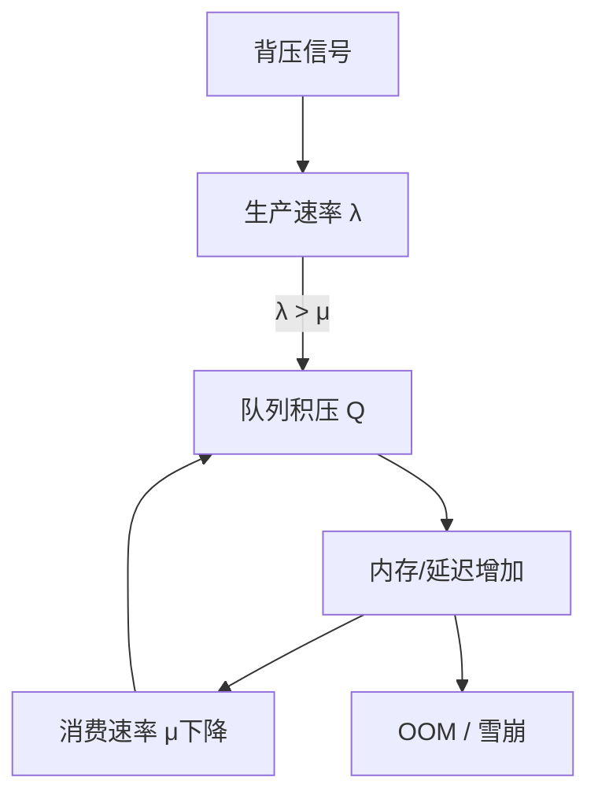
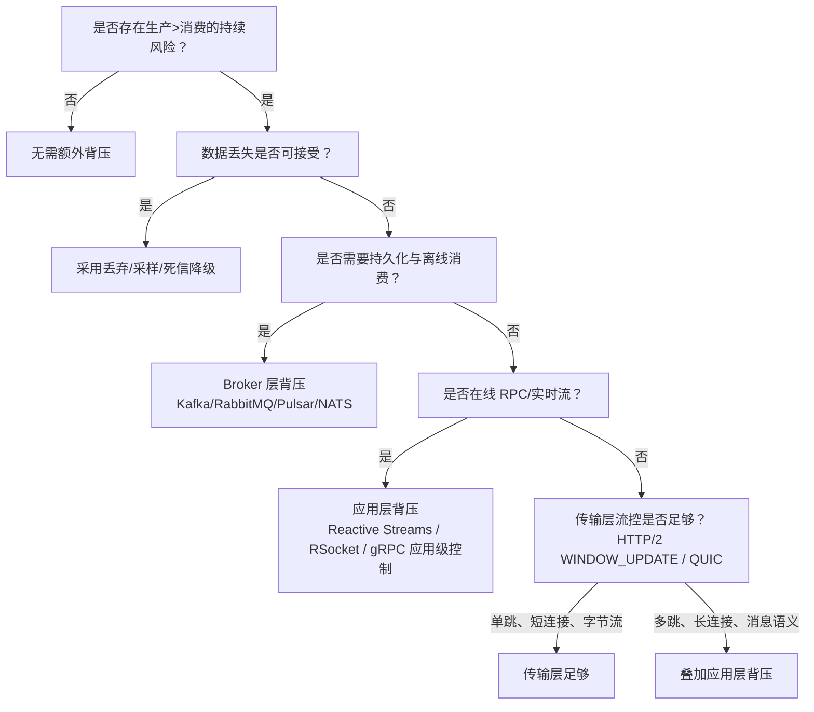

# 1.66 背压机制全谱系

> **置信口径**: 协议/规范语义=【定理】；架构对比与工程推理=【论证】；正文未单独标注的具体数字（阈值/百分比/时长）按【估算】理解（AGENTS.md §4.1，P3 基线声明）。
> **时效声明**: 本文事实基于 Kafka/Pulsar/RabbitMQ/NATS/Redis/MQTT、Apache Flink、Reactive Streams、gRPC、RSocket、HTTP/2、QUIC 官方发布信息与 RFC，核实至 2026-11。
> **定位声明**: 本文档是 01 系列深度分析旗舰篇，承接并深化 [01-40-应用层流协议与交互标准](01-40-应用层流协议与交互标准.md) 中 Reactive Streams 与 RSocket 两节，与 [02-22-消息流控设计](../02-场景驱动架构设计/02-22-消息流控设计.md) 形成“概念-设计”互补；落地操作请互链 03 系列。核心术语定义见 [01-58-全局核心概念卡片总表](01-58-全局核心概念卡片总表.md)。

## 目录

- [1.66 背压机制全谱系](#166-背压机制全谱系)
  - [目录](#目录)
  - [1.66.1 背压的动因与形式化刻画](#1661-背压的动因与形式化刻画)
    - [1.66.1.1 生产-消费速率失衡](#16611-生产-消费速率失衡)
    - [1.66.1.2 M/M/1 稳定性临界与排队模型](#16612-mm1-稳定性临界与排队模型)
  - [1.66.2 传输层流控](#1662-传输层流控)
    - [1.66.2.1 TCP 滑动窗口](#16621-tcp-滑动窗口)
    - [1.66.2.2 HTTP/2 流控窗口](#16622-http2-流控窗口)
    - [1.66.2.3 QUIC 信用机制](#16623-quic-信用机制)
    - [1.66.2.4 传输层与消息层背压的差异](#16624-传输层与消息层背压的差异)
  - [1.66.3 应用层背压协议：Reactive Streams](#1663-应用层背压协议reactive-streams)
    - [1.66.3.1 request-n 协议语义](#16631-request-n-协议语义)
    - [1.66.3.2 Java 9 Flow 实现示例](#16632-java-9-flow-实现示例)
    - [1.66.3.3 Project Reactor 与 RxJava/Akka Streams 对照](#16633-project-reactor-与-rxjavaakka-streams-对照)
  - [1.66.4 Broker 内置背压](#1664-broker-内置背压)
    - [1.66.4.1 Kafka：producer buffer 与 consumer fetch 限制](#16641-kafkaproducer-buffer-与-consumer-fetch-限制)
    - [1.66.4.2 RabbitMQ：prefetch/QoS 与 AMQP 1.0 credit flow](#16642-rabbitmqprefetchqos-与-amqp-10-credit-flow)
    - [1.66.4.3 Pulsar：receiver queue](#16643-pulsarreceiver-queue)
    - [1.66.4.4 NATS：pull consumer 的 fetch/ack 等待](#16644-natspull-consumer-的-fetchack-等待)
    - [1.66.4.5 Redis Stream：无原生背压的补偿](#16645-redis-stream无原生背压的补偿)
  - [1.66.5 系统级背压](#1665-系统级背压)
    - [1.66.5.1 gRPC streaming 流控](#16651-grpc-streaming-流控)
    - [1.66.5.2 RSocket request-n](#16652-rsocket-request-n)
    - [1.66.5.3 Flink 背压传播机制](#16653-flink-背压传播机制)
  - [1.66.6 无背压的灾难模式](#1666-无背压的灾难模式)
  - [1.66.7 背压观测指标体系](#1667-背压观测指标体系)
  - [1.66.8 设计决策树](#1668-设计决策树)
  - [1.66.9 参考来源](#1669-参考来源)

---

## 1.66.1 背压的动因与形式化刻画

### 1.66.1.1 生产-消费速率失衡

消息队列的本质是**时间解耦**：生产者 `λ(t)` 与消费者 `μ(t)` 的速率不必时刻相等，系统通过队列吸收瞬时差值。当 `λ(t) > μ(t)` 持续存在时，差值不会消失，只会以**队列深度**、**延迟**、**资源占用**三种形式积累。若没有任何背压机制，积累将趋向无界，最终触发 OOM、磁盘耗尽或级联超时。

【论证】背压（Backpressure）不是“让系统变慢”的优化手段，而是**把无界增长转化为有界排队或上游减速**的稳定性控制。其数学本质是一个负反馈回路：下游把自身处理能力以信号形式返回上游，上游据此调节 `λ(t)`。信号可以是 TCP 窗口大小、HTTP/2 的 WINDOW_UPDATE、Reactive Streams 的 `request(n)`，也可以是 Kafka producer buffer 满时的阻塞。



上图中，若没有 `F` 这条反馈边，正反馈环 `B → C → D → B` 会使系统在有限时间内越过资源边界。

### 1.66.1.2 M/M/1 稳定性临界与排队模型

【论证】把单分区/单队列抽象为 M/M/1 排队系统：到达率为 `λ`（消息/秒），服务率为 `μ`（消息/秒），利用率 `ρ = λ / μ`。该模型假设到达与服务均为泊松过程、单服务台、无限缓冲区，虽与真实 MQ 的批量、分区、重试不完全一致，但能给出**稳定性临界**的清晰边界。

稳定条件为：

```text
ρ = λ / μ < 1
```

当 `ρ < 1` 时，稳态下平均队列长度 `L` 与平均等待时间 `W` 为：

```text
L = ρ / (1 - ρ)
W = 1 / (μ - λ)
```

当 `ρ → 1` 时，`L` 与 `W` 趋向无穷；`ρ ≥ 1` 时系统进入**不稳定态**，队列长度随时间线性增长：

```text
Q(t) = Q(0) + (λ - μ) * t
```

| 利用率 ρ | 平均队列长度 L | 工程含义 |
| ------ | -------------- | -------- |
| 0.5 | 1 | 资源充足，延迟低 |
| 0.7 | 2.33 | 健康负载，有一定缓冲 |
| 0.8 | 4 | 高负载，尾部延迟开始放大 |
| 0.9 | 9 | 接近临界，抖动敏感 |
| 0.95 | 19 | 风险区，轻微扰动即可雪崩 |
| ≥1.0 | ∞ | 不稳定，必须引入背压或扩容 |

【估算】生产环境的 Kafka 分区利用率通常建议控制在 0.7 以下；若持续高于 0.8，应优先扩容分区或消费实例，而非仅靠调大 buffer 掩盖问题。

---

## 1.66.2 传输层流控

传输层流控解决的是“**字节流**”级别的速率匹配：发送方不应超过接收方 TCP 接收缓冲区的容量。它与消息层背压的核心差异在于**不感知消息边界**，也不理解业务语义。

### 1.66.2.1 TCP 滑动窗口

【定理】TCP 滑动窗口由 RFC 793 及后续 RFC 1323/7323 定义，接收方通过 TCP 头部的 `Window Size` 字段通告剩余接收缓冲区；发送方在 `min(rwnd, cwnd)` 范围内发送未确认字节。若窗口为 0，发送方停止发送（零窗口探测除外）。

- **rwnd（接收窗口）**：接收方应用读取速度的函数。
- **cwnd（拥塞窗口）**：发送方根据网络拥塞状态动态调整，与背压无直接对应。

TCP 流控是**字节级、连接级、无消息边界**的。对消息队列而言，这意味着：即使 consumer 已经处理完 99 条消息，只要 TCP 缓冲区里还有未确认字节，producer 仍可能继续发送；TCP 不会按“消息条数”停止发送。

### 1.66.2.2 HTTP/2 流控窗口

【定理】HTTP/2 在 TCP 之上再引入一层**流级 + 连接级**的信用流控，定义于 RFC 7540（已被 RFC 9113 替代更新）。每条流初始窗口为 65,535 字节，连接级窗口同样为 65,535 字节；接收方通过 `WINDOW_UPDATE` 帧增加信用。

关键属性：

| 属性 | 说明 |
| ---- | ---- |
| 双层级 | 连接窗口控制所有流总和，流窗口控制单条流 |
| 按字节计数 | 以字节而非消息为单位 |
| 独立停滞 | 一条流窗口耗尽不会阻塞其他流，避免队头阻塞 |
| 不可撤销 | WINDOW_UPDATE 只能增加窗口，不能减少 |

HTTP/2 的流控让代理/服务器可以针对慢消费流单独限速，而不会影响同连接上的其他请求。gRPC streaming 直接继承这套机制。

### 1.66.2.3 QUIC 信用机制

【定理】QUIC 在 RFC 9000 中定义了连接级（`MAX_DATA`）与流级（`MAX_STREAM_DATA`）两种流量控制信用。与 HTTP/2 类似，发送方 `bytes_in_flight` 不得超过接收方通告的绝对偏移上限；接收方在应用读取数据后发送新的 `MAX_DATA` / `MAX_STREAM_DATA` 帧授予额外信用。

QUIC 相对 HTTP/2 over TCP 的优势：

- **消除 TCP 队头阻塞**：单条流窗口耗尽只停滞该流，其他流在同一条 QUIC 连接上继续传输。
- **0-RTT/1-RTT 握手**：初始传输参数在握手时交换，包括 `initial_max_data`、`initial_max_stream_data_bidi_local` 等。
- **用户空间实现**：应用层可直接读取并释放缓冲区，信用更新更及时。

### 1.66.2.4 传输层与消息层背压的差异

| 维度 | TCP 滑动窗口 | HTTP/2 WINDOW_UPDATE | QUIC MAX_DATA | 消息层背压（MQ/RS） |
| ---- | ------------ | --------------------- | ------------- | ------------------- |
| 控制粒度 | 连接字节流 | 连接 + 单流字节 | 连接 + 单流字节 | 消息/元素/批次 |
| 感知消息边界 | 否 | 否 | 否 | 是 |
| 信用单位 | 字节 | 字节 | 字节 | 消息数/元素数 |
| 跨连接 | 否 | 单连接多路复用 | 单连接多路复用 | 可跨连接/订阅 |
| 业务语义 | 无 | 无 | 无 | 有（处理完成再请求） |
| 典型场景 | 通用字节传输 | gRPC/Web 多路复用 | HTTP/3、低延迟游戏 | Kafka pull、Reactive Streams |

【论证】传输层流控是“必要的底盘”：没有它，网络缓冲区会先于应用缓冲区溢出。但它不足以替代消息层背压，因为传输层不知道一条消息何时才算被业务处理完成。工程上二者通常分层叠加：TCP/HTTP/2/QUIC 保护网络，MQ prefetch / Reactive Streams 保护应用。

---

## 1.66.3 应用层背压协议：Reactive Streams

### 1.66.3.1 request-n 协议语义

【定理】Reactive Streams JVM 规范当前稳定版为 1.0.4（2022-05-26 发布），定义了 `Publisher<T>`、`Subscriber<T>`、`Subscription`、`Processor<T,R>` 四个核心接口。背压通过 `Subscription.request(long n)` 实现：Subscriber 显式请求 `n` 个元素，Publisher 在未收到请求前不得调用 `onNext` 推送数据。

协议核心规则（非完整列举）：

1. `Publisher` 必须在 `Subscriber.onSubscribe` 之后才能调用 `onNext`/`onError`/`onComplete`。
2. `Subscriber` 通过 `Subscription.request(n)` 表达需求，`n > 0`。
3. `Publisher` 推送的元素总数不得超过 `Subscriber` 已请求的累计总数。
4. `Subscriber` 可随时调用 `Subscription.cancel()` 终止订阅。

这套规则把“推”模型改造为“**按需拉取**”模型，使下游处理能力成为上游发送的硬约束。

### 1.66.3.2 Java 9 Flow 实现示例

Java 9 将语义等价的接口纳入标准库 `java.util.concurrent.Flow`。以下示例展示一个按处理能力逐条请求的 Subscriber：

```java
import java.util.concurrent.*;

public class FlowBackpressureDemo {
    public static void main(String[] args) throws InterruptedException {
        SubmissionPublisher<String> publisher = new SubmissionPublisher<>();
        publisher.subscribe(new Flow.Subscriber<>() {
            private Flow.Subscription subscription;
            @Override public void onSubscribe(Flow.Subscription s) {
                this.subscription = s;
                s.request(1); // 初始只请求 1 个元素
            }
            @Override public void onNext(String item) {
                process(item);
                subscription.request(1); // 处理完再请求 1 个
            }
            @Override public void onError(Throwable t) { t.printStackTrace(); }
            @Override public void onComplete() { System.out.println("done"); }
        });
        for (int i = 0; i < 10; i++) publisher.submit("msg-" + i);
        publisher.close();
        Thread.sleep(1000);
    }
    static void process(String s) { System.out.println("processing " + s); }
}
```

上例中，Publisher 的 `submit()` 在 Subscriber 未请求时不会无界堆积，因为 `SubmissionPublisher` 内部使用缓冲与背压策略（默认 `BUFFER`）。若生产速度持续高于消费速度，最终 `submit` 也会阻塞或抛出异常，取决于配置。

### 1.66.3.3 Project Reactor 与 RxJava/Akka Streams 对照

| 实现 | 核心类型 | 背压表达方式 | 生态归属 | 当前基线（2026-11） |
| ---- | -------- | ------------ | -------- | ------------------- |
| Project Reactor | `Flux<T>` / `Mono<T>` | `limitRate(n)`、`onBackpressureBuffer()`、`requestedFromDownstream()` | Spring | 3.8.8（BOM 2025.0.8） |
| RxJava | `Flowable<T>` / `Observable<T>` | `request(n)`、`onBackpressureBuffer/Drop/Latest` | RxJava 社区 | 3.1.x 稳定，4.x alpha |
| Akka Streams | `Source` / `Sink` / `Flow` | `mapAsync(parallelism)`、`throttle`、`asyncBoundary` | Akka / Pekko | 2.11.x |
| Java 9 Flow | `Flow.Publisher` / `Flow.Subscriber` | `Subscription.request(long)` | JDK | Java 9+ |
| Mutiny | `Multi<T>` / `Uni<T>` | `overflow()`、`broadcast()` | Quarkus | 2.x |

Project Reactor 示例：

```java
Flux.create(sink -> {
    long requested = sink.requestedFromDownstream();
    for (long i = 0; i < requested && !sink.isCancelled(); i++) {
        sink.next(fetchNext());
    }
    sink.complete();
}, FluxSink.OverflowStrategy.BUFFER)
.limitRate(64)           // 每次向下游请求 64 个
.onBackpressureBuffer(256) // 最多缓冲 256 个未消费元素
.subscribe(this::process);
```

RxJava 示例：

```java
Flowable.generate(
    () -> 0L,
    (state, emitter) -> {
        emitter.onNext(state);
        return state + 1;
    }
)
.onBackpressureBuffer(128)   // 缓冲 128 个
.observeOn(Schedulers.io(), false, 16) // 下游 observeOn 队列 16
.subscribe(System.out::println);
```

Akka Streams 示例：

```scala
Source(1 to 1000000)
  .throttle(100, 1.second)          // 限速 100 条/秒
  .mapAsync(4)(i => Future(process(i))) // 最多 4 个并发异步处理
  .runWith(Sink.ignore)
```

【论证】Reactive Streams 是**应用层背压的通用契约**，但它不解决网络传输问题；工程上常与 MQ 组合：Kafka `KafkaReceiver` 返回 `Flux`，消费端用 Reactor 控制处理并发，MQ 负责持久化与削峰。详见 [01-40-应用层流协议与交互标准](01-40-应用层流协议与交互标准.md) 与 [01-52-多语言客户端生态与编程模型](01-52-多语言客户端生态与编程模型.md) 的响应式编程模型节。

---

## 1.66.4 Broker 内置背压

Broker 内置背压是消息系统的“中间层保险”：它不依赖应用代码是否实现 Reactive Streams，而是利用协议或客户端配置限制未处理消息的数量。

### 1.66.4.1 Kafka：producer buffer 与 consumer fetch 限制

Kafka producer 背压体现为**发送缓冲区满时阻塞**。`buffer.memory` 默认 32 MB（33554432 bytes），`max.block.ms` 默认 60 秒。当 `send()` 速度快于 broker 确认速度时，记录先进入 `RecordAccumulator`；若缓冲区满，`send()` 会阻塞直到有空间或超时。

```properties
# Kafka producer 背压相关配置
buffer.memory=33554432          # 发送缓冲总字节
max.block.ms=60000              # send() 阻塞上限，超时抛 TimeoutException
max.in.flight.requests.per.connection=5  # 单连接未确认请求数
enable.idempotence=true         # 开启后 in-flight 重试仍保证分区顺序
linger.ms=10                    # 批量等待，降低网络往返
batch.size=16384                # 单批次目标字节
```

`max.in.flight.requests.per.connection` 与顺序性的关系：

- 当 `enable.idempotence=true` 时，即使 `max.in.flight > 1` 且发生重试，Kafka 也能保证**单分区、单会话**的写入顺序。
- 若关闭幂等性，`max.in.flight > 1` 与重试组合可能导致消息乱序。

Consumer 侧背压：

```properties
# Kafka consumer 背压相关配置
fetch.max.bytes=52428800        # 一次 fetch 所有分区返回的最大字节（默认 50 MB）
max.partition.fetch.bytes=1048576 # 单分区最大字节（默认 1 MB）
max.poll.records=500            # 一次 poll 最多返回记录数
max.poll.interval.ms=300000     # 处理超时触发再平衡
```

【论证】Kafka 的 consumer 背压本质上是**拉取限速**：消费者按自己的节奏 poll，broker 不会主动推送。`fetch.max.bytes` 与 `max.poll.records` 共同决定了单次 poll 的“债务上限”，避免一次拉取过多导致下游处理不过来。

### 1.66.4.2 RabbitMQ：prefetch/QoS 与 AMQP 1.0 credit flow

RabbitMQ 默认采用 push 模式向消费者投递消息，因此必须显式设置 prefetch（QoS）来限制未确认消息数，否则单个慢消费者可能堆积大量消息。

```python
import pika

channel = connection.channel()
channel.basic_qos(
    prefetch_count=10,   # 每个消费者最多 10 条未确认消息
    prefetch_size=0,     # 不限制字节（RabbitMQ 0-9-1 中 prefetch_size 不常用）
    global_qos=False     # False=按消费者；True=按 channel 全局
)
channel.basic_consume(queue='orders', on_message_callback=handle)
```

当未确认消息数达到 `prefetch_count` 时，RabbitMQ 不再向该消费者推送新消息，实现**消息级背压**。

AMQP 1.0 则使用更原生的 credit-based 流控：接收者通过 `flow` 帧向发送者授予 link credit，发送者只能在 credit > 0 时发送。详细语义与帧交互见 [01-42-JMS-AMQP-与传统企业消息标准](01-42-JMS-AMQP-与传统企业消息标准.md) 的“Link 与 Credit-based 背压”节。

```text
Receiver -> flow(credit=10)  -> Sender
Sender   -> transfer(msg)    -> Receiver
Receiver -> flow(credit=9)   -> Sender
```

RabbitMQ 4.0+ 原生支持 AMQP 1.0，新应用可评估使用官方 AMQP 1.0 客户端获得更精确的信用背压。

### 1.66.4.3 Pulsar：receiver queue

Pulsar consumer 通过 `receiverQueueSize` 控制客户端预取消息数，默认 1000 条。该队列是 consumer 与 broker 之间的缓冲，过大可能掩盖背压，过小则增加网络往返。

```java
Consumer<String> consumer = client.newConsumer(Schema.STRING)
    .topic("persistent://public/default/orders")
    .subscriptionName("payment-sub")
    .receiverQueueSize(500)          // 默认 1000，根据下游处理能力下调
    .maxTotalReceiverQueueSizeAcrossPartitions(2000)
    .negativeAckRedeliveryDelay(1, TimeUnit.MINUTES)
    .subscribe();
```

Pulsar 还提供：

- `receiverQueueSize=0` 模式： consumer 每次显式请求一条，类似 pull 语义，背压最强。
- Negative Ack / Dead Letter Topic：处理失败的消息可按策略重投或转储，避免无限占用 queue。

### 1.66.4.4 NATS：pull consumer 的 fetch/ack 等待

NATS Core 的 push 订阅存在“slow consumer”风险：若消费者处理不过来，broker 会断开连接或丢弃消息。JetStream 的 **pull consumer** 把节奏控制权交还消费者。

```go
js, _ := nc.JetStream()
sub, _ := js.PullSubscribe("orders.>", "order-processor")

for {
    // 每次最多拉 100 条，最多等 5 秒
    msgs, err := sub.Fetch(100, nats.MaxWait(5*time.Second))
    if err != nil {
        continue
    }
    for _, msg := range msgs {
        process(msg.Data)
        msg.Ack()
    }
}
```

关键参数：

| 参数 | 含义 | 背压作用 |
| ---- | ---- | -------- |
| `Fetch(batch)` | 每次拉取条数 | 直接限制未处理债务 |
| `MaxWait` | 拉取超时 | 避免阻塞过久 |
| `max_ack_pending` | 消费者配置 | 未 ack 上限，broker 不再投递 |
| `ack_wait` | ack 超时 | 超时后重投，防止消息永久挂起 |

### 1.66.4.5 Redis Stream：无原生背压的补偿

Redis Stream 本身**没有内置背压机制**：`XADD` 持续写入不会阻塞， consumer 通过 `XREADGROUP` 读取。若生产者远快于消费者，Stream 会按 `MAXLEN` 策略截断或无限增长，导致数据丢失或内存暴涨。

补偿方案：

1. **消费侧限速**：在 `XREADGROUP` 中显式限制 `COUNT`，每次只拉取固定条数。
2. **PEL 长度监控**：用 `XPENDING` 监控已投递未确认的消息数，超过阈值时暂停拉取。
3. **应用层令牌桶**：消费循环前加 `RateLimiter`，使处理速率不超过下游容量。
4. **Stream 大小上限**：设置 `MAXLEN ~ <count>`，在内存与完整性之间取舍。

```python
import redis
import time

r = redis.Redis()
GROUP = 'workers'
CONSUMER = 'worker-1'
STREAM = 'events'

while True:
    # COUNT=10 显式拉取限制
    msgs = r.xreadgroup(GROUP, CONSUMER, {STREAM: '>'}, count=10, block=1000)
    if not msgs:
        continue
    pending = r.xpending(STREAM, GROUP)['pending']
    if pending > 1000:          # 应用层背压阈值
        time.sleep(1)
        continue
    for _, entries in msgs:
        for entry_id, fields in entries:
            process(fields)
            r.xack(STREAM, GROUP, entry_id)
```

---

## 1.66.5 系统级背压

### 1.66.5.1 gRPC streaming 流控

gRPC 基于 HTTP/2，因此天然继承其流控窗口。对于 streaming RPC，发送方的 `Send()` 在以下情况下会阻塞或进入 onReady 回调：

- 对端接收窗口耗尽（HTTP/2 流级/连接级 WINDOW_UPDATE 未到达）。
- gRPC 自己的 send buffer 达到配额。

Go 语言示例展示了如何利用阻塞语义实现隐式背压：

```go
for _, item := range items {
    if err := stream.Send(&pb.Event{Data: item}); err != nil {
        return err
    }
    // stream.Send 在 HTTP/2 窗口耗尽时阻塞，形成背压
}
stream.CloseSend()
```

Java 中可使用 `isReady()` / `setOnReadyHandler()` 做非阻塞控制：

```java
responseObserver.setOnReadyHandler(() -> {
    while (responseObserver.isReady() && hasMore()) {
        responseObserver.onNext(nextEvent());
    }
});
```

【论证】gRPC 的背压主要在**传输层**；它保证字节流不会压垮对端，但不会等待对端“业务处理完成”。若需要应用级确认，应在 proto 中设计显式的 ack/ready 消息，或使用 RSocket/Reactive Streams 层。

### 1.66.5.2 RSocket request-n

RSocket 是面向 Reactive Streams 语义的二进制应用层协议，支持 Request-Response、Fire-and-Forget、Request-Stream、Request-Channel 四种交互模型。其背压通过 `REQUEST_N` 帧实现：请求者授予响应者一定数量的 PAYLOAD 发送信用，响应者只能在该 credit 范围内发送。

```text
Requester -> REQUEST_STREAM(initial_request_n=10) -> Responder
Responder -> PAYLOAD(data) -> Requester
Requester -> REQUEST_N(n=5) -> Responder
Responder -> PAYLOAD(data) x 5 -> Requester
```

除 `REQUEST_N` 外，RSocket 还提供 `LEASE` 帧做连接级拥塞控制：服务端通过 LEASE 限制客户端可发起的请求总数。详见 [01-40-应用层流协议与交互标准](01-40-应用层流协议与交互标准.md) 的 RSocket 节。

### 1.66.5.3 Flink 背压传播机制

Apache Flink 的背压是分布式流处理中的经典实现。Flink TaskManager 之间的网络栈采用**基于信用的流控（credit-based flow control）**：

- 每个下游 Task 维护一组输入缓冲（exclusive buffers + floating buffers）。
- 下游向上游发送**信用（credit）**，表示当前可接收的 buffer 数量。
- 上游只有在 credit > 0 时才会发送数据；credit 为 0 时上游阻塞。
- 阻塞会沿拓扑反向传播，直到 source 降低读取速率。

Flink Web UI 暴露三项关键指标：

| 指标 | 含义 | 判读方式 |
| ---- | ---- | -------- |
| `backPressuredTimeMsPerSecond` | 每秒处于背压状态的毫秒数 | 越接近 1000ms 背压越严重 |
| `idleTimeMsPerSecond` | 每秒等待输入的毫秒数 | 高表示上游慢或已反压到底 |
| `busyTimeMsPerSecond` | 每秒实际处理工作的毫秒数 | 三项之和约等于 1000ms |

【定理】根据 Flink 官方文档，现代 Flink 通过**输出缓冲区可用性**判断背压：若 subtask 没有可用输出缓冲区，则视为背压。旧版本（≤1.11）曾使用堆栈采样（stack trace sampling）估算背压，已被淘汰。

```yaml
# flink-conf.yaml 中与网络背压相关的内存参数
taskmanager.memory.network.fraction: 0.1
taskmanager.memory.network.min: 64mb
taskmanager.memory.network.max: 1gb
taskmanager.network.memory.buffers-per-channel: 2
taskmanager.network.memory.floating-buffers-per-gate: 8
```

---

## 1.66.6 无背压的灾难模式

当生产速率持续大于消费速率且没有任何背压时，系统会沿以下时序恶化。

| 阶段 | 时间 | 现象 | 根因 |
| ---- | ---- | ---- | ---- |
| T+0 | 突发开始 | 生产速率 λ 突然升高（如大促、批量补偿） | 上游流量尖峰 |
| T+1 | 秒级 | 队列/分区积压快速增长，consumer lag 上升 | λ > μ |
| T+2 | 分钟级 | 消费者 JVM heap / 网络缓冲占用升高，GC 频率增加 | 未处理消息堆积 |
| T+3 | 数分钟 | Broker 进入流控：Kafka quota 触发、RabbitMQ 阻塞连接、NATS slow consumer 断开 | 资源达到阈值 |
| T+4 | 数分钟 | 下游依赖（DB、缓存、外部 API）被拖垮，延迟暴涨 | 队列溢出到下游 |
| T+5 | 十分钟级 | 级联超时、重试放大、服务雪崩，最终 OOM 或磁盘满 | 正反馈失控 |

【论证】无背压系统的失败模式不是“突然崩溃”，而是**从队列积压到资源耗尽再到级联故障**的渐进过程。若在 T+1 阶段就能通过背压信号让上游减速，则 T+5 的雪崩可以避免。

上游保护手段：

- **熔断**：当下游延迟/错误率达到阈值时，快速失败，避免继续加压。见 [02-22-消息流控设计](../02-场景驱动架构设计/02-22-消息流控设计.md)。
- **限流**：在 producer 入口或网关层用令牌桶/滑动窗口限制 λ。见 [02-37-消息限流设计](../02-场景驱动架构设计/02-37-消息限流设计.md)。
- **降级**：丢弃非关键消息、采样、或转储到死信队列。

---

## 1.66.7 背压观测指标体系

背压是否生效、是否过度，需要量化指标支撑。建议建立以下指标矩阵：

| 指标类别 | 指标名 | 采集位置 | 告警阈值（【估算】） | 说明 |
| -------- | ------ | -------- | --------------------- | ---- |
| Producer buffer | `buffer-available-bytes` / `buffer-total-bytes` | Kafka producer metrics | 使用率 > 80% 持续 2min | 接近满时 send() 将阻塞 |
| Consumer lag | `kafka_consumer_lag_records` / `pulsar_subscription_backlog` | Consumer group / Pulsar sub | lag > 10000 或 5min 增长 10x | 最直接的背压结果指标 |
| 反压比率 | `backPressuredTimeMsPerSecond / 1000` | Flink subtask metrics | > 50% 高反压，> 10% 关注 | Flink 专用 |
| 队列深度 | `rabbitmq_queue_messages` / `redis_stream_length` | Broker / Redis INFO | > 10000 条或持续增长 | 提示消费跟不上 |
| Ack 待处理 | `nats_consumer_num_ack_pending` / Pulsar `pendingMessages` | Consumer stats | > prefetch/receiverQueue 的 80% | 消费者处理债务 |
| Fetch 延迟 | `fetch-latency-avg` / `records-lag-max` | Kafka consumer metrics | p99 > 5s | 网络或处理慢 |
| 流控触发 | `kafka_produce_throttle_time_avg` | Broker metrics | > 100ms 持续 | Broker 主动限流 |

告警设计原则：

1. **lag 是结果指标**：lag 高说明已经存在背压，应配套 producer buffer/反压比率等先行指标。
2. **阈值应随流量基线动态调整**：固定阈值在业务增长后会频繁误报，可用同比/环比或自适应基线。
3. **区分正常排队与异常堆积**：业务低谷期的 lag 与峰值期的 lag 含义不同。

---

## 1.66.8 设计决策树

何时仅依赖传输层流控？何时必须引入应用层或 Broker 层背压？决策流程如下：



各层选择对照表：

| 场景特征 | 推荐背压层 | 代表技术 | 关键配置 |
| -------- | ---------- | -------- | -------- |
| 持久化消息、消费者可离线 | Broker 层 | Kafka, Pulsar, RabbitMQ | `prefetch`、`receiverQueueSize`、`fetch.max.bytes` |
| 跨服务在线 RPC 流 | 应用层 + 传输层 | gRPC + 应用级 isReady | `onReadyHandler`、`flowControlWindow` |
| Reactive 端到端流 | 应用层 | Reactive Streams / RSocket | `request(n)`、`REQUEST_N`、`LEASE` |
| 浏览器/移动端实时推送 | 传输/应用层 | WebSocket/SSE/WebTransport | TCP buffer、应用级 request-n |
| 内部字节流大数据传输 | 传输层 | TCP/HTTP/2/QUIC | rwnd、WINDOW_UPDATE、MAX_DATA |
| 无原生背压的轻量队列 | 应用层补偿 | Redis Stream | `COUNT`、`XPENDING`、RateLimiter |

【论证】背压设计应遵循**分层防御**：传输层兜底网络、Broker 层兜底持久化吞吐、应用层兜底业务处理能力。单独任何一层都无法覆盖全部故障模式。

---

## 1.66.9 参考来源

- [Kafka Producer Configs](https://kafka.apache.org/documentation/#producerconfigs)
- [Kafka Consumer Configs](https://kafka.apache.org/documentation/#consumerconfigs)
- [RabbitMQ Confirms and QoS](https://www.rabbitmq.com/confirms.html)
- [RabbitMQ AMQP 1.0 文档](https://www.rabbitmq.com/docs/amqp)
- [OASIS AMQP 1.0 Core Specification](https://docs.oasis-open.org/amqp/core/v1.0/os/amqp-core-complete-v1.0-os.pdf)
- [Apache Pulsar Consumer API](https://pulsar.apache.org/docs/next/client-libraries-java/)
- [NATS JetStream Pull Consumers](https://docs.nats.io/using-nats/developer/consuming/push)
- [Redis Streams](https://redis.io/docs/data-types/streams/)
- [Reactive Streams JVM 1.0.4](https://www.reactive-streams.org/)
- [Project Reactor Reference](https://projectreactor.io/docs/core/release/reference/)
- [RxJava Wiki](https://github.com/ReactiveX/RxJava/wiki)
- [Akka Streams](https://doc.akka.io/docs/akka/current/stream/index.html)
- [gRPC Core Documentation](https://grpc.io/docs/what-is-grpc/introduction/)
- [RSocket Protocol](https://rsocket.io/about/protocol/)
- [Flink Back Pressure Monitoring](https://nightlies.apache.org/flink/flink-docs-stable/docs/ops/monitoring/back_pressure/)
- [Flink Network Stack Vol. 2](https://flink.apache.org/2019/07/23/flink-network-stack-vol.-2-monitoring-metrics-and-that-backpressure-thing/)
- [RFC 7540 / RFC 9113 — HTTP/2](https://httpwg.org/specs/rfc9113.html)
- [RFC 9000 — QUIC](https://datatracker.ietf.org/doc/html/rfc9000)
- [01-40-应用层流协议与交互标准](./01-40-应用层流协议与交互标准.md)
- [01-42-JMS-AMQP-与传统企业消息标准](./01-42-JMS-AMQP-与传统企业消息标准.md)
- [01-52-多语言客户端生态与编程模型](./01-52-多语言客户端生态与编程模型.md)
- [01-58-全局核心概念卡片总表](./01-58-全局核心概念卡片总表.md)
- [02-22-消息流控设计](../02-场景驱动架构设计/02-22-消息流控设计.md)
- [02-37-消息限流设计](../02-场景驱动架构设计/02-37-消息限流设计.md)

---

**最后更新**: 2026-11-18
