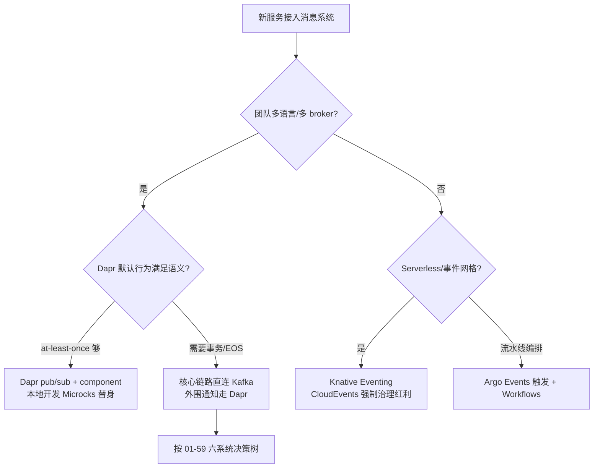

# 01-68 云原生抽象消息层评测

> **置信口径**: 各项目公开文档事实=【论证】（CNCF 级别/版本事实经 WebSearch 核实）；能力裁剪判断=【论证】；无公开数据=【估算】。
> **时效声明**: 核实至 2026-11（Dapr/Knative/Argo CNCF 状态、Dapr 交付语义文档、Microcks 集成状态）。
> **本文档定位**: 深度旗舰篇。应用与 broker 之间的"通用通信层"——Dapr pub/sub、Knative Eventing、Argo Events 三大国际主流方案全面对照，回应"六系统直连之外"的架构层。与 [01-40](01-40-应用层流协议与交互标准.md)（流协议层）互补：01-40 论传输，本篇论平台抽象。

## 目录

- [01-68 云原生抽象消息层评测](#01-68-云原生抽象消息层评测)
  - [目录](#目录)
  - [1.68.1 问题定义：直连六系统的耦合成本](#1681-问题定义直连六系统的耦合成本)
  - [1.68.2 Dapr pub/sub building block](#1682-dapr-pubsub-building-block)
  - [1.68.3 Knative Eventing](#1683-knative-eventing)
  - [1.68.4 Argo Events](#1684-argo-events)
  - [1.68.5 十二维对照总表](#1685-十二维对照总表)
  - [1.68.6 评测落地：本项目如何实测](#1686-评测落地本项目如何实测)
  - [1.68.7 选型决策树](#1687-选型决策树)
  - [1.68.8 参考来源](#1688-参考来源)

---

## 1.68.1 问题定义：直连六系统的耦合成本

应用直连 broker 的隐性成本【论证】：

```text
直连耦合面                      抽象层收敛为
├─ SDK 锁定（六套客户端语义）      → 统一 pub/sub API（HTTP/gRPC 调用）
├─ 拓扑知识（topic/exchange 名）   → component 声明（运维侧配置）
├─ 语义承诺散落代码（重试/背压）   → building block 默认行为 + 声明式覆盖
├─ 本地开发依赖真实 broker        → sidecar mock / Microcks 替身
└─ 多语言客户端质量参差（01-52）   → sidecar 统一实现
```

代价同样明确【论证】：能力下沉损失（协议特有特性如 Kafka 事务被裁剪）、延迟 +1 hop（进程内→localhost sidecar，~0.5-2ms【估算】）、故障域扩大（sidecar 成为新 SPOF 层）、运维面新增（sidecar 生命周期管理）。

## 1.68.2 Dapr pub/sub building block

**模型**：应用经 Dapr API（`v1.0/publish/{pubsub}/{topic}` / 订阅 webhook）与具体 broker 解耦；broker 以 component YAML 声明（pubsub.kafka/rabbitmq/nats/pulsar/redis/in-memory 等——组件清单执行时以 [官方组件文档](https://docs.dapr.io/reference/components-reference/supported-pubsub/) 复核）。

```yaml
# component 声明（与 config-templates 风格对齐）
apiVersion: dapr.io/v1alpha1
kind: Component
metadata:
  name: eventbus
spec:
  type: pubsub.kafka
  version: v1
  metadata:
    - name: brokers
      value: "kafka:9092"
    - name: consumerGroup
      value: "order-service"
    - name: deadLetterTopic           # 死信：路由到独立 topic
      value: "orders.dlq"
```

**语义裁剪（关键，核实官方文档）**：Dapr pub/sub 默认交付保证为 **at-least-once**；CloudEvents 信封为默认包装（content-type 强制）；顺序性不承诺（除非 bulk/subscribe 配置有序语义）；backpressure 由 sidecar 订阅推送的窗口控制。

**上游 conformance**：Dapr 仓库自带 conformance 测试矩阵（components-contrib 仓库 pubsub 目录），按组件标记 supported/beta/stable——本项目评测直接复用其断言集，不重复造轮子（§1.68.6）。

**与 Microcks 的协同**（国际生态信号）：Microcks 2025 年与 Dapr 社区建立官方协作（[CNCF 博客](https://www.cncf.io/blog/2026/05/07/microcks-becomes-a-cncf-incubating-project/)证实），本地开发用 Microcks 替身 sidecar——本项目 06-行为验证层的组合路径已有国际先例。

## 1.68.3 Knative Eventing

**模型**：CloudEvents 强制的事件网格——Producer → Broker（事件入口）→ Trigger（过滤器）→ Subscriber。Kafka 实现（Kafka Broker/Channel）是生产主流。

```yaml
# Trigger 声明：过滤+投递
apiVersion: eventing.knative.dev/v1
kind: Trigger
metadata:
  name: order-events
spec:
  broker: default
  filter:
    attributes:
      type: ORDER_CREATED        # CloudEvents type 过滤（消息过滤维度）
  subscriber:
    ref:
      apiVersion: serving.knative.dev/v1
      kind: Service
      name: order-processor
```

**语义定位**【论证】：at-least-once（broker at-least-once delivery）；CloudEvents 1.x 信封强制；与 Serverless 伸缩天然联动（eventing+serving）；顺序性不承诺。本质是"事件网格模式"（02-14 路由的声明式化）而非通用队列。

## 1.68.4 Argo Events

**模型**：事件源驱动工作流——Sensor（事件监听）→ Trigger（动作：workflow/HTTP/K8s 资源）。与消息系统的关系是**消费方**而非抽象层：它把 webhook/minio/calendar/Kafka 等事件源统一接入 Argo Workflows。

**定位差异**【论证】：Dapr/Knative 是"应用通信抽象"，Argo Events 是"事件驱动编排触发器"——三者不互斥，常组合使用（Events 触发 → Workflows 编排 → Dapr/Knative 传递）。

## 1.68.5 十二维对照总表

| 维度 | Dapr pub/sub | Knative Eventing | Argo Events | 直连六系统（对照） |
| ---- | ---- | ---- | ---- | ---- |
| 接入方式 | HTTP/gRPC API + sidecar | HTTP POST CloudEvents | Sensor 声明式 | 原生 SDK |
| 交付语义 | at-least-once（默认） | at-least-once | 触发器语义（fire） | 全谱（TEST-14） |
| CloudEvents | 默认信封 | **强制** | 可选转换 | 可选（01-30） |
| 背压传递 | sidecar 推送窗口 | subscriber 并发 | 无（一次性触发） | 全谱（01-66） |
| 顺序性 | 不承诺 | 不承诺 | 不承诺 | 分区/队列有序可选 |
| 死信 | deadLetterTopic（组件支持） | DLQ（broker 实现相关） | 无 | 系统原生（01-65） |
| 消息过滤 | topic 级 | **属性过滤（Trigger）** | 事件源内过滤 | routing key/订阅过滤 |
| 可观测性 | sidecar 统一 OTel | Knative 插件 | Argo UI/指标 | 客户端自理 |
| 运维面 | sidecar 生命周期 | Knative 控制面 | Argo 控制面 | broker 运维 |
| 延迟代价 | +0.5-2ms【估算】 | +网络 hop | 调度级（秒） | 基线 |
| CNCF 状态 | Incubating（核实） | 项目级 | Graduated（Argo 整体） | — |
| 适用场景 | 多语言微服务统一接入 | Serverless 事件网格 | 事件驱动流水线编排 | 语义密集型核心链路 |

## 1.68.6 评测落地：本项目如何实测

1. **复用上游 conformance**：Dapr `components-contrib` pubsub conformance 断言集（kafka/rabbitmq/nats 组件）映射为 TC-CON-03~05 用例——国际断言集直接引用，标注版本；
2. **本项目场景包经 Dapr 投递**：01-order-lifecycle 契约包 + Dapr component（pubsub.kafka）→ 断言 invariants 在抽象层下是否仍成立（顺序性放弃声明 vs 契约不变式冲突检测）；
3. **延迟测量**：直连 vs sidecar 的端到端延迟分布（hdrhistogram，03-66 方法）；
4. **注册**：TC-CON-03~05、TC-ABS-01~02（抽象层语义透传测试）入 registry（本批追加）。

```text
评测拓扑（E1/E2 可执行）
┌─────────┐   ┌──────────┐   ┌─────────┐
│ testcase │──▶│ Dapr side│──▶│ Kafka   │
│ (orders) │   │ car pub/ │   │ (fixtures
└─────────┘   │ sub      │   │ compose)│
              └──────────┘   └─────────┘
   断言：contract.yaml invariants 经抽象层后仍成立的子集
```

## 1.68.7 选型决策树



## 1.68.8 参考来源

- 项目内：[01-40](01-40-应用层流协议与交互标准.md)、[01-30](01-30-事件互操作标准分析.md)、[01-35](01-35-MQ与AI-Agent基础设施分析.md)、[02-51](../02-场景驱动架构设计/02-51-多活消息架构设计.md)、[契约语义测试 TEST-14](../..//契约语义测试/02-语义矩阵/TEST-14-通信层语义矩阵与行为断言.md)、[06-行为验证 README](../..//契约语义测试/06-行为验证/README.md)
- 外部：[Dapr pub/sub 文档](https://docs.dapr.io/developing-applications/building-blocks/pubsub/pubsub-overview/)、[Dapr 组件参考](https://docs.dapr.io/reference/components-reference/supported-pubsub/)、[Knative Eventing](https://knative.dev/docs/eventing/)、[Argo Events](https://argoproj.github.io/argo-events/)、[CloudEvents](https://cloudevents.io/)、[CNCF Microcks Incubating 公告](https://www.cncf.io/blog/2026/05/07/microcks-becomes-a-cncf-incubating-project/)

---

**最后更新**: 2026-11-18
