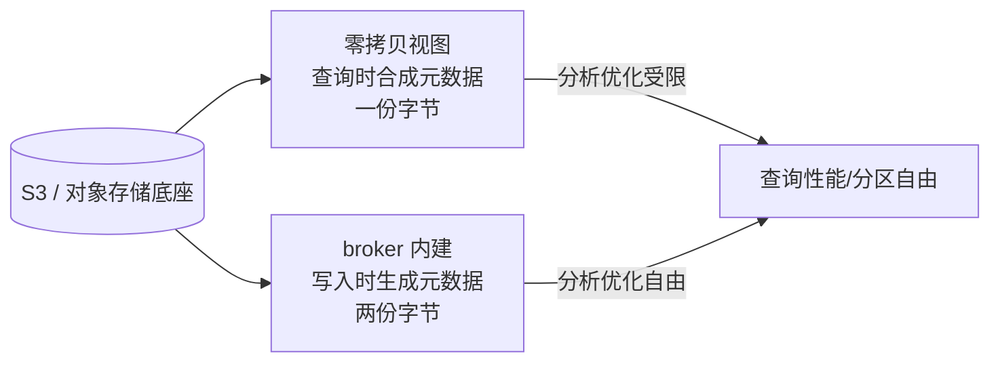
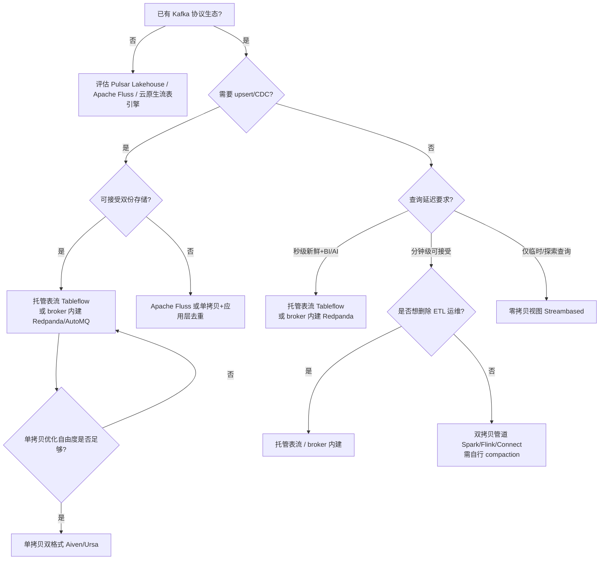

# 1.70 流表一体与开放表格式收敛深度解析

> **置信口径**: 协议/规范语义=【定理】（官方规范保证）；架构对比与工程推理=【论证】；正文未单独标注的具体数字按【估算】理解（AGENTS.md §4.1，P3 基线声明）。
> **时效声明**: 本文事实基于 Confluent、Redpanda、Apache Iceberg、Apache Kafka 官方发布信息及 Valery Frolov 权威分析，核实至 2026-11。
> **定位声明**: 本文聚焦消息系统向开放表格式（Iceberg）的国际收敛形态，属于 01 系列深度旗舰篇；与 [1.29 S3 解耦存储消息系统分析](01-29-S3解耦存储消息系统分析.md)、[1.62 Apache Pulsar 存算分离架构深度解析](01-62-Pulsar存算分离架构深度解析.md)、[1.67 存储解耦与队列化收敛深度解析](01-67-存储解耦与队列化收敛深度解析.md) 互补，共同构成"存储解耦→流表一体"的连续视角。

## 目录

- [1.70 流表一体与开放表格式收敛深度解析](#170-流表一体与开放表格式收敛深度解析)
  - [目录](#目录)
  - [1.70.1 问题定义：传统 Kafka→湖的双拷贝管道之痛](#1701-问题定义传统-kafka湖的双拷贝管道之痛)
    - [Kafka 4.x 官方 Iceberg 集成动向](#kafka-4x-官方-iceberg-集成动向)
  - [1.70.2 五种形态全景对比表](#1702-五种形态全景对比表)
  - [1.70.3 深度形态剖析：零拷贝视图 vs broker 内建](#1703-深度形态剖析零拷贝视图-vs-broker-内建)
    - [写路径差异：元数据生成时机](#写路径差异元数据生成时机)
    - [与 1.67 存储解耦的关系](#与-167-存储解耦的关系)
  - [1.70.4 Schema 与契约：topic schema→表 schema 的演化规则](#1704-schema-与契约topic-schema表-schema-的演化规则)
    - [字段映射基线](#字段映射基线)
    - [兼容性模式对照（契约语义测试视角）](#兼容性模式对照契约语义测试视角)
    - [模式演化时的表结构变更策略](#模式演化时的表结构变更策略)
    - [类型映射边界与治理红线](#类型映射边界与治理红线)
  - [1.70.5 测试维度（供 TC-SEM/CON 扩展）](#1705-测试维度供-tc-semcon-扩展)
  - [1.70.6 与相关文档的边界声明](#1706-与相关文档的边界声明)
  - [1.70.7 选型决策树与参考来源](#1707-选型决策树与参考来源)
    - [选型决策树](#选型决策树)
    - [参考来源](#参考来源)

---

## 1.70.1 问题定义：传统 Kafka→湖的双拷贝管道之痛

长期以来，"如何把 Kafka 数据放进数据湖"的标准答案是在中间放一个作业：Kafka Connect 集群、Spark Structured Streaming 作业或 Flink 管道。它们消费 topic、写 Parquet、提交 Iceberg 元数据。这个模式成熟，但积累了四项结构性成本【论证】，源自 [Valery Frolov 对 Kafka-Iceberg 收敛的权威分析](https://valeryfrolov.com/writing/kafka-iceberg-convergence/)：

1. **重复字节**：同一条记录在 broker 本地段、分层存储段、Iceberg Parquet 中各存一份。Aiven 估算，一个 1 GiB/s 的集群可能把同一份字节写、传、存多达四次，年成本约 340 万美元【估算】，且这笔钱买的只是"已经拥有的数据的一个新副本"。
2. **第二个分布式系统**：Connect/Spark/Flink 集群需要独立扩容、监控、升级和 on-call；它持有 offset、去重、刷盘调优和 schema 映射责任，但 Kafka 与 catalog 并不协助它。
3. **小文件永恒**：所有方案都按区间提交。表越新鲜，提交越频繁，小文件越多；快照过期与 orphan 清理往往成为被遗忘的生产服务。
4. **CDC 痛苦**：流式写入器不知道旧行位置，更新退化为 equality delete 文件，查询时 reconciliate，直到 compaction 重写——而 compaction 又需要有人拥有。

Confluent 对 100 多家客户的调研结论是：把 Kafka 数据弄进湖"脆弱、昂贵、难以管理"（[Confluent Tableflow GA 博客](https://www.confluent.io/blog/tableflow-is-now-generally-available/)）。这正是 2024–2026 年国际厂商集体推出"删除中间作业"方案的背景。2025 年 3 月 Confluent Tableflow GA，2025 年 4 月 Redpanda Iceberg Topics GA（[Redpanda 25.1 Iceberg Topics GA](https://www.redpanda.com/blog/redpanda-25-1-iceberg-topics-ga)），以及 Streambased、Aiven、StreamNative Ursa、WarpStream Tableflow、AutoMQ Table Topic 等产品，共同构成消息系统向开放表格式收敛的浪潮。

这一收敛的底层前提是 **Apache Iceberg 已成为开放表格式的事实标准**【论证】：Databricks 于 2024 年收购 Iceberg 原创团队创立的 Tabular，并在 2026 年通过 Unity Catalog 提供托管 Iceberg 表的读写（[Databricks Unity Catalog 与 Iceberg 下一时代](https://www.databricks.com/blog/unity-catalog-and-next-era-apache-icebergtm)）；Snowflake 推出 Polaris（已捐赠 Apache 孵化器）与 Horizon Catalog，原生支持 Iceberg 外部表读写（[Snowflake Horizon Catalog Iceberg 外部引擎访问](https://docs.snowflake.com/en/release-notes/2025/other/2025-11-21-tables-iceberg-query-using-external-query-engine-snowflake-horizon-preview)）；AWS 则以 S3 Tables、Glue、Athena、EMR 全栈原生支持 Iceberg（[AWS 上的 Apache Iceberg](https://docs.aws.amazon.com/pdfs/prescriptive-guidance/latest/apache-iceberg-on-aws/apache-iceberg-on-aws.pdf)）。三方共同押注使"流数据直接流入 Iceberg"成为 2026 年 streaming-first lakehouse 的国际共识（[2026 Guide to Data Lakehouses](https://iceberglakehouse.com/posts/2025-09-2026-guide-to-data-lakehouses/)）。

### Kafka 4.x 官方 Iceberg 集成动向

Apache Kafka 4.0 于 2025 年 3 月 18 日发布（[Apache Kafka 4.0.0 Release Announcement](https://kafka.apache.org/blog/2025/03/18/apache-kafka-4.0.0-release-announcement/)），核心里程碑是移除 ZooKeeper、全面进入 KRaft 模式，以及 35+ 个 KIP。经对 Kafka 官方发布说明与 KIP 列表的检索核实，**截至 2026-11，Apache Kafka 4.x 主线没有提供原生的"topic 直转 Iceberg 表"功能，也未出现对应 KIP**。

当前可用的官方/半官方路径是 [Apache Iceberg Kafka Connect Sink Connector](https://iceberg.apache.org/docs/latest/kafka-connect/)：它属于 Apache Iceberg 项目子模块，而非 Kafka 项目本身；Confluent Hub 上有打包分发版本。因此，若选择 Apache Kafka 4.x 自建集群并希望 Iceberg 入湖，仍需自行部署 Connect 集群或 Spark/Flink 作业。Tableflow、Redpanda Iceberg Topics、AutoMQ Table Topic 等"无管道"方案均为商业/企业版或第三方实现，不是 Kafka 主线的功能。

> **IBM-Confluent 收购背景**：2025 年 12 月 IBM 宣布收购 Confluent，2026 年 3 月完成交割；本文仅将其作为 Tableflow 产品线的所有权变更指针，不展开商业分析（批次 87 负责）。

## 1.70.2 五种形态全景对比表

分类应服务于决策。按"数据保留几份"排序比按厂商排序更有工程意义——这是 [Valery Frolov 分析](https://valeryfrolov.com/writing/kafka-iceberg-convergence/) 的核心洞察。以下五种形态覆盖了当前国际主流实现：

| 形态 | 数据份数 | 代表产品 | 元数据生成时机 | 典型新鲜度 | Schema 演化 | 厂商锁定点 | 运维面 | 成本结构要点 |
| --- | --- | --- | --- | --- | --- | --- | --- | --- |
| **零拷贝视图** | 1（热数据在 Kafka） | Streambased | **查询时**合成 Iceberg 元数据 | 零滞后 | 受 Kafka segment 布局约束 | 查询网关、catalog 路径 | 无表维护，但查询 CPU/读取负载高 | 省存储，转移为查询时计算 |
| **单拷贝双格式** | 1（段即表文件） | Aiven Iceberg Topics、StreamNative Ursa、Bufstream（历史） | **写入/段滚动时**生成 Parquet+Iceberg 元数据 | 秒–分钟 | 段布局即表布局，演进受限 | 段布局、catalog commit 路径 | 需协调 compaction 与 Kafka 读取 | 最低存储，但表优化受限 |
| **双拷贝管道** | 2（Kafka + 湖） | Kafka Connect Iceberg Sink、Spark、Flink | **写入湖时**按提交间隔生成 | 分钟–小时 | 灵活，由作业逻辑控制 | ETL 作业、引擎生态 | 完全自负：小文件、compaction、快照 | 存储×2 + 作业集群 |
| **托管表流** | 2（Kafka + 托管表） | Confluent Tableflow、WarpStream Tableflow | **后台服务**按 topic 事件异步生成 | ~5 min（Tableflow 默认） | 自动检测并应用兼容变更 | 托管服务、Schema Registry、catalog 集成 | 厂商负责 compaction 与快照过期 | 存储×2 + 托管服务费 |
| **broker 内建** | 2（log + 表元数据） | Redpanda Iceberg Topics、AutoMQ Table Topic | **broker 写入路径**直接提交 Iceberg 快照 | 秒–分钟 | 支持 Iceberg 全量 schema 演化 | broker 实现、企业版/云服务 | snapshot 过期自动化，compaction 部分外包 | 存储×2 + 企业授权/云服务 |

上表的"数据份数"按持久化副本计。零拷贝视图与单拷贝双格式在存储层只保留一份权威字节；其余三种至少保留 log 与 table 两份表示。关键洞察【论证】：

- **单拷贝设计的结构性张力**：如果 Kafka replay 路径读取的 Parquet 文件与 Iceberg 表引用的是同一对象，则外部不能随意重写或 repartition 这些文件。Aiven 明确 broker 是单写者，compaction 必须谨慎在 Kafka 外部运行；Bufstream 也曾警告 managed catalog 重写数据的风险。
- **双拷贝设计的核心交易**：用存储翻倍换取表布局自由、compaction 自由、查询性能可优化。选择哪种方案，本质上是选择"付两份存储费"还是"把表优化权交给 Kafka segment 布局"。

## 1.70.3 深度形态剖析：零拷贝视图 vs broker 内建

### 写路径差异：元数据生成时机

零拷贝视图与 broker 内建位于光谱两端，差异首先体现在"表元数据何时生成"。

**零拷贝视图（Streambased）**:

```text
Producer → Kafka segment(log) → 查询时网关
                                      ↓
                              按需合成 Parquet + Iceberg 元数据
                                      ↓
                              返回 Iceberg 快照给查询引擎
```

- 不物化表文件；网关在读请求到达时，把 Kafka segment 当作 Parquet 数据源，合成 Iceberg 元数据。
- 优点：零滞后、无表维护、无额外存储。
- 代价：查询时 CPU 高、Kafka 读取负载高、 aged-out 数据仍需 spill 到真正的 Iceberg"coldset"（第二份拷贝回归）。
- 限制：无 row identity，不支持 upsert；表分区与排序完全受 Kafka segment 布局限制。

**broker 内建（Redpanda Iceberg Topics）**:

```text
Producer → Redpanda broker
                ↓
        ├─ 写入 Kafka log（本地/对象存储）
        └─ 同步/异步生成 Iceberg 元数据 + Parquet
                ↓
        注册到 Snowflake Open Catalog / Databricks Unity / 内置 catalog
```

- broker 在写入路径直接产生 Iceberg 表；数据仍以 Kafka 协议服务，同时以 Iceberg 表服务。
- Redpanda 25.1 支持自定义分区、死信队列、完整 Iceberg schema 演化、snapshot 过期，并自动注册到 Snowflake Open Catalog 与 Databricks Unity（[Redpanda 25.1 Iceberg Topics GA](https://www.redpanda.com/blog/redpanda-25-1-iceberg-topics-ga)）。
- 代价：log 与 table 两份字节；compaction 通常只到 snapshot 过期，深度 compaction 需外部工具或云服务。

### 与 1.67 存储解耦的关系

[1.67 存储解耦与队列化收敛深度解析](01-67-存储解耦与队列化收敛深度解析.md) 指出：对象存储（S3 类）成为消息持久化的共同底座后，ISR/LEO、分区迁移等语义被重新定义。零拷贝视图与 broker 内建正是同一 S3 底座上的两条收敛路径：

- **零拷贝视图**：把 S3 上的 Kafka segment 直接暴露为分析表，最大化"一份数据"原则，但牺牲分析优化自由度。
- **broker 内建**：在 S3 底座上再写一份 Iceberg 表示，用对象存储的廉价性对冲双份存储，换取分析生态原生访问。



结论【论证】：没有免费选项。单拷贝把"表优化权"交给 Kafka segment 布局；双拷贝把"存储费"翻倍。选型时应先回答"表消费者是否需要自定义分区/compaction/upsert"，再决定走哪条路。

## 1.70.4 Schema 与契约：topic schema→表 schema 的演化规则

Topic schema 是生产者的契约；table schema 是下游所有消费者的契约。二者演化速度不同、破坏面不同，收敛产品必须在这之间建立规则。

### 字段映射基线

| Topic 侧（Kafka/Schema Registry） | Table 侧（Iceberg） | 说明 |
| --- | --- | --- |
| message key | 可选主键 / 分区键 | 默认不映射为表列；若启用 upsert，需显式声明 key 字段 |
| message value | 表主体行 | Avro/Protobuf/JSON 按 Iceberg 类型系统转换 |
| headers | 可选元数据列 | 通常映射为 `_kafka_headers` 结构或忽略 |
| timestamp（producer/broker/event） | `_kafka_timestamp` / `_event_time` | 分区与过滤策略的决策点 |
| offset / partition | `_kafka_offset`、`_kafka_partition` | 用于幂等、对账、增量读取 |

### 兼容性模式对照（契约语义测试视角）

Confluent Schema Registry 的兼容性模式与 Iceberg schema 演化的对应关系如下：

| Schema Registry 模式 | 含义 | Iceberg 表行为 | 契约语义测试断言 |
| --- | --- | --- | --- |
| **BACKWARD** | 新 schema 可被旧数据读取 | 只允许新增 optional 字段 | 旧查询不因新字段失败 |
| **BACKWARD_TRANSITIVE** | 全局 backward | 同上，且所有历史版本均满足 | 任意历史快照用最新 schema 读取成功 |
| **FORWARD** | 旧 schema 可被新数据读取 | 允许新增 required 字段（有限） | 新查询读取旧数据不失败 |
| **FULL** | 同时 backward + forward | 仅允许新增 optional 字段 | 双向兼容 |
| **NONE** | 无兼容性检查 | 可能触发 breaking change | 需人工审批 + 下游通知 |

### 模式演化时的表结构变更策略

收敛产品通常采用以下策略（以 Tableflow、Redpanda Iceberg Topics 为参照）【论证】：

1. **添加字段**：最常见且安全的变更。若新字段为 optional，表自动 ADD COLUMN；若为 required，可能触发 breaking change 警报。
2. **类型放宽**（int → long、float → double）：多数产品支持，但需确认 Iceberg 分区剪枝不受影响。
3. **重命名字段**：Iceberg 本身支持 rename，但 topic schema 与 table schema 的重命名映射需要显式配置，否则会被识别为"删除旧列+新增新列"。
4. **删除字段**：在 Iceberg 中标记为 dropped；若 topic 侧删除字段而 table 侧保留，需保证后续写入不再携带该字段或填默认值。
5. **分区演进**：Iceberg 支持分区演进，但消息系统侧的分区键（Kafka key）变更会导致数据分布抖动，需作为变更事件审批。

### 类型映射边界与治理红线

以下映射在实践中最容易触发"表能查但结果错"的事故：

| Topic 类型 | Iceberg 类型 | 风险点 | 治理建议 |
| --- | --- | --- | --- |
| Avro `union { null, int }` | `optional int` | 默认安全 | 确认 null 语义与业务空值一致 |
| Avro `bytes` | `binary` | 长度无界可能导致 Parquet row group 过大 | 设置最大字节长度或转存外部对象 |
| Protobuf `Timestamp` | `timestamp` / `timestamptz` | 时区约定不一致 | 统一使用 UTC 或显式时区列 |
| JSON 数值 | `double` 或 `decimal(P,S)` | 浮点精度 vs 定点精度 | 财务字段必须显式 decimal 精度 |
| JSON 嵌套对象 | `struct` 或 `string` | 结构漂移导致 struct 不断膨胀 | 对不稳定嵌套结构拍平或存为 JSON string |
| Kafka `null` key | — | upsert 表无主键 | 必须业务指定替代主键，否则拒绝 upsert |

```properties
# 契约语义测试建议的 topic→table 映射检查清单（示意）
# 1. 每个 topic 必须声明 event-time 字段名
iceberg.event-time-field=event_time
# 2.  Upsert 表必须声明主键（key 字段名或字段组合）
iceberg.upsert-key=order_id
# 3. Schema 变更触发 table 自动演进还是人工门控
iceberg.schema-evolution=auto|gated
# 4. 不兼容记录处置：DLQ 或拒绝
iceberg.incompatible-record-policy=dlq|reject
```

> **契约红线**：自动 schema 演化是功能，直到某生产者重命名列并让四十个仪表盘继承该变更。必须存在一个审批者，且管道必须有地方放置失败的记录。

## 1.70.5 测试维度（供 TC-SEM/CON 扩展）

以下维度建议注册到 `Testing/06-契约语义测试/04-行为用例/` 与 `Testing/06-契约语义测试/02-语义矩阵/` 的 TC-SEM/CON 条目，作为 01-70 的验证输出：

| 测试维度 | GWT 断言示例 | 关键指标 | 工具/脚本线索 |
| --- | --- | --- | --- |
| **表新鲜度 SLO** | Given topic 以 1k msg/s 写入，When 启用 Tableflow/Iceberg Topic，Then 表查询在 5 min 内可见最新 offset | `table_lag_seconds ≤ 300` | Iceberg 快照时间 vs broker max offset |
| **模式漂移检测** | Given topic schema 新增字段，When 写入携带新字段的记录，Then 表 schema 在 N 个提交周期内同步且不破坏旧查询 | `schema_sync_latency`、下游查询成功率 | Schema Registry webhook + Iceberg `snapshots` 元数据 |
| **零拷贝视图查询一致性** | Given 同一 topic 同时被 Kafka 消费与 Iceberg 视图查询，Then 二者对同一 offset 范围返回等价行集合 | `row_count_delta=0`、`checksum_match` | 在固定时间窗口内 broker fetch vs 视图 scan 对账 |
| **数据份数审计** | Given 1 GiB 原始 topic 数据，Then 对象存储中 Iceberg 相关字节数 / Kafka 段字节数 比值符合预期（单拷贝≈1，双拷贝≈2×压缩后） | `copy_ratio`、Parquet 压缩率 | S3 清单 vs Iceberg metadata 文件列表 |
| **CDC upsert 正确性** | Given upsert 流含 update/delete，Then 当前快照最终反映主键最新状态，且时间旅行可回滚 | `delete_visibility`、`upsert_idempotency` | Equality delete + position delete 占比监控 |
| **compaction 不破坏 Kafka 读取** | Given 单拷贝方案运行外部 compaction，When 重写 Parquet 文件，Then Kafka replay 仍能按原 offset 范围读取 | `replay_offset_consistency` | 单拷贝方案特有测试 |

```bash
# 表新鲜度对账脚本示意（TC-SEM-70-01）
#!/bin/bash
# 参数：topic、bootstrap、iceberg_rest_uri、table_name、threshold_sec
MAX_OFFSET=$(kafka-run-class kafka.tools.GetOffsetShell --broker-list $BOOTSTRAP --topic $TOPIC --time -1 | awk -F: '{sum+=$3} END{print sum}')
LATEST_SNAPSHOT=$(curl -s "$ICEBERG_REST_URI/v1/namespaces/default/tables/$TABLE_NAME/snapshots" | jq '.snapshots[-1].timestamp-ms')
SNAPSHOT_OFFSET=$(curl -s "$ICEBERG_REST_URI/v1/namespaces/default/tables/$TABLE_NAME" | jq -r '.properties.kafka_max_offset // null')
# 断言：快照 offset 与 broker max offset 差值在阈值内
```

## 1.70.6 与相关文档的边界声明

为避免重复并保证系列一致性，本文与以下文档的边界如下：

| 相关文档 | 本文视角 | 不重复内容 |
| --- | --- | --- |
| [1.29 S3 解耦存储消息系统分析](01-29-S3解耦存储消息系统分析.md) | 本文聚焦"topic 如何变成 Iceberg 表" | 1.29 的 WarpStream/AutoMQ 成本模型、KIP-405/KIP-1150 路线 |
| [1.67 存储解耦与队列化收敛深度解析](01-67-存储解耦与队列化收敛深度解析.md) | 本文是 1.67 的湖仓侧延伸 | 1.67 的 S3 权威路线语义变化、share groups、RabbitMQ Streams |
| [1.62 Apache Pulsar 存算分离架构深度解析](01-62-Pulsar存算分离架构深度解析.md) | Pulsar 的 Lakehouse Tiered Storage 是另一种"段即表文件"路径 | 1.62 的 BookKeeper quorum、ledger offload、Oxia 元数据层 |
| [契约语义测试 conformance-matrix](../../Testing/06-契约语义测试/02-语义矩阵/conformance-matrix.md) | 本文提供 topic→table 的语义测试输入 | conformance-matrix 的六系统对比、Jepsen 证据矩阵 |

Pulsar 侧已有 StreamNative Lakehouse Tiered Storage（Private Preview），把 ledger offload 直接落到 Iceberg/Delta/Hudi，属于"单拷贝双格式"谱系；这与 Kafka 生态的 Aiven Iceberg Topics 形态对称，但实现依托 BookKeeper 的 ledger 粒度（[Streaming Lakehouse: Introducing Pulsar's Lakehouse Tiered Storage](https://streamnative.io/blog/streaming-lakehouse-introducing-pulsars-lakehouse-tiered-storage)）。本文不再展开 Pulsar 实现细节。

## 1.70.7 选型决策树与参考来源

### 选型决策树



### 参考来源

- [Confluent Tableflow Is Now Generally Available](https://www.confluent.io/blog/tableflow-is-now-generally-available/)
- [Redpanda 25.1: Iceberg Topics now generally available](https://www.redpanda.com/blog/redpanda-25-1-iceberg-topics-ga)
- [The Kafka-to-Iceberg Pipe Is Disappearing. The Table Contract Is Not.](https://valeryfrolov.com/writing/kafka-iceberg-convergence/) — 五种形态分类与双拷贝成本分析
- [2026 Guide to Data Lakehouses](https://iceberglakehouse.com/posts/2025-09-2026-guide-to-data-lakehouses/) — streaming-first lakehouse 共识
- [Apache Iceberg Kafka Connect Sink Connector Docs](https://iceberg.apache.org/docs/latest/kafka-connect/)
- [Aiven Iceberg Topics: Zero ETL, Zero Copy](https://aiven.io/blog/iceberg-topics-for-apache-kafka-zero-etl-zero-copy)
- [StreamNative Ursa: A Lakehouse-Native Data Streaming Engine](https://streamnative.io/blog/ursa-everywhere-lakehouse-native-future-data-streaming)
- [WarpStream Tableflow Is Now Generally Available](https://www.warpstream.com/blog/warpstream-tableflow-is-now-generally-available)
- [AutoMQ Table Topic Overview](https://docs.automq.com/automq-cloud/table-topic/overview)
- [Streaming Lakehouse: Introducing Pulsar's Lakehouse Tiered Storage](https://streamnative.io/blog/streaming-lakehouse-introducing-pulsars-lakehouse-tiered-storage)
- [Apache Kafka 4.0.0 Release Announcement](https://kafka.apache.org/blog/2025/03/18/apache-kafka-4.0.0-release-announcement/)
- [Iceberg vs Delta vs Hudi in 2026 - The Format Wars Are Over](https://jamesm.blog/data-engineering/iceberg-vs-delta-vs-hudi-2026/)
- [Databricks Unity Catalog and the Next Era of Apache Iceberg](https://www.databricks.com/blog/unity-catalog-and-next-era-apache-icebergtm)
- [Snowflake External query engine support for Apache Iceberg tables with Horizon Catalog](https://docs.snowflake.com/en/release-notes/2025/other/2025-11-21-tables-iceberg-query-using-external-query-engine-snowflake-horizon-preview)
- 项目内：[1.29 S3 解耦存储消息系统分析](01-29-S3解耦存储消息系统分析.md)、[1.62 Apache Pulsar 存算分离架构深度解析](01-62-Pulsar存算分离架构深度解析.md)、[1.67 存储解耦与队列化收敛深度解析](01-67-存储解耦与队列化收敛深度解析.md)、[契约语义测试 conformance-matrix](../../Testing/06-契约语义测试/02-语义矩阵/conformance-matrix.md)

---

**最后更新**: 2026-11-18
