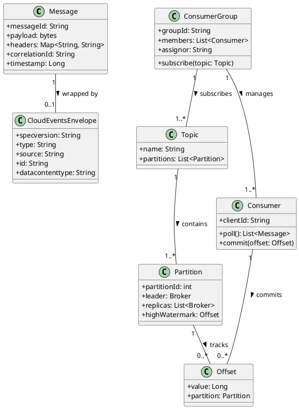
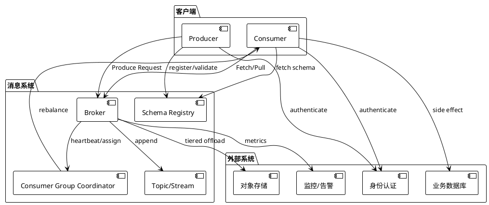
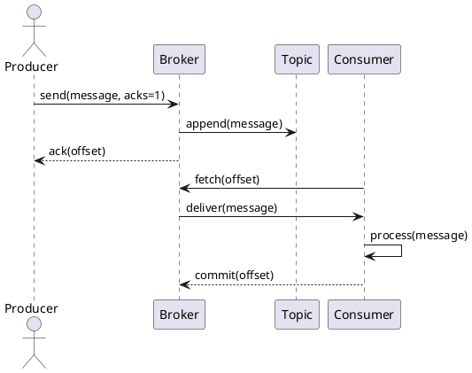
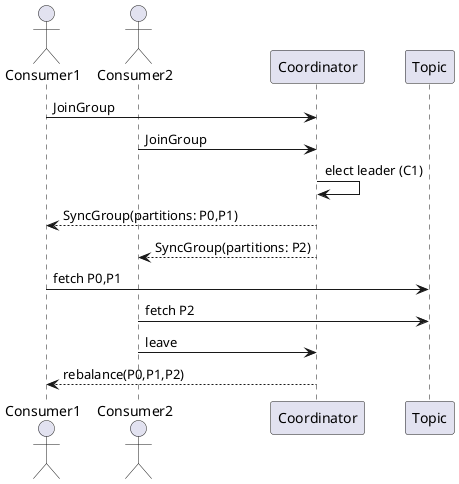
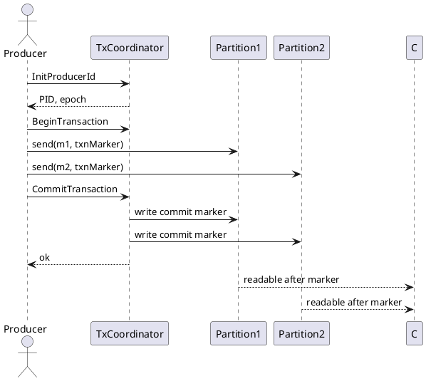
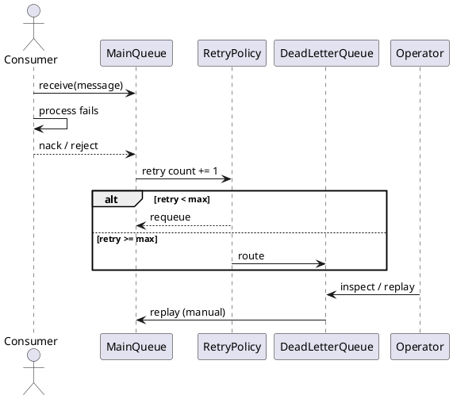
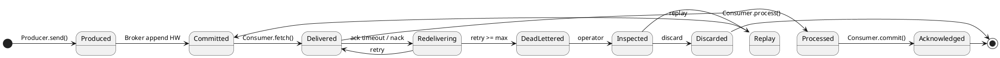
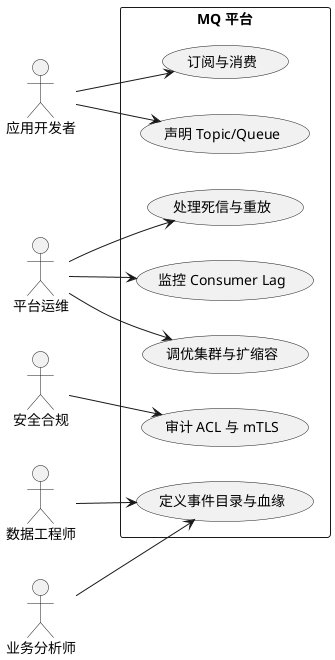

# 1.79 消息系统核心模式 UML 表示集

> **置信口径**: UML 符号与图式 =【定理】（OMG UML 2.5.1 规范）；消息系统结构映射 =【论证】；正文未单独标注的具体数字按【估算】理解（AGENTS.md §4.1，P3 基线声明）。
> **时效声明**: 本文事实基于 OMG UML 2.5.1、Apache Kafka/Pulsar/RabbitMQ/NATS/MQTT/Redis 官方文档，核实至 2026-11。
> **定位声明**: 本文是 01 系列概念表征层旗舰（方向 5：concept 复兴的图版）。首次在项目内系统引入 UML 作为跨团队工程沟通语言，把 [1.6 架构设计深度分析](01-06-架构设计深度分析.md)、[1.13 Kafka KRaft 模式分析](01-13-Kafka-KRaft模式分析.md)、[1.63 Exactly-once 语义全论证](01-63-Exactly-once语义全论证.md)、[1.71 Kafka 线上协议深度解析](01-71-Kafka线上协议深度解析.md) 中的核心结构转换为可视化 UML 图集。

## 目录

- [1.79 消息系统核心模式 UML 表示集](#179-消息系统核心模式-uml-表示集)
  - [目录](#目录)
  - [1.79.1 为什么用 UML](#1791-为什么用-uml)
  - [1.79.2 类图：消息、消费者组与订阅的静态结构](#1792-类图消息消费者组与订阅的静态结构)
    - [类图元素与 1.58 概念映射](#类图元素与-158-概念映射)
  - [1.79.3 组件图：Broker-生产者-消费者-外部系统](#1793-组件图broker-生产者-消费者-外部系统)
  - [1.79.4 时序图](#1794-时序图)
    - [发布订阅全链路](#发布订阅全链路)
    - [消费组再平衡](#消费组再平衡)
    - [事务两阶段提交](#事务两阶段提交)
    - [DLQ 流转](#dlq-流转)
  - [1.79.5 状态图：消息生命周期](#1795-状态图消息生命周期)
  - [1.79.6 用例图：MQ 平台角色](#1796-用例图mq-平台角色)
    - [本文图集速查](#本文图集速查)
  - [1.79.7 互链与参考来源](#1797-互链与参考来源)

---

## 1.79.1 为什么用 UML

UML 由 OMG 维护，是软件工程领域事实上的国际标准图式语言。类图/组件图统一架构师与开发的静态认知，时序图/状态图帮助开发与运维定位“消息在哪里丢失/重复/卡住”，用例图则用于团队与外部审计对齐平台职责。

下表给出本文五种 UML 图及其首选工程问题：

| UML 图类型 | 回答的工程问题 | 本文对应节 | 消息系统典型元素 |
| --- | --- | --- | --- |
| 类图 | 消息/消费者/订阅的静态结构是什么？ | 1.79.2 | Message、ConsumerGroup、Partition、Offset |
| 组件图 | 系统与外部组件如何部署与交互？ | 1.79.3 | Broker、Producer、Consumer、Schema Registry、S3 |
| 时序图 | 消息在时序上如何流动？失败如何传播？ | 1.79.4 | send/ack/commit/rebalance/commit marker |
| 状态图 | 消息本身经历哪些状态？ | 1.79.5 | Produced → Committed → Delivered → Acknowledged |
| 用例图 | 哪些角色使用 MQ 平台做什么？ | 1.79.6 | 应用开发者、平台运维、安全合规、数据工程师 |

本文所有图均使用 PlantUML 语法，可直接在 IDE、GitHub、文档站点中渲染，保持“代码即图”的可持续维护性。

---

## 1.79.2 类图：消息、消费者组与订阅的静态结构

**读图要点**：回答“消息在代码里长什么样”。`CloudEventsEnvelope` 聚合到 `Message` 表示可选信封；`ConsumerGroup` 与 `Topic` 多对多表示一组消费者可订阅多个 Topic。

### 类图元素与 1.58 概念映射

| UML 元素 | 对应 1.58 概念 | 说明 |
| --- | --- | --- |
| `Message` | Message | 1.58.8 契约 DSL 域：一次传输的数据单元 |
| `CloudEventsEnvelope` | CloudEvents | 1.58.8：CNCF 事件数据标准信封 |
| `Topic` | Topic | 1.58.1：消息逻辑分类标识 |
| `Partition` | Partition | 1.58.1：Topic 的物理分片 |
| `Offset` | Offset | 1.58.1：分区/流内单调递增位置标识 |
| `ConsumerGroup` | Consumer Group / Share Group | 1.58.1：协同消费者组 |
| `Consumer` | Consumer | 1.58.1：接收并处理消息的客户端 |

---

## 1.79.3 组件图：Broker-生产者-消费者-外部系统

**读图要点**：回答“消息系统在生产环境里与谁交互”。`Schema Registry` 独立于 `Broker` 表示客户端可校验 schema；`S3` 表示 Tiered Storage 冷卸载；`IAM` 强调零信任下身份与路由解耦。

---

## 1.79.4 时序图

### 发布订阅全链路

**读图要点**：at-least-once 最小交互。`acks=1` 表示 broker 落盘即 ack；`commit` 与 `process` 顺序决定“至少一次”还是“精确一次”。

### 消费组再平衡

**读图要点**：回答“消费者变化时消息如何重新分配”。Kafka Rebalance Protocol、RabbitMQ 队列分配、Pulsar Subscription Type 都可用此时序模式理解。

### 事务两阶段提交

**读图要点**：对应 [1.63](01-63-Exactly-once语义全论证.md) 事务协调器与 [1.71](01-71-Kafka线上协议深度解析.md) 事务报文。`CommitTransaction` 后消息才对消费者可见。

### DLQ 流转

**读图要点**：回答“poison message 最终去哪”。重试计数、最大重试上限、人工重放是 DLQ 三个关键参数。

---

## 1.79.5 状态图：消息生命周期

**读图要点**：与 [契约语义测试 03-业务场景/01-order-lifecycle/contract.yaml](../../Testing/06-契约语义测试/03-业务场景/01-order-lifecycle/contract.yaml) 的 `stateMachine` 呼应：YAML 描述订单状态机，UML 状态图描述消息生命周期，可互转。

---

## 1.79.6 用例图：MQ 平台角色

**读图要点**：回答“谁对消息系统负什么责”。运维负责运行态，安全合规负责访问控制，数据工程师负责集成管道与事件目录。

### 本文图集速查

| 图分组 | 包含图 | 核心阅读目标 |
| --- | --- | --- |
| 静态结构 | 类图、组件图 | 消息系统由哪些元素/组件组成 |
| 动态行为 | 时序图、状态图 | 消息如何流动、失败如何传播 |
| 组织治理 | 用例图 | 谁对 MQ 平台负什么责 |

---

## 1.79.7 互链与参考来源

- **架构分层基准**: [1.6 架构设计深度分析](01-06-架构设计深度分析.md)
- **Kafka 元数据与副本模型**: [1.13 Kafka KRaft 模式分析](01-13-Kafka-KRaft模式分析.md)
- **Exactly-once 与事务时序**: [1.63 Exactly-once 语义全论证](01-63-Exactly-once语义全论证.md)
- **Kafka 线上协议报文**: [1.71 Kafka 线上协议深度解析](01-71-Kafka线上协议深度解析.md)
- **概念定义来源**: [1.58 全局核心概念卡片总表](01-58-全局核心概念卡片总表.md)
- **业务场景状态机示例**: [契约语义测试 03-业务场景/01-order-lifecycle/contract.yaml](../../Testing/06-契约语义测试/03-业务场景/01-order-lifecycle/contract.yaml)
- **外部参考**:
  - OMG UML 2.5.1 Specification
  - PlantUML Language Reference
  - Apache Kafka / Pulsar / RabbitMQ / NATS / MQTT / Redis 官方文档

---

**最后更新**: 2026-11-18
