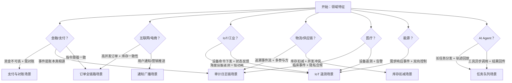

# 1.80 场景领域转换决策树

> **置信口径**: 领域标准与契约规范语义 =【定理】（官方规范保证）；领域→场景→模式→契约→实现的转换推理 =【论证】；正文未单独标注的具体数字按【估算】理解（AGENTS.md §4.1，P3 基线声明）。
> **时效声明**: 本文事实基于 ISO 20022、HL7 FHIR、GS1 EPCIS、OpenADR、Sparkplug、AsyncAPI、CloudEvents 官方发布信息，核实至 2026-11。
> **定位声明**: 本文是 01 系列概念表征层旗舰（方向 5：concept 复兴的图版）。把 [1.45 产业领域消息标准纵览](01-45-产业领域消息标准纵览.md)、[1.46 IoT 与互联网领域消息标准纵览](01-46-IoT与互联网领域消息标准纵览.md) 中的领域特征，通过判定树逐级转换为业务场景、消息模式、契约形式与实现栈，与 [契约语义测试 TEST-13](../../Testing/06-契约语义测试/00-模型与规划/TEST-C1-六层契约语义测试模型与规划.md) 的 L5 业务场景层直接对应。

## 目录

- [1.80 场景领域转换决策树](#180-场景领域转换决策树)
  - [目录](#目录)
  - [1.80.1 五级转换链模型](#1801-五级转换链模型)
    - [转换链常见反模式](#转换链常见反模式)
  - [1.80.2 领域 → 场景判定树](#1802-领域--场景判定树)
  - [1.80.3 场景 → 消息模式判定树](#1803-场景--消息模式判定树)
  - [1.80.4 模式 → 契约形式判定树](#1804-模式--契约形式判定树)
  - [1.80.5 契约 → 实现栈判定树](#1805-契约--实现栈判定树)
  - [1.80.6 与 1.59 总树的关系](#1806-与-159-总树的关系)
  - [1.80.7 互链与参考来源](#1807-互链与参考来源)

---

## 1.80.1 五级转换链模型

领域驱动的消息系统设计不应从“选 Kafka 还是 RabbitMQ”开始，而应从“领域特征”开始，逐级下钻到可执行的实现栈。本文把这一过程抽象为五级转换链：

| 层级 | 输入属性 | 输出产物 | 对应知识库资产 |
| --- | --- | --- | --- |
| **L1 领域特征** | 行业合规、数据敏感度、设备规模、时延要求 | 领域分类与关键约束 | [1.45](01-45-产业领域消息标准纵览.md)、[1.46](01-46-IoT与互联网领域消息标准纵览.md) |
| **L2 业务场景** | 领域特征 + 业务意图（支付、对账、遥测、通知） | 场景定义与主系统倾向 | [契约语义测试 03-业务场景](../../Testing/06-契约语义测试/03-业务场景/README.md) 8 场景 |
| **L3 消息模式** | 场景属性（1:N、竞争消费、补偿、回放） | 模式选择（pub/sub、Saga、Outbox 等） | [2.47](../02-场景驱动架构设计/02-47-企业集成模式与事务消息模式.md) ~ [2.58](../02-场景驱动架构设计/02-58-CQRS与事件溯源落地设计.md) 46 个专项模式 |
| **L4 契约形式** | 模式所需语义（Schema、Binding、x-semantics） | AsyncAPI / ODCS / 事件契约模板 | [2.54](../02-场景驱动架构设计/02-54-事件契约模板库与命名规范.md)、[2.56](../02-场景驱动架构设计/02-56-Spec-Driven契约驱动开发体系.md)、[2.57](../02-场景驱动架构设计/02-57-IT通用场景事件契约模式库.md) |
| **L5 实现栈** | 契约 + 团队技能 + 运维约束 | 语言框架、客户端库、部署形态 | [1.52](01-52-多语言客户端生态与编程模型.md)、[1.68](01-68-云原生抽象消息层评测.md)、[1.73~1.76](.)（语言深耕） |

```text
领域特征(L1)
    ↓ 属性匹配
业务场景(L2)
    ↓ 意图识别
消息模式(L3)
    ↓ 语义需求
契约形式(L4)
    ↓ 绑定映射
实现栈(L5)
```

例如，当 L4 评估发现 AsyncAPI 的 MQTT binding 无法表达“恰好一次投递”的端到端保证时，应回退到 L3 改用 Outbox + Idempotency 模式，而不是在 AsyncAPI spec 中嵌入应用级去重逻辑。这种回环是设计迭代，不是判定失败。

【论证】五级链不是瀑布流程，而是可回环的判定框架。例如 L4 发现 AsyncAPI 的 kafka binding 无法表达某个顺序约束时，应回退到 L3 改用支持更强顺序语义的模式，而不是在契约里写程序逻辑。

### 转换链常见反模式

| 反模式 | 表现 | 后果 | 修正方式 |
| --- | --- | --- | --- |
| 跳过 L1/L2 直接选系统 | “我们要用 Kafka”先于“我们在做什么业务” | 系统能力过剩或不足，运维成本失控 | 先走 1.80 的 L1~L3，再进入 1.59 |
| 在契约里写程序逻辑 | AsyncAPI 里塞路由规则、状态机转换 | 契约不可静态校验，漂移检测失效 | 复杂逻辑下沉到 L3 模式，契约只描述接口 |
| 把模式当银弹 | 所有场景都上 Saga 或 Event Sourcing | 过度设计、延迟与复杂度飙升 | 按场景属性选择最小够用模式 |
| 忽视领域标准字段 | 金融事件不用 ISO 20022、医疗事件不用 FHIR | 合规审计失败，跨组织集成困难 | L4 优先评估 ODCS + 产业标准映射 |

这些反模式的共同根源是混淆了“业务语言”与“技术语言”。五级转换链的价值正是强制每一层都使用本层最精确的语言：业务人员说领域特征，架构师说消息模式，工程师说契约与实现。

---

## 1.80.2 领域 → 场景判定树

以下 mermaid 树按 [1.45](01-45-产业领域消息标准纵览.md) 与 [1.46](01-46-IoT与互联网领域消息标准纵览.md) 的领域分类，把领域特征映射到业务场景。叶节点与 [契约语义测试 03-业务场景](../../Testing/06-契约语义测试/03-业务场景/README.md) 的 8 个场景包一一对应。



**读图要点**：

- 金融域的“支付与对账”和“审计日志链”都强调不可变与可追溯，但前者关注交易状态机，后者关注长期合规留存。
- 电商域的“订单全链路”与“库存扣减”共享订单上下文，但库存场景更强调并发控制与幂等。
- AI Agent 域目前收敛到“任务队列”，因为其核心需求是长任务分发、幂等取消与轨迹审计。

例如，某能源企业若要设计需求响应（DR）系统，其领域特征为“能源 + 双向控制 + 事件驱动”，沿树走到 `IoT 遥测场景`；再下钻到 L3 时，命令下发用 `Command Message`，海量设备上报用 `Publish-Subscribe Channel`。该路径与 [契约语义测试 03-业务场景/05-iot-telemetry](../../Testing/06-契约语义测试/03-业务场景/05-iot-telemetry/SEMANTICS.md) 的语义矩阵直接对应。

> **设计提示**: 领域→场景的判定不必追求唯一映射。一个领域通常产生 1~3 个候选场景，最终由 L3 消息模式和 L4 契约复杂度二次收敛。若候选场景差距过大，应回到 L1 重新审视领域特征是否被误读。
>
> 例如，把“实时交易通知”误判为“实时通知”会导向 Pub/Sub；但若其真正意图是“交易状态变更的不可变记录”，则应收敛到“审计日志链”。

---

## 1.80.3 场景 → 消息模式判定树

每个场景下钻到具体消息模式。模式名取自 01-58 模式域与 02 系列专项设计模式。

```text
场景 → 消息模式判定树
├── 支付与对账
│   ├── 需要跨服务原子提交 → Saga（协同式）
│   ├── 需要本地 DB 与事件原子一致 → Outbox
│   └── 需要最终对账补偿 → Event Sourcing + CQRS
├── 订单全链路
│   ├── 需要状态机驱动 → Command Message + Event Sourcing
│   ├── 需要多消费者独立视图 → Publish-Subscribe Channel
│   └── 需要按订单号负载均衡 → Competing Consumers
├── 库存扣减
│   ├── 高并发冲突 → Saga（编排式）+ Idempotency
│   └── 需要缓存旁路一致性 → Outbox + CDC
├── 通知广播
│   ├── 在线即时推送 → Publish-Subscribe Channel
│   └── 离线补偿/重试 → Competing Consumers + Dead Letter
├── IoT 遥测
│   ├── 海量 1:N 上报 → Publish-Subscribe Channel
│   ├── 命令下发需 ACK → Command Message
│   └── 协议/格式转换 → Message Translator
├── 审计日志链
│   ├── 长期不可变留存 → Event Sourcing + Stream
│   └── 多组织共享审计 → Content-Based Router
└── 任务队列
    ├── 长任务 + 取消/重试 → Competing Consumers + Saga
    └── 协议/格式转换 → Message Translator
```

**读图要点**：

- 同一业务场景可能对应多个模式，需要按“业务意图”二次选择。例如“支付与对账”在需要本地一致性时用 Outbox，在需要跨服务协调时用 Saga。
- 02 系列 46 个专项模式是这棵树的具体展开，每个叶节点模式都可以链接到对应的 02-XX 设计文档。

---

## 1.80.4 模式 → 契约形式判定树

模式确定后，需要选择契约描述规范与模板。

```text
模式 → 契约形式判定树
├── 需要跨协议互操作（Kafka/MQTT/NATS 混合）？
│   ├── 是 → AsyncAPI 3.x + 多系统 bindings
│   └── 否 → 继续
├── 需要产业标准字段（ISO 20022/FHIR/EPCIS/OpenADR）？
│   ├── 是 → ODCS v3.1.0 数据契约 + AsyncAPI 事件层
│   └── 否 → 继续
├── 需要云原生事件网格互操作？
│   ├── 是 → CloudEvents 信封 + AsyncAPI channels
│   └── 否 → 继续
└── 项目内私有事件模板？
    ├── 是 → 项目事件契约模板库（2.54/2.57）
    └── 否 → 基础 AsyncAPI spec
```

**读图要点**：

- AsyncAPI 是默认选择，因为它同时描述 channels、operations、messages、bindings，是跨系统契约的通用语言。
- 当产业标准字段占主导时，用 ODCS 描述数据契约，再用 AsyncAPI 描述事件传输契约，避免在 AsyncAPI 里写复杂业务 schema。
- CloudEvents 信封解决“事件元数据统一”问题，但不替代 AsyncAPI 的传输语义。

---

## 1.80.5 契约 → 实现栈判定树

契约最终落地到语言框架、客户端库与部署形态。

```text
契约 → 实现栈判定树
├── 团队主力语言？
│   ├── Java / Kotlin → Spring Cloud Stream / Kafka Streams / Pulsar Client
│   ├── Python → aiokafka / aiomqtt / pynats
│   ├── Go → franz-go / nats.go / amqp091-go
│   ├── TypeScript / Node → kafkajs / mqtt / nats.js
│   └── C/C++/Rust → librdkafka / paho-mqtt-c / rust-rdkafka
├── 是否需要抽象消息层屏蔽具体系统？
│   ├── 是 → 评估 [1.68 云原生抽象消息层评测](01-68-云原生抽象消息层评测.md)
│   └── 否 → 直接用目标系统原生客户端
├── 部署环境？
│   ├── Kubernetes → Operator / Helm + KEDA 事件驱动扩缩容
│   ├── 云托管 → 云厂商托管 Kafka/MQTT/Service Bus
│   └── 裸机/VM → 系统原生二进制 + systemd
└── 可观测性要求？
    ├── 全链路追踪 → OpenTelemetry + SemConv
    └── 仅指标 → Prometheus Exporter
```

**读图要点**：

- 语言深耕文档 [1.73](01-73-Python消息客户端工程深耕.md) ~ [1.76](01-76-系统编程语言消息客户端工程深耕.md) 提供各语言客户端选型细节；[1.52](01-52-多语言客户端生态与编程模型.md) 提供生态总览。
- [1.68](01-68-云原生抽象消息层评测.md) 是混合系统场景下的关键决策点：当契约需要在多个 MQ 系统间迁移时，抽象层可以降低锁定成本。

---

## 1.80.6 与 1.59 总树的关系

[1.59](01-59-全局选型决策总树.md) 在 L0~L3 层回答“选什么系统”，本文 1.80 在 L1~L4 层回答“场景→模式→契约→实现”。两者的调用链如下：

```text
1.80 场景领域转换决策树
    L1 领域特征
      → L2 业务场景（对应 1.59 的 L0 场景分类）
        → L3 消息模式
          → L4 契约形式
            → L5 实现栈候选
                  ↓
1.59 全局选型决策总树
    L0 场景分类（消费 1.80 的 L2 输出）
      → L1 负载特征
        → L2 语义需求（消费 1.80 的 L3 模式语义）
          → L3 约束五问
            → 叶节点：候选系统排序 + 子树挂载
```

| 1.80 层级 | 1.59 对应层 | 接口说明 |
| --- | --- | --- |
| L2 业务场景 | L0 场景分类 | 1.80 的“支付与对账”对应 1.59 的“数据集成 CDC/任务队列”混合分支 |
| L3 消息模式 | L2 语义需求 | 1.80 选出的 Saga/Outbox 模式直接映射到 1.59 的“事务/幂等/回放”五问 |
| L4 契约形式 | L3 约束五问 | 契约复杂度影响运维能力与团队技能评估 |
| L5 实现栈 | 叶节点子树挂载 | 实现栈指向 01-52、01-68、01-73~76 与 03 系列落地指南 |

【论证】1.80 与 1.59 不是竞争关系，而是“需求细化 → 系统收敛”的两段式决策：1.80 把业务语言转译为技术概念，1.59 把这些概念映射到具体系统。

---

## 1.80.7 互链与参考来源

- **产业标准**: [1.45 产业领域消息标准纵览](01-45-产业领域消息标准纵览.md)
- **IoT/互联网/AI Agent 标准**: [1.46 IoT 与互联网领域消息标准纵览](01-46-IoT与互联网领域消息标准纵览.md)
- **事件驱动设计方法论**: [2.53 事件驱动设计方法论与工作坊](../02-场景驱动架构设计/02-53-事件驱动设计方法论与工作坊.md)
- **Spec-Driven 体系**: [2.56 Spec-Driven 契约驱动开发体系](../02-场景驱动架构设计/02-56-Spec-Driven契约驱动开发体系.md)
- **IT 通用契约模式库**: [2.57 IT 通用场景事件契约模式库](../02-场景驱动架构设计/02-57-IT通用场景事件契约模式库.md)
- **六层契约语义测试**: [TEST-13](../../Testing/06-契约语义测试/00-模型与规划/TEST-C1-六层契约语义测试模型与规划.md)、[TEST-15](../../Testing/06-契约语义测试/00-模型与规划/TEST-C3-业务场景契约库与用例规范.md)、[03-业务场景 README](../../Testing/06-契约语义测试/03-业务场景/README.md)
- **系统选型总入口**: [1.59 全局选型决策总树](01-59-全局选型决策总树.md)
- **多语言客户端与抽象层**: [1.52 多语言客户端生态与编程模型](01-52-多语言客户端生态与编程模型.md)、[1.68 云原生抽象消息层评测](01-68-云原生抽象消息层评测.md)
- **外部参考**:
  - ISO 20022、HL7 FHIR、GS1 EPCIS、OpenADR Alliance
  - Sparkplug、OPC UA PubSub、A2A Protocol
  - AsyncAPI 3.1.0、CloudEvents 1.0.2、ODCS v3.1.0

---

**最后更新**: 2026-11-18
