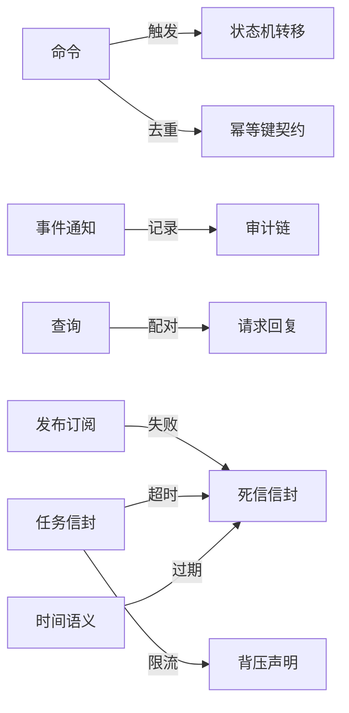

# 01-84 消息 DSL 通用模式全集

> **置信口径**: 模式定义为【论证】（工程模式共识）；与规范映射=【定理】（官方规范构件）。
> **时效声明**: 核实至 2026-11。
> **本文档定位**: 地基旗舰（批次 112d）。独立于任何系统与规范的消息 DSL 通用模式——12 大模式的元模型、最小表达与跨规范映射。01-84 是"消息领域的设计模式语言"：02 系 46 个专项设计模式是它的场景化展开，Testing/06 场景包是它的实例。

## 目录

- [01-84 消息 DSL 通用模式全集](#01-84-消息-dsl-通用模式全集)
  - [目录](#目录)
  - [1.84.1 消息 DSL 的最小内核](#1841-消息-dsl-的最小内核)
  - [1.84.2 十二大通用模式](#1842-十二大通用模式)
  - [1.84.3 模式关系图](#1843-模式关系图)
  - [1.84.4 跨规范映射](#1844-跨规范映射)
  - [1.84.5 参考来源](#1845-参考来源)

---

## 1.84.1 消息 DSL 的最小内核

一切消息 DSL 可归纳为三元组【论证】：

```yaml
message:  { identity, type, payload, headers }   # 是什么
channel:  { address, semantics }                  # 在哪（投递语义：队列/流/主题）
operation: { send | receive, correlation }        # 怎么交互
```

任何消息契约语言（AsyncAPI/AMQP 建模/本项目 contract.yaml）都是这三元的特化与扩展——这是跨语言映射（01-82）与跨规范转换（ODCS）的共同基础。

## 1.84.2 十二大通用模式

| # | 模式 | 元模型要点 | 最小 YAML 骨架 | 适用判据 |
| ---- | ---- | ---- | ---- | ---- |
| 1 | 命令消息 | type=command + idempotency-key 必填 | `cmd: {key, payload}` | 触发动作；副作用必须幂等 |
| 2 | 事件通知 | type=event + occurredAt | `evt: {fact, at}` | 广播领域事实；无返回值 |
| 3 | 查询与响应 | type=query + reply-address | `qry: {criteria, replyTo}` | 请求数据；需响应通道 |
| 4 | 发布订阅 | channel 语义=topic | `pub: {topic}` | 多消费者广播 |
| 5 | 请求回复 | operation.reply | `req: {corrId}` | 一对一 RPC 语义 |
| 6 | 死信信封 | DLQ channel + 原消息包裹 | `dlq: {original, reason}` | 失败隔离（01-65 工程面） |
| 7 | 任务信封 | task-id + deadline + retry-budget | `task: {id, ddl, budget}` | 异步执行（02-57 模板源） |
| 8 | 状态机转移 | from/event/to 三元 | `sm: {from, on, to}` | 实体生命周期（contract.yaml stateMachine） |
| 9 | 幂等键契约 | 键生成/传播/去重域 | `idem: {key, scope}` | 任何 at-least-once 链路 |
| 10 | 时间语义 | TTL / 延迟到期 / 事件时间 | `time: {ttl, deliverAt}` | 过期与定时（TEST-C2 两维度） |
| 11 | 背压声明 | 上限值+超出行为 | `bp: {maxPending, onFull}` | 快慢速不匹配必然存在时 |
| 12 | 审计链 | append-only + 哈希链 | `audit: {prevHash, hash}` | 合规取证（07-audit-trail） |

## 1.84.3 模式关系图



互斥判据【论证】：发布订阅 ⟂ 请求回复（广播 vs 点对点）；审计链 ⟂ 幂等去重（证据保留 vs 重复消除——07-audit-trail 的 dedup:false 依据）。

## 1.84.4 跨规范映射

| 模式 | AsyncAPI 3.x 落点 | ODCS 块 | 本项目契约落点 |
| ---- | ---- | ---- | ---- |
| 命令/事件/查询 | message + operation.action | schema.properties | messages[].type |
| 发布订阅 | channel + send/receive | — | x-semantics:交付语义 |
| 请求回复 | operation.reply | — | 场景级组合 |
| 死信信封 | 独立 channel（.dlq 后缀约定） | — | 场景包 DLQ 通道 |
| 任务信封 | message payload | sla（deadline） | 复用 task-envelope-template |
| 状态机 | （无原生）x- 扩展 | customProperties | stateMachine 段 |
| 幂等键 | headers.idempotency-key | quality.not_null | headers 必填 |
| 时间语义 | binding 参数（ttl/qos） | sla.freshness | ttlSeconds 字段 |
| 背压声明 | （无）x- 扩展 | sla | x-jetstream.maxAckPending 等 |
| 审计链 | （无）x- 扩展 | sla.retention | SEMANTICS 标注 |

"（无）"即表达力边界的落点（01-44）——登记簿管理（bindings-matrix §三）。

## 1.84.5 参考来源

- 项目内：[02-54](../02-场景驱动架构设计/02-54-事件契约模板库与命名规范.md)、[02-57](../02-场景驱动架构设计/02-57-IT通用场景事件契约模式库.md)、[Testing/06-03-业务场景](../../Testing/06-契约语义测试/03-业务场景/README.md)、[01-44](01-44-DSL表达力边界与等价转换策略.md)、[01-78](01-78-概念推理判定树.md)
- 外部：[EIP 官方目录](https://www.enterpriseintegrationpatterns.com/patterns/messaging/)、[CloudEvents 规范](https://github.com/cloudevents/spec)

---

**最后更新**: 2026-11-18
