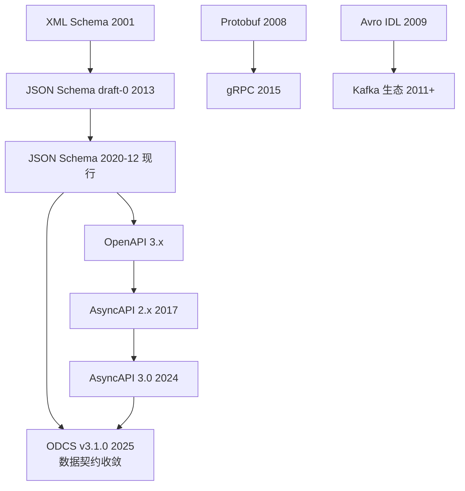

# 01-85 数据描述语言谱系

> **置信口径**: 规范语义=【定理】（各官方规范）；生态判断=【论证】。
> **时效声明**: 核实至 2026-11（JSON Schema 2020-12 / ODCS v3.1.0 为当前版）。
> **本文档定位**: 地基旗舰（批次 112b）。消息契约的载体语言全谱系——从 XML Schema 到 ODCS 的二十年演化。01-72（格式选型）与 02-60（演化策略）的上游。

## 目录

- [1.85.1 谱系总图：二十年演化](#1851-谱系总图二十年演化)
- [1.85.2 JSON Schema 2020-12 全语义](#1852-json-schema-2020-12-全语义)
- [1.85.3 三强对照：Protobuf vs Avro IDL vs JSON Schema](#1853-三强对照protobuf-vs-avro-idl-vs-json-schema)
- [1.85.4 新一代：TypeSpec 与 CUE](#1854-新一代typespec-与-cue)
- [1.85.5 Schema 双向工程的保真度问题](#1855-schema-双向工程的保真度问题)
- [1.85.6 参考来源](#1856-参考来源)

---

## 1.85.1 谱系总图：二十年演化



演化主线【论证】：①语法从繁到简（XML→JSON/YAML）；②语义从"验证文档"到"治理资产"（ODCS 的 quality/SLA 块）；③工作流从"写完再用"到"spec-first 门禁"（02-56 体系）。

## 1.85.2 JSON Schema 2020-12 全语义

消息契约最常用的核心特性（2020-12 版）【定理，官方规范】：

| 特性 | 语义 | 消息契约实例 |
| ---- | ---- | ---- |
| type/composition | allOf 合取/anyOf 析取/oneOf 互斥判别/not 否定 | oneOf[OrderCreated, OrderPaid] 消息判别 |
| if-then-else | 条件子模式 | if type=CANCELLED then required[reason] |
| format | 语义格式注解（date-time/uuid/email——annotation 非断言） | format: uuid 需配合 pattern 才强制 |
| unevaluatedProperties | 闭包控制（false=禁额外字段） | 契约严格模式 |
| $ref/$dynamicRef | 引用与动态引用 | $ref: contract.yaml#/messages/X |

**陷阱**【论证】：format 默认仅注解——多数 validator 需显式开启 format-assertion；oneOf 消息判别需 discriminator 类机制配套，否则消费者无法高效路由。

## 1.85.3 三强对照：Protobuf vs Avro IDL vs JSON Schema

| 维度 | Protobuf | Avro IDL | JSON Schema 2020-12 |
| ---- | ---- | ---- | ---- |
| 模式位置 | 源（schema-first） | 源 | 源或派生 |
| 代码生成 | 全语言 protoc | Java 生态最强（Avro tools） | modelina/Quicktype 类 |
| 演化机制 | field number+reserved | union+default | composition+unevaluated |
| 改名 | ✅ 安全（按号匹配） | ❌ 危险（按名匹配） | ⚠️ 视为删+增 |
| 自描述 | 否（需 schema 外带） | 是（header 带 schema） | 是（文档即 schema） |
| 消息契约适配 | payload 强类型 | Kafka 生态原生 | AsyncAPI 原生 |

选型判据【论证】：跨语言 RPC 重载→Protobuf；Kafka 数据管道→Avro；契约治理与 Web 生态→JSON Schema。三者在 01-72 的体积/速度维度再交叉一次。

## 1.85.4 新一代：TypeSpec 与 CUE

- **TypeSpec**（微软，原 CADL）【论证】：可组合的语言工作台风格 DSL，@typespec/asyncapi 发射器可生成 AsyncAPI（npm 生态核实至 2026）；定位=写一次元模型，发射 OpenAPI/AsyncAPI/Protobuf 多靶。
- **CUE**（Google 系）【论证】：配置+schema+数据同一语言，约束即值；在 k8s/流水线配置域渗透中。
- 对本项目的意义【论证】：contract.yaml 如需多靶发射（AsyncAPI+ODCS+文档），TypeSpec 路线是候选演进方向——当前 YAML+脚本转换（contract-to-odcs.py）已满足，迁移优先级低（审计批次 107 P2 已登记）。

## 1.85.5 Schema 双向工程的保真度问题

两个方向都有损耗【论证】：

```text
代码 → schema（springwolf 类）：注解覆盖率不全；泛型/继承展开失真
schema → 代码（modelina 类）：描述性信息（examples/描述）保留度因模板而异；
         x- 扩展与 bindings 在生成代码中通常丢失（01-82 断点分析）
```

工程对策【论证】：单向权威（schema 为准）+ 生成物不入库（生成于 CI）+ 保真度测试（生成→回读 schema 的对拍）。这与 01-77 金样本对账同构。

## 1.85.6 参考来源

- 项目内：[01-72](01-72-消息与数据编码对比矩阵.md)、[02-60](../02-场景驱动架构设计/02-60-消息设计与演化策略.md)、[Testing/06 odcs-alignment](../../Testing/06-契约语义测试/00-模型与规划/odcs-alignment.md)、[01-32](01-32-AsyncAPI工程生态深度分析.md)
- 外部：[JSON Schema 2020-12 规范](https://json-schema.org/draft/2020-12)、[Protobuf 语言指南](https://protobuf.dev/programming-guides/proto3/)、[Avro 规范](https://avro.apache.org/docs/current/specification/)、[TypeSpec](https://typespec.io/)、[ODCS v3.1.0](https://bitol.io/)

---

**最后更新**: 2026-11-18
