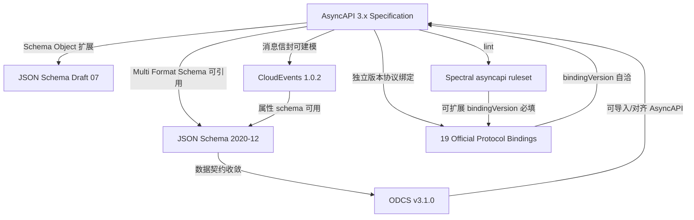
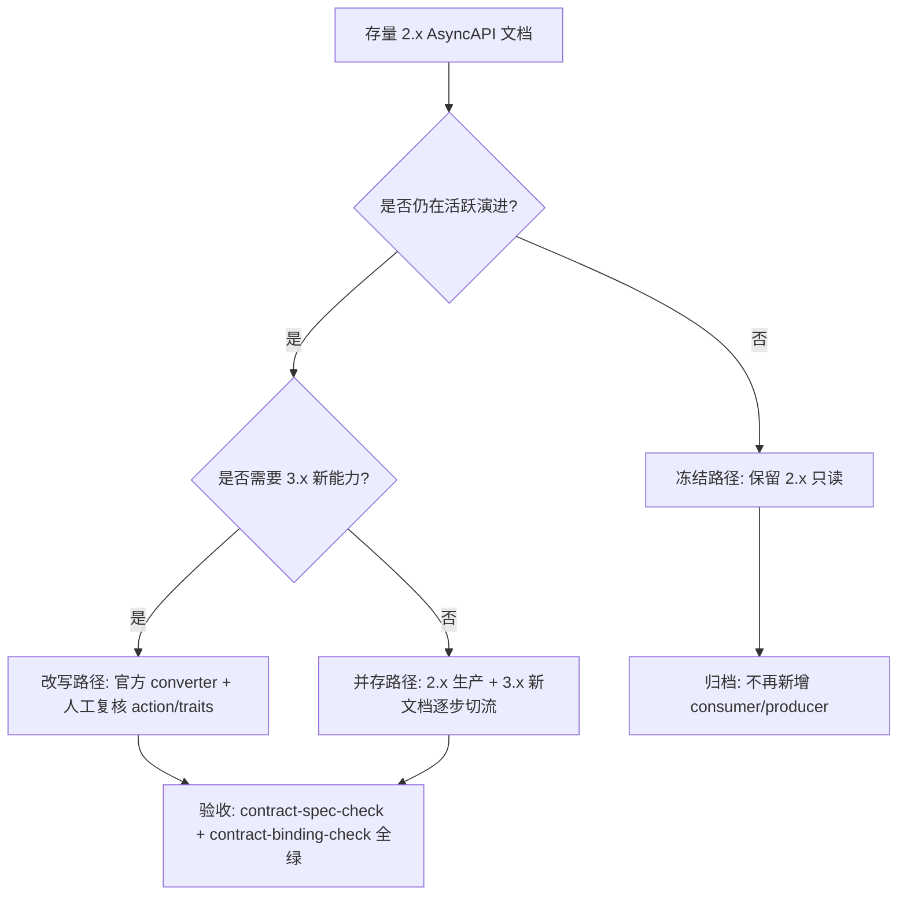

# 01-87 AsyncAPI 规范族全景与符合性栈

> **置信口径**: 规范族事实=【定理】（AsyncAPI 官方规范、asyncapi/bindings 仓库、JSON Schema/CloudEvents/Spectral 官方文档）；工程判断与兼容承诺=【论证】。
> **时效声明**: 核实至 2026-11（AsyncAPI 3.0.0 / 3.1.0；bindings 版本见表 1；CloudEvents 1.0.2；ODCS v3.1.0）。
> **本文档定位**: 旗舰（批次 112c 延伸）。把 AsyncAPI 规范族视为"依赖网络+符合性栈"——01-86 讲构件语义，本书讲规范族关系、演化迁移、符合性分层；绑定字段细节归 bindings-matrix，不复述。

## 目录

- [01-87 AsyncAPI 规范族全景与符合性栈](#01-87-asyncapi-规范族全景与符合性栈)
  - [目录](#目录)
  - [1.87.1 规范族依赖图与版本兼容矩阵](#1871-规范族依赖图与版本兼容矩阵)
    - [JSON Schema Draft 07 与 2020-12 的边界](#json-schema-draft-07-与-2020-12-的边界)
    - [Spectral 治理规则集分层](#spectral-治理规则集分层)
  - [1.87.2 19 个官方 bindings 与版本基线](#1872-19-个官方-bindings-与版本基线)
  - [1.87.3 规范演化与迁移论证](#1873-规范演化与迁移论证)
    - [2.0 → 2.6 → 3.0 语义破坏点清单](#20--26--30-语义破坏点清单)
    - [2.x → 3.x 迁移决策树](#2x--3x-迁移决策树)
    - [迁移工具链](#迁移工具链)
  - [1.87.4 六层符合性栈](#1874-六层符合性栈)
    - [L1 语法层](#l1-语法层)
    - [L2 结构层](#l2-结构层)
    - [L3 语义层](#l3-语义层)
    - [L4 绑定层](#l4-绑定层)
    - [L5 行为层](#l5-行为层)
    - [L6 治理层](#l6-治理层)
  - [1.87.5 与测试资产的映射](#1875-与测试资产的映射)
    - [挂账清单汇总](#挂账清单汇总)
  - [1.87.6 参考来源与版本事实清单](#1876-参考来源与版本事实清单)
    - [核实的版本事实清单](#核实的版本事实清单)
    - [项目内参考](#项目内参考)

---

## 1.87.1 规范族依赖图与版本兼容矩阵



**依赖关系说明**【定理】：

- AsyncAPI 3.x 的 `Schema Object` 是 JSON Schema Draft 07 的超集【定理，见 [AsyncAPI 3.0.0 Specification](https://www.asyncapi.com/docs/reference/specification/v3.0.0)】。这与常见的"AsyncAPI 用 JSON Schema 2020-12"直觉不同——2020-12 只在 **Multi Format Schema Object** 作为外部 schema 格式被引用，或出现在 ODCS/CloudEvents 侧时才是事实基线。
- 19 个官方 bindings 由 `asyncapi/bindings` 仓库独立维护版本，不随 spec 主版本同步发布【定理，见 [asyncapi/bindings](https://github.com/asyncapi/bindings)】。
- CloudEvents 1.0.2 是事件信封规范，AsyncAPI 可通过 `headers` + trait 描述其 binary/structured 模式；ODCS v3.1.0 是数据契约治理规范，与 AsyncAPI 呈"对齐"而非"被引用"关系。
- Spectral 内置 `spectral:asyncapi` 规则集，可同时校验 AsyncAPI 2.x 与 3.x；项目规则集再叠加 `bindingVersion`/`payload-required` 等治理意见。

**版本兼容矩阵**（WebSearch + 官方仓库核实）：

| 规范/资产 | 当前稳定版 | 与 AsyncAPI 3.x 的兼容关系 |
| ---- | ---- | ---- |
| AsyncAPI Specification | 3.1.0（2026-01-31） | 3.x 主版本最新；3.0.0（2023-12-05）为项目当前基线 |
| JSON Schema（Schema Object） | Draft 07 | AsyncAPI 3.x Schema Object 扩展 Draft 07 |
| JSON Schema（外部格式） | 2020-12 | Multi Format Schema Object 可引用；ODCS 原生使用 |
| CloudEvents | 1.0.2（2022-02-06） | 事件信封规范，AsyncAPI 以 headers/payload 建模 |
| ODCS | v3.1.0 | quality/SLA 治理块可与 AsyncAPI 对齐，非被引用 |
| Spectral | built-in `asyncapi` ruleset | 支持 2.x/3.x；项目自定义规则叠加在之上 |

> **关键纠正**【定理】：AsyncAPI 3.x 的 Schema Object 基于 JSON Schema Draft 07，而非 2020-12。01-85 把 2020-12 标为"当前版"是指 JSON Schema 生态的最新独立版本；在 AsyncAPI 内部，Draft 07 仍是 payload 默认语义基线。

### JSON Schema Draft 07 与 2020-12 的边界

AsyncAPI 3.x 在文档内同时存在两种 schema 语义，必须区分：

| 位置 | 默认 JSON Schema 版本 | 能否写 2020-12 | 说明 |
| ---- | ---- | ---- | ---- |
| `components.schemas` / `payload` / `headers` | Draft 07 | ❌ 不原生支持 | 可用 `allOf/anyOf/oneOf`、`format`、`unevaluatedProperties` 等 Draft 07 关键字 |
| `Multi Format Schema Object` | 由 `schemaFormat` 指定 | ✅ 可声明 `application/schema+json;version=draft-07` 或 2020-12 | 用于 Avro/Protobuf/JSON Schema 2020-12 等外部格式 |
| ODCS `quality/sla` 块 | 2020-12 | ✅ 原生 | ODCS 本身以 2020-12 为 schema 基础 |

工程影响【论证】：若团队已按 2020-12 写业务 schema，应通过 `payload.schemaFormat` 显式声明版本，否则 AsyncAPI 默认解析器可能按 Draft 07 解释 `if-then-else`、`$dynamicRef` 等新关键字，导致契约漂移。

### Spectral 治理规则集分层

项目规则集 `topics/config-templates/spectral-asyncapi-ruleset.yaml` 采用三层叠加：

```yaml
extends: spectral:asyncapi          # 官方内置规则：结构/必填/base 格式
rules:
  message-payload-schema-required:  # 项目层：每个 message 必须有 payload
  channel-binding-required:         # 项目层：每个 channel 必须声明协议绑定
  kafka-replication-minimum:        # 项目层：replicationFactor >= 2
  trace-header-recommended:         # 项目层：建议 trace-id header
  # 批次 94 计划新增：binding-version-required
```

当前缺失的治理规则即 DSL_ASYNCAPI_AUDIT P1 的 `bindingVersion` 必填规则；补齐后可在 E0 步骤 6 之前把 13 处缺失直接报 error。

---

## 1.87.2 19 个官方 bindings 与版本基线

以下 19 个协议绑定来自 `asyncapi/bindings` 仓库索引 + 官方插件/工具共识清单（按字母序），版本均从各 binding README 核实至 2026-11。

| 协议绑定 | AsyncAPI 3.x 适用版本 | 服务器 | 通道 | 操作 | 消息 | 备注 |
| ---- | ---- | :----: | :----: | :----: | :----: | ---- |
| AMQP 0-9-1 | 0.3.0 | R | ● | ● | R | RabbitMQ 主协议 |
| AMQP 1.0 | 0.1.0 | R | R | R | R | 全保留空 |
| Anypoint MQ | 0.1.0 | ● | ● | R | R | MuleSoft 托管队列 |
| Google Cloud Pub/Sub | 0.2.0 | R | ● | R | R | topic/subscription 语义 |
| HTTP | 0.3.0 | R | R | ● | R | Webhook/SSE 场景 |
| IBM MQ | 0.1.0 | ● | ● | R | R | 企业级 MQ |
| JMS | 0.0.1 | R | R | ● | R | 允许 `latest` 占位 |
| Kafka | 0.5.0 | ● | ● | ● | ● | 项目六系统重点 |
| Mercure | 0.1.0 | R | R | R | R | 全保留空 |
| MQTT | 0.2.0 | ● | R | ● | ● | 项目六系统重点 |
| MQTT5 | 0.2.0 | ● | R | ● | ● | v5 专属字段 |
| NATS | 0.1.0 | R | R | ● | R | Core/JetStream 用 x-jetstream 扩展 |
| Pulsar | 0.1.0 | ● | ● | R | R | 项目六系统重点 |
| Redis | 0.1.0 | R | R | R | R | 全保留空；项目用 x-redis 扩展 |
| SNS | 1.0.0（3.x）/ 0.2.0（2.x） | R | ● | R | R | 按 AsyncAPI 主版本分册 |
| Solace | 0.4.0 | ● | ● | ● | ● | 企业级事件网格 |
| SQS | 0.3.0 | R | ● | R | R | 队列/死信配置 |
| STOMP | 0.1.0 | R | R | R | R | 全保留空 |
| WebSockets | 0.1.0 | R | R | R | R | ws/wss 原生通道 |

图例：**●**=有字段集；**R**=保留空（MUST NOT contain properties）。

**兼容性承诺**【论证】：

1. **binding 版本独立于 spec 版本**。Kafka binding 0.5.0 同时可用于 AsyncAPI 2.6 与 3.x，字段语义不变；SNS binding 因结构差异按 AsyncAPI 主版本分册（2.x 用 0.2.0，3.x 用 1.0.0）。
2. **bindingVersion 字段必须显式声明**。虽然规范允许省略，但项目治理要求每个 binding 对象声明 `bindingVersion`（01-86 陷阱 8）。DSL_ASYNCAPI_AUDIT 登记：当前仍有 **13 处缺失**，为 P1 挂账。
3. **保留空 binding 不得写字段**。Redis/MQTT channel/AMQP server 等保留空层级若出现字段，属于层级违规（bindings-matrix §四 修正项）。

---

## 1.87.3 规范演化与迁移论证

### 2.0 → 2.6 → 3.0 语义破坏点清单

| 破坏点 | 2.x 形态 | 3.x 形态 | 事故概率 |
| ---- | ---- | ---- | ----: |
| operation 与 channel 耦合 | channel 内嵌 publish/subscribe | channel 与 operation 解耦，operation 通过 `$ref` 引用 channel | 高 |
| action 方向参照系 | publish/subscribe 以 broker 为参照 | send/receive 以 application 为参照 | 极高 |
| channel 地址语义 | channel key = address/topic | channel key = 任意 ID；address 独立属性 | 高 |
| traits 组合优先级 | trait 覆盖目标对象同名属性 | 目标对象优先于 trait | 中 |
| message 组织方式 | operation.message + oneOf | channel.messages 键值映射 | 中 |
| messageId | 独立字段 | 用 messages map 的 key 作为 ID | 中 |
| schemaFormat | message.schemaFormat | Multi Format Schema Object 的 schemaFormat + schema | 中 |
| 参数对象 | 完整 Schema Object | 仅 string + enum/default/description/examples/location | 低 |
| 显式引用 | channel.servers 用名称字符串 | 必须 `$ref` 引用 | 低 |
| tags/externalDocs | 全局根属性 | 移入 info 对象 | 低 |

> 上表基于 [AsyncAPI Migrating to v3](https://www.asyncapi.com/docs/migration/migrating-to-v3) 官方迁移指南逐条映射，事故概率为项目经验估值【估算】。

### 2.x → 3.x 迁移决策树



**三路径判据**【论证】：

- **改写路径**：文档频繁变更、需要多 operation 共享同一 channel、需要请求-响应 `reply` 对象、需要 CloudEvents trait 结构化描述。代价高但长期治理最优。
- **并存路径**：存量 2.x 已稳定运行，新增服务用 3.x；通过 schema registry/主题命名约定保证互通。代价中等，风险可控。
- **冻结路径**：遗留系统文档不再更新，消费者只读不扩容。代价最低，但禁止再用其生成新代码。

### 迁移工具链

官方提供的 `asyncapi convert` 是起点而非终点：

```bash
# 1. 自动转换
asyncapi convert asyncapi_v2.yaml --output=asyncapi_v3.yaml --target-version=3.0.0

# 2. 项目 E0 校验
bash topics/scripts/contract-spec-check.sh --spec asyncapi_v3.yaml
bash topics/scripts/contract-binding-check.sh --spec asyncapi_v3.yaml

# 3. 人工复核清单（必须人工，无法机器完全判定）
#    - 所有 action 是否以 application 为参照
#    - trait 与目标对象同名属性是否仍符合业务语义
#    - channel address 与 name 是否分离清楚
#    - 外部 $ref 是否仍指向正确文件
```

converter 能处理结构迁移，但 **action 方向反转**和 **trait 优先级反转**会改变业务语义，必须逐 operation review（DSL_ASYNCAPI_AUDIT P1 外部 `$ref` 解析缺位，更让自动复核受限）。

---

## 1.87.4 六层符合性栈

本项目把"AsyncAPI 文档是否可信"拆成六层。L1-L4 由 E0 静态门禁兜底；L5 进入 hermes H1 执行域；L6 是尚未完全自动化的治理层。

### L1 语法层

- **定义**：文档是合法的 YAML/JSON，机器可解析。
- **判据**：`python3 yaml.safe_load` 不抛异常；无 BOM/制表符混用；文件编码 UTF-8。
- **工具**：`contract-dsl-check.sh`（校验 contract.yaml）、`contract-spec-check.sh` 内 YAML 解析。
- **检查命令示例**：

```bash
bash topics/scripts/contract-dsl-check.sh --json
# 输出: SCHEMA=... PASS=8 FAIL=0 ERROR=0
```

- **置信上限**：【定理】—— 可机读即合法。
- **当前挂账**：无结构性挂账；DSL_ASYNCAPI_AUDIT P0 已补齐 `dsl-schema.json`。

### L2 结构层

- **定义**：文档符合 AsyncAPI 3.x 的 schema 结构，必填字段存在，`$ref` 不悬空。
- **判据**：`asyncapi: '3.1.0'`；`info.title/version` 存在；`channels` 非空；operation 引用的 channel 存在；message `$ref` 指向 `components/messages`；binding key 在官方 19 个列表内。
- **工具**：`contract-spec-check.sh`（E0 步骤 6）、Spectral `spectral:asyncapi` 规则集。
- **检查命令示例**：

```bash
bash topics/scripts/contract-spec-check.sh --json
# 输出: SPECS=14 PASS=14 FAIL=0
```

- **置信上限**：【定理】—— 按官方 JSON Schema 校验。
- **当前挂账**：`contract-spec-check` 不解析外部 `$ref: contract.yaml#/messages/X`（DSL_ASYNCAPI_AUDIT P1）；工具链对外部引用支持参差（01-86 §1.86.5）。

### L3 语义层

- **定义**：构件按 01-86 的语义规则使用，无方向/层级/分界陷阱。
- **判据**：action 以 application 为参照；channel address 与 name 分离；headers/payload 分界符合项目约定；traits 按"目标对象优先"组合；parameters 替换后再投递；oneOf 消息有判别器或路由约定。
- **工具**：`tc-assert-check.sh` 校验 `x-semantics` 维度归属；人工 design review；Spectral 自定义规则（如 `channel-binding-required`）。
- **检查命令示例**：

```bash
bash topics/scripts/tc-assert-check.sh --json
# 输出: CHECKS=25 PASS=25 FAIL=0
```

- **置信上限**：【论证】—— 规则来自官方规范 + 项目工程约定。
- **当前挂账**：8 个语义陷阱仍依赖人工识别；01-86 陷阱 1/3/5/6 未完全机读化（DSL_ASYNCAPI_AUDIT P1/P2）。

### L4 绑定层

- **定义**：binding 字段在官方字段集内，层级正确，x- 扩展已登记，bindingVersion 显式声明。
- **判据**：四级字段白名单（bindings-matrix §二）；MQTT 语义字段在 operation 级；Redis 等保留空层级无字段；x- 扩展在 §三 登记簿。
- **工具**：`contract-binding-check.sh`（E0 已纳入路径修复后的运行）。
- **检查命令示例**：

```bash
bash topics/scripts/contract-binding-check.sh --json
# 输出: SPECS=14 PASS=14 FAIL=0
```

- **置信上限**：【定理】—— 字段集来自 asyncapi/bindings 官方规范。
- **当前挂账**：13 处 `bindingVersion` 缺失（DSL_ASYNCAPI_AUDIT P1）；`asyncapi-contract-skeleton.yaml` 使用非官方 `replicas` 字段（P2）。

### L5 行为层

- **定义**：spec 描述的行为在真实 broker/消费者上可验证，包括 payload schema、headers、顺序性、幂等键、死信路径等。
- **判据**：Microcks 导入 spec 后 mock 可用；contract test 对真实流量断言；TC-SEM/TC-BUS 脚本覆盖 12 语义维度。
- **工具**：Microcks（`docker-compose-microcks.yml`）、`tc-sem-*.sh`、`tc-bus-*.sh`。
- **启动示例**（H1 执行域）：

```bash
docker compose -f Testing/fixtures/docker-compose-microcks.yml down -v && up -d
# 导入首个场景: Testing/06-契约语义测试/03-业务场景/01-order-lifecycle/asyncapi.yaml
```

- **置信上限**：【论证】—— 受测试环境、broker 版本、fixtures 真实性约束。
- **当前挂账**：H1 Microcks 收尾未开始（HERMES-STATE.md）；12 个 TC-SEM 中仅 2 个有真实执行脚本（DSL_ASYNCAPI_AUDIT P2）。

### L6 治理层

- **定义**：spec 作为资产可持续治理——diff 可审、版本兼容可判、目录可检索、变更可追溯。
- **判据**：`info.version` 遵循 SemVer 表达契约兼容性；每次变更走 `asyncapi convert` 或 diff 工具；目录服务可检索 x-semantics/x- 扩展；Spectral 规则集持续更新。
- **工具**：`asyncapi convert`（2.x↔3.x）、`contract-drift-check.sh`、Spectral 自定义规则集、`test-registry.tsv`。
- **置信上限**：【论证】—— 治理成熟度取决于组织流程，非规范本身。
- **当前挂账**：无统一 spec 目录服务；L6 规则未完全 Spectral 化；外部 `$ref` 变更无法被 E0 diff 捕获（DSL_ASYNCAPI_AUDIT P1）。

---

## 1.87.5 与测试资产的映射

| 符合性层 | 判据/资产 | 现有工具/E0 门禁 | hermes 执行域 | 当前挂账（来源） |
| ---- | ---- | ---- | ---- | ---- |
| L1 语法 | contract.yaml / asyncapi.yaml 可解析 | `contract-dsl-check.sh`（E0 已可用） | — | 无 |
| L2 结构 | AsyncAPI 3.x schema、内部 `$ref` 不悬空 | `contract-spec-check.sh`（E0 步骤 6） | — | 外部 `$ref` 不解析（DSL_ASYNCAPI_AUDIT P1） |
| L3 语义 | 8 个语义陷阱、`x-semantics` 维度合法 | `tc-assert-check.sh`（E0 步骤 7） + Spectral 自定义规则 | — | 陷阱未全机读化（P1/P2） |
| L4 绑定 | binding 字段/层级/x- 扩展合法 | `contract-binding-check.sh`（E0 路径修复后） | — | 13 处 bindingVersion 缺失；`replicas` 字段误用（P1/P2） |
| L5 行为 | Microcks mock + TC-SEM/TC-BUS 真实执行 | — | **H1**（Microcks 收尾） | 仅 2/12 TC-SEM 实跑（HERMES-STATE、DSL_ASYNCAPI_AUDIT P2） |
| L6 治理 | diff/版本兼容/目录/追溯 | `contract-drift-check.sh` + Spectral 规则集 | 周期任务/夜间重跑 | 无统一目录；外部引用变更不可 diff（P1） |

**映射说明**：

- L1-L4 已全部进入 E0 静态门禁：每次提交自动跑 `contract-spec-check`、`contract-binding-check`、`tc-assert-check`（E0 步骤 6/7）。`contract-dsl-check` 作为独立工具交付，尚未默认接入 E0（批次 94 决策）。
- L5 落入 hermes **H1 执行域**：Microcks 容器就绪 → 导入 8 个场景 spec → contract test 对真实 broker 流量断言。当前 H1 A3 未开始（HERMES-STATE.md）。
- L6 挂账清单即 DSL_ASYNCAPI_AUDIT 的 P1/P2 缺口，需通过 Spectral 规则补全、`asyncapi convert` 版本兼容检查、以及统一目录服务逐步消化。

### 挂账清单汇总

| 优先级 | 挂账项 | 影响 | 计划批次 |
| ---- | ---- | ---- | ---- |
| P1 | 13 处 bindingVersion 缺失 | 不同工具解释不一致；E0 无法拦截 | 94 |
| P1 | contract-spec-check 不解析外部 `$ref: contract.yaml#` | payload 字段变更无法被 E0 捕获 | 94 |
| P1 | 7/8 场景包缺失 `quality/sla` ODCS 段 | ODCS 对齐不完整 | 94 |
| P1 | 无 design→asyncapi 生成器 | 转换靠手写，效率低、易出错 | 95 |
| P2 | 跨语言金样本矩阵 `xlang-matrix.sh --live` 未实跑 | 5 语言对等验证停留在规划 | 100 |
| P2 | `asyncapi-contract-skeleton.yaml` 使用非官方 `replicas` | 模板自身与 bindings-matrix 冲突 | 94 |
| P2 | Spectral 缺少 `binding-version-required` 规则 | 13 处缺失无法被 lint 自动拦截 | 94 |

---

## 1.87.6 参考来源与版本事实清单

### 核实的版本事实清单

| 事实 | 版本/日期 | 官方来源 |
| ---- | ---- | ---- |
| AsyncAPI 3.0.0 发布 | 2023-12-05 | [GitHub Release v3.0.0](https://github.com/asyncapi/spec/releases/tag/v3.0.0) |
| AsyncAPI 3.1.0 发布 | 2026-01-31 | [GitHub Release v3.1.0](https://github.com/asyncapi/spec/releases/tag/v3.1.0) |
| AsyncAPI 2.6.0 发布 | 2023-02-01 | [GitHub Release v2.6.0](https://github.com/asyncapi/spec/releases/tag/v2.6.0) |
| AsyncAPI Schema Object | 基于 JSON Schema Draft 07 | [AsyncAPI 3.0.0 规范 §Schema Object](https://www.asyncapi.com/docs/reference/specification/v3.0.0) |
| CloudEvents 发布 | 1.0.2（2022-02-06） | [GitHub Release ce@v1.0.2](https://github.com/cloudevents/spec/releases/tag/ce%40v1.0.2) |
| Kafka binding | 0.5.0 | [asyncapi/bindings kafka README](https://github.com/asyncapi/bindings/tree/master/kafka) |
| MQTT / MQTT5 binding | 0.2.0 | [asyncapi/bindings mqtt README](https://github.com/asyncapi/bindings/tree/master/mqtt) |
| AMQP 0-9-1 binding | 0.3.0 | [asyncapi/bindings amqp README](https://github.com/asyncapi/bindings/tree/master/amqp) |
| NATS / Pulsar / Redis / STOMP / WebSockets / Mercure / AMQP1.0 / IBM MQ / Anypoint MQ binding | 0.1.0 | [asyncapi/bindings](https://github.com/asyncapi/bindings) 各子目录 README |
| Google Cloud Pub/Sub binding | 0.2.0 | [asyncapi/bindings googlepubsub README](https://github.com/asyncapi/bindings/tree/master/googlepubsub) |
| HTTP binding | 0.3.0 | [asyncapi/bindings http README](https://github.com/asyncapi/bindings/tree/master/http) |
| JMS binding | 0.0.1 | [asyncapi/bindings jms README](https://github.com/asyncapi/bindings/tree/master/jms) |
| Solace binding | 0.4.0 | [asyncapi/bindings solace README](https://github.com/asyncapi/bindings/tree/master/solace) |
| SQS binding | 0.3.0 | [asyncapi/bindings sqs README](https://github.com/asyncapi/bindings/tree/master/sqs) |
| SNS binding（AsyncAPI 3.x） | 1.0.0 | [asyncapi/bindings sns/3.0.0 README](https://github.com/asyncapi/bindings/tree/master/sns/3.0.0) |
| SNS binding（AsyncAPI 2.x） | 0.2.0 | [asyncapi/bindings sns/2.x.x README](https://github.com/asyncapi/bindings/tree/master/sns/2.x.x) |
| Spectral AsyncAPI 规则 | built-in `asyncapi` ruleset | [Spectral Docs](https://docs.stoplight.io/docs/spectral/1e63ffd0220f3-async-api-rules) |

### 项目内参考

- 项目内：[01-85](01-85-数据描述语言谱系.md)、[01-86](01-86-AsyncAPI构件语义全书.md)、[bindings-matrix](../../Testing/06-契约语义测试/01-契约规格/bindings-matrix.md)、[DSL_ASYNCAPI_AUDIT](../DSL_ASYNCAPI_AUDIT.md)、[TEST-C1](../../Testing/06-契约语义测试/00-模型与规划/TEST-C1-六层契约语义测试模型与规划.md)、[HERMES-STATE](../../Testing/HERMES-STATE.md)、[spectral-asyncapi-ruleset](../../config-templates/spectral-asyncapi-ruleset.yaml)
- 外部：[AsyncAPI 3.0.0 Specification](https://www.asyncapi.com/docs/reference/specification/v3.0.0)、[AsyncAPI 3.1.0 Specification](https://www.asyncapi.com/docs/reference/specification/v3.1.0)、[AsyncAPI Spec 仓库](https://github.com/asyncapi/spec)、[AsyncAPI Bindings 仓库](https://github.com/asyncapi/bindings)、[Migrating to v3](https://www.asyncapi.com/docs/migration/migrating-to-v3)、[ODCS v3.1.0](https://bitol.io/)

---

**最后更新**: 2026-11-18
