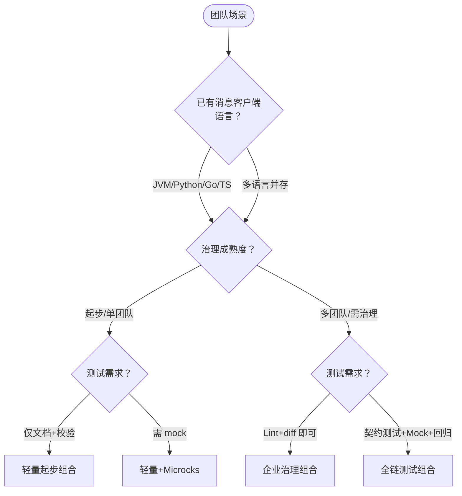

# 1.90 AsyncAPI 技术栈全景 2026

> **置信口径**: 协议/规范语义=【定理】；工具版本与能力=【论证】（以官方 GitHub/npm/官网发布为准）；新兴层成熟度=【论证】+【估算】。
> **时效声明**: 本文事实基于 AsyncAPI Initiative、npm、GitHub 官方发布信息核实至 2026-11。
> **定位声明**: 本文是 [01-32 AsyncAPI 工程生态深度分析](./01-32-AsyncAPI工程生态深度分析.md) 的 2026 全景升级版，聚焦六层工具栈版本基线、选型决策与新兴层评估；概念与实操细节见 01-32，治理三件套实现见 [governance-tools](../../Testing/06-契约语义测试/00-模型与规划/governance-tools.md)，行为验证层见 [06-行为验证](../../Testing/06-契约语义测试/06-行为验证/README.md)。

## 目录

- [1.90 AsyncAPI 技术栈全景 2026](#190-asyncapi-技术栈全景-2026)
  - [目录](#目录)
  - [1.90.1 六层栈全景图谱](#1901-六层栈全景图谱)
  - [1.90.2 版本基线表](#1902-版本基线表)
  - [1.90.3 各层能力解析](#1903-各层能力解析)
    - [L1 核心规范层](#l1-核心规范层)
    - [L2 生成层](#l2-生成层)
    - [L3 治理层](#l3-治理层)
    - [L4 测试层](#l4-测试层)
    - [L5 运行时绑定层](#l5-运行时绑定层)
    - [L6 平台层](#l6-平台层)
  - [1.90.4 选型决策树](#1904-选型决策树)
  - [1.90.5 新兴层评估](#1905-新兴层评估)
    - [AI 生成契约](#ai-生成契约)
    - [契约 fuzzing / property-based 测试](#契约-fuzzing--property-based-测试)
  - [1.90.6 落地组合与最小闭环](#1906-落地组合与最小闭环)
  - [1.90.7 参考来源](#1907-参考来源)

---

## 1.90.1 六层栈全景图谱

AsyncAPI 的工程价值由六层栈共同兑现：核心规范提供机器可读契约，生成层把契约变成类型与文档，治理层保证契约演进可控，测试层把契约变成可执行断言，运行时绑定层把契约映射到真实 broker 客户端，平台层把契约纳入组织级发现与门户【论证：官方工具链】。

```mermaid
flowchart TB
    subgraph L1["L1 核心规范层"]
        A1[AsyncAPI Spec 3.1.0]
        A2[@asyncapi/parser 3.6.6]
        A3[@asyncapi/cli 6.3.1]
    end
    subgraph L2["L2 生成层"]
        B1[@asyncapi/modelina 5.10.1]
        B2[@asyncapi/generator 3.5.0]
        B3[@asyncapi/html-template 3.5.6]
    end
    subgraph L3["L3 治理层"]
        C1[Spectral 6.17.1]
        C2[@asyncapi/diff 0.6.1]
        C3[EventCatalog 5.13.2]
        C4[Backstage plugin-api-docs 0.14.6]
    end
    subgraph L4["L4 测试层"]
        D1[Microcks 1.16.0]
        D2[Pact JS 17.1.4 / Pact Python 0.5.12.1]
        D3[Specmatic 2.56.3]
    end
    subgraph L5["L5 运行时绑定层"]
        E1["Kafka / MQTT / NATS / Pulsar / RabbitMQ / Redis Stream clients"]
    end
    subgraph L6["L6 平台层"]
        F1[Backstage]
        F2[Port]
        F3[内部门户]
    end
    L1 --> L2
    L1 --> L3
    L2 --> L5
    L3 --> L6
    L4 --> L5
    L4 --> L6
```

| 层 | 成员 | 主要职责 | 关键入口 |
| --- | --- | --- | --- |
| L1 核心规范层 | AsyncAPI Spec 3.1.0、@asyncapi/parser、@asyncapi/cli | 契约定义、解析、校验、转换 | `asyncapi validate` / `asyncapi convert` |
| L2 生成层 | Modelina、Generator、html-template | 类型模型、脚手架、交互文档生成 | `asyncapi generate models` / `fromTemplate` |
| L3 治理层 | Spectral、@asyncapi/diff、EventCatalog、Backstage plugin-api-docs | Lint、破坏性变更检测、事件目录、门户集成 | `spectral lint` / `asyncapi diff` |
| L4 测试层 | Microcks、Pact、Specmatic | Mock、契约测试、服务虚拟化 | Microcks 导入 / `pact verify` / Specmatic 测试 |
| L5 运行时绑定层 | 六系统客户端生态 | 把契约绑定到真实 broker 的运行时语义 | 见 01-73~01-76 专章 |
| L6 平台层 | Backstage、Port、内部门户 | 组织级发现、血缘、自助联调 | 见 02-59 消息平台工程与内部开发者门户 |

**六层成员数**: 核心工具 22 个（L1=3、L2=3、L3=4、L4=3、L5=6 协议族、L6=3 门户形态），版本基线表 14 条（Pact 按 JS/Python 两行计，来源各一）。

## 1.90.2 版本基线表

以下版本均通过 npm `latest` 标签或 GitHub `releases/latest` 接口核实；发布日期取 UTC 发布日【论证】。

| 工具/组件 | 稳定版 | 发布日期 | 来源 |
| --- | --- | --- | --- |
| AsyncAPI Specification | 3.1.0 | 2026-01-31 | [GitHub releases](https://github.com/asyncapi/spec/releases/tag/v3.1.0) / [Release Notes](https://asyncapi.com/blog/release-notes-3.1.0) |
| @asyncapi/parser | 3.6.6 | 2026-10-16 | [npm](https://www.npmjs.com/package/@asyncapi/parser) |
| @asyncapi/cli | 6.3.1 | 2026-11-16 | [npm](https://www.npmjs.com/package/@asyncapi/cli) |
| @asyncapi/modelina | 5.10.1 | 2025-10-19 | [npm](https://www.npmjs.com/package/@asyncapi/modelina) |
| @asyncapi/generator | 3.5.0 | 2026-10-20 | [npm](https://www.npmjs.com/package/@asyncapi/generator) |
| @asyncapi/html-template | 3.5.6 | 2026-03-14 | [npm](https://www.npmjs.com/package/@asyncapi/html-template) |
| @asyncapi/diff | 0.6.1 | 2026-11-02 | [npm](https://www.npmjs.com/package/@asyncapi/diff) |
| @stoplight/spectral-cli | 6.17.1 | 2026-11-06 | [npm](https://www.npmjs.com/package/@stoplight/spectral-cli) |
| @eventcatalog/core | 5.13.2 | 2026-11-17 | [npm](https://www.npmjs.com/package/@eventcatalog/core) |
| @backstage/plugin-api-docs | 0.14.6 | 2026-10-20 | [npm](https://www.npmjs.com/package/@backstage/plugin-api-docs) |
| Microcks | 1.16.0 | 2026-11-13 | [GitHub releases](https://github.com/microcks/microcks/releases/tag/1.16.0) |
| Pact JS | 17.1.4 | 2026-09-07 | [GitHub releases](https://github.com/pact-foundation/pact-js/releases/tag/v17.1.4) |
| Pact Python (FFI) | 0.5.12.1 | 2026-10-23 | [GitHub releases](https://github.com/pact-foundation/pact-python/releases/tag/pact-python-ffi/0.5.12.1) |
| Specmatic | 2.56.3 | 2026-11-15 | [GitHub releases](https://github.com/znsio/specmatic/releases/tag/2.56.3) |

**版本基线表**: 14 条；来源均为 npm 或 GitHub 官方 release，无二手聚合站。

> **安全提示**: 2026-07-14 `@asyncapi/generator`、`@asyncapi/specs` 等包曾因 CI 工作流被投毒发布恶意版本；当前表内版本均在该事件之后且已 yank 恶意版本，生产使用仍需 pin 版本并校验 `package-lock.json` / provenance 签名【论证：Microsoft 安全博客】。

## 1.90.3 各层能力解析

### L1 核心规范层

核心层是全部后续层的“源事实”。Parser 3.6.6 支持 AsyncAPI 2.x/3.x，提供 `parse()`、`validate()`、`bundle()` 等 API；CLI 6.3.1 把这些能力包装成命令行入口【论证：npm 与官方文档】。

```bash
# 校验与版本转换
asyncapi validate asyncapi.yaml
asyncapi convert asyncapi-v2.yaml -o asyncapi-v3.yaml

# 多文件合并为单一文档
asyncapi bundle ./specs/**/*.yaml -o asyncapi.bundled.yaml
```

### L2 生成层

Modelina 与 Generator 的分工在 01-32 已有详述；2026 年无结构性变化，但 Generator 3.5.0 与 html-template 3.5.6 已修复 2026-07 供应链事件相关依赖。Modelina 5.10.1 仍是稳定线，6.0.0 仍为 next 预发布【论证：npm latest 标签】。

```bash
# 生成数据模型
asyncapi generate models asyncapi.yaml -l python -o models/

# 生成交互式 HTML 文档
asyncapi generate fromTemplate asyncapi.yaml @asyncapi/html-template -o site/
```

### L3 治理层

- **Spectral 6.17.1**: `@stoplight/spectral-cli` 内置 `spectral:asyncapi` 规则集，可扩展企业治理规则（如 Kafka RF≥2、必填 payload schema）。
- **@asyncapi/diff 0.6.1**: 比较两版文档，输出 `breaking`、`non-breaking`、`unclassified` 三类变更；2026-11 重新发布修复版本后可用性恢复【论证：npm】。
- **EventCatalog 5.13.2**: 从 AsyncAPI 文档自动生成域/服务/通道/消息拓扑，是事件目录的事实标准。
- **Backstage plugin-api-docs 0.14.6**: 在 Backstage 中渲染 AsyncAPI 定义，与软件目录天然集成。

```bash
# diff 入 CI，破坏性变更非零退出
asyncapi diff asyncapi.old.yaml asyncapi.new.yaml

# Spectral lint
npx @stoplight/spectral-cli lint asyncapi.yaml --ruleset spectral:asyncapi
```

### L4 测试层

- **Microcks 1.16.0**: CNCF Incubating，支持 AsyncAPI 导入后生成 mock 与契约一致性测试，覆盖 Kafka/MQTT/AMQP 等绑定【论证：GitHub release】。
- **Pact**: v4 协议支持 message pact，Pact JS 17.1.4 与 Pact Python 0.5.12.1 均已支持异步消息交互；2026-09 Pact 官方宣布 AsyncAPI 2.x/3.0.x 导入能力进入 Bi-Directional Contract Testing（BDCT）【论证：Pact Docs 博客】。
- **Specmatic 2.56.3**: 将 OpenAPI/AsyncAPI 作为可执行契约，提供 mock、测试、向后兼容检查，2026-11 仍在快速迭代【论证：GitHub release】。

### L5 运行时绑定层

L5 不重复展开，各系统客户端版本与选型结论见项目内专章：

| 系统 | 对应专章 | 说明 |
| --- | --- | --- |
| Kafka | 01-73 | 客户端生态、分区策略、schema registry |
| MQTT | 01-74 | QoS、保留消息、遗嘱 |
| NATS | 01-75 | JetStream、subject 映射 |
| Pulsar | 01-76 | 租户/命名空间、持久化 |
| RabbitMQ | 01-?（AMQP 专章） | exchange/binding/queue |
| Redis Stream | 01-? | 消费者组、ID 范围 |

绑定字段本身由 AsyncAPI 规范扩展（bindings）承载，与核心规范独立演进；解析器校验语法，合理性需由 Spectral 规则治理。

### L6 平台层

平台层把契约从“仓库文件”变成“组织资产”。Backstage 通过 `plugin-api-docs` 渲染 AsyncAPI；Port 等 IDP 可通过 AsyncAPI 集成把消息服务纳入软件目录；内部门户通常基于 EventCatalog 或自研前端，消费 Generator 产物与 CI diff 报告。详细设计见 [02-59 消息平台工程与内部开发者门户](../02-场景驱动架构设计/02-59-消息平台工程与内部开发者门户.md)。

## 1.90.4 选型决策树



| 档位 | 组合 | 适用场景 | 入门槛 |
| --- | --- | --- | --- |
| 轻量起步 | CLI validate + html-template + Spectral 基础规则 | 单团队、1-2 个 topic、快速出文档 | 低（纯 npm 工具） |
| 企业治理 | CLI + Spectral 自定义规则 + @asyncapi/diff + EventCatalog + Backstage 插件 | 多团队、契约变更需评审、需事件目录 | 中（需 CI 与目录站点） |
| 全链测试 | 企业治理 + Microcks + Pact/Specmatic + 运行时绑定测试 | 核心消息链路、变更回归零容忍、生产影子验证 | 高（需 broker 环境/契约用例维护） |

选型建议：
- 如果团队处于“契约先行”阶段，优先 CLI + Spectral + Modelina，先让编译期强类型约束落地。
- 如果团队是“实现先行”，用 Springwolf/FastStream/nestjs-asyncapi（01-32 已列）反向生成契约，再用 `@asyncapi/diff` 做设计文档与生成文档的一致性门禁。
- 如果多语言消费同一 topic，优先 Generator 生成多语言客户端模型 + Microcks 提供统一 mock，避免每语言手写 fixture。

## 1.90.5 新兴层评估

### AI 生成契约

2026 年已出现把自然语言需求转换为 AsyncAPI 的插件/技能，但均非官方工具，成熟度参差不齐。

| 工具/技能 | 形态 | 成熟度 | 风险 |
| --- | --- | --- | --- |
| formal-specification / api-contract（Claude 插件市场） | 从需求描述生成 OpenAPI/AsyncAPI | 【估算】实验级 | 绑定字段易 hallucinate，需 parser 校验 |
| lobehub asyncapi-design skill | 对话式辅助设计、模板加载 | 【估算】实验级 | 输出需人工复核 operation/channel 语义 |
| AsyncAI JetBrains 插件（Pavel on Software 2026-09） | 扫描 Spring 消息代码并导出 AsyncAPI | 【论证】早期可用 | 仅覆盖 Spring/Kafka/Pulsar 等映射，复杂 header/envelope 可能遗漏 |
| 通用 LLM（ChatGPT/Copilot） | 从示例 JSON/文档草稿生成 YAML | 【估算】可用但不可信 | 版本号、bindings、schema 格式错误率高 |

**采用建议【论证】**:
1. 把 AI 生成定位成“初稿加速器”，输出必须经 `asyncapi validate` + Spectral lint 才能入仓。
2. 用项目模板（config-templates/asyncapi-kafka-example.yaml 等）做 few-shot，约束 LLM 输出结构。
3. 禁止直接由 AI 生成 binding 取值、安全参数、版本变更结论；这些属于治理决策。

### 契约 fuzzing / property-based 测试

| 工具/方法 | 是否原生支持 AsyncAPI | 机制 | 成熟度 | 采用建议 |
| --- | --- | --- | --- | --- |
| Microcks 1.16.0 | 是 | example 驱动 + 变异生成测试消息 | 【论证】成熟 | 优先用于有 example 的契约回归 |
| Specmatic 2.56.3 | 是 | 以 AsyncAPI 为可执行契约，生成边界值 | 【论证】成熟 | 适合 spec-first 团队做服务虚拟化与兼容性检查 |
| Pact v4 message pact | 是（BDCT 支持导入 AsyncAPI） | 消费者驱动契约 + 消息 pact | 【论证】成熟 | 适合微服务消费者/生产者双向约束 |
| Schemathesis 4.33.4 | 否（OpenAPI/GraphQL/gRPC） | property-based fuzz | 【论证】成熟但不适用 | AsyncAPI 需先转换为 OpenAPI 或抽取 JSON Schema 片段 |
| 自定义 fuzz（基于 Modelina + Hypothesis） | 是 | 用 Modelina 生成模型，再用 Hypothesis 变异字段 | 【估算】需自研 | 适合对 payload 边界有高定制需求的团队 |

**新兴层结论**: AI 生成契约处于“可用初稿、不可信任”阶段，必须接 parser/lint 人工复核；AsyncAPI 原生 fuzzing/property-based 测试已有 Microcks/Specmatic/Pact 成熟选项，但通用 schema fuzzer（如 Schemathesis）尚未原生支持 AsyncAPI，跨协议统一 fuzz 仍是缺口。

## 1.90.6 落地组合与最小闭环

以“企业治理”档位为例，最小 CI 闭环如下：

```bash
# ① 起草/修改契约
# ② 校验 + lint
asyncapi validate contracts/orders/asyncapi.yaml
npx @stoplight/spectral-cli lint contracts/orders/asyncapi.yaml \
  --ruleset config-templates/spectral-asyncapi-ruleset.yaml

# ③ 破坏性变更检测（与 main 分支基线比较）
asyncapi diff contracts/orders/asyncapi.baseline.yaml contracts/orders/asyncapi.yaml

# ④ 生成模型与文档
asyncapi generate models contracts/orders/asyncapi.yaml -l typescript -o src/models/
asyncapi generate fromTemplate contracts/orders/asyncapi.yaml @asyncapi/html-template -o site/orders/

# ⑤ 导入 Microcks 做契约回归（需启动 Microcks）
microcks-cli import contracts/orders/asyncapi.yaml --microcks-url http://microcks:8080
```

与项目资产的衔接点：
- 模板与规则集：`config-templates/asyncapi-kafka-example.yaml`、`config-templates/spectral-asyncapi-ruleset.yaml`。
- 行为验证层：Microcks/Pact 用例对应 [06-行为验证](../../Testing/06-契约语义测试/06-行为验证/README.md) 的 TC-CON 系列。
- 治理注册表：diff 报告与 lint 结果按 [governance-tools](../../Testing/06-契约语义测试/00-模型与规划/governance-tools.md) 入 PR 附件。

## 1.90.7 参考来源

- [AsyncAPI Spec v3.1.0 GitHub release](https://github.com/asyncapi/spec/releases/tag/v3.1.0) / [Release Notes](https://asyncapi.com/blog/release-notes-3.1.0)
- [@asyncapi/parser npm](https://www.npmjs.com/package/@asyncapi/parser)
- [@asyncapi/cli npm](https://www.npmjs.com/package/@asyncapi/cli)
- [@asyncapi/modelina npm](https://www.npmjs.com/package/@asyncapi/modelina)
- [@asyncapi/generator npm](https://www.npmjs.com/package/@asyncapi/generator)
- [@asyncapi/html-template npm](https://www.npmjs.com/package/@asyncapi/html-template)
- [@asyncapi/diff npm](https://www.npmjs.com/package/@asyncapi/diff)
- [@stoplight/spectral-cli npm](https://www.npmjs.com/package/@stoplight/spectral-cli)
- [@eventcatalog/core npm](https://www.npmjs.com/package/@eventcatalog/core)
- [@backstage/plugin-api-docs npm](https://www.npmjs.com/package/@backstage/plugin-api-docs)
- [Microcks 1.16.0 GitHub release](https://github.com/microcks/microcks/releases/tag/1.16.0)
- [Pact JS v17.1.4 GitHub release](https://github.com/pact-foundation/pact-js/releases/tag/v17.1.4)
- [Pact Python FFI 0.5.12.1 GitHub release](https://github.com/pact-foundation/pact-python/releases/tag/pact-python-ffi/0.5.12.1)
- [Specmatic 2.56.3 GitHub release](https://github.com/znsio/specmatic/releases/tag/2.56.3)
- [Pact Open Source Update - Sept 2026](https://docs.pact.io/blog/2026/09/14/pact-open-source-update-sept-2026)
- [Schemathesis 官网](https://schemathesis.io/)
- [formal-specification / api-contract Claude plugin](https://www.claudepluginhub.com/skills/melodic-software-formal-specification-plugins-formal-specification/api-contract)
- [JetBrains AsyncAPI plugin AI backend](https://pavelon.dev/)
- [Microsoft: AsyncAPI npm supply chain compromise](https://www.microsoft.com/en-us/security/blog/2026/07/15/unpacking-the-asyncapi-npm-supply-chain-compromise-import-time-payload-delivery/)
- 项目内：[01-32](./01-32-AsyncAPI工程生态深度分析.md)、[governance-tools](../../Testing/06-契约语义测试/00-模型与规划/governance-tools.md)、[06-行为验证](../../Testing/06-契约语义测试/06-行为验证/README.md)、[02-59](../02-场景驱动架构设计/02-59-消息平台工程与内部开发者门户.md)

---

**最后更新**: 2026-11-18
