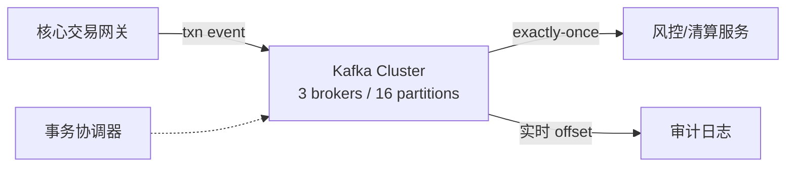
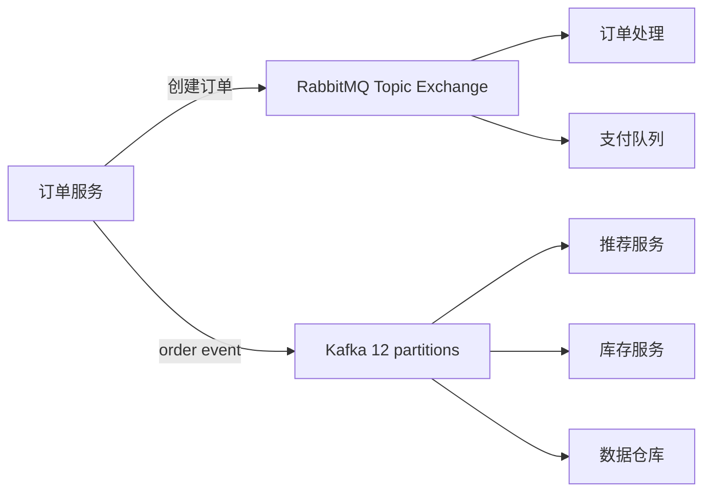
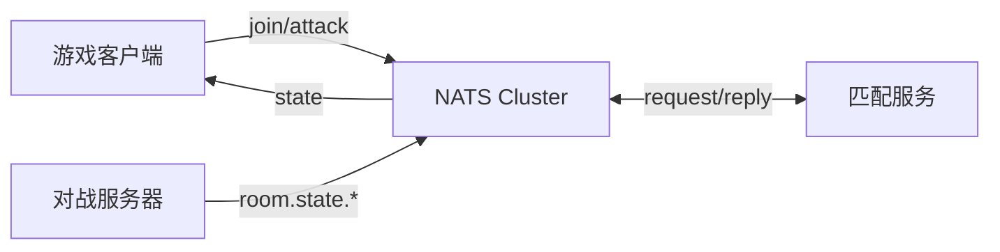
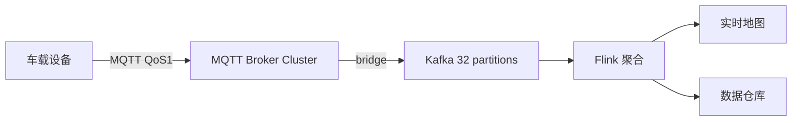

# 2.7 更多生产环境案例研究

> **置信口径**: 协议/规范语义=【定理】；架构对比与工程推理=【论证】；正文未单独标注的具体数字（阈值/百分比/时长）按【估算】理解（AGENTS.md §4.1，P3 基线声明）。
> **本文档定位**：设计原理与选型论证（为什么、选哪种方案）。落地操作与检查清单见 [03-架构与运维实践](../03-架构与运维实践/) 对应主题指南。

## 目录

- [2.7 更多生产环境案例研究](#27-更多生产环境案例研究)
  - [目录](#目录)
  - [2.7.1 金融行业案例](#271-金融行业案例)
    - [案例：某银行实时交易系统（示意性合成案例）](#案例某银行实时交易系统示意性合成案例)
      - [容量估算过程](#容量估算过程)
      - [架构示意](#架构示意)
      - [关键配置](#关键配置)
      - [故障场景与应对](#故障场景与应对)
    - [真实案例：Robinhood 证券交易的 Kafka 事件驱动架构](#真实案例robinhood-证券交易的-kafka-事件驱动架构)
  - [2.7.2 电商行业案例](#272-电商行业案例)
    - [案例：某电商平台订单系统（示意性合成案例）](#案例某电商平台订单系统示意性合成案例)
      - [容量估算过程](#容量估算过程-1)
      - [架构示意](#架构示意-1)
      - [关键配置](#关键配置-1)
      - [故障场景与应对](#故障场景与应对-1)
    - [真实案例：阿里巴巴双十一核心交易链路的 RocketMQ](#真实案例阿里巴巴双十一核心交易链路的-rocketmq)
  - [2.7.3 游戏行业案例](#273-游戏行业案例)
    - [案例：某游戏实时对战系统（示意性合成案例）](#案例某游戏实时对战系统示意性合成案例)
      - [容量估算过程](#容量估算过程-2)
      - [架构示意](#架构示意-2)
      - [关键配置](#关键配置-2)
      - [故障场景与应对](#故障场景与应对-2)
  - [2.7.4 物流行业案例](#274-物流行业案例)
    - [案例：某物流追踪系统（示意性合成案例）](#案例某物流追踪系统示意性合成案例)
      - [容量估算过程](#容量估算过程-3)
      - [架构示意](#架构示意-3)
      - [关键配置](#关键配置-3)
      - [故障场景与应对](#故障场景与应对-3)
    - [真实案例：滴滴出行基于 RocketMQ 的企业级消息队列服务](#真实案例滴滴出行基于-rocketmq-的企业级消息队列服务)
  - [2.7.5 案例总结](#275-案例总结)
    - [选型模式](#选型模式)

---

## 2.7.1 金融行业案例

### 案例：某银行实时交易系统（示意性合成案例）

> 「示意性合成案例」：本节案例为说明性构造，机构与数字均为合成，不构成任何真实银行的实证数据（AGENTS.md §6.3）。

**系统**：Kafka + 事务型生产者/消费者
**规模**：日均 1 亿笔交易，峰值按日均 5 倍估算约为 5,800 TPS，单笔消息约 200 B–1 KB
**核心诉求**：P99 端到端延迟 < 50 ms；已提交交易不丢失、不重复。

#### 容量估算过程

- 峰值 TPS ≈ 1×10⁸ / 86,400 × 5 ≈ 5,787 msg/s。
- 单分区安全写入上限按 3,000 msg/s、单消费者 500 msg/s 估算，分区数取 16（2 的整数幂并预留 2 倍余量）。
- 原始存储 ≈ 1×10⁸ × 500 B × 3 副本 × 7 天 ≈ 0.9 TiB；含索引、日志开销与 30 % 预留后，建议规划 1.5 TiB【估算】。

#### 架构示意



#### 关键配置

```properties
# Kafka 生产者：精确一次语义
bootstrap.servers=broker1:9092,broker2:9092,broker3:9092
transactional.id=bank-txn-producer-${instance}
enable.idempotence=true
acks=all
retries=2147483647
max.in.flight.requests.per.connection=1
```

```properties
# Broker 端可靠性参数
min.insync.replicas=2
default.replication.factor=3
unclean.leader.election.enable=false
```

#### 故障场景与应对

| 故障 | 影响 | 应对 |
| ------ | ------ | ------ |
| 单 Broker 崩溃 | 部分分区 ISR 收缩 | RF=3 + min.insync.replicas=2，禁止 unclean leader election，已提交消息不丢失 |
| 生产者网络抖动 | 可能重试导致乱序/重复 | enable.idempotence=true + transactional.id 保证幂等与会话内恰好一次 |
| 消费者处理超时 | 消费组重平衡、消息重复 | 业务层幂等键（交易单号）+ 短超时提交 |

---

### 真实案例：Robinhood 证券交易的 Kafka 事件驱动架构

> 来源：Robinhood 官方工程博客 / 会议演讲一手资料——[Fresher Data Lake on AWS S3](https://robinhood.com/newsroom/fresher-data-lake-on-aws-s3/)（Robinhood Engineering，2022，CDC 数据湖新鲜度 24h→<15min）、[How we scaled Robinhood's brokerage system](https://robinhood.com/newsroom/how-we-scaled-robinhoods-brokerage-system-for-greater-reliability/)（Robinhood Engineering，2021，分片 Kafka 消费）及 [Kafka Summit Americas 2021: Taming a Massive Fleet of Python-based Kafka Apps at Robinhood](https://www.confluent.io/events/kafka-summit-americas-2021/taming-a-massive-fleet-of-python-based-kafka-apps-at-robinhood/)（规模指标）。

Robinhood 是美国证券与加密货币交易平台，其 Kafka 平台被描述为参与“几乎每一项关键任务步骤”。该案例的核心价值在于展示了如何在以 Python 为主、流量高度波动的金融场景中，用 Kafka 支撑交易链路并控制运维复杂度。

| 指标 | 数值 | 来源 |
| ------ | ------ | ------ |
| Kafka 集群数 | 6 | Kafka Summit Americas 2021 |
| Broker 总数 | 160 | Kafka Summit Americas 2021 |
| Topic 数 | 1,400 | Kafka Summit Americas 2021 |
| 分区数 | 90,000 | Kafka Summit Americas 2021 |
| 峰值消息速率 | 220 万 msg/s | Kafka Summit Americas 2021 |
| 证券交易确认 SLA | < 1 秒 | Robinhood 公开演讲 |
| 数据湖 CDC 新鲜度 | 24 小时 → 5–15 分钟 | Robinhood Engineering，2022 |

**典型链路**：股票买入事件写入 Kafka 与 Postgres → 多个下游服务通过 Kafka Streams 以 exactly-once 语义处理 → 风控、清算、推送、数据湖并行消费。Robinhood 还自研了 `kafkahood` 统一客户端、`kafkaproxy` 边车聚合连接，并用 Postgres 存储死信便于人工修复。

**选型启示**：金融交易场景优先选择具备强持久化语义、可审计、可重放的日志型 MQ；当客户端语言异构且连接数爆炸时，引入侧向代理（sidecar）比为每门语言重复实现客户端更可持续。

---

## 2.7.2 电商行业案例

### 案例：某电商平台订单系统（示意性合成案例）

> 「示意性合成案例」：本节案例为说明性构造，企业与指标均为合成（AGENTS.md §6.3）。

**系统**：RabbitMQ + Kafka 混合架构
**规模**：日均 500 万订单，峰值约为日均 10 倍，约 580 TPS
**核心诉求**：订单创建低延迟、支付状态可靠投递；订单事件可被推荐、库存、BI 等多方消费。

#### 容量估算过程

- 峰值订单 ≈ 5×10⁶ / 86,400 × 10 ≈ 579 TPS。
- RabbitMQ 侧：单队列单线程上限约 5,000 msg/s，按 8 个业务队列、每队列 2 个消费者即可覆盖峰值。
- Kafka 侧：事件流主要用于 fan-out，按峰值 600 TPS、下游 6 个消费组，取 12 分区即可满足并行度与后续扩展。

#### 架构示意



#### 关键配置

```properties
# RabbitMQ 客户端：可靠投递 + 背压
prefetch_count=100
publisher_confirms=true
automatic_recovery=true
topology_recovery=true
```

```properties
# Kafka 生产者：事件溯源
bootstrap.servers=broker1:9092,broker2:9092,broker3:9092
acks=all
retries=3
compression.type=lz4
batch.size=65536
linger.ms=20
```

#### 故障场景与应对

| 故障 | 影响 | 应对 |
| ------ | ------ | ------ |
| RabbitMQ 节点故障 | 队列不可用 | 使用 Quorum Queue（RabbitMQ 3.8+）或镜像队列，消费者自动重连 |
| 支付服务处理慢 | 队列堆积 | 设置 TTL + DLX 死信交换器，超时订单进入补偿流程 |
| Kafka 分区 leader 切换 | 短暂生产延迟 | acks=all + min.insync.replicas=2，避免未确认写入丢失 |
| 网络闪断导致重复下单 | 数据不一致 | 订单 ID 作为幂等键，数据库唯一索引兜底 |

---

### 真实案例：阿里巴巴双十一核心交易链路的 RocketMQ

> 来源：[阿里云消息队列 RocketMQ 版产品页](https://www.aliyun.com/product/rocketmq)。

阿里巴巴自 2012 年起自研 MetaQ，后开源为 Apache RocketMQ，并持续支撑集团核心交易链路十余年。该案例表明：在电商大促的瞬时流量洪峰下，消息系统需要同时具备高可靠、事务消息、定时/延时消息与弹性伸缩能力。

| 维度 | 公开信息 |
| ------ | ---------- |
| 验证场景 | 十余年双十一万亿级数据洪峰 |
| 主要用途 | 核心交易链路异步解耦、订单/支付/库存消息 |
| 关键特性 | 分布式事务消息、顺序消息、定时/延时消息、Serverless 百万级 TPS 弹性 |
| 来源 | 阿里云 RocketMQ 产品页 |

**架构要点**：RocketMQ 在电商场景下通常与微服务、分布式事务框架配合，利用事务消息实现“下单扣库存”的最终一致；在大促前通过云原生存算分离架构进行分钟级扩容。

**选型启示**：电商核心交易链路若同时需要强一致性事务消息、顺序消费与弹性扩缩容，RocketMQ 是经过大规模验证的候选；若团队已深度使用 Kafka 生态，则需评估 Kafka 事务与外部事务协调器的复杂度。

---

## 2.7.3 游戏行业案例

### 案例：某游戏实时对战系统（示意性合成案例）

**系统**：NATS Core
**规模**：10 万+ 并发玩家，按每房间 50 人、每房间 20 次/秒状态更新估算，峰值约 4 万次/秒消息
**核心诉求**：同机房 P99 延迟 < 1 ms；故障时自动恢复；架构尽量简单。

#### 容量估算过程

- 活跃房间 ≈ 100,000 / 50 = 2,000 间。
- 状态更新 ≈ 2,000 × 20 = 40,000 msg/s；额外 RPC 请求按 20 % 估算，总约 48,000 msg/s。
- NATS 单节点可支撑百万级 msg/s，3 节点集群即可满足容量与可用性需求【估算】。

#### 架构示意



#### 关键配置

```yaml
# nats-server.conf
port: 4222
max_connections: 100000
max_payload: 65536
ping_interval: 120
ping_max: 2
```

```bash
# 客户端环境变量示例
export TCP_NODELAY=1
export NATS_MAX_RECONNECT_ATTEMPTS=10
```

#### 故障场景与应对

| 故障 | 影响 | 应对 |
| ------ | ------ | ------ |
| NATS 节点崩溃 | 连接断开 | 客户端自动重连到剩余节点；无状态服务可快速恢复 |
| 状态消息丢失 | 玩家位置不同步 | NATS Core 为 at-most-once；关键状态使用 JetStream 或应用层快照补偿 |
| 匹配服务过载 | 匹配延迟增加 | 通过 NATS Queue Group 负载均衡多个匹配服务实例 |

---

## 2.7.4 物流行业案例

### 案例：某物流追踪系统（示意性合成案例）

> 「示意性合成案例」：本节案例为说明性构造，企业与指标均为合成（AGENTS.md §6.3）。

**系统**：MQTT + Kafka
**规模**：100 万+ 车载/手持设备，每 10 秒上报一次 GPS，峰值约 10 万 msg/s
**核心诉求**：海量设备接入、弱网环境可靠上报、后端实时聚合。

#### 容量估算过程

- 峰值上报 ≈ 1×10⁶ / 10 = 100,000 msg/s。
- MQTT broker 侧：单节点约 50 万并发连接、10 万 TPS，规划 5 节点集群并跨可用区部署。
- Kafka 侧：单分区写入上限约 3,000–5,000 msg/s，取 32 分区；保留 7 天，原始存储 ≈ 100,000 × 200 B × 86,400 × 7 / 1024⁴ ≈ 10.4 TiB，3 副本后约 31 TiB，加 30 % 预留约 40 TiB【估算】。

#### 架构示意



#### 关键配置

```properties
# MQTT broker（以 EMQX 风格为例）
listener.tcp.external.max_connections=1000000
zone.external.allow_anonymous=false
zone.external.max_qos=1
```

```properties
# Kafka 生产者：高吞吐、低可靠性要求
bootstrap.servers=broker1:9092,broker2:9092,broker3:9092
acks=1
compression.type=lz4
batch.size=65536
linger.ms=20
buffer.memory=134217728
```

#### 故障场景与应对

| 故障 | 影响 | 应对 |
| ------ | ------ | ------ |
| 设备集中上线 | MQTT 连接风暴 | 连接限速、心跳保持、负载均衡 |
| 网络抖动导致上报失败 | GPS 点丢失 | MQTT QoS1 + 客户端本地队列重试；允许少量丢失的场景可用 QoS0 |
| Kafka 消费滞后 | 实时地图延迟 | 增加 Flink 并行度；Kafka 分区数足够时水平扩展消费者 |

---

### 真实案例：滴滴出行基于 RocketMQ 的企业级消息队列服务

> 来源：[《滴滴出行基于 RocketMQ 构建企业级消息队列服务的实践》](https://www.6aiq.com/article/1549986997717)（作者江海挺，滴滴出行消息队列负责人，整理自 Apache RocketMQ 开发者沙龙北京站分享）【二手综述】。

滴滴出行早期的消息队列使用方式较杂，以 Kafka 0.8.2 为主。随着业务增长，核心业务出现集群写入抖动、频繁写失败的问题。关键原因包括：

1. Topic 数量增多后，Kafka 0.8.2 吞吐显著下降；
2. 该版本存在 bug，会触发副本重新复制，叠加机械盘导致磁盘 IO 过大。

滴滴最终选择 RocketMQ 3.4.6 作为新的企业级消息队列底座，并在 Proxy 层实现双写/双读迁移方案，使业务方无需一次性切流。

| 维度 | Kafka 0.8.2 | RocketMQ 3.4.6（滴滴测试） |
| ------ | ------------- | --------------------------- |
| Topic 扩展性 | 256 topic 后吞吐急剧下降 | topic 增加对吞吐影响小 |
| 同步复制延迟 | 超过 1 万 TPS 后延迟 > 1 ms | 4 万 TPS 内延迟 < 1 ms |
| 多语言支持 | 需要自行封装多语言客户端 | 通过 ThriftRPC 在 Proxy 层统一支持 PHP/Go/Java/C++ |
| 元信息管理 | — | 改造后单机可支撑百万级 topic |

**迁移要点**：

```text
客户端 --> ProducerProxy --双写--> Kafka / RocketMQ
                         --双读--> ConsumerProxy --> 业务消费端
```

- **双写**：Proxy 同时写入 Kafka 与 RocketMQ，保证迁移期间两份全量数据；
- **双读**：消费先切到 Proxy 从 Kafka 消费，RocketMQ 有流量后自动切换，减少重复消费风险；
- 自研主从自动切换、批量生产（跨 topic/queue）、元信息优化等改造。

**选型启示**：当企业内存在多种 MQ 且历史包袱重时，采用“统一代理 + 双写双读”的混合迁移架构，比一次性停机迁移风险更低；RocketMQ 在 topic 规模大、延迟敏感的场景下表现优于早期 Kafka。

---

## 2.7.5 案例总结

### 选型模式

| 行业 | 典型场景 | 推荐方案 | 关键理由 |
| ------ | ---------- | ---------- | ---------- |
| 金融交易 | 证券交易、支付清算、风控 | Kafka / RocketMQ + 事务 | 需要 exactly-once/强一致性、可审计、可重放 |
| 电商订单 | 订单创建、库存扣减、事件溯源 | RabbitMQ + Kafka 或 RocketMQ | 任务队列与事件流互补，支持多下游 fan-out |
| 游戏实时 | 对战状态、匹配服务、RPC | NATS Core / JetStream | 亚毫秒级延迟、无状态自动恢复、部署简单 |
| 物流 IoT | 设备接入、轨迹聚合、实时监控 | MQTT + Kafka / RocketMQ | 海量弱网设备接入 + 后端持久化流处理 |

**设计原则提炼**：

1. **按延迟与一致性分层**：交易链路用强一致日志 MQ；通知/状态同步用低延迟内存 MQ。
2. **容量规划先于部署**：根据峰值 TPS、消息大小、保留时长估算分区数、节点数与存储容量。
3. **故障场景驱动配置**：金融场景禁用 `unclean.leader.election`，IoT 场景允许 `acks=1` 以换取吞吐。
4. **历史系统迁移用代理隔离**：Proxy 层双写双读可降低从旧 MQ 向新 MQ 切流的风险。

落地实施细节与检查清单见 [03-架构与运维实践](../03-架构与运维实践/) 对应主题指南。

---

**最后更新**: 2026-11-18
