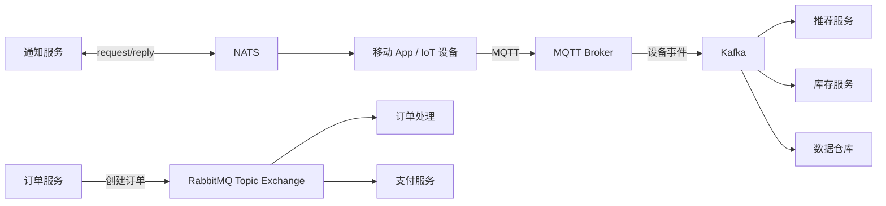
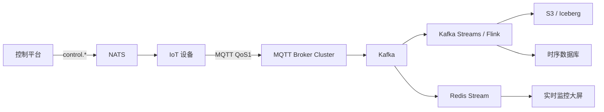
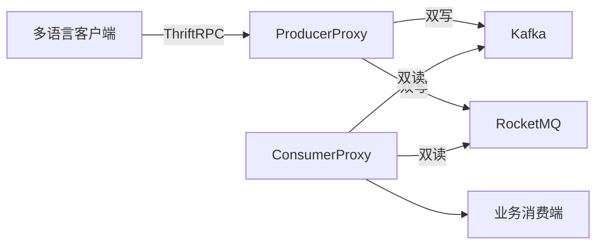

# 2.8 混合架构案例研究

> **置信口径**: 协议/规范语义=【定理】；架构对比与工程推理=【论证】；正文未单独标注的具体数字（阈值/百分比/时长）按【估算】理解（AGENTS.md §4.1，P3 基线声明）。
> **本文档定位**：设计原理与选型论证（为什么、选哪种方案）。落地操作与检查清单见 [03-架构与运维实践](../03-架构与运维实践/) 对应主题指南。

## 目录

- [2.8 混合架构案例研究](#28-混合架构案例研究)
  - [目录](#目录)
  - [2.8.1 多系统混合架构](#281-多系统混合架构)
    - [架构模式](#架构模式)
    - [混合类型决策矩阵](#混合类型决策矩阵)
  - [2.8.2 案例1：电商平台混合架构（示意性合成案例）](#282-案例1电商平台混合架构示意性合成案例)
    - [架构设计](#架构设计)
    - [容量估算与关键配置](#容量估算与关键配置)
    - [故障场景与应对](#故障场景与应对)
  - [2.8.3 案例2：IoT 平台混合架构（示意性合成案例）](#283-案例2iot-平台混合架构示意性合成案例)
    - [架构设计](#架构设计-1)
    - [容量估算与关键配置](#容量估算与关键配置-1)
    - [故障场景与应对](#故障场景与应对-1)
  - [2.8.4 混合架构最佳实践](#284-混合架构最佳实践)
    - [1. 系统选型原则](#1-系统选型原则)
    - [2. 数据流转](#2-数据流转)
    - [3. 运维管理](#3-运维管理)
  - [2.8.5 真实混合架构案例（公开来源）](#285-真实混合架构案例公开来源)
    - [DoorDash：从 RabbitMQ 到 Kafka + Flink 的实时事件平台 Iguazu](#doordash从-rabbitmq-到-kafka--flink-的实时事件平台-iguazu)
    - [Netflix：Keystone 与 Data Mesh 的 Kafka + Flink 混合架构](#netflixkeystone-与-data-mesh-的-kafka--flink-混合架构)
    - [滴滴出行：RocketMQ 与 Kafka 双写双读迁移架构](#滴滴出行rocketmq-与-kafka-双写双读迁移架构)

---

## 2.8.1 多系统混合架构

### 架构模式

单一消息系统通常无法同时满足“海量设备接入、低延迟 RPC、高吞吐事件流、长期存储与批量分析”四类差异极大的需求。混合架构通过“按场景选系统、按数据分层”实现能力互补。

1. **分层架构**
   - 接入层：MQTT / NATS（设备接入、微服务入口）
   - 处理层：Kafka / Pulsar（事件流、持久化、重放）
   - 服务层：NATS / RabbitMQ（服务间通信、任务队列）

2. **场景分离**
   - 实时通信：NATS Core（亚毫秒）
   - 事件流：Kafka / Pulsar（高吞吐、可重放）
   - 任务队列：RabbitMQ / RocketMQ（路由丰富、可靠投递）

3. **MQ + 流处理 + 云存储**
   - Kafka / Pulsar 作为统一事件总线；
   - Flink / Kafka Streams 做实时计算；
   - S3 / Iceberg / Snowflake 做长期存储与离线分析。

### 混合类型决策矩阵

| 混合类型 | 适用场景 | 典型组合 | 主要收益 |
| ---------- | ---------- | ---------- | ---------- |
| MQ + MQ | 历史系统迁移、多语言/多协议接入 | Kafka + RocketMQ、RabbitMQ + Kafka | 渐进式替换、风险隔离 |
| MQ + 流处理 | 实时 ETL、特征工程、监控 | Kafka + Flink、Pulsar + Flink | 统一事件源 + 低延迟计算 |
| MQ + 云服务 | 数仓实时化、Serverless 弹性 | Kafka + S3 + Snowflake、MQTT + 云 TSDB | 降低自运维、按需扩展 |

---

## 2.8.2 案例1：电商平台混合架构（示意性合成案例）

> 「示意性合成案例」：本节案例为说明性构造，企业与指标均为合成（AGENTS.md §6.3）。

### 架构设计

某综合电商平台同时面临“订单履约可靠性”与“事件流多下游消费”两类需求，采用 MQTT + RabbitMQ + Kafka + NATS 四层混合架构。



**系统分工**：

- **MQTT**：移动端推送到达、IoT 设备心跳；
- **RabbitMQ**：订单处理队列、支付队列、补偿任务；
- **Kafka**：订单事件流、日志聚合、用户行为流；
- **NATS**：实时通知、服务间 RPC、促销秒杀状态广播。

### 容量估算与关键配置

- 日活 1,000 万，下单峰值 1,000 TPS，每个订单产生约 8 条事件（创建、支付、发货、签收等）→ 事件流峰值约 8,000 TPS。
- MQTT 并发连接按日活 5 % 估算约 50 万；单 broker 支撑 10–20 万连接，规划 5 节点集群。
- Kafka 取 24 分区，下游 6 个消费组并行度充足；RabbitMQ 按业务域拆分为 8 个队列。

```properties
# RabbitMQ 生产者：订单路由
exchange.type=topic
routing.key=order.created.{region}
publisher_confirms=true
prefetch_count=100
```

```properties
# Kafka 生产者：订单事件流
bootstrap.servers=broker1:9092,broker2:9092,broker3:9092
acks=all
retries=3
compression.type=lz4
batch.size=65536
linger.ms=20
```

```yaml
# NATS 服务端：实时通知
port: 4222
max_connections: 100000
max_payload: 32768
```

### 故障场景与应对

| 故障 | 影响 | 应对 |
| ------ | ------ | ------ |
| RabbitMQ 队列堆积 | 订单处理延迟 | 增加消费者、设置队列 TTL + DLX、限流上游 |
| Kafka 消费滞后 | 推荐/库存实时性下降 | 扩展消费组、增加分区、Flink 自动扩缩容 |
| MQTT 连接风暴 | broker 资源耗尽 | 连接速率限制、心跳超时、负载均衡 |
| NATS 节点故障 | 通知短暂中断 | 客户端自动重连到剩余节点；无状态服务快速恢复 |

---

## 2.8.3 案例2：IoT 平台混合架构（示意性合成案例）

> 「示意性合成案例」：本节案例为说明性构造，企业与指标均为合成（AGENTS.md §6.3）。

### 架构设计

某工业互联网平台需要同时支撑“海量传感器上报、实时监控、设备控制”三类流量，采用 MQTT + Kafka + Redis Stream + NATS 的混合架构。



**系统分工**：

- **MQTT**：设备数据采集、弱网环境重试；
- **Kafka**：数据持久化、批处理、多下游共享；
- **Redis Stream**：近实时告警、滑动窗口聚合；
- **NATS**：低延迟控制指令下发。

### 容量估算与关键配置

- 设备 500 万，每 30 秒上报一次 → 峰值约 17 万 msg/s；加上告警突发，按 25 万 msg/s 设计。
- Kafka 单分区 5,000 msg/s → 取 64 分区；保留 30 天，原始数据约 25 万 × 300 B × 86,400 × 30 = 185 TiB，3 副本约 555 TiB，加 30 % 预留约 720 TiB【估算】。
- Redis Stream 仅保留最近 1 小时热点数据，控制内存。

```properties
# MQTT broker：海量设备接入
listener.tcp.external.max_connections=1000000
zone.external.max_qos=1
zone.external.idle_timeout=60s
```

```properties
# Kafka 生产者：传感器数据
bootstrap.servers=broker1:9092,broker2:9092,broker3:9092
acks=1
compression.type=lz4
batch.size=131072
linger.ms=50
```

```bash
# Redis Stream 实时告警（示例）
XADD alerts:realtime * sensor_id 1001 temp 85 level warning
XTRIM alerts:realtime MAXLEN ~ 100000
```

### 故障场景与应对

| 故障 | 影响 | 应对 |
| ------ | ------ | ------ |
| 设备集中重连 | MQTT broker CPU 飙升 | 连接速率限制、JVM/ Erlang 调优、水平扩展 broker |
| Kafka 单分区热点 | 某设备类型上报量突增 | 按 device_type 或 device_id 前缀散列 key |
| Redis Stream 内存不足 | 实时告警丢失 | 设置 MAXLEN 裁剪 + 降级写入 Kafka |
| 控制指令丢失 | 设备未收到命令 | NATS Core 升级至 JetStream 持久化，或应用层 ACK |

---

## 2.8.4 混合架构最佳实践

### 1. 系统选型原则

| 原则 | 说明 | 反例 |
| ------ | ------ | ------ |
| 按场景选择 | 不同场景使用不同系统 | 用 Kafka 做大量 1:1 RPC 导致延迟过高 |
| 避免重复 | 不要让多个系统做同一件事 | 同时在 RabbitMQ 和 Kafka 中保存完整订单事件 |
| 统一契约 | 事件 schema 在源头注册 | 各系统各自解析 JSON，导致版本冲突 |
| 渐进替换 | 用 proxy/bridge 隔离旧系统 | 一次性停机迁移导致业务中断 |

### 2. 数据流转

- **明确数据流向**：每个事件类型有且仅有一个“事实来源”系统；
- **避免循环依赖**：系统 A 写 B，B 写 C，C 再写 A 会导致无限循环；
- **数据一致性**：跨系统一致性优先使用最终一致 + 幂等消费，必要时引入 Saga/Outbox；
- **schema 治理**：所有进入 Kafka/Pulsar 的事件强制注册 Avro/Protobuf schema。

### 3. 运维管理

- **统一监控**：使用 Prometheus + Grafana 采集各系统核心指标；
- **统一日志**：通过 OpenTelemetry / Fluentd 将跨系统 trace id 传递；
- **统一告警**：AlertManager 聚合各系统告警，避免告警风暴；
- **容量隔离**：关键业务与非关键业务分集群或分租户，防止“ noisy neighbor ”。

---

## 2.8.5 真实混合架构案例（公开来源）

### DoorDash：从 RabbitMQ 到 Kafka + Flink 的实时事件平台 Iguazu

> 来源：DoorDash Engineering 官方博客——[Eliminating Task Processing Outages by Replacing RabbitMQ with Apache Kafka Without Downtime](https://doordash.engineering/2020/09/03/eliminating-task-processing-outages-with-kafka/)（2020，RabbitMQ/Celery → Kafka 迁移）及 [Building scalable real time event processing with Kafka and Flink](https://doordash.engineering/2022/08/02/building-scalable-real-time-event-processing-with-kafka-and-flink/)（2022，Iguazu 实时事件平台）。

DoorDash 的混合架构演进分为两个阶段：

1. **2019 年：RabbitMQ + Celery → Kafka**
   订单结账与 Dasher 派单等异步任务原由 RabbitMQ + Celery 承载，峰值时 broker 反复宕机。团队用 Kafka 的持久化日志替代 RabbitMQ，通过无停机切流消除了任务处理中断。

2. **2020 年起：构建 Iguazu（Kafka + Flink + S3 + Snowflake）**
   此前 DoorDash 同时使用 Amazon SQS、Kinesis 等多条管道向数据仓库、ML 平台、时序数据库供数，数据仓库延迟长达一天。Iguazu 以 Kafka 为统一摄入层，Flink 做格式转换与多路 fan-out，经 S3/Parquet → Snowpipe 进入 Snowflake，端到端延迟降至分钟级。

| 指标 | 数值 | 来源 |
| ------ | ------ | ------ |
| Kafka 集群数 | 5 | DoorDash Engineering Blog，2023 |
| Topic 数 | 2,500+ | DoorDash Engineering Blog，2023 |
| 日均消息量 | ~60 亿 | DoorDash Engineering Blog，2023 |
| 峰值吞吐 | ~800 万 msg/min | DoorDash Engineering Blog，2023 |
| Iguazu 日事件量 | 数千亿 | Allen Wang，QCon/InfoQ，2022–2023 |
| 数仓延迟 | 约 1 天 → 数分钟 | Allen Wang，QCon/InfoQ，2023 |

**关键优化**：对无自然 key 的高吞吐量 topic，DoorDash 启用 Kafka sticky partitioner 并将 `linger.ms` 提高到 50–100 ms，使 broker CPU 下降 30–40 %。

```properties
# DoorDash 高吞吐 topic 优化示例
partitioner.class=org.apache.kafka.clients.producer.internals.DefaultPartitioner
# sticky partitioner 为 2.4+ 默认行为，可显式确认
linger.ms=100
batch.size=262144
compression.type=lz4
```

**选型启示**：当任务队列被推到接近流式数据量时，RabbitMQ 的 broker 中心化模型容易成为瓶颈；用 Kafka 统一摄入层 + Flink 做实时分发，可显著降低多管道运维复杂度。

---

### Netflix：Keystone 与 Data Mesh 的 Kafka + Flink 混合架构

> 来源：Netflix TechBlog 一手资料——[Keystone Real-time Stream Processing Platform](https://netflixtechblog.com/keystone-real-time-stream-processing-platform-a3ee651812a)（2018）及 [Kafka Inside Keystone Pipeline](https://netflixtechblog.com/kafka-inside-keystone-pipeline-dd5aeabaf6bb)（2016）。

Netflix 的 Keystone 管道是业界最成熟的 Kafka 混合架构之一。其核心设计是将“写入密集型摄入”与“读取密集型消费”在物理上分离：

- **Fronting Kafka clusters**：接收所有 producer 事件；
- **Consumer Kafka clusters**：服务下游数百个消费组；
- **Flink / Samza**：实时特征、A/B 测试、个性化推荐；
- **S3 / Iceberg**：Kafka 保留期外的历史数据回补。

| 指标 | 数值 | 来源 |
| ------ | ------ | ------ |
| 日事件量 | 2 万亿+ | Netflix TechBlog，Data Mesh，2022 |
| Flink 作业数 | 20,000+ | Netflix TechBlog，Data Mesh，2022 |
| 实时直播监控峰值 | 3,800 万 events/s | InfoQ，2025 |
| Keystone 可用性 | 99.99 % | QCon London 2018 |

Netflix 还贡献了 Kafka 的 rack-aware partition assignment 到 Apache Kafka 上游，使生产者和消费者优先使用同一可用区，降低跨 AZ 流量成本与延迟。

**关键教训**：

1. 配置选择即耐久性选择。Netflix 曾出现因 `replication.factor=2` + `acks=1` 与重复 consumer group ID 导致的数据丢失，后统一为高复制因子、`acks=all` 与 group ID 强制唯一。
2. Kafka 不是万能的。Tudum 内容站点因读多写少，最终用 RAW Hollow 内存对象存储替代了基于 Kafka 的 CQRS。

---

### 滴滴出行：RocketMQ 与 Kafka 双写双读迁移架构

> 来源：[《滴滴出行基于 RocketMQ 构建企业级消息队列服务的实践》](https://www.6aiq.com/article/1549986997717)。

滴滴的混合架构并非为了长期共存，而是为了“安全地从 Kafka 迁移到 RocketMQ”。其关键在于 Proxy 层：



- **双写**：Proxy 同时写入 Kafka 与 RocketMQ，保证两套存储全量数据；
- **双读**：消费先切到 Proxy 从 Kafka 读，RocketMQ 有流量后无感切换；
- 元信息管理改造后，单机可支撑百万级 topic。

**选型启示**：当企业内部已有运行多年的 Kafka 生态，但新业务对 topic 规模、延迟、事务消息提出更高要求时，不宜一次性停机迁移。通过代理层双写双读，可在不影响业务的前提下完成架构升级。

> **动态系统论视角**：混合架构的真实案例（DoorDash RabbitMQ→Kafka、Netflix Keystone 演进、滴滴 Kafka→RocketMQ 迁移）均体现了消息系统在技术债务与路径依赖下的时间维度演化。若需从演化动力学、锁定效应与迁移路径角度理解，参见 [04-02 时间维度演化分析](../04-动态系统论与演化分析/04-02-时间维度演化分析.md)。
>
> **动态系统论视角**：混合架构的选型与分层决策可进一步置于动态系统论框架下审视，综合考虑时间演化、组织耦合与锁定效应。若需从动态系统视角完善混合架构选型判断，参见 [04-05 动态系统总结与选型决策](../04-动态系统论与演化分析/04-05-动态系统总结与选型决策.md)。

---

**最后更新**: 2026-11-18
