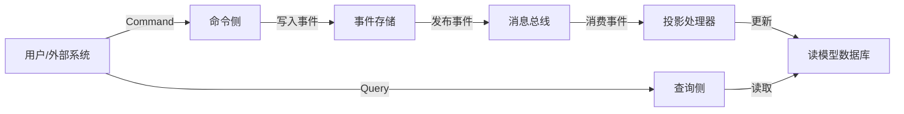

# 2.58 CQRS与事件溯源落地设计

> **置信口径**: 协议/规范语义=【定理】；架构对比与工程推理=【论证】；正文未单独标注的具体数字（阈值/百分比/时长）按【估算】理解（AGENTS.md §4.1，P3 基线声明）。
> **本文档定位**: 设计原理与选型论证（为什么、选哪种方案）。落地操作与检查清单见 [03-架构与运维实践](../03-架构与运维实践/) 对应主题指南；事件溯源核心机制与存储选型见 [1.47 事件溯源核心机制与存储选型](../01-基础概念与对比分析/01-47-事件溯源核心机制与存储选型.md)。
> **时效声明**: 本文产品版本信息基于 Apache Kafka、Redis 与 PostgreSQL 官方发布信息，核实至 2026-11。

## 目录

- [2.58 CQRS与事件溯源落地设计](#258-cqrs与事件溯源落地设计)
  - [目录](#目录)
  - [2.58.1 CQRS 模式结构](#2581-cqrs-模式结构)
    - [与消息集成示例](#与消息集成示例)
  - [2.58.2 读模型延迟治理](#2582-读模型延迟治理)
    - [最终一致性窗口](#最终一致性窗口)
    - [读己之写](#读己之写)
    - [投影检查点与幂等写入](#投影检查点与幂等写入)
  - [2.58.3 与现有模式衔接](#2583-与现有模式衔接)
    - [与 Outbox 模式衔接](#与-outbox-模式衔接)
    - [与 Saga 模式衔接](#与-saga-模式衔接)
    - [与 2.11 数据一致性保障互补](#与-211-数据一致性保障互补)
  - [2.58.4 何时不用 CQRS](#2584-何时不用-cqrs)
  - [2.58.5 互链与延伸阅读](#2585-互链与延伸阅读)
  - [2.58.6 参考来源](#2586-参考来源)

---

## 2.58.1 CQRS 模式结构

CQRS（Command Query Responsibility Segregation）将写入侧（Command Side）与查询侧（Query Side）分离：

- **命令侧**：负责接收命令、执行业务规则、产生领域事件并写入事件存储。
- **查询侧**：通过投影把事件转换为读模型，对外提供针对查询优化的视图。

【论证】CQRS 常与事件溯源组合使用，但并非必须：CQRS 可以基于传统数据库实现（写库+读库），事件溯源也可以单独用于审计而不分离读模型。二者组合时，数据流如下：



### 与消息集成示例

以下 YAML 描述一个简化的命令→事件→投影流程：

```yaml
# CQRS 流水线示意（概念配置，非生产模板）
command_side:
  aggregate: Order
  command_handler: PlaceOrderHandler
  event_store: kurrentdb://esdb:2113
  outbox: true           # 通过 Outbox 保证命令侧事件发布原子性

event_bus:
  broker: kafka
  topic: order-events
  consumer_group: order-projections

projection:
  handler: OrderSummaryProjection
  read_model: postgres://read-db/orders
  checkpoint_table: projection_checkpoints
```

> 生产配置应引用 `config-templates/` 中的真实参数，并配合 schema registry 与死信队列。

---

## 2.58.2 读模型延迟治理

事件溯源 + CQRS 天然带来**最终一致性**：命令提交后，读模型需要经过一段时间才能反映最新状态。治理重点是把这个延迟控制在业务可接受范围内。

### 最终一致性窗口

| 场景 | 可接受延迟 | 典型做法 |
| --- | --- | --- |
| 实时仪表盘 | < 1 s | 同步投影或内存物化视图 |
| 业务后台/列表查询 | 秒级 ~ 分钟级 | 异步投影 + lag 监控 |
| 对账/报表 | 小时级 | 批量重放 + 离线数仓 |
| 强一致读（如余额） | 不允许延迟 | 避免 CQRS，直接读事件存储重建或强一致状态库 |

> 上表延迟值为【估算】，需按业务 SLO 调整。

### 读己之写

用户在提交命令后立即查询，可能读到旧数据。常见缓解手段：

1. **会话粘性（Session Stickiness）**：同一用户的查询路由到已消费该事件的投影副本；在云原生无状态服务中实现成本较高。
2. **版本戳（Version Stamp）**：命令返回事件版本号 `expected_version`，查询时若读模型版本低于该值，则等待或返回“处理中”。
3. **命令侧直接返回快照**：在命令响应中携带聚合当前状态，前端先用该状态渲染，再异步刷新读模型。

```java
// 读模型携带版本戳的查询示例
public OrderView getOrder(String orderId, long minVersion) {
    OrderView view = readModel.find(orderId);
    if (view.getVersion() < minVersion) {
        // 等待投影追赶，或返回 STALE 状态给前端
        waitForProjection(orderId, minVersion, Duration.ofMillis(500));
        view = readModel.find(orderId);
    }
    return view;
}
```

> 版本戳方案对读模型有幂等写入要求，避免重放导致版本回退。

### 投影检查点与幂等写入

投影处理器必须记录已处理事件的偏移（checkpoint），防止崩溃后重复处理或漏处理。checkpoint 应与读模型更新放在同一事务中写入，保证“读模型更新 + checkpoint 更新”原子。

```sql
-- 投影检查点表
CREATE TABLE projection_checkpoints (
    projection_name VARCHAR(255) PRIMARY KEY,
    stream_name     VARCHAR(255) NOT NULL,
    last_position   BIGINT       NOT NULL,
    updated_at      TIMESTAMPTZ  NOT NULL DEFAULT NOW()
);
```

```java
// 投影处理：在同一事务中更新读模型与 checkpoint
@Transactional
public void onOrderPaid(OrderPaidEvent event, long position) {
    orderSummaryDao.upsert(event);
    checkpointDao.save("order-summary", "order-events", position);
}
```

> 若投影失败但 checkpoint 已提交，则该事件不会被自动重放；因此投影逻辑本身必须幂等，或对失败事件转入死信队列人工处理。

---

## 2.58.3 与现有模式衔接

### 与 Outbox 模式衔接

命令侧通常需要“更新业务库 + 发布事件”原子化。事件溯源下，事件存储本身就是写模型，因此**事件写入与业务状态更新合二为一**。但若事件存储与消息总线是两套系统（例如 PostgreSQL 事件表 + Kafka），仍需 Outbox 模式保证事件被可靠转发。Outbox 的详细设计见 [2.47 企业集成模式与事务消息模式](02-47-企业集成模式与事务消息模式.md)。

### 与 Saga 模式衔接

跨聚合或跨服务的业务流程中，每个聚合维护自己的事件流，Saga 通过监听事件或编排器发送命令推进流程。事件溯源为 Saga 提供了天然的审计轨迹：每个 Saga 步骤的触发事件、补偿事件均可被追溯。Saga 设计同样见 [2.47 企业集成模式与事务消息模式](02-47-企业集成模式与事务消息模式.md)。

### 与 2.11 数据一致性保障互补

[2.11 数据一致性保障](02-11-数据一致性保障.md) 讨论消息系统层面的一致性配置（ISR、acks、JetStream 持久化等）。在 CQRS + 事件溯源架构中，这些配置影响的是**事件从命令侧传递到读模型侧**的可靠性；而聚合内部的一致性由事件存储的 append-only + expected version 保证。两者互补：前者解决“事件不丢”，后者解决“同一聚合状态不冲突”。

---

## 2.58.4 何时不用 CQRS

CQRS 引入命令/查询双模型、投影、最终一致性，显著增加复杂度。以下情况应谨慎或避免使用：

| 条件 | 建议 | 理由 |
| --- | --- | --- |
| 读/写比 < 10:1 | 不用 | 查询优化收益无法抵消双模型维护成本 |
| 业务强一致查询刚需 | 不用 | 最终一致性无法满足余额、库存强一致场景 |
| 团队规模小/领域模型简单 | 不用 | 事件溯源 + CQRS 的学习曲线陡峭 |
| 已有成熟 CRUD 且变更频率低 | 不用 | 传统方案更简单可控 |
| 读模型查询多样且经常变化 | 谨慎评估 | 投影爆炸会导致维护困难 |
| 需要完整审计与重放能力 | 可用 | 事件溯源本身收益足以覆盖复杂度 |
| 读/写比 > 100:1 且查询模式稳定 | 推荐 | CQRS 的查询优化收益显著 |

> 上表“读/写比 10:1 / 100:1”为【估算】经验阈值，需结合实际数据与团队能力判断。

---

## 2.58.5 互链与延伸阅读

- 事件溯源核心机制与存储选型见 [1.47 事件溯源核心机制与存储选型](../01-基础概念与对比分析/01-47-事件溯源核心机制与存储选型.md)。
- 企业集成模式与事务消息（Outbox/Inbox/Saga）见 [2.47 企业集成模式与事务消息模式](02-47-企业集成模式与事务消息模式.md)。
- 数据一致性保障见 [2.11 数据一致性保障](02-11-数据一致性保障.md)。
- 消息版本兼容设计见 [2.35 消息版本兼容设计](02-35-消息版本兼容设计.md)。

---

## 2.58.6 参考来源

- microservices.io — [CQRS pattern](https://microservices.io/patterns/data/cqrs.html)
- Martin Fowler — [CQRS](https://martinfowler.com/bliki/CQRS.html)
- microservices.io — [Event Sourcing pattern](https://microservices.io/patterns/data/event-sourcing.html)
- Kurrent — [KurrentDB Documentation](https://docs.kurrent.io/)（事件存储实现参考）
- Apache Kafka — [Documentation](https://kafka.apache.org/documentation/)（事件总线参考）

---

**最后更新**: 2026-11-18
