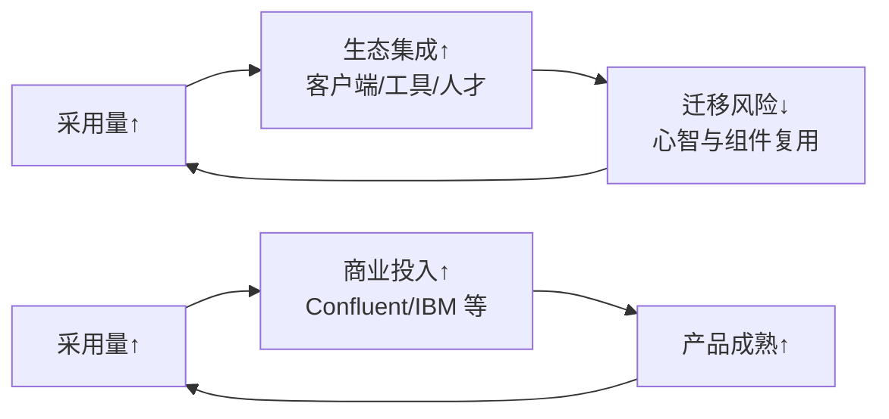
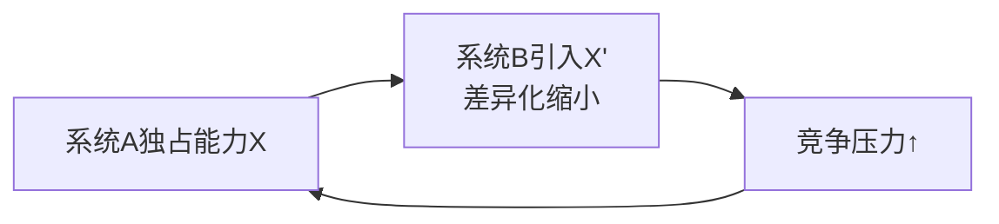

# 04-06 消息系统技术演化动力学

> **置信口径**: 演化路径事实=【论证】（以官方发布史与 01-26 等专章为源）；动力学模型为定性系统动力学分析=【论证】；无公开数据=【估算】。
> **时效声明**: 核实至 2026-11（含 IBM-Confluent 收购 2026-03 事件）。
> **本文档定位**: 04 动态系统论系列第 6 篇。04-02 论单系统时间演化，本篇论**六系统群体层面的演化动力学**——竞争、收敛与技术周期的系统动力学解释。项目特色视角，谨慎改动。

## 目录

- [04-06 消息系统技术演化动力学](#04-06-消息系统技术演化动力学)
  - [目录](#目录)
  - [4.06.1 演化全景：十五年六系统](#4061-演化全景十五年六系统)
  - [4.06.2 核心增强回路：采用-生态共演](#4062-核心增强回路采用-生态共演)
  - [4.06.3 收敛作为平衡回路：三组技术对偶](#4063-收敛作为平衡回路三组技术对偶)
  - [4.06.4 扰动与重置事件](#4064-扰动与重置事件)
  - [4.06.5 阶段模型：niche→breakout→dominance→renewal](#4065-阶段模型nichebreakoutdominancerenewal)
  - [4.06.6 对选型与治理的含义](#4066-对选型与治理的含义)
  - [4.06.7 参考来源](#4067-参考来源)

---

## 4.06.1 演化全景：十五年六系统

| 系统 | 诞生 | 原设计靶心 | 演化主轴（→2026） | 阶段判定（§4.06.5） |
| ---- | ---- | ---- | ---- | ---- |
| RabbitMQ | 2007 | 企业集成（AMQP） | 经典队列→Streams 日志化 | dominance→renewal |
| Kafka | 2011 | 日志聚合→流平台 | KRaft/队列化/分层存储 | dominance |
| Redis Stream | 2018（5.0） | 内存数据结构→轻量队列 | 模块生态共存 | niche→breakout |
| NATS | 2012 | 云原生轻量消息 | Core→JetStream 持久化 | breakout→dominance（云原生域） |
| Pulsar | 2016 | 多租户解耦存储 | 存算分离/Oxia | breakout |
| RocketMQ | 2012 | 交易型队列 | 云厂商内核化 | dominance（交易域） |
| Redpanda | 2020 | Kafka 兼容+C++ | 无 JVM/流表一体 | breakout |

观察【论证】：**没有系统固守原靶心**——全部沿"持久化↔轻量""日志↔队列""本地↔云"三条轴迁移。这就是演化动力学的研究对象。

## 4.06.2 核心增强回路：采用-生态共演

- Kafka 回路最强（事实标准地位）【论证：01-25 生态节】；其副作用是**创新被兼容性约束**——4.x 的革命（KRaft/队列化）耗时 5 年，远慢于 Greenfield 系统（Redpanda 一年一形态）【论证】。
- 回路脆弱点：重置事件（§4.06.4）可使回路反向运转（采用↓→生态↓→迁移风险↑）。

## 4.06.3 收敛作为平衡回路：三组技术对偶

竞争系统的差异化不会无限扩大——能力差距触发模仿，形成收敛平衡回路：

三组 2026 年正在闭合的对偶【论证，细节见对应专章】：

| 对偶 | A 侧 | B 侧 | 收敛产物 | 文档 |
| ---- | ---- | ---- | ---- | ---- |
| 队列×日志 | Kafka 无队列语义 | RabbitMQ 无回放 | Share Groups（KIP-932）+ RabbitMQ Streams | 01-67 |
| 本地×云 | 本地磁盘权威 | S3 弹性 | Kafka-on-S3 四路线 | 01-67 |
| 流×表 | broker 消息 | 湖仓表 | Iceberg Topics/Tableflow | 01-70 |

收敛的方向性【论证】：每次都是**日志范式吸收对方能力**（队列语义、表格式），而非反向——追加日志的数据结构通用性是深层原因（01-61 的 segment 不变量）。

## 4.06.4 扰动与重置事件

| 事件 | 时间 | 受影响回路 | 动力学效应 |
| ---- | ---- | ---- | ---- |
| 云原生/K8s 普及 | 2018- | 运维回路 | 重量型系统（ZK 时代 Kafka/Pulsar）回路边弱；轻量系统（NATS/Redpanda）回路加速【论证】 |
| Redis 许可证变更（AGPL 风波） | 2024 | 采用-信任回路 | Valkey 分叉，信任回路断裂的教科书案例（01-34） |
| **IBM 收购 Confluent** | 2026-03 | Kafka 商业回路 | 短期生态独立（Apache 治理【定理】），中期商业策略不确定——04-06 模型中的"外部资本注入扰动"，跟踪项已入 ROADMAP 季度复核 |
| Jepsen 类一致性评测公开化 | 2021- | 质量信号回路 | 第三方评测成为采用决策输入（conformance-matrix），劣迹系统回路受阻 |

## 4.06.5 阶段模型：niche→breakout→dominance→renewal

移植技术采纳生命周期到消息系统（各阶段可观测判据）【论证】：

| 阶段 | 判据 | 当前实例 |
| ---- | ---- | ---- |
| niche | 单一场景验证，无商业背书 | （六系统均已越过） |
| breakout | 跨场景采用+生态起步+融资/捐赠事件 | Pulsar、Redpanda |
| dominance | 事实标准信号：竞品兼容其协议/海量招聘/书籍 | Kafka、RabbitMQ（域内） |
| renewal | 形态自我革命（队列化/云化/表化）以延续 dominance | Kafka（4.x 三连革命）、RabbitMQ（Streams） |
| 风险态 | 许可分叉/收购/社区分裂信号 | 观察哨：Confluent 条款、Redis 系 |

**renewal 是 dominance 的必要条件**【论证】：不自我革命的系统被新一代在邻近生态位取代（代理服务器/日志库被消息系统吸收的历史）。

## 4.06.6 对选型与治理的含义

1. **选 dominance 系统买生态，选 breakout 系统买性价比**——但须评估其 renewal 能力（本模型判据：近 3 年是否有形态级发布）；
2. **收敛对偶意味着"等 18 个月"策略常成立**：独有能力差往往被行业收敛抹平（队列语义案例），为短期独特能力支付高迁移成本需谨慎；
3. **治理跟踪项**（联动 ROADMAP 季度复核）：IBM-Confluent 整合、Redis 系许可、Jepsen 新报告——三者是下一阶段重置事件的最可能来源【估算】。

## 4.06.7 参考来源

- 项目内：[04-01](04-01-系统动力学视角.md)、[04-02](04-02-时间维度演化分析.md)、[04-03](04-03-负载动态响应与故障传播.md)、[04-04](04-04-混沌工程与系统韧性.md)、[04-05](04-05-动态系统总结与选型决策.md)、[01-25](../01-基础概念与对比分析/01-25-Kafka-4.0新时代与队列语义分析.md)、[01-34](../01-基础概念与对比分析/01-34-消息系统许可证与选型合规分析.md)、[01-67](../01-基础概念与对比分析/01-67-存储解耦与队列化收敛深度解析.md)、[契约语义测试 conformance-matrix](../..//契约语义测试/02-语义矩阵/conformance-matrix.md)
- 外部：[IBM 完成收购 Confluent](https://newsroom.ibm.com/2026-03-17-ibm-completes-acquisition-of-confluent,-making-real-time-data-the-engine-of-enterprise-ai-and-agents)、[Redis AGPL 公告](https://redis.io/blog/agplv3/)、[Jepsen 分析索引](https://jepsen.io/analyses)

---

**最后更新**: 2026-11-18
