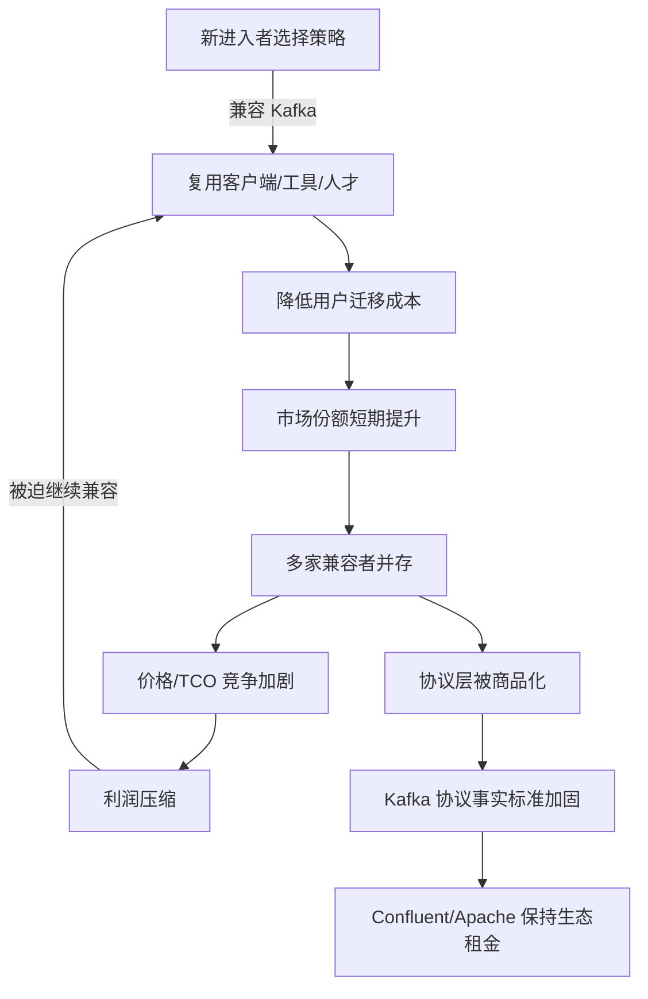

# 04-08 多系统竞争演化博弈

> **置信口径**: 博弈论概念与 ESS 定义=【定理】（演化博弈论经典定义）；市场份额、兼容策略与生态事实=【论证】（官方文档、行业景观分析）；收益矩阵数值为示意=【估算】。
> **时效声明**: 核实至 2026-11（Kafka 兼容生态、IBM-Confluent 收购后续）。
> **本文档定位**: 04 动态系统论系列第 8 篇。04-06 用系统动力学定性描述六系统演化，本篇引入博弈论视角，将市场份额竞争形式化为多主体重复博弈，解释 Kafka 协议事实标准的演化稳定策略（ESS）地位与兼容策略困境。项目特色视角，谨慎改动。

## 目录

- [04-08 多系统竞争演化博弈](#04-08-多系统竞争演化博弈)
  - [目录](#目录)
  - [4.08.1 从定性动力学到博弈论](#4081-从定性动力学到博弈论)
  - [4.08.2 生态位博弈模型](#4082-生态位博弈模型)
    - [4.08.2.1 混合策略与演化稳定均衡](#40821-混合策略与演化稳定均衡)
  - [4.08.3 策略集：价格/开源/云托管/兼容协议](#4083-策略集价格开源云托管兼容协议)
  - [4.08.4 Kafka 兼容策略的囚徒困境](#4084-kafka-兼容策略的囚徒困境)
    - [4.08.4.1 收益矩阵的实证含义](#40841-收益矩阵的实证含义)
  - [4.08.5 ESS 与 Kafka 协议事实标准](#4085-ess-与-kafka-协议事实标准)
  - [4.08.6 对标案例：Docker 运行时与浏览器兼容史](#4086-对标案例docker-运行时与浏览器兼容史)
  - [4.08.7 对选型与治理的含义](#4087-对选型与治理的含义)
    - [4.08.7.1 治理检查清单](#40871-治理检查清单)
  - [4.08.8 参考来源](#4088-参考来源)

---

## 4.08.1 从定性动力学到博弈论

04-06 把六系统的演化归结为“采用-生态共演”的增强回路与“技术对偶收敛”的平衡回路【论证】。这些回路可进一步抽象为**多主体重复博弈**：每个系统选择一组策略（定价、协议兼容度、云化深度、开源程度），策略组合决定市场份额与生态租金的分配。

与 04-06 的接口【论证】：

- 增强回路 = 博弈中的**收益递增**（采用越多，边际生态收益越高）；
- 收敛对偶 = 博弈中的**模仿压力**（独占能力被竞争者复制，差异化租金下降）；
- 重置事件 = 外生冲击改变收益矩阵（许可变更、收购、协议标准演进）。

形式化地，系统 `i` 的当期收益可写为：

```text
π_i(t) = α·N_i(t)            # 直接采用租金
       + β·E_i(t)             # 生态互补品租金（工具/人才/集成）
       - γ·C(strategy_i)      # 策略成本（兼容成本、差异化研发成本）
       - δ·Σ_j overlap(i,j)   # 生态位重叠导致的竞争损耗
```

其中 `N_i` 为安装基数，`E_i` 为生态规模，`overlap(i,j)` 为生态位重叠度【估算：参数仅用于定性比较】。

## 4.08.2 生态位博弈模型

六系统并非同质产品，而是占据不同生态位的差异化竞争者。下表给出 2026-11 的生态位坐标（相对位置，非精确数值）【论证：基于 01-25/01-67/01-70 等专章与行业景观分析】。

| 系统 | 核心生态位 | 差异化壁垒 | 主要重叠对手 | 迁移成本锚点 |
| ---- | ---- | ---- | ---- | ---- |
| Kafka | 高吞吐持久化日志/事实标准 | 协议生态、人才池、工具链 | Redpanda、AutoMQ、Bufstream | 客户端代码、运维知识、连接器 |
| RabbitMQ | 企业队列/AMQP 经典 | 协议成熟、企业支持 | Redis Stream、部分 Pulsar | AMQP 客户端、路由规则 |
| Redis Stream | 内存轻量队列 | 低延迟、已有 Redis 集群 | RabbitMQ、NATS Core | Redis 数据与连接 |
| NATS | 云原生轻量消息 | 极简协议、低延迟 | Redis Stream、部分 Kafka | 服务发现、JetStream 持久化 |
| Pulsar | 云原生多租户流平台 | 存算分离、多租户 | Kafka（高吞吐域） | 客户端、BookKeeper 运维 |
| RocketMQ | 交易型消息/金融域 | 事务消息、金融实践 | Kafka（部分交易场景） | NameServer、事务消息语义 |

生态位越近，竞争损耗 `δ·overlap` 越大；生态位越远，越能通过差异化避开直接价格竞争【论证】。

### 4.08.2.1 混合策略与演化稳定均衡

现实中系统很少采用纯策略，而是按资源比例执行**混合策略**【定理：演化博弈论】。设系统 `i` 的策略向量为 `p_i=(p_兼容, p_差异化, p_价格战, p_云托管)`，则复制者动态可写作：

```text
dp_i,k / dt = p_i,k · [ payoff_i(k, P_{-i}) − avg_payoff_i(P) ]

其中 P_{-i} 为其他玩家的策略分布；
    avg_payoff_i(P) = Σ_k p_i,k · payoff_i(k, P_{-i})
```

该动态有两个工程含义【论证】：

1. **占优策略会被强化**：当兼容 Kafka 的短期收益高于差异化时，资源会流向兼容策略；
2. **ESS 是动态均衡点**：Kafka 协议 ESS 并非静态最优，而是“任何偏离者都会被拉回”的稳定 attractor。

在 2023-2026 窗口内，Redpanda、AutoMQ、Bufstream 的资源配置明显向 `p_兼容` 倾斜【论证】，这正是复制者动态收敛到 Kafka 协议 ESS 的证据。

## 4.08.3 策略集：价格/开源/云托管/兼容协议

每个系统可观测到的纯策略可归纳为四类，实际多为混合策略。

| 策略 | 机制 | 代表动作 | 风险 |
| ---- | ---- | ---- | ---- |
| **成本领先/价格战** | 降低 TCO，特别是存储与运维成本 | S3 分层存储、无 JVM、Serverless 计费 | 利润空间压缩，难以支撑研发 |
| **开源社区战** | 扩大贡献者与用户基数 | Apache 孵化、BSL/SSPL 许可调整、GitHub 生态 | 许可争议导致分叉（Redis→Valkey） |
| **云托管/Serverless** | 把运维复杂度转化为服务收入 | Confluent Cloud、Redpanda Cloud、AutoMQ 云服务 | 被云厂商“虹吸”，品牌弱化 |
| **兼容协议** | 复用已有客户端与工具生态 | 实现 Kafka 协议、支持 Kafka 0.11+ 客户端 | 商品化上层，陷入囚徒困境 |
| **垂直差异化** | 在特定维度建立不可替代性 | Iceberg 原生、MQTT 桥接、低延迟金融消息 | 市场天花板受限于细分场景 |

兼容性策略的成本最低【估算】：无需重建客户端、连接器、运维知识体系；但收益上限也最低，因为用户切换成本被压低，系统趋于可替代。

## 4.08.4 Kafka 兼容策略的囚徒困境

Redpanda、AutoMQ、Bufstream 均宣称“Kafka 兼容”或“drop-in replacement”【论证：[Redpanda Kafka 兼容](https://docs.redpanda.com/streaming/current/develop/kafka-clients/)、[AutoMQ 概述](https://docs.automq.com/automq/what-is-automq/overview)、[Bufstream 概述](https://docs.bufbuild.ru/bufstream/quickstart/)】。当多家同时选择兼容策略时，出现典型的囚徒困境：

```text
收益含义：相对 Kafka 生态租金的增量市场份额（示意，非真实财务数据）
```

| Redpanda \ AutoMQ | 兼容 Kafka | 垂直差异化 |
| ---- | ---- | ---- |
| **兼容 Kafka** | (+2,+2)：均分“替代 Kafka”市场，利润薄，Kafka 协议锁定加深 | (+5,-1)：Redpanda 抢占迁移用户，AutoMQ 被边缘化 |
| **垂直差异化** | (-1,+5)：AutoMQ 抢占迁移用户，Redpanda 被边缘化 | (+3,+3)：各自守住细分 niche，利润率更高，但总量受限 |

纳什均衡是（兼容，兼容）【定理：占优策略均衡】，尽管（差异化，差异化）对双方更有利。其集体后果是：

1. **Kafka 协议层被商品化**——broker 可替换，但协议本身不可替换；
2. **Confluent/Apache Kafka 保持生态租金**——客户端、Schema Registry、连接器、人才市场仍以 Kafka 协议为中心；
3. **竞争者陷入“兼容-低价”循环**【论证】，难以在协议层建立新的事实标准。

### 4.08.4.1 收益矩阵的实证含义

将抽象收益对应到 2024-2026 年的真实厂商动作【论证】：

- **(兼容, 兼容)**：Redpanda 与 AutoMQ 均主打“drop-in Kafka replacement”，双方在 TCO、无 JVM、S3 分层等维度展开成本竞争，未能在协议层创造新租金；
- **(兼容, 差异化)**：Bufstream 早期强调 Kafka + Iceberg 原生集成（垂直差异化），但 2025 年被 CoreWeave 收购后仍继续兼容 Kafka 协议，显示差异化难以脱离协议兼容【论证】；
- **(差异化, 差异化)**：NATS 与 MQTT 在各自 niche（云原生低延迟、IoT 设备接入）避开 Kafka 直接竞争，利润率与忠诚度更高，但总量受限。

因此，囚徒困境的均衡解解释了为何 2026 年 Kafka 兼容者众多，却无一能取代 Kafka 成为新的事实标准。



## 4.08.5 ESS 与 Kafka 协议事实标准

**演化稳定策略（ESS）**【定理】：策略 `S` 是 ESS，当且仅当对任意突变策略 `M`：

1. `payoff(S,S) ≥ payoff(M,S)`，且
2. 若等号成立，则 `payoff(S,M) > payoff(M,M)`。

Kafka 协议在数据流领域满足 ESS 条件【论证】：

- `payoff(Kafka, Kafka)` 很高：庞大的客户端库、连接器生态、人才市场、云厂商托管服务；
- 对任何“兼容 Kafka 的替代品”`M`，`payoff(M, Kafka)` 为正但远低于 `payoff(Kafka, Kafka)`，因为 `M` 只能分得 broker 替代租金，拿不到协议标准租金；
- 对“全新协议”`M'`，`payoff(M', Kafka)` 为负或接近零：缺乏客户端、工具、人才，迁移成本极高。

事实证据【论证】：行业分析将 Kafka 协议视为数据流事实标准，超过 15 万家组织使用 Kafka，大量新兴厂商把 Kafka 兼容作为首要卖点（[Data Streaming Landscape 2026](https://www.kai-waehner.de/blog/2025/12/05/the-data-streaming-landscape-2026/)）。Apache Kafka 官方文档对 wire protocol 有完整规范（[Apache Kafka Protocol](https://kafka.apache.org/43/design/protocol/)）。

ESS 并非不可打破。ESS 只能抵抗**同生态位内的突变**；来自相邻生态位的“颠覆者”可能通过改变游戏规则获胜：

- NATS 在云原生低延迟 niche 中不挑战 Kafka 协议，而是绕开它；
- MQTT 在 IoT 设备接入 niche 中建立独立 ESS；
- 云原生存算分离架构（Pulsar/AutoMQ）试图把竞争从“协议兼容”转移到“成本结构”。

## 4.08.6 对标案例：Docker 运行时与浏览器兼容史

**Docker 运行时案例**【论证】：Docker 的镜像格式（后标准化为 OCI）成为事实标准，但运行时被 containerd、CRI-O 等替代。结果：

- 镜像层 = ESS，不可替换（所有运行时都读 OCI 镜像）；
- 运行时层 = 商品化，可被替换（Kubernetes 在 1.24 移除 dockershim）。

这与 Kafka 生态的对应关系：Kafka 协议 ≈ OCI 镜像格式；Kafka broker ≈ Docker 运行时。兼容者们争夺的是“运行时”层，而协议层租金仍归 Kafka 生态。

**浏览器兼容史**【论证】：IE6 时代，微软通过 ActiveX 等私有扩展制造锁定；随后 WebKit/Blink 以标准兼容性取胜，Chrome 成为新 ESS。教训：

- 私有扩展可短期提高 `payoff(IE,IE)`，但降低与其他浏览器的兼容性收益；
- 当 Web 标准（HTML5/CSS3）成为公共品，标准兼容者获得更大生态租金；
- 浏览器的 ESS 从“私有扩展”转移到“标准兼容+性能”。

对消息系统的映射：Kafka 协议已从 Apache 项目演变成行业公共品，任何试图用私有协议替代的行为都会面临类似 IE6 的兼容成本惩罚。

## 4.08.7 对选型与治理的含义

1. **选型时区分“协议锁定”与“实现锁定”**【论证】：使用 Kafka 协议不必然绑定 Apache Kafka broker，但绑定的是协议生态。迁移到 Redpanda/AutoMQ 可降低实现成本，却难以逃离 Kafka 协议租金。
2. **新进入者避免在 ESS 领地正面竞争**：在 Kafka 协议生态内做兼容者，均衡结果是低利润；真正的机会在相邻生态位（低延迟、IoT、云原生存算分离）。
3. **治理跟踪项**：IBM-Confluent 整合（2026-03）改变 Kafka 商业生态的收益分配；Redis 系许可风波显示“开源策略”本身就是博弈变量。两者均入 ROADMAP 季度复核。
4. **对基础设施团队**：在 ESS 领地内，重点应放在“实现替换+协议保值”，而非追逐全新协议；在相邻 niche 则可提前布局以对冲锁定风险。
5. **对架构评审**：任何“替换 Kafka”方案必须量化协议迁移成本与生态租金损失，不能仅比较 broker 性能。

### 4.08.7.1 治理检查清单

| 检查项 | 通过标准 | 复核频率 |
| ---- | ---- | ---- |
| 协议锁定审计 | 明确列出 Kafka 客户端/连接器/Schema Registry 依赖 | 每季度 |
| 兼容者生态跟踪 | 记录 Redpanda/AutoMQ/Bufstream 的版本兼容矩阵变化 | 每季度 |
| 新进入者 niche 扫描 | 识别低延迟、IoT、Iceberg 原生等相邻生态位威胁 | 每半年 |
| 许可策略博弈评估 | 评估 BSL/SSPL/AGPL 变更对生态租金的影响 | 每次许可公告后 |

---

## 4.08.8 参考来源

- 项目内：[04-01](04-01-系统动力学视角.md)、[04-02](04-02-时间维度演化分析.md)、[04-03](04-03-负载动态响应与故障传播.md)、[04-04](04-04-混沌工程与系统韧性.md)、[04-05](04-05-动态系统总结与选型决策.md)、[04-06](04-06-消息系统技术演化动力学.md)、[04-07](04-07-动态监测与控制回路.md)、[01-25](../01-基础概念与对比分析/01-25-Kafka-4.0新时代与队列语义分析.md)、[01-33](../01-基础概念与对比分析/01-33-可观测性与自治运维能力体系分析.md)、[01-34](../01-基础概念与对比分析/01-34-消息系统许可证与选型合规分析.md)、[01-67](../01-基础概念与对比分析/01-67-存储解耦与队列化收敛深度解析.md)、[01-70](../01-基础概念与对比分析/01-70-流表一体与开放表格式收敛深度解析.md)、[02-49](../02-场景驱动架构设计/02-49-自动伸缩与自愈架构设计.md)、[TEST-15](../../Testing/05-体系与机制/TEST-15-动态系统论测试视角.md)
- 外部：[Redpanda Kafka Compatibility](https://docs.redpanda.com/streaming/current/develop/kafka-clients/)、[AutoMQ Overview](https://docs.automq.com/automq/what-is-automq/overview)、[Bufstream Quickstart](https://docs.bufbuild.ru/bufstream/quickstart/)、[Data Streaming Landscape 2026](https://www.kai-waehner.de/blog/2025/12/05/the-data-streaming-landscape-2026/)、[Apache Kafka Protocol](https://kafka.apache.org/43/design/protocol/)、[Kubernetes 移除 Dockershim](https://kubernetes.io/blog/2022/02/17/dockershim-removal-faq/)

---

**最后更新**: 2026-11-18
