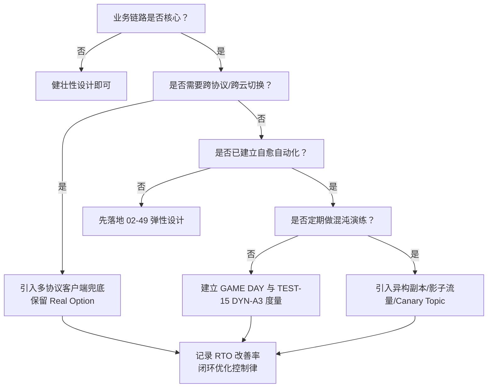

# 04-10 反脆弱架构设计原理

> **置信口径**: 反脆弱概念=【定理】（Taleb《反脆弱》定义）；消息系统实例与设计原则=【论证】；阈值/改善率=【估算】。
> **时效声明**: 核实至 2026-11。
> **本文档定位**: 04 动态系统论系列第 10 篇。04-04 通过混沌工程验证系统韧性，04-05 讨论 Pulsar 的反脆弱设计，本篇从“验证”推进到“设计”——系统如何从波动与故障中获益。与 02-35~39 弹性设计组、02-49 自动伸缩与自愈、TEST-15 DYN-A3 互链。项目特色视角，谨慎改动。

## 目录

- [04-10 反脆弱架构设计原理](#04-10-反脆弱架构设计原理)
  - [目录](#目录)
  - [4.10.1 从混沌验证到反脆弱设计](#4101-从混沌验证到反脆弱设计)
  - [4.10.2 健壮、弹性、反脆弱的区分](#4102-健壮弹性反脆弱的区分)
  - [4.10.3 反脆弱三设计原则](#4103-反脆弱三设计原则)
    - [可选性（Real Option）](#可选性real-option)
    - [压力源营养（小故障免疫接种）](#压力源营养小故障免疫接种)
    - [冗余多样性（异构副本）](#冗余多样性异构副本)
  - [4.10.4 消息系统实例](#4104-消息系统实例)
    - [4.10.4.1 Canary Topic 配置示例](#41041-canary-topic-配置示例)
  - [4.10.5 与 02-35~39 弹性设计组的关系](#4105-与-02-3539-弹性设计组的关系)
  - [4.10.6 度量：RTO 改善率](#4106-度量rto-改善率)
    - [4.10.6.1 RTO 改善率的统计陷阱](#41061-rto-改善率的统计陷阱)
  - [4.10.7 反脆弱设计决策树](#4107-反脆弱设计决策树)
    - [4.10.7.1 反脆弱设计检查清单](#41071-反脆弱设计检查清单)
  - [4.10.8 参考来源](#4108-参考来源)

---

## 4.10.1 从混沌验证到反脆弱设计

04-04 的混沌工程回答“系统在故障下能否存活”；04-05 提出 Pulsar 的“反脆弱”特征——波动不仅不造成损害，反而使系统更强。本篇把这一理念转为可执行的设计原则【论证】。

反脆弱设计的核心命题：

```text
健壮性：故障 → 系统不变
弹性：    故障 → 系统恢复
反脆弱：  故障 → 系统学习并改进 → 下一次更从容
```

在消息系统中，反脆弱不是让 broker 更“硬”，而是让组织与系统在面对积压、分区失效、网络抖动、发布错误时，能够持续积累**可选性、免疫记忆与异构冗余**。

## 4.10.2 健壮、弹性、反脆弱的区分

| 能力 | 面对波动 | 系统状态变化 | 典型机制 | 消息系统实例 |
| ---- | ---- | ---- | ---- | ---- |
| **健壮（Robust）** | 抵抗、吸收 | 不变 | 重试、超时、限流 | 客户端重试配置、broker 配额 |
| **弹性（Resilient）** | 恢复、回弹 | 回到原态 | 自动扩容、自愈、故障转移 | KEDA lag 扩容、NATS Raft 自愈合 |
| **反脆弱（Antifragile）** | 受益、进化 | 变得更强 | 混沌演练、灰度发布、多协议兜底、事后学习 | RTO 随演练下降、canary topic 自动回滚 |

设计上的递进关系【论证】：健壮是底线，弹性是目标，反脆弱是弹性的**学习增强版**。没有度量和学习的弹性只能回到原态，无法减少未来同类故障的影响。

## 4.10.3 反脆弱三设计原则

### 可选性（Real Option）

保留在未来以较低成本切换或扩展的权利，而不是过早锁定唯一路径【论证】。在消息系统中体现为：

- **多协议客户端兜底**：核心业务同时支持 Kafka 协议与 NATS/MQTT 协议，主路径故障时可在应用层切换；
- **多云/多区域 topic 镜像**：保留跨云迁移的 option，避免被单一云托管服务锁定；
- **Schema 向后兼容**：给未来字段扩展留 option，避免破坏性变更。

可选性的成本是“维护多条路径”，收益是降低**不可逆转的锁定风险**。

### 压力源营养（小故障免疫接种）

定期、受控地引入小剂量压力，使系统与团队产生“免疫记忆”【论证】。具体做法：

- **混沌工程**：04-04 的定期 broker 故障注入，不仅验证韧性，更让控制回路、自愈脚本、告警阈值在真实压力下被校准；
- **降级演练**：主动触发 02-38 的降级路径，确认非核心流量可被安全牺牲；
- **容量压测**：在生产镜像中模拟 2-3 倍峰值，暴露瓶颈并优化。

关键约束：压力必须是**可恢复、可观测、可学习**的；否则就是单纯破坏。

### 冗余多样性（异构副本）

同质冗余只能对抗随机失效，无法对抗系统性缺陷（共同模式故障）【论证】。反脆弱要求**异构冗余**：

- **异构 broker 技术栈**：关键链路同时使用 Kafka + NATS JetStream，避免单一路径的协议级缺陷；
- **异构消费实现**：同一事件由不同语言/框架的消费者处理，暴露客户端库差异导致的语义偏差；
- **异构监控**：指标、日志、追踪三支柱独立采集，避免单点观测失效。

异构性的代价是复杂度；适用边界是**核心链路**与**关键决策点**，而非全部系统。

## 4.10.4 消息系统实例

| 实例 | 反脆弱原则 | 设计要点 | 与 02/03 系列接口 |
| ---- | ---- | ---- | ---- |
| **多协议客户端兜底** | 可选性 | 应用层封装消息网关，主协议失效时切备用协议；保留幂等键跨协议一致 | 02-34 消息桥接与集成设计 |
| **影子流量（Shadow Traffic）** | 压力源营养 + 冗余多样性 | 把生产流量复制到新版本/新架构，观测差异而不影响主链路 | 02-35 消息版本兼容设计 |
| **渐进发布 / Canary Topic** | 压力源营养 | 新版本 consumer 先订阅 canary topic，错误率/延迟达标后再切主 topic | 02-35、02-38 降级设计 |
| **多 AZ + 异构存储层** | 冗余多样性 | 热数据本地 SSD + 冷数据 S3，单一层失效时另一层可接管 | 03-63 可观测与自治运维 |
| **自动伸缩 + 事后学习** | 弹性 → 反脆弱 | 每次扩缩容动作记录触发信号与结果，用于优化控制律 | 02-49 自动伸缩与自愈 |

这些实例的共同特征：不是“防止故障”，而是**把故障与波动转化为信息**，用于改进架构、流程与自动化。

### 4.10.4.1 Canary Topic 配置示例

以下 Kafka 配置示意如何实现 canary topic 渐进发布，主 topic 与 canary topic 共享同一 Schema，但消费组独立，便于对比错误率与延迟【论证】：

```properties
# producer: 按用户 ID 取模分流 5% 流量到 canary topic
main.topic=orders.v1
canary.topic=orders.v1.canary
canary.ratio=0.05
routing.key=user_id

# consumer: canary 组独立消费，延迟/错误率达标后再切换主组
canary.group.id=orders-processor-canary
main.group.id=orders-processor
# 切换判据：canary 组 error_rate < 0.1% 且 lag < 100 持续 30 分钟
```

该配置把“发布风险”转化为“可观测、可回滚的实验”，是压力源营养原则的典型落地。

## 4.10.5 与 02-35~39 弹性设计组的关系

02-35~39 覆盖消息系统的弹性设计：版本兼容（02-35）、缓存（02-36）、限流（02-37）、降级（02-38）、监控告警（02-39）。反脆弱是这些弹性能力的**上层目标与闭环机制**【论证】。

| 02 系列主题 | 弹性机制 | 反脆弱增强 |
| ---- | ---- | ---- |
| 02-35 版本兼容 | 向前/向后兼容避免发布事故 | Schema 演化历史用于预测未来变更风险 |
| 02-36 消息缓存 | 削峰填谷 | 缓存命中率趋势用于识别真实峰值模式 |
| 02-37 消息限流 | 保护下游 | 限流触发日志用于优化阈值与容量规划 |
| 02-38 消息降级 | 非核心流量牺牲 | 降级演练结果用于校准业务优先级 |
| 02-39 监控告警 | 发现故障 | 告警-处置-复盘闭环用于降低误报与漏报 |

02-49 的自动伸缩与自愈把“恢复”自动化；反脆弱要求这些自动化动作**产生学习**：每次自愈后更新 runbook、阈值、测试用例，使下一次 RTO 更短。

## 4.10.6 度量：RTO 改善率

反脆弱必须可度量，否则退化为口号。TEST-15 DYN-A3 提出以 RTO（Recovery Time Objective）随演练次数的下降曲线作为度量【论证】。

```text
RTO_improvement_rate(n) = (RTO_baseline − RTO_n) / RTO_baseline × 100%

目标（示例）：
- 第 1 次演练：基线，改善率 0%
- 第 2 次演练：改善率 ≥ 10%
- 第 3 次演练：改善率 ≥ 25%
- 第 4 次及以后：改善率进入平台期（边际收益递减）
```

改善率的理论基础是“压力源营养”：每次受控故障让团队熟悉流程、校准自动化、发现隐藏依赖。04-07 的控制回路理论解释为何改善会进入平台期——控制延迟、观测噪声、执行器惯性构成下限。

### 4.10.6.1 RTO 改善率的统计陷阱

使用 RTO 改善率时必须避免以下误判【论证】：

| 陷阱 | 表现 | 规避方法 |
| ---- | ---- | ---- |
| **选择偏差** | 只记录成功的演练，忽略失败演练 | 所有演练（包括未达标的）必须入表 |
| **场景漂移** | 第 n 次演练的故障强度低于第 1 次 | 固定注入强度与成功判据 |
| **人员熟练度饱和** | 改善来自同一团队记忆，而非系统改进 | 引入新人执行演练，区分“人”与“系统”的进步 |
| **回归风险** | 架构变更后旧演练结论失效 | 每次重大发布后重新标定基线 |

只有在控制上述偏差后，RTO 改善率才能作为反脆弱能力的可信代理指标。

记录格式（对应 TEST-15 §T.15.3）：

```text
results/trends/rto-trend.tsv
轮次 | 日期 | 场景 | 注入时长 | RTO实测 | RTO基线 | 改善率 | 根因改进项
1    | 2026-11 | broker 单点故障 | 90s | 300s | 300s | 0%   | 基线标定
2    | 2026-12 | broker 单点故障 | 90s | 240s | 300s | 20%  | 自愈脚本优化
```

## 4.10.7 反脆弱设计决策树



决策树的关键节点：

- 非核心链路不必追求反脆弱，过度设计带来不必要的复杂度；
- 没有弹性与自愈的底座，反脆弱演练会变成不可控的生产事故；
- 反脆弱的最终闭环是**度量与学习**，而非引入更多组件。

### 4.10.7.1 反脆弱设计检查清单

| 检查项 | 通过标准 | 验证方式 |
| ---- | ---- | ---- |
| 可选性保留 | 核心链路至少存在一条备用协议或备用云路径 | 架构评审 |
| 压力源营养 | 每季度至少一次受控混沌演练，结果入 TEST-15 | GAME DAY 记录 |
| 冗余多样性 | 关键数据/决策至少经过两种异构路径 | 故障注入测试 |
| RTO 度量 | `rto-trend.tsv` 连续 3 轮记录完整 | 审计数据文件 |
| 学习闭环 | 每次演练后至少更新一条 runbook 或自动化规则 | 演练复盘纪要 |
| 复杂度控制 | 反脆弱机制不使日常运维人效下降超过 10%【估算】 | 运维人时跟踪 |

## 4.10.8 参考来源

- 项目内：[04-01](04-01-系统动力学视角.md)、[04-04](04-04-混沌工程与系统韧性.md)、[04-05](04-05-动态系统总结与选型决策.md)、[04-06](04-06-消息系统技术演化动力学.md)、[04-07](04-07-动态监测与控制回路.md)、[02-35](../02-场景驱动架构设计/02-35-消息版本兼容设计.md)、[02-36](../02-场景驱动架构设计/02-36-消息缓存设计.md)、[02-37](../02-场景驱动架构设计/02-37-消息限流设计.md)、[02-38](../02-场景驱动架构设计/02-38-消息降级设计.md)、[02-39](../02-场景驱动架构设计/02-39-消息监控告警设计.md)、[02-49](../02-场景驱动架构设计/02-49-自动伸缩与自愈架构设计.md)、[01-33](../01-基础概念与对比分析/01-33-可观测性与自治运维能力体系分析.md)、[03-63](../03-架构与运维实践/03-63-可观测与自治运维实践指南.md)、[TEST-15](../../Testing/05-体系与机制/TEST-15-动态系统论测试视角.md)
- 外部：[Taleb《Antifragile》](https://en.wikipedia.org/wiki/Antifragile)、[Principles of Chaos Engineering](https://principlesofchaos.org/)、[Google SRE Workbook：自动化](https://sre.google/workbook/table-of-contents/)

---

**最后更新**: 2026-11-18
